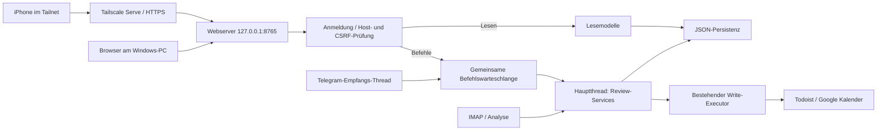

# Mailhelp 1.1 – Konzept und Umsetzungsplan Web/PWA

> Historischer Versionsstand: Dieses Dokument beschreibt die genannte Version oder
> deren damaligen Plan. Ursprüngliche Ziele und Prüfergebnisse sind kein Nachweis
> des heutigen Umfangs. Aktueller Betrieb: [README](../README.md),
> [Release 3.3](Release-3.3.md) und [Projektspezifikation](../Mailhelp-Projektspezifikation.md).

**Zielversion:** 1.1

**Status:** Phasen 0–8 umgesetzt im Branch `beta` (Version 1.1.0, Beta). Offen ist
nur die Anpassung der Bestätigungsregel in `AGENTS.md`, die eine ausdrückliche
Zustimmung erfordert (siehe Abschnitt 7). Betriebsanleitung:
[Release-1.1.md](Release-1.1.md).

**Stand:** 11. Oktober 2026

Dieses Dokument ist vor Implementierungsarbeiten an Version 1.1 vollständig zu
lesen. Die Phasen werden in der angegebenen Reihenfolge umgesetzt. Jede Phase endet
mit einer überprüfbaren Abnahme und hinterlässt einen lauffähigen, vollständig
getesteten Stand. Maßgeblich sind außerdem die [Entwicklungsregeln](../AGENTS.md),
die [Projektspezifikation](../Mailhelp-Projektspezifikation.md), die
[Betriebsanleitung](Einrichtung-und-Qualitaetspruefung.md) und die
[Datenschutzerklärung](../DATENSCHUTZ.md).

## 1. Ziel und Zugriffswege

Mailhelp erhält eine Weboberfläche, die im bestehenden Mailhelp-Prozess läuft. Sie
bietet dieselben Review-, Entscheidungs- und Rückfragefunktionen wie Telegram.

| Gerät / Zugriff | Adresse | Voraussetzung |
| --- | --- | --- |
| Browser am Windows-PC | `http://127.0.0.1:8765` | Mailhelp läuft; Tailscale ist nicht erforderlich |
| iPhone und andere berechtigte Tailnet-Geräte | `https://mailhelp-pc.<tailnet>.ts.net` | Mailhelp und Tailscale am PC laufen; das Gerät ist im Tailnet |

Es gibt eine responsive Oberfläche und eine gemeinsame fachliche Service-Schicht.
Telegram bleibt während und nach der Einführung erhalten und ist in 1.1 weiterhin
der Kanal für Benachrichtigungen. Telegram und Web verwenden dieselbe Persistenz und
dieselben fachlichen Regeln. Ein schlafender oder ausgeschalteter PC stellt keine
aktuellen Daten bereit; die Oberfläche zeigt diesen Zustand verständlich an.



## 2. Verbindliche Invarianten

- Fachliche Entscheidungen werden ausschließlich serverseitig getroffen. API-Routen
  übersetzen Requests in Befehle; die Oberfläche übernimmt nur Darstellung, Eingabe
  und Aktualisierung.
- **Ein Zustandsbesitzer:** Zustandsändernde Verarbeitung findet ausschließlich im
  Hauptthread statt, wie seit Einführung des Telegram-Empfangs-Threads. Webserver-
  Threads schreiben nie direkt in den Zustand, sondern legen Befehle in die
  gemeinsame, dauerhaft gespeicherte Befehlswarteschlange.
- Jeder externe Schreibzugriff benötigt eine ausdrückliche Bestätigung der aktuellen
  Vorschlagsversion durch einen autorisierten Benutzer. Jeder Befehl trägt die
  erwartete Version; ist sie veraltet, wird er abgelehnt (HTTP 409 im Web).
- Eine fachliche Revision erfordert eine erneute Bestätigung der neuen Version.
- Zielprüfungen, Dublettenprüfung, Aktionsbuch und Wiederanlauf bleiben an der
  Schreibgrenze wirksam. Unklare Schreibresultate werden abgeglichen, bevor eine
  Wiederholung erwogen wird. Ein Browser-Timeout ist keine Erlaubnis für einen neuen
  Schreibversuch: Wiederholungen tragen denselben Idempotenzschlüssel.
- Mailinhalte, Benutzertexte und LLM-Ausgaben bleiben nicht vertrauenswürdig. Die
  Oberfläche gibt sie ausschließlich escaped aus; eine Content-Security-Policy
  verbietet Inline-Skripte.
- Direkte externe Schreibzugriffe aus API-Routen oder JavaScript sind unzulässig.
- Mailanalyse, IMAP-Verarbeitung, LLM-Auswertung, Kalender- und Todoist-Integration
  sowie die Mailstatuslogik bleiben funktional erhalten.
- Keine Zugangsdaten, Sitzungs- oder Kopplungstoken in Logs; Webzugriffe werden
  ohne Mailinhalte protokolliert.

Die projektverantwortliche Person hat am 11. Oktober 2026 die autorisierte,
versionsbezogene Bestätigung über Telegram oder die authentifizierte Weboberfläche
ausdrücklich freigegeben. `AGENTS.md` und Spezifikation wurden entsprechend angepasst.
Eine Bearbeitung autorisiert keine externe Anlage; die neue Version benötigt eine
separate Bestätigung. Anmeldung, CSRF, erneute Autorisierung bei Ausführung,
Versionsprüfung und Idempotenz bleiben verbindlich.

## 3. Prüfergebnis: Änderungen gegenüber dem Entwurf

Der Entwurf vom 11. Oktober 2026 wurde gegen den aktuellen Code geprüft. Folgende
Punkte waren nicht oder nicht ausreichend geregelt und sind in dieses Dokument
eingearbeitet:

1. **Nebenläufigkeit.** `JsonStore` sperrt nur gegen andere Prozesse, nicht gegen
   Threads. Unter Windows scheitert `os.replace` zudem, wenn ein anderer Thread die
   Zieldatei gerade liest. Ein Webserver darf deshalb weder direkt schreiben noch
   ungeschützt lesen. Lösung: Befehlswarteschlange zum Hauptthread (Erweiterung der
   bestehenden `telegram-inbox`) und eine prozessinterne Sperre im `JsonStore` für
   konsistentes Lesen und Schreiben (Phase 2).
2. **Antwortzeit.** Der Hauptthread verarbeitet Befehle vor jeder Mail und im
   Leerlauf sofort. Während einer laufenden Mailanalyse wartet ein Webbefehl wie
   heute eine Telegram-Eingabe. Die Oberfläche bestätigt deshalb sofort den Eingang
   (HTTP 202) und zeigt den Ausführungsstatus an, statt den Request offen zu halten.
3. **Anmeldung.** Tailscale Serve leitet Anfragen von `127.0.0.1` an den Webserver
   weiter, genau wie der lokale Browser. Die von Serve gesetzten Identitäts-Header
   (`Tailscale-User-Login`) sind daher nicht von gefälschten lokalen Anfragen
   unterscheidbar und dürfen nicht als Authentifizierung dienen. Lösung: eigene
   Anmeldung per einmaligem Kopplungscode über Telegram und langlebige,
   widerrufbare Sitzungen für beide Zugriffswege (Phase 4).
4. **Lokale Angriffe aus dem Browser.** Ein Dienst auf `127.0.0.1` ist von beliebigen
   Webseiten im lokalen Browser aus erreichbar (CSRF, DNS-Rebinding). Lösung:
   strikte Prüfung des `Host`-Headers gegen eine Positivliste, CSRF-Token für alle
   schreibenden Requests, `SameSite=Strict`-Cookies, kein CORS (Phase 3/4).
5. **Kanalübergreifende Zustände.** Der Rückfragedialog `telegram-dialog` ist global
   und Telegram-gebunden; die Outbox gibt zurückgehaltene Nachrichten nach einer
   Telegram-Entscheidung frei. Telegram-Nachrichten-IDs werden nicht gespeichert, so
   dass Schaltflächen nach einer Web-Entscheidung nicht entfernt werden können.
   Lösung: kanalneutrales Antwortmodell je Vorschlagsversion, Outbox-Freigabe durch
   den gemeinsamen Service, verständliche Meldung bei veralteten Telegram-Schaltflächen
   („Bereits im Web entschieden“) (Phase 1/6).
6. **Abdeckungspflicht für JavaScript.** Die 100-%-Regel gilt für sämtlichen eigenen
   Anwendungscode. Lösung: serverseitig gerendertes HTML mit Formularen, die ohne
   JavaScript funktionieren; JavaScript nur für Komfort (automatische Aktualisierung,
   Statusanzeige) in einer kleinen Datei, die mit einem JS-Testwerkzeug mit Abdeckung
   geprüft wird. Keine Build-Toolchain und kein Frontend-Framework.
7. **PWA und Offline.** Der Service Worker speichert nur die App-Hülle (HTML-Gerüst,
   CSS, Icons, Offline-Seite), niemals API-Antworten oder Mailinhalte. Offline sind
   keine Aktionen möglich und es wird nichts zwischengespeichert, das später
   automatisch gesendet wird. Web-Push ist nicht Teil von 1.1; Benachrichtigungen
   kommen weiterhin über Telegram.
8. **Docker/Linux.** Die Entwicklungsregeln verlangen Betrieb unter Windows 11 und
   in Docker. Die Bind-Adresse ist konfigurierbar; im Container lauscht der Server
   auf `0.0.0.0`, Compose veröffentlicht den Port ausschließlich auf
   `127.0.0.1` des Hosts. Tailscale läuft auf dem Host.
9. **Abhängigkeiten.** Mailhelp hat vier Laufzeitabhängigkeiten. Für eine kleine,
   private API genügt `http.server.ThreadingHTTPServer` der Standardbibliothek mit
   einem dünnen eigenen Router; das hält Angriffsfläche, Lockdatei und
   Testaufwand klein. Ein Framework (z. B. Starlette) wird nur eingeführt, wenn die
   Bewertung in Phase 3 einen konkreten Bedarf zeigt.
10. **Datenschutz und Doku.** Webzugriff, Tailscale und Sitzungen werden in
    Datenschutzerklärung, Betriebsanleitung und Spezifikation ergänzt.

## 4. Umsetzungsplan

### Phase 0 – Bestehendes Verhalten dokumentieren

Lesen und dokumentieren, ohne Code zu ändern:

- `TelegramDialogController` (`telegram/dialog.py`), `ProposalDecisionService`
  (`telegram/decisions.py`), `ProposalRevisionProcessor` (`telegram/revisions.py`),
  `ConfirmedWriteExecutor` (`telegram/writes.py`), `ProposalRepository`
  (`telegram/persistence.py`), `ActionLedgerService` (`telegram/ledger.py`),
  `RelevanceDialogProcessor`, `TelegramOutbox`, `TelegramInbox`/`TelegramReceiver`.
- `JsonStore`, Anwendungsaufbau, Verarbeitungsschleife, Wiederanlauf, Shutdown und
  die Schreibgrenze in `integrations.py`.

Ergebnis ist `docs/1.1-Bestandsaufnahme.md` mit Antworten auf:

1. Welche Aktionen sind in welchem Vorschlagszustand erlaubt?
2. Wann entstehen neue Vorschlagsversionen?
3. Welche Rückfragen verhindern eine Bestätigung?
4. Wann ist eine Sonderbestätigung nötig (Doppelanlage, unverbindlicher Hinweis)?
5. Welche Zustände werden nach einem Neustart fortgesetzt?
6. Welche Datensätze sind maßgeblich, welche nur abgeleitete Darstellung?
7. Welche Wartezustände, Outbox-Freigaben und Dialogzustände hängen an Telegram
   (mindestens `telegram-dialog`, `telegram-offset`, `telegram-outbox`,
   `telegram-inbox`, Relevanz-Offsets, `answer_callback`)?

**Abnahme:** Die Übersicht ist vollständig, `python -m pytest` ist grün. Vorhandene
Fehler sind von neu verursachten Fehlern unterschieden.

### Phase 1 – Kanalneutrale Review-Service-Schicht

Struktur:

```text
src/mailhelp/review/
    commands.py      # Befehle: Confirm, ConfirmDuplicate, Reject, StartClarification,
                     # Answer, CancelClarification, RelevanceDecision
    results.py       # typisierte Ergebnisse: Accepted, Stale, Invalid, Unauthorized,
                     # Written, WriteUncertain, NeedsAnswer
    service.py       # ReviewService: führt Befehle aus, ohne Kanalwissen
    views.py         # Lesemodelle: offene Entscheidungen, Vorschlagskarte, Status
    errors.py
```

- Jeder Befehl enthält Quelle (`telegram`/`web`), autorisierte Person, Mail-ID,
  Vorschlags-ID, erwartete Version und einen Idempotenzschlüssel.
- Der bisherige Telegram-Code ruft den `ReviewService` auf und übersetzt nur noch
  Callback-Daten und Freitext in Befehle sowie Ergebnisse in Nachrichten.
- Der Rückfragedialog wird kanalneutral: Die aktive Frage gehört zur
  Vorschlagsversion, nicht zum Kanal. `telegram-dialog` bleibt als Zeiger für
  Telegram-Freitext erhalten (Migration ohne Datenverlust).
- Outbox-Freigaben werden vom Service ausgelöst, unabhängig vom Kanal.
- Lesemodelle liefern strukturierte Daten; die Telegram-Kartenformatierung baut
  darauf auf, damit Web und Telegram dieselben Inhalte zeigen.

**Abnahme:** Telegram verhält sich unverändert (alle bestehenden Tests grün,
unverändert bis auf Importpfade). Neue Service-Tests decken jede Aktion in jedem
erlaubten und verbotenen Zustand ab, außerdem Versionskonflikte, Neustart und
Autorisierung. 100 % Abdeckung.

### Phase 2 – Gemeinsame Befehlswarteschlange und Thread-Sicherheit

- `TelegramInbox` wird zur kanalneutralen `CommandInbox` (`command-inbox.json`,
  Schemaversion, Migration der vorhandenen Datei). Einträge enthalten Quelle,
  Befehl, Idempotenzschlüssel, Eingangszeit, Status (`queued`, `running`, `done`,
  `rejected`, `failed`) und ein knappes Ergebnis ohne Mailinhalt.
- Gleicher Idempotenzschlüssel ⇒ kein zweiter Effekt; das gespeicherte Ergebnis
  wird erneut geliefert. Erledigte Einträge werden nach einer Frist bereinigt.
- `JsonStore` erhält eine prozessinterne `RLock` um `load`/`save`/`names`, damit
  Lesemodelle aus Webserver-Threads konsistente Dateien lesen und `os.replace` unter
  Windows nicht an offenen Lesehandles scheitert.
- Der Hauptthread verarbeitet Befehle in Eingangsreihenfolge vor jeder Mail, im
  Leerlauf sofort und während offener Relevanzfragen.

**Abnahme:** Regressions- und Nebenläufigkeitstests: paralleles Lesen während des
Schreibens unter Windows, doppelt eingereichter Befehl, Neustart mit `queued` und
`running` Befehlen (laufende Befehle werden abgeglichen, nicht blind wiederholt).
Telegram unverändert. 100 % Abdeckung.

### Phase 3 – Webserver-Grundgerüst (nur lesend, ohne Mailinhalte)

Konfiguration (Zielvorgabe):

```yaml
web:
  enabled: false
  host: 127.0.0.1          # im Docker-Container 0.0.0.0, Port nur auf 127.0.0.1 veröffentlichen
  port: 8765
  allowed_hosts: [127.0.0.1:8765, localhost:8765, mailhelp-pc.<tailnet>.ts.net]
  session_days: 30
```

Geheimnis: `MAILHELP_WEB_SECRET` (Signatur für Sitzungen und CSRF) ausschließlich in
`.env`.

- `ThreadingHTTPServer` in einem Daemon-Thread, Start und Stopp mit dem
  Anwendungslebenszyklus; `--check` prüft die Web-Konfiguration.
- Pflichtprüfungen vor jeder Route: `Host` gegen `allowed_hosts` (sonst 421),
  Methoden-Positivliste, Größenlimit für Request-Bodies.
- Sicherheits-Header: `Content-Security-Policy` ohne `unsafe-inline`,
  `X-Content-Type-Options`, `Referrer-Policy: no-referrer`,
  `X-Frame-Options: DENY`, `Cache-Control: no-store` für alle Daten.
- `GET /health` ohne Anmeldung (nur Status, keine Daten).
- Zugriffsprotokoll ohne Mailinhalt, Token oder Query-Strings mit Daten.

**Abnahme:** Tests für Host-Prüfung (DNS-Rebinding), Header, Limits, Start und
Stopp (auch bei belegtem Port: verständliche Fehlermeldung, kein Absturz der
Mailverarbeitung). Mit `web.enabled: false` verhält sich Mailhelp exakt wie 1.0.

### Phase 4 – Anmeldung und Autorisierung

- **Kopplung:** Auf der Anmeldeseite „Gerät koppeln“ wählen; Mailhelp sendet einen
  einmaligen, 10 Minuten gültigen Code an den konfigurierten Telegram-Chat. Die
  Eingabe des Codes erzeugt eine Sitzung. Fehlversuche sind begrenzt.
- **Sitzung:** zufälliges Token, nur als Hash gespeichert (`web-sessions.json`);
  Cookie `HttpOnly`, `SameSite=Strict`, `Secure` beim Tailnet-Zugriff; Ablauf nach
  `session_days`; Gerätename und letzte Nutzung sichtbar; Abmelden und Widerruf
  einzelner oder aller Sitzungen (auch per Telegram-Befehl `/web_abmelden`).
- **CSRF:** Token je Sitzung in jedem Formular, Prüfung bei jedem schreibenden
  Request.
- Jede neue Kopplung wird in Telegram gemeldet.
- Autorisiert ist genau die eine konfigurierte Person (wie `telegram.user_id`);
  Mehrbenutzerbetrieb ist nicht Teil von 1.1.

**Abnahme:** Tests für Kopplung, abgelaufene und falsche Codes, Ratenbegrenzung,
Sitzungsablauf, Widerruf, CSRF-Fehler und gefälschte Tailscale-Header (müssen
wirkungslos sein). Sicherheitsreview gegen die Invarianten aus Abschnitt 2.

### Phase 5 – Lesende Oberfläche

- Seiten: Übersicht offener Entscheidungen (aktuelle Entscheidung zuerst, dann
  Warteschlange), Vorschlagsdetail, Relevanzfragen, Laufstatus, Sitzungen.
- Darstellung aus den Lesemodellen aus Phase 1; dieselben Inhalte wie die kompakte
  Telegram-Karte, auf Wunsch vollständig aufklappbar (Beschreibung, Beleg).
- Responsives HTML/CSS ohne Framework; funktioniert ohne JavaScript. Eine kleine
  JS-Datei aktualisiert die Übersicht periodisch und zeigt den Verbindungsstatus.
- Mailinhalte werden ausnahmslos escaped; Links aus Mails sind nicht klickbar
  (Anzeige als Text), Videolinks nur nach Prüfung auf `https`.

**Abnahme:** Snapshot-Tests der HTML-Ausgabe, Escaping-Tests mit bösartigen
Mailinhalten, Barrierefreiheits-Grundprüfung (Überschriften, Labels, Kontrast),
JS-Tests mit 100 % Abdeckung.

### Phase 6 – Schreibende Aktionen über das Web

- Aktionen: Bestätigen (inklusive Doppelanlage- und Hinweisbestätigung),
  Verwerfen, Klären/Ändern, Rückfrage beantworten, Bearbeitung abbrechen,
  Relevanz entscheiden.
- `POST` legt einen Befehl mit erwarteter Version und Idempotenzschlüssel
  (vom Formular erzeugt) in die Befehlswarteschlange und antwortet mit 202 sowie
  einer Statusadresse. Veraltete Versionen ergeben 409 mit Hinweis auf die
  aktuelle Version.
- Nach einer Web-Entscheidung gibt der Service die Outbox frei. Telegram meldet
  bei einer veralteten Schaltfläche „Bereits im Web entschieden“ statt eines
  allgemeinen Fehlers. Unklare Schreibresultate erscheinen im Web als
  „wird abgeglichen“.
- Anpassung von `AGENTS.md` und Spezifikation von „Telegram-Bestätigung“ auf
  „autorisierte, versionsbezogene Bestätigung über Telegram oder Web“ – erst nach
  grüner Abnahme dieser Phase und mit ausdrücklicher Zustimmung der
  projektverantwortlichen Person.

**Abnahme:** Regressionstests für: dieselbe Version gleichzeitig über Telegram und
Web bestätigt (genau ein Schreibvorgang), Browser-Timeout mit Wiederholung
desselben Schlüssels (kein zweiter Schreibversuch), Neustart während `running`,
veraltete Telegram-Schaltfläche nach Web-Entscheidung, Revision über das Web
erfordert erneute Bestätigung. 100 % Abdeckung.

### Phase 7 – PWA und Tailscale

- `manifest.webmanifest` mit Name, Icons (aus dem vorhandenen Anwendungslogo),
  `display: standalone`, Startseite.
- Service Worker: speichert ausschließlich die App-Hülle und eine Offline-Seite
  („PC nicht erreichbar – Mailhelp läuft nicht oder der PC schläft“); API- und
  Datenantworten werden nie gespeichert; keine Hintergrundsynchronisation.
- Anleitung für Tailscale Serve (`tailscale serve --bg --https=443 http://127.0.0.1:8765`),
  HTTPS-Zertifikat des Tailnets, Installation auf dem iPhone über „Zum
  Home-Bildschirm“, Verhalten bei Schlaf und Neustart des PCs.

**Abnahme:** Tests für Manifest und Service-Worker-Regeln (keine Daten im Cache,
Offline-Seite), manueller Test am iPhone und am PC-Browser nach Checkliste.

### Phase 8 – Gesamtabnahme und Release 1.1

- Simulierter Ende-zu-Ende-Test: Mail eingehen lassen, im Web klären und
  bestätigen, Schreibvorgang gegen simulierte Dienste, Telegram-Konsistenz prüfen.
- Docker: Compose veröffentlicht `127.0.0.1:8765`; Neustartprüfung mit offenen
  Webbefehlen.
- Doku: README, Spezifikation, Betriebsanleitung, `DATENSCHUTZ.md` und
  `website/datenschutz.html` (Webzugriff, Sitzungen, Tailscale),
  `docs/Release-1.1.md`.
- `python -m pytest` mit 100 % Zeilen- und Branch-Abdeckung für Python und
  JavaScript; Windows- und Linux-CI.

**Abnahme:** Alle Phasen-Abnahmen erfüllt, Release-Checkliste abgearbeitet.

## 5. Teststrategie (übergreifend)

- Externe Dienste und Telegram werden simuliert; Webtests nutzen einen
  In-Prozess-Client gegen den echten Router, keinen Browser.
- Jede Phase enthält Erfolgs-, Fehler-, Wiederholungs-, Neustart- und
  Autorisierungsfälle (Entwicklungsregeln).
- Sicherheitsfälle sind Pflicht: Host-Header-Manipulation, CSRF, gefälschte
  Tailscale-Header, abgelaufene Sitzungen, Skript-Injektion über Mailinhalte,
  übergroße Requests.
- Jeder in einer Phase gefundene Fehler erhält einen Regressionstest, der vor dem
  Fix scheitert.

## 6. Offene Entscheidungen

| Frage | Empfehlung |
| --- | --- |
| Webserver: Standardbibliothek oder Framework? | Standardbibliothek; Neubewertung in Phase 3 |
| Anmeldung: Kopplungscode über Telegram oder Passwort/Passkey? | Kopplungscode über Telegram (kein neues Geheimnis zum Merken) |
| Web-Push-Benachrichtigungen? | Nicht in 1.1; Telegram bleibt Benachrichtigungskanal |
| Mehrere Benutzer? | Nicht in 1.1 |
| Telegram langfristig optional? | Nach 1.1 bewerten; Voraussetzung wäre Web-Push |

## 7. Umsetzungsstand und Abweichungen

| Phase | Ergebnis |
| --- | --- |
| 0 | [1.1-Bestandsaufnahme.md](1.1-Bestandsaufnahme.md) |
| 1 | `mailhelp.review` (Befehle, Ergebnisse, Service, Lesemodelle, gemeinsame Kartendaten); Telegram-Schaltflächen laufen über den Service |
| 2 | `command-inbox` mit Idempotenz, Statusmodell und Neustartabgleich; `JsonStore` mit `RLock`, `peek`/`peek_model` |
| 3 | `mailhelp.web` (Router, Server, Sicherheits-Header, Limits), Konfiguration `web`, `MAILHELP_WEB_SECRET` |
| 4 | Kopplung per Telegram-Code, Sitzungen, CSRF, `/web_abmelden` |
| 5 | Übersicht, Detail, Status, automatische Aktualisierung |
| 6 | Aktionen über `/aktion` mit 409/202/303, Statusseite, Telegram-Konsistenz |
| 7 | Manifest, Service Worker (nur App-Hülle), Offline-Seite, Tailscale-Anleitung |
| 8 | Ende-zu-Ende-Test im Web, Docker-Port auf `127.0.0.1`, Doku, CI-Job für Browsertests |

Bewusste Abweichungen vom Entwurf:

- Die `telegram-inbox` bleibt eigenständig, weil Telegram-Updates Offsets und
  Quittungen tragen, die Web-Befehle nicht haben. Web-Befehle stehen in der neuen
  `command-inbox`; beide werden vom Hauptthread im selben Zyklus abgearbeitet und
  wecken ihn über dasselbe Ereignis.
- Zusätzlich zu den In-Prozess-Tests prüfen Browsertests (`ui_tests/`, Chrome über
  Playwright) jede Seite auf Desktop und iPhone mit Screenshots. Sie messen auch die
  JavaScript-Abdeckung, die das Konzept verlangt.
- Die Formulierung in `AGENTS.md` und Spezifikation zur Bestätigungspflicht wird
  erst nach ausdrücklicher Zustimmung geändert; bis dahin beschreibt Abschnitt 18
  der Spezifikation die Web-Bestätigung.
