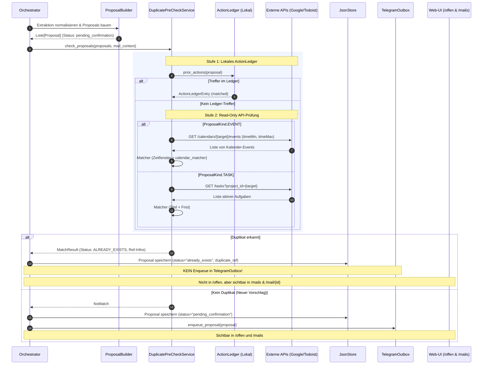

# Mailhelp 1.3 – Konzept und Umsetzungsplan: Dubletten-Vorabprüfung für Aufgaben und Termine

**Zielversion:** 1.3.0  
**Status:** In Planung (Spezifikation und Umsetzungsplan)  
**Stand:** 11. Oktober 2026  
**Bezug:** [Entwicklungsregeln](../AGENTS.md), [Mailhelp-Projektspezifikation](../Mailhelp-Projektspezifikation.md), [Konzept-1.2-Web-Ausbau.md](Konzept-1.2-Web-Ausbau.md)

---

## 1. Ausgangslage und Problemstellung

### 1.1 Der bisherige Ablauf (Ist-Zustand bis Version 1.2)
In den Versionen 1.0 bis 1.2 verarbeitet Mailhelp eingehende E-Mails nach folgendem Ablauf:
1. **Relevanz & Extraktion:** Eine relevante E-Mail wird analysiert; Aufgaben und Termine werden extrahiert und in `Proposal`-Objekte überführt.
2. **Initialer Status:** Alle extrahierten Vorschläge erhalten standardmäßig den Status `PENDING_CONFIRMATION` (bzw. `NEEDS_CLARIFICATION`, falls offene Fragen aus dem Text nicht auflösbar waren).
3. **Vorlage zur Entscheidung:**
   - **Telegram:** Die Vorschläge werden in die `TelegramOutbox` eingereiht und dem Nutzer sequenziell als Frage vorgelegt:  
     *„Aufgabe anlegen: X?“* bzw. *„Termin anlegen: Y?“* mit den Optionen `[Bestätigen]`, `[Ändern]`, `[Verwerfen]`.
   - **Weboberfläche:** Die Vorschläge erscheinen auf der Seite `/offen` mit Aktionsschaltflächen zum direkten Anlegen in Todoist bzw. Google Kalender.
4. **Verzögerte Dublettenprüfung:**
   - Erst **nachdem** der Nutzer auf *„Bestätigen“* bzw. *„Anlegen“* klickt, prüft das System:
     - Im Telegram-Dialog prüft `decisions.py` das lokale `ActionLedger` und warnt: *„Bereits angelegt: ... Soll die Aktion wirklich ein zweites Mal angelegt werden?“*
     - Beim Ausführen des Kalenderschreibzugriffs prüft `HttpWriter.prepare()` über die Google Calendar API (`_matching_calendar_event()`), ob im Zeitfenster bereits ein deckungsgleicher Termin existiert. Ist dies der Fall, bricht der Schreibvorgang mit `duplicate_skipped` ab.
     - Für Todoist erfolgt vor dem Schreiben überhaupt keine externe Dublettenprüfung.

### 1.2 Schwachstellenanalyse
- **Ineffizienz und Aufmerksamkeitsverlust (Alert Fatigue):** Der Nutzer wird für Termine und Aufgaben um eine Entscheidung gebeten, die längst in seinem Kalender oder seiner Aufgabenliste stehen (z.B. weil ein Kollege den Termin direkt eingestellt hat, der Nutzer ihn manuell erfasst hat oder eine frühere Mail ihn bereits behandelte).
- **Frustration bei nachgelagertem Abbruch:** Der Nutzer investiert Prüfzeit und Klicks, nur um anschließend zu erfahren, dass die Aktion gar nicht ausgeführt wurde (`duplicate_skipped`) oder eine zweite Sicherheitsabfrage erfordert.
- **Blockierung der Entscheidungs-Warteschlange:** Da Telegram Vorschläge sequenziell vorlegt, blockiert ein überflüssiger, bereits vorhandener Termin die Bearbeitung nachfolgender, tatsächlich neuer Vorschläge.

---

## 2. Zielsetzung für Version 1.3 (Soll-Zustand)

1. **Vorabprüfung vor Entscheidungsvorlage (Pre-Check):**
   Direkt nach der Extraktion und Normalisierung prüft Mailhelp vollautomatisch und **vor** der Benachrichtigung, ob der Termin oder die Aufgabe bereits im Zielsystem oder im lokalen Ledger vorhanden ist.
2. **Keine Vorlage zur Entscheidung bei vorhandenen Einträgen:**
   Wird ein Vorschlag als bereits vorhanden erkannt:
   - Wird er dem Nutzer **weder über Telegram noch über die Weboberfläche zur Entscheidung vorgelegt**.
   - Telegram stellt keine sequenzielle Frage (*„Termin anlegen?“* entfällt vollständig).
   - Die Web-Ansicht `/offen` enthält diesen Vorschlag **nicht**.
3. **Volle Transparenz in der Web-Übersicht:**
   - Der gefundene Vorschlag geht nicht verloren. Er bleibt in der Mailübersicht (`/mails`), in der Mail-Detailansicht (`/mail/<mail_id>`) und im Verlauf (`/verlauf`) vollständig einsehbar.
   - Er erhält einen klaren Status-Badge: `[Bereits vorhanden]`.
   - Die Ansicht zeigt an, **wo** und **wann** das Duplikat gefunden wurde (inkl. Direktlink zum bestehenden Google-Kalender-Termin bzw. Todoist-Task).
   - Standardmäßig gibt es keine störenden Bestätigungs-Buttons. Für Ausnahmefälle steht in einem Untermenü die Option *„Trotzdem neu anlegen“* zur Verfügung.

---

## 3. Verbindliche Invarianten und Sicherheitsregeln

Gemäß den [Entwicklungsregeln](../AGENTS.md) gelten für die Umsetzung folgende strikte Invarianten:

1. **Strikte Trennung von Lese- und Schreiboperationen:**
   - Die Vorabprüfung verwendet **ausschließlich idempotente Lesezugriffe** (`GET`). Sie modifiziert niemals den Zustand in Google Kalender oder Todoist.
   - Ein gefundener Abgleich erzeugt niemals automatische Schreibzugriffe auf externe Systeme.
2. **Bestätigungsregel für Neuanlagen bleibt unberührt:**
   - Soll ein als vorhanden erkannter Vorschlag dennoch manuell neu angelegt werden (*„Trotzdem anlegen“*), erfordert dies weiterhin eine ausdrückliche, versionsbezogene Bestätigung mit CSRF-Schutz und Idempotenzschlüssel.
3. **Ausfallsicherheit und konservativer Fallback:**
   - Ist ein externes Zielsystem während der Vorabprüfung vorübergehend nicht erreichbar (z.B. HTTP-Timeout, Netzwerkausfall, temporäres 5xx-Error oder Rate-Limit):
     - Die Verarbeitung bricht **nicht** mit einem Fehler ab.
     - Der Vorschlag wird **nicht** verworfen.
     - **Fallback:** Der Vorschlag verbleibt sicher im Status `PENDING_CONFIRMATION` und wird wie bisher zur Prüfung vorgelegt (kein Datenverlust bei Systemstörungen).
4. **Keine Speicherung oder Protokollierung von Zugangsdaten:**
   - Alle Token- und API-Aufrufe nutzen die bestehenden, gehärteten Adapter; Zugangsdaten erscheinen in keinem Log.
5. **100 % Zeilen- und 100 % Branch-Abdeckung:**
   - Für den gesamten neuen Code sind vollständige automatisierte Tests mit simulierten externen Diensten (synthetische Daten, Mock-Transports) zwingend vorgeschrieben.
   - Alle Fehlerpfade (Netzwerkfehler, unklare Antworten, ungültiges JSON, Teilabgleiche) müssen explizit getestet werden.

---

## 4. Ziel-Architektur und Ablaufsteuerung

### 4.1 Sequenzdiagramm: Vorabprüfung in der Pipeline



---

## 5. Datenmodell und Status-Erweiterungen

### 5.1 Erweiterung `ProposalStatus`
In `src/mailhelp/domain/proposal.py`:
```python
class ProposalStatus(StrEnum):
    NEEDS_CLARIFICATION = "needs_clarification"
    PENDING_CONFIRMATION = "pending_confirmation"
    ALREADY_EXISTS = "already_exists"         # <-- NEU in 1.3
    CONFIRMED = "confirmed"
    WRITING = "writing"
    CREATED = "created"
    SIMULATED = "simulated"
    REJECTED = "rejected"
    FAILED = "failed"
    UNCERTAIN = "uncertain"
```

### 5.2 Strukturiertes Treffermodell `DuplicateMatchInfo`
Um im Web-Interface und im Protokoll exakt nachvollziehbar zu machen, woher das Duplikat stammt:
```python
class DuplicateSource(StrEnum):
    ACTION_LEDGER = "action_ledger"
    GOOGLE_CALENDAR = "google_calendar"
    TODOIST = "todoist"

class DuplicateMatchInfo(StrictModel):
    source: DuplicateSource
    external_id: str | None = Field(default=None, max_length=500)
    external_link: str | None = Field(default=None, max_length=2000)
    matched_title: str = Field(min_length=1, max_length=500)
    matched_time: datetime | date | None = None
    similarity_score: float | None = Field(default=None, ge=0.0, le=1.0)
    details: str = Field(default="", max_length=1000)
    checked_at: datetime = Field(default_factory=lambda: datetime.now(timezone.utc))
```

### 5.3 Erweiterung der `Proposal`-Klasse
```python
class Proposal(StrictModel):
    ...
    # Metadaten zur Vorab-Dublettenprüfung
    duplicate_match: DuplicateMatchInfo | None = None
    ...
```

### 5.4 Invarianten bei `ALREADY_EXISTS`
- Ein Vorschlag im Status `ALREADY_EXISTS` darf **nicht** in `ProposalStatus.PENDING_CONFIRMATION` übergehen, es sei denn, der Nutzer fordert über einen expliziten Revisions- oder Override-Befehl (*„Trotzdem anlegen“*) eine manuelle Umwandlung an.
- Ein Vorschlag im Status `ALREADY_EXISTS` gilt als fachlich abgeschlossen für den automatischen Benachrichtigungskanal.

---

## 6. Die Komponenten der Vorabprüfung

### 6.1 Stufe 1: Lokaler Ledger-Check (`ActionLedger`)
- **Aufgabe:** Schneller, lokaler Null-Latenz-Check ohne Netzwerkzugriff.
- **Logik:**
  - Berechnung des `action_key(proposal)` über `ActionLedgerService`.
  - Abfrage `ledger.prior_actions(proposal)`.
  - Falls eine übereinstimmende Aktion existiert: Treffer mit Quelle `DuplicateSource.ACTION_LEDGER`, Übernahme der gespeicherten `external_id` und `external_link`.

### 6.2 Stufe 2: Google Kalender Read-Only Vorabprüfung
- **Aufgabe:** Auffinden bereits vorhandener Termine im Zielkalender (auch wenn von Dritten oder manuell eingetragen).
- **Zeitfenster-Eingrenzung:**
  - Für zeitgebundene Termine: `timeMin = start - 24h`, `timeMax = end + 24h` (Puffer für eventuelle Zeitzonenverschiebungen).
  - Für ganztägige Termine: `timeMin = start - 1 Tag`, `timeMax = end + 1 Tag`.
- **Abgleich-Kriterien:**
  1. *Deterministischer Vorfilter:* Hat das Event im Kalender denselben Startzeitpunkt und einen identischen/nahezu identischen Titel?
  2. *LLM-gestützter Matcher:* Bei komplexeren Abweichungen wird der bestehende `calendar_matcher` herangezogen (`analysis.py:calendar_duplicate`).
  3. *Entscheidung:* Ergibt der Matcher `same_event: True` und liegen keine offenen Differenzen vor (oder handelt es sich um eine exakte Kopie), gilt der Termin als vorhanden.

### 6.3 Stufe 3: Todoist Read-Only Vorabprüfung
- **Aufgabe:** Auffinden aktiver Aufgaben im Zielprojekt.
- **API-Abruf:**
  - `GET /tasks?project_id={target}` (gecacht je Verarbeitungsdurchlauf).
- **Erweiterung von `TodoistTaskResponse`:**
  - Ergänzung der Felder `content: str` (Titel) und `due: dict[str, Any] | None` (Frist).
- **Abgleich-Kriterien:**
  - Textnormalisierung: Kleinschreibung, Entfernung von Interpunktion, Whitespace-Trimming.
  - Exakte Titelübereinstimmung ODER hohe Token-Set-Ähnlichkeit (z.B. > 85 %).
  - Falls Frist vorhanden: Fristen müssen auf denselben Tag fallen (oder beide fristlos sein).

### 6.4 Caching und Performance
- Um bei Mail-Stößen (z.B. nach Neustart oder Abruf vieler Mails) die externen Rate-Limits nicht zu belasten:
  - **In-Memory-Laufzeit-Cache:** Kalender-Events im selben Zeitfenster und Todoist-Projektaufgaben werden für die Dauer des Abruflaufs (bzw. max. 60 Sekunden) im Arbeitsspeicher gehalten.
  - Nur `GET`-Anfragen werden gecacht.

---

## 7. Verhalten in den Benutzerschnittstellen

### 7.1 Telegram
- Vorschläge mit `status == ProposalStatus.ALREADY_EXISTS`:
  - Werden **nicht** an `ProposalDeliveryService.enqueue()` übergeben.
  - Sie erzeugen keine Fragekarten im Chat.
  - Sie blockieren nicht das sequenzielle Frage-Gate.
- **Informationszeile in der Mail-Zusammenfassung:**
  - In der allgemeinen Mail-Benachrichtigung (sofern aktiviert) wird ein stummer Vermerk ergänzt, z.B.:  
    *„1 Termin bereits im Kalender vorhanden (Fr., 17.10. 14:00 Uhr).“*

### 7.2 Weboberfläche: Entscheidungsansicht `/offen`
- Die Menge der offenen Vorschläge in `review/views.py`:
  ```python
  _OPEN = {ProposalStatus.PENDING_CONFIRMATION, ProposalStatus.NEEDS_CLARIFICATION}
  ```
  `ALREADY_EXISTS` gehört **nicht** zu `_OPEN`.
- Ergebnis: Die Liste der offenen Entscheidungen bleibt sauber und enthält ausschließlich Dinge, die eine menschliche Entscheidung erfordern.

### 7.3 Weboberfläche: Mailübersicht (`/mails`) und Detailseite (`/mail/<mail_id>`)
- Vorschläge mit Status `ALREADY_EXISTS` werden vollständig angezeigt.
- **Optische Gestaltung:**
  - Badge: `info` (dezent blau/grau) mit Text `Bereits im Kalender vorhanden` bzw. `Bereits in Todoist vorhanden`.
  - Box mit Trefferdetails:
    - *„Gefunden: [Titel des existierenden Termins]“*
    - Klickbarer Link: *„Im Google Kalender öffnen ↗“* bzw. *„In Todoist öffnen ↗“*.
    - Zeitpunkt der Prüfung.
- **Aktionen:**
  - Die primären Buttons *„Im Kalender anlegen“* und *„In Todoist anlegen“* **entfallen**.
  - Sekundäre Option in Ausklappmenü/Details: *„Trotzdem neu anlegen“* (führt zur Bestätigungsseite mit explizitem Hinweis auf das bestehende Duplikat).

### 7.4 Weboberfläche: Entscheidungsverlauf (`/verlauf`)
- Filtererweiterung: Filteroption `Bereits vorhanden` / `Vorab abgeglichen`.
- Zeigt lückenlos, welche Termine/Aufgaben automatisch erkannt und als Duplikate deklariert wurden.

---

## 8. Phasenweiser Umsetzungsplan für Version 1.3

| Phase | Schwerpunkt | Inhalt & Ergebnis |
| :--- | :--- | :--- |
| **Phase 1** | **Datenmodell & Invarianten** | `ProposalStatus.ALREADY_EXISTS`, `DuplicateMatchInfo`, Validierungsregeln, Migration bestehender JSON-Zustände, Unit-Tests für Modellinvarianten. |
| **Phase 2** | **Read-Only Adapter & Matcher** | Erweiterung der Todoist- und Google-Kalender-Adapter um getrennte, isolierte Leseabfragen (`fetch_active_tasks`, `fetch_events_in_window`), Caching-Layer, Heuristik- und LLM-Matcher. |
| **Phase 3** | **Orchestrator-Pipeline-Schritt** | Einführung des neuen Pipeline-Schritts `DUPLICATE_PRECHECK` im `Orchestrator` nach der Normalisierung; Fallback bei API-Fehlern; Logging von Prüfereignissen. |
| **Phase 4** | **Entkopplung Telegram & Filter** | Telegram-Outbox filtert `ALREADY_EXISTS` aus dem interaktiven Frage-Gate; `/offen` schließt `ALREADY_EXISTS` aus. |
| **Phase 5** | **Weboberfläche & Ansichten** | Anzeige in `/mails`, `/mail/<mail_id>` und `/verlauf` mit Info-Badge, Trefferdetails und externem Link; Wegfall primärer Anlege-Buttons; Untermenü *„Trotzdem anlegen“*. |
| **Phase 6** | **E2E-Tests, Doku & Release 1.3** | Vollständige Testsuite mit 100 % Zeilen- und Branch-Coverage; Regressionstests; Aktualisierung von `CHANGELOG.md`, `Mailhelp-Projektspezifikation.md` und `README.md`. |

---

## 9. Test- und Qualitätssicherungsstrategie

1. **Synthetische Daten & Mock-Dienste:**
   - E2E-Tests simulieren Google Calendar API und Todoist API mittels `httpx.MockTransport`.
   - Tests prüfen:
     - Exakter Treffer (Kalendertermin existiert bereits mit identischem Beginn und Titel) $\rightarrow$ Status wird `ALREADY_EXISTS`, Telegram bleibt stumm, kein Eintrag in `/offen`.
     - Fast deckungsgleicher Treffer (Titel mit leichten Unterschieden) $\rightarrow$ `calendar_matcher` erkennt Duplikat $\rightarrow$ `ALREADY_EXISTS`.
     - Kein Treffer $\rightarrow$ Status bleibt `PENDING_CONFIRMATION`, Telegram fragt wie gewohnt, Eintrag erscheint in `/offen`.
     - Externer Dienst liefert HTTP 500 / Timeout $\rightarrow$ Graceful Fallback auf `PENDING_CONFIRMATION` (kein Abbruch, keine verlorenen Daten).
2. **Regressionstest:**
   - Ein dedizierter Test reproduziert den bisherigen Fehlerzustand (Vorschlag wird trotz vorhandenem Termin dem Nutzer zur Bestätigung vorgelegt) und verifiziert, dass dieser Vorschlag in Version 1.3 ohne Benutzerinteraktion im Web einsehbar, aber nicht entscheidungsbedürftig ist.
3. **Coverage-Garantie:**
   - 100 % Zeilen- und Branch-Abdeckung für alle neuen und modifizierten Module (`orchestrator.py`, `precheck.py`, `integrations.py`, `review/views.py`, `web/review_pages.py`).

