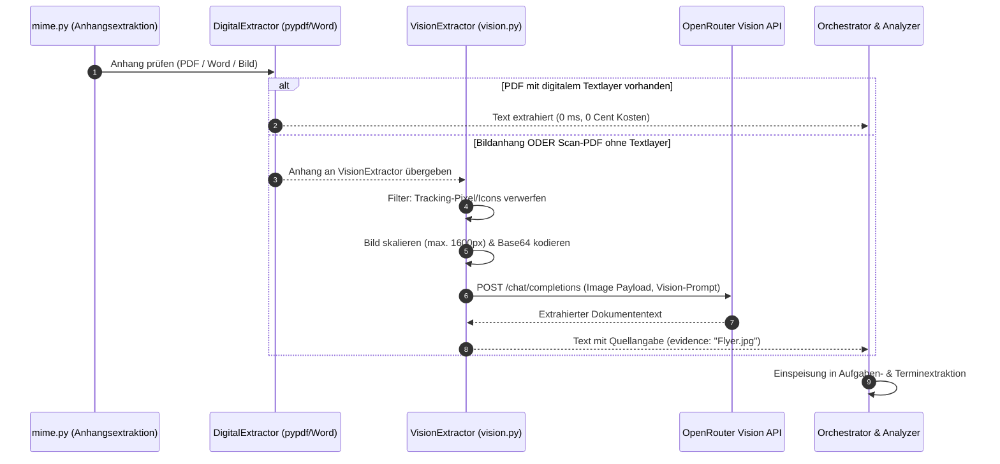

# Mailhelp 1.4 – Konzept und detaillierter Umsetzungsplan: Multimodal & OCR (Texterkennung für Scans und Bildanhänge)

**Stand:** 11. Oktober 2026  
**Zielversion:** 1.4.0  
**Status:** In Planung (Folgt auf Version 1.3 und bereitet Version 2.0 vor)  
**Grundlage:** [Mailhelp-Projektspezifikation](../Mailhelp-Projektspezifikation.md), [Entwicklungsregeln](../AGENTS.md), [Planung-1.4.md](Planung-1.4.md)  
**Vorausgehendes Release:** [Konzept-1.3-Intelligenter-Workflow.md](Konzept-1.3-Intelligenter-Workflow.md)  
**Nachfolgendes Release:** [Konzept-2.0-Redesign-und-Web-Push.md](Konzept-2.0-Redesign-und-Web-Push.md)

---

## 1. Ziel und vollständiger Umfang

Während Version 1.3 die digitale Textextraktion (PDFs mit Textlayer, Word `.docx`, ICS-Dateien) implementiert, schließt Version 1.4 die Lücke für **visuelle und gescannte Dokumente**:
- **Bildanhänge:** `.jpg`, `.jpeg`, `.png`, `.webp` (z.B. Handyfotos von Verträgen, Aushängen, Veranstaltungskalendern, Quittungen).
- **Gescannte Bild-PDFs:** Mehrseitige PDF-Dokumente, die von klassischen Scannern ohne OCR als reine Bildraster erzeugt wurden.

Ziel ist es, den Text aus solchen Anhängen hochpräzise zu erfassen und in dieselbe Aufgaben- und Terminextraktionskette einzuspeisen, **ohne** schwere lokale Systemtools (wie Tesseract) oder riesige Machine-Learning-Pakete (wie PyTorch) vorauszusetzen.

---

## 2. Technische Strategie: Warum Cloud-Vision über OpenRouter?

### 2.1 Analyse der Alternativen

| Ansatz | Systemanforderungen | Erkennungsqualität | Wartbarkeit & Portabilität |
| :--- | :--- | :--- | :--- |
| **Klassisches Tesseract (`pytesseract`)** | Benötigt externe C++-Installation (`tesseract.exe` unter Windows, `apt-get install` in Linux). | Mittelmäßig (scheitert oft an schrägen Fotos, schlechtem Kontrast oder Handschrift). | Schlecht: Bricht einfache `pip`-Installationen; erfordert systemspezifische Pfadkonfigurationen. |
| **Lokales PyTorch / EasyOCR** | 2–3 GB Download für `torch`, `torchvision`, CUDA/C-Runtimes. | Gut bis sehr gut. | Sehr schlecht: Bläht Docker-Images enorm auf; auf schwächeren Systemen extrem speicher- und CPU-intensiv. |
| **Multimodale Cloud-Vision (OpenRouter)** | **Null lokale Zusatztools.** Reine API-Aufrufe über den bestehenden Client. | **Herausragend** (versteht schlechte Belichtung, Tabellen, handschriftliche Vermerke, Kontext). | **Hervorragend:** Nahtlose Integration in die bestehende, gehärtete HTTP- und Logging-Architektur. |

### 2.2 Architekturentscheidung
Mailhelp setzt in Version 1.4 auf **multimodale Vision-Modelle über OpenRouter** (mit lokaler Fallback-Option auf multimodale Ollama-Modelle wie `llama3.2-vision` oder `qwen2.5-vl`):
1. **Zero External Dependencies:** Die bestehende schlanke Python-Umgebung bleibt unangetastet.
2. **Kaskadierte Kosteneffizienz:**
   - 90 % aller Mails werden über den kostenfreien, lokalen Digitalpfad aus Version 1.3 (`pypdf`, Word-XML) in wenigen Millisekunden abgewickelt.
   - Nur wenn ein echter Bildanhang vorliegt oder ein PDF nachweislich keinen Textlayer besitzt, greift die Vision-API. Die Kosten betragen typischerweise unter 0,2 Cent pro analysiertem Dokument (z.B. mit `google/gemini-2.0-flash` über OpenRouter).

---

## 3. Architektur und Ablaufsteuerung



---

## 4. Detaillierte Spezifikationen

### 4.1 Bildvorbereitung und DoS-/Kostenschutz (`src/mailhelp/vision.py`)
1. **Relevanz-Filter für Bilder:**
   - Bilder unter 150×150 Pixel oder unter 10 KB Dateigröße werden als Tracking-Pixel, Firmenlogos oder E-Mail-Signatur-Icons eingestuft und ignoriert.
2. **Skalierung & Normalisierung:**
   - Überschreitet ein Foto 1600 Pixel an der längsten Kante, wird es mit Pythons Standard-Bildverarbeitung (`Pillow` oder leichtgewichtigem Skalierer) auf max. 1600px herunterskaliert. Dies halbiert den Tokenverbrauch bei gleichbleibender Lesbarkeit.
3. **Format-Unterstützung:**
   - Direkt: `image/jpeg`, `image/png`, `image/webp`.
   - Bei gescannten PDFs: Die ersten $N$ Seiten (konfigurierbar, Standard: max. 3 Seiten) werden in 150 DPI gerendert und als JPEG verarbeitet.
4. **Budgetierung in `config.yaml`:**
   ```yaml
   vision:
     enabled: true
     model: "google/gemini-2.0-flash-001" # oder openai/gpt-4o-mini
     max_images_per_mail: 3
     max_image_bytes: 10485760 # 10 MB
   ```

### 4.2 API-Payload nach W3C / OpenRouter-Standard
Die Nachricht an das Vision-Modell nutzt das multimodale Content-Format:
```json
{
  "model": "google/gemini-2.0-flash-001",
  "messages": [
    {
      "role": "user",
      "content": [
        {
          "type": "text",
          "text": "Lies den gesamten sichtbaren Text dieses Dokuments vollständig und wahrheitsgetreu aus. Achte insbesondere auf Fristen, Termine, Uhrzeiten, Aufgaben, Aktenzeichen und Adressen."
        },
        {
          "type": "image_url",
          "image_url": {
            "url": "data:image/jpeg;base64,/9j/4AAQSkZJRgABAQ..."
          }
        }
      ]
    }
  ]
}
```

### 4.3 Provenienz und Web-Darstellung
- **Belegführung (`evidence`):**
  *„Gefunden in Bildanhang ‚Handwerker_Angebot.jpg‘ (via Vision-OCR): 'Montage erfolgt am 24.10. ab 08:00 Uhr.'“*
- **Web-Transparenz (`/mail/<id>`):**
  Anzeige des Anhangs mit Kennzeichnung `[Vision-OCR: Text erfolgreich erkannt (1 Termin extrahiert)]`.

---

## 5. Phasenweiser Umsetzungsplan für Version 1.4

### Phase 1: Konfiguration & Domänenmodelle
1. `config.yaml` und `config.py` um den Abschnitt `vision` erweitern (`enabled`, `model`, `max_images_per_mail`).
2. Datenmodell `VisionExtractionResult` (Text, Token-Verbrauch, Bildgröße, Dauer) in `domain/processing.py` anlegen.
3. Validierungsregeln für Grenzwerte und Bilddimensionen testen.

### Phase 2: Bildvorbereitung & Scan-Erkennung
1. Modul `src/mailhelp/vision.py` anlegen: Größenfilter gegen Icons/Tracking-Pixel, Normalisierung und Base64-Codierung.
2. In `attachment_extractor.py`: Erkennung von bildbasierten PDFs (`is_scanned_pdf()` wenn Zeichenzahl < 50 trotz Dateigröße > 50 KB).

### Phase 3: Multimodaler Vision-Client
1. `OpenRouterClient` um multimodale Bild-Payloads erweitern.
2. Vision-Prompt in `prompts.yaml` einpflegen.
3. Fehlerbehandlung (ungültiges Bildformat, API-Rate-Limits, fehlerhaftes JSON) absichern.

### Phase 4: Pipeline-Integration im Orchestrator
1. Vision-Extraktor in den Extraktionsschritt des `Orchestrators` einhängen.
2. Extrahierte Bildtexte fließen nahtlos in die Normalisierungs- und Vorabprüfungs-Kette aus Version 1.3 ein.
3. Telemetrie und Event-Logging (`vision_ocr_completed`, Bildgröße, Verarbeitungsdauer).

### Phase 5: Web-Oberfläche & Kostenansicht
1. `/mail/<id>`: Ausweisung des Vision-OCR-Status bei Bildanhängen.
2. `/auswertung`: Anzeige der für Vision-Modelle aufgewendeten Tokens und Kosten.

### Phase 6: Qualitätssicherung & Release 1.4
1. Synthetische Bildtests (Kassenzettel, Scan-Dokument, Einladungsflyer) mit `httpx.MockTransport`.
2. 100 % Zeilen- und Branch-Coverage für alle neuen Codepfade.
3. Aktualisierung von `CHANGELOG.md` und `Mailhelp-Projektspezifikation.md`.
4. Version auf `1.4.0` anheben.

---

## 6. Test- und Qualitätssicherungsstrategie ([`AGENTS.md`](../AGENTS.md))

- **Keine echten externen Aufrufe in automatisierten Tests:** Alle multimodalen Anfragen an OpenRouter werden offline über Mock-Transports mit synthetischen Bild- und Textantworten simuliert.
- **Synthetische Test-Assets:**
  - Sehr kleines Bild (1×1 Tracking-Pixel) $\rightarrow$ Test verifiziert, dass kein Vision-Call erfolgt.
  - Großes JPEG-Foto (3000×2000) $\rightarrow$ Test verifiziert automatische Skalierung.
  - Bild mit handschriftlichem Termin $\rightarrow$ Test verifiziert korrekte Übernahme in `Proposal`.
- **100 % Coverage-Gate:** Verbindliche 100 % Zeilen- und Branch-Abdeckung für `vision.py` und alle Adaptererweiterungen.

