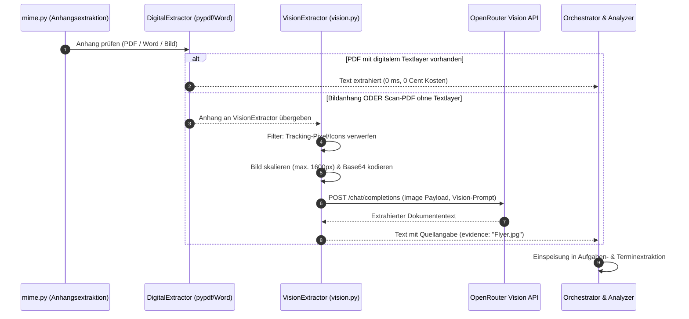
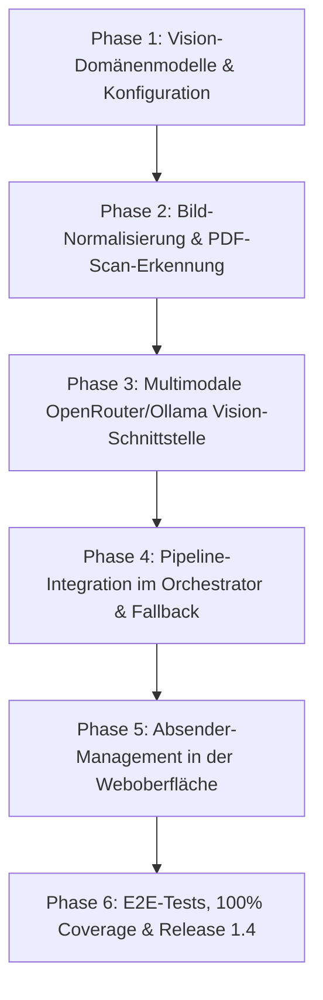

# Mailhelp 1.4 – Konzept und detaillierter Umsetzungsplan: Multimodal, OCR und Absender-Filterung

> Historischer Versionsstand: Dieses Dokument beschreibt die genannte Version oder
> deren damaligen Plan. Ursprüngliche Ziele und Prüfergebnisse sind kein Nachweis
> des heutigen Umfangs. Aktueller Betrieb: [README](../README.md),
> [Release 3.3](Release-3.3.md) und [Projektspezifikation](../Mailhelp-Projektspezifikation.md).

**Stand:** 11. Oktober 2026  
**Zielversion:** 1.4.0  
**Status:** Historischer Entwurf; Bild-/Scan-Auswertung seit 1.4 implementiert. Maßgeblich für Grenzen und unterstützte Formate ist die Projektspezifikation.
**Grundlage:** [Mailhelp-Projektspezifikation](../Mailhelp-Projektspezifikation.md), [Entwicklungsregeln](../AGENTS.md), [Planung-1.4.md](Planung-1.4.md)  
**Vorausgehendes Release:** [Konzept-1.3-Intelligenter-Workflow.md](Konzept-1.3-Intelligenter-Workflow.md)  
**Nachfolgendes Release:** [Konzept-2.0-Redesign-und-Web-Push.md](Konzept-2.0-Redesign-und-Web-Push.md)

---

## 1. Ziel und vollständiger Umfang

Während Version 1.3 die digitale Textextraktion (PDFs mit Textlayer, Word `.docx`, ICS-Dateien) implementiert, schließt Version 1.4 zwei entscheidende Lücken im alltäglichen E-Mail-Handling:
1. **Multimodale Texterkennung (OCR) für visuelle Dokumente:**
   - **Bildanhänge:** `.jpg`, `.jpeg`, `.png`, `.webp` (z.B. Fotos von Verträgen, Aushängen, Veranstaltungskalendern, Quittungen).
   - **Gescannte Bild-PDFs:** Mehrseitige PDF-Dokumente, die von klassischen Scannern ohne OCR als reine Bildraster erzeugt wurden.
   - Text und Termine werden hochpräzise erfasst, **ohne** schwere lokale Systemtools (wie Tesseract) oder riesige Machine-Learning-Pakete (wie PyTorch) vorauszusetzen.
2. **Direktes Absender-Management in der Web-Mail-Detailansicht:**
   - Ein-Klick-Aufnahme der jeweiligen Absenderadresse in die Liste ignorierter Absender (`irrelevant-senders`).
   - Künftige E-Mails dieser Adresse werden vor jedem LLM-Aufruf deterministisch als irrelevant eingestuft.
   - Reversible Verwaltung und Entsperrung direkt über die Weboberfläche.

---

## 2. Technische Strategie: Warum Cloud-Vision über OpenRouter?

### 2.1 Analyse der Alternativen

| Ansatz | Systemanforderungen | Erkennungsqualität | Wartbarkeit & Portabilität |
| :--- | :--- | :--- | :--- |
| **Klassisches Tesseract (`pytesseract`)** | Benötigt externe C++-Installation (`tesseract.exe` unter Windows, `apt-get install` in Linux). | Mittelmäßig (scheitert oft an schrägen Fotos, schlechtem Kontrast oder Handschrift). | Schlecht: Bricht einfache `pip`-Installationen; erfordert systemspezifische Pfadkonfigurationen. |
| **Lokales PyTorch / EasyOCR** | 2–3 GB Download für `torch`, `torchvision`, CUDA/C-Runtimes. | Gut bis sehr gut. | Sehr schlecht: Bläht Docker-Images enorm auf; auf schwächeren Systemen extrem speicher- und CPU-intensiv. |
| **Multimodale Cloud-Vision (OpenRouter)** | **Null lokale Zusatztools.** Reine API-Aufrufe über den bestehenden Client. | **Herausragend** (versteht schlechte Belichtung, Tabellen, handschriftliche Vermerke, Kontext). | **Hervorragend:** Nahtlose Integration in die bestehende, gehärtete HTTP- und Logging-Architektur. |

### 2.2 Architekturentscheidung
Mailhelp setzt in Version 1.4 auf **multimodale Vision-Modelle über OpenRouter** (mit lokaler Fallback-Option auf multimodale Ollama-Modelle wie `llama3.2-vision` oder `qwen2.5-vl`):
1. **Zero External Dependencies:** Die bestehende schlanke Python-Umgebung bleibt unangetastet.
2. **Kaskadierte Kosteneffizienz:**
   - 90 % aller Mails werden über den kostenfreien, lokalen Digitalpfad aus Version 1.3 (`pypdf`, Word-XML) in wenigen Millisekunden abgewickelt.
   - Nur wenn ein echter Bildanhang vorliegt oder ein PDF nachweislich keinen Textlayer besitzt, greift die Vision-API. Die Kosten betragen typischerweise unter 0,2 Cent pro analysiertem Dokument (z.B. mit `google/gemini-2.0-flash` über OpenRouter).

---

## 3. Architektur und Ablaufsteuerung (Vision-OCR)



---

## 4. Detaillierte Spezifikationen: Bildvorbereitung & Vision-OCR

### 4.1 Bildvorbereitung und DoS-/Kostenschutz (`src/mailhelp/vision.py`)
1. **Relevanz-Filter für Bilder:**
   - Bilder unter 150×150 Pixel oder unter 10 KB Dateigröße werden als Tracking-Pixel, Firmenlogos oder E-Mail-Signatur-Icons eingestuft und ignoriert.
2. **Skalierung & Normalisierung:**
   - Überschreitet ein Foto 1600 Pixel an der längsten Kante, wird es auf max. 1600px herunterskaliert. Dies halbiert den Tokenverbrauch bei gleichbleibender Lesbarkeit.
3. **Format-Unterstützung:**
   - Direkt: `image/jpeg`, `image/png`, `image/webp`.
   - Bei gescannten PDFs: Die ersten $N$ Seiten (Standard: max. 3 Seiten) werden in 150 DPI gerendert und verarbeitet.
4. **Budgetierung in `config.yaml`:**
   ```yaml
   vision:
     enabled: true
     model: "google/gemini-2.0-flash-001" # oder openai/gpt-4o-mini
     max_images_per_mail: 3
     max_image_bytes: 10485760 # 10 MB
   ```

### 4.2 API-Payload nach W3C / OpenRouter-Standard
```json
{
  "model": "google/gemini-2.0-flash-001",
  "messages": [
    {
      "role": "user",
      "content": [
        {
          "type": "text",
          "text": "Lies den gesamten sichtbaren Text dieses Dokuments vollständig und wahrheitsgetreu aus. Achte insbesondere auf Fristen, Termine, Uhrzeiten, Aufgaben, Aktenzeichen und Adressen."
        },
        {
          "type": "image_url",
          "image_url": {
            "url": "data:image/jpeg;base64,/9j/4AAQSkZJRgABAQ..."
          }
        }
      ]
    }
  ]
}
```

---

## 5. Absender-Management in der Mail-Detailansicht

### 5.1 Motivation & Benutzerführung
Bisher konnten ignorierte Absender nur über statische Konfigurationsdateien (`irrelevant-senders.json`) definiert werden. Nutzer, die in der Web-Oberfläche eine unerwünschte Newsletter-Mail oder Spam-Nachricht sichten, mussten diesen Absender mühsam manuell in JSON-Dateien nachtragen.

In Version 1.4 wird die Mail-Detailansicht `/mail/<mail_id>` um eine direkte **Ein-Klick-Aktion** ergänzt.

### 5.2 Darstellung in der Mail-Detailansicht (`web/review_pages.py`)
In der Header-Box der Mail:
```html
<div class="mail-header-sender">
  <span><strong>Von:</strong> newsletter@marketing-spam.de</span>
  <form method="post" action="/mail/a3f890c21.../absender-ignorieren" class="inline-form">
    <input type="hidden" name="csrf" value="...">
    <button type="submit" class="button small danger" title="Künftige E-Mails dieses Absenders automatisch als irrelevant einstufen">
      🚫 Absender ignorieren
    </button>
  </form>
</div>
```
- **Ist der Absender bereits blockiert:**
  Anzeige des Badges `<span class="badge danger">Absender wird ignoriert</span>` mit Aktionsbutton:  
  `[Absender wieder zulassen]` (`POST /mail/<id>/absender-zulassen`).

### 5.3 Backend-Verarbeitung & Persistenz (`src/mailhelp/web/site.py`)
1. **Route `POST /mail/<mail_id>/absender-ignorieren`:**
   - Validierung der Sitzung und des CSRF-Tokens.
   - Laden des `MailState` zur `mail_id`.
   - Normalisierung der Absenderadresse über `sender_filter.sender_addresses(mail.display_headers.sender)`.
   - Laden des bestehenden `IrrelevantSenders`-Modells aus `irrelevant-senders`.
   - Hinzufügen der Adresse über `sender_filter.add_irrelevant_senders()`.
   - Atomares Speichern des aktualisierten Modells im JsonStore.
   - Rückleitung auf die Mail-Detailseite mit Erfolgsmeldung:  
     *„Absender 'newsletter@marketing-spam.de' zur Liste ignorierter Absender hinzugefügt.“*
2. **Route `POST /mail/<mail_id>/absender-zulassen`:**
   - Entfernt die normalisierte Adresse aus `IrrelevantSenders.addresses` und speichert die Datei atomar.
   - Rückleitung mit Bestätigung: *„Absender wird künftig wieder normal verarbeitet.“*

### 5.4 Zentrale Verwaltung unter `/einstellungen/ignorierte-absender`
- Eine übersichtliche Einstellungsseite listet alle aktuell blockierten Adressen und Domains auf.
- Jede Adresse besitzt einen `[Entfernen]`-Button.
- Neue Adressen oder Domains können auch manuell über ein Formularfeld ergänzt werden.

---

## 6. Phasenweiser Umsetzungsplan für Version 1.4



| Phase | Schwerpunkt | Liefergegenstand |
| :--- | :--- | :--- |
| **Phase 1** | **Konfiguration & Modelle** | Ergänzung `config.yaml` (`vision`-Sektion, Limits), `VisionExtractionResult`-Modell, Budget-Validierung. |
| **Phase 2** | **Bildvorbereitung & Scan-Erkennung** | Bildskalierung (Pillow/reine Byte-Normalisierung), Erkennung textloser PDFs in `attachment_extractor.py`. |
| **Phase 3** | **Vision-Client** | Erweiterung von `OpenRouterClient` und `OllamaClient` um multimodale Bild-Payloads (Base64 data URLs), dedizierte Prompts in `prompts.yaml`. |
| **Phase 4** | **Pipeline-Integration** | Anbindung im `Orchestrator`: Bildtexte fließen nahtlos in dieselbe Normalisierungs- und Vorabprüfungs-Kette ein wie Mail- und PDF-Texte. |
| **Phase 5** | **Absender-Management in Web-UI** | Routen `POST /mail/<id>/absender-ignorieren` und `absender-zulassen`, Button & Badges in der Detailansicht, Verwaltungsliste in `/einstellungen/ignorierte-absender`. |
| **Phase 6** | **Qualitätssicherung & 1.4-Release** | Synthetische Bildtests, Mock-Vision-Transports, Tests für Absender-Blockieren/Zulassen, 100 % Zeilen-/Branch-Coverage, Release **1.4.0**. |

---

## 7. Test- und Qualitätssicherungsstrategie ([`AGENTS.md`](../AGENTS.md))

1. **Keine echten externen Aufrufe in automatisierten Tests:**
   - Alle multimodalen Anfragen an OpenRouter werden offline über Mock-Transports mit synthetischen Bild- und Textantworten simuliert.
2. **Sicherheits- und Berechtigungstests für Absenderfilter:**
   - Test auf CSRF-Schutz: Fehlendes oder falsches CSRF-Token wird mit HTTP 403 abgewiesen.
   - Test auf Normalisierung: Groß-/Kleinschreibung, Leerzeichen und Display-Namen werden syntaktisch korrekt bereinigt.
   - Test auf Idempotenz: Mehrfaches Ignorieren derselben Adresse erzeugt keine Duplikate in `IrrelevantSenders`.
3. **100 % Coverage-Gate:**
   - Verbindliche 100 % Zeilen- und Branch-Abdeckung für `vision.py`, Web-Routen und modifizierte Module.
