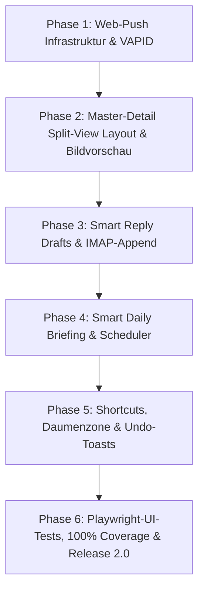

# Mailhelp 2.0 – Konzept und detaillierter Umsetzungsplan: The New Experience & Standalone PWA

**Stand:** 11. Oktober 2026  
**Zielversion:** 2.0.0  
**Status:** In Planung (Folgt auf die Versionen 1.5 und 1.6)
**Grundlage:** [Mailhelp-Projektspezifikation](../Mailhelp-Projektspezifikation.md), [Entwicklungsregeln](../AGENTS.md), [Planung-2.0.md](Planung-2.0.md)  
**Vorausgehende Releases:** [Konzept-1.3-Intelligenter-Workflow.md](Konzept-1.3-Intelligenter-Workflow.md), [Konzept-1.4-Multimodal-und-OCR.md](Konzept-1.4-Multimodal-und-OCR.md), [Planung-1.5.md](Planung-1.5.md), [Planung-1.6.md](Planung-1.6.md)

---

## 1. Ziel und vollständiger Umfang

Mailhelp 2.0 vollzieht den entscheidenden Generationswechsel von einem begleitenden Telegram-Bot mit Administrations-Webseite zu einer **autonomen, modernen Produktivitätsanwendung** für Smartphone und Desktop.

Das Release ruht auf **vier tragenden Säulen**:
1. **Säule 1: Modernes Web-Redesign nach 8 UX-Design-Patterns:** Master-Detail Split-View am Desktop, Daumenzonen-Buttons am Smartphone, Progressive Disclosure, Quick-Filter-Chips, Keyboard-Shortcuts (`J`/`K`/`C`/`E`/`X`), Undo-Toasts, visuelle Bildanhang-Vorschau mit Lightbox im Detail-Pane und motivierender Inbox-Zero-State.
2. **Säule 2: Mobile Autonomie durch Web-Push:** Vollwertige System-Push-Benachrichtigungen über den W3C VAPID-/Service-Worker-Standard. Mailhelp kann auf iOS Safari (installierte PWA), Android Chrome und Desktop völlig unabhängig von Telegram betrieben werden.
3. **Säule 3: Intelligente Antwort-Entwürfe (Smart Reply Drafts):** Automatische Vorformulierung passender Antwortschreiben. Nach Nutzerbestätigung werden sie **via IMAP-Append im Entwurfsordner (`Drafts`)** abgelegt – inklusive korrekter Thread-Header (`In-Reply-To`, `References`). Es erfolgt **kein automatischer Direktversand**.
4. **Säule 4: Smart Daily Briefing (Tageszusammenfassung):** Konfigurierbare morgendliche Zusammenfassung über anstehende Termine, fällige Todos und offene Entscheidungen per Web-Push und Telegram; steuerbar über ein `enabled`-Flag in `config.yaml`.

---

## 2. Verbindliche Invarianten und Sicherheitsregeln

Gemäß den [Entwicklungsregeln](../AGENTS.md) gelten für Version 2.0 folgende Grundsätze:

1. **Progressive Enhancement:**
   - Alle wesentlichen Funktionen (Prüfen, Bestätigen, Bearbeiten, Verwerfen, Entwurf-Erstellen) müssen auch bei vollständig deaktiviertem JavaScript garantiert funktionieren.
2. **Strikte E-Mail-Versand-Grenze (Kein SMTP):**
   - Mailhelp versendet niemals eigenmächtig E-Mails. Antwort-Entwürfe werden **ausschließlich schreibend via IMAP in den Entwurfsordner (`Drafts`)** abgelegt. Der eigentliche E-Mail-Versand erfolgt stets durch den Nutzer über sein gewohntes Mail-Programm.
3. **Sitzungsprüfung und CSRF-Schutz:**
   - Alle Aktionen (Push-Abonnement, Entwurfs-Speicherung, Undo-Befehle) verlangen eine gültige, serverseitig geprüfte Sitzung mit CSRF-Schutz und Idempotenzschlüssel.
4. **Schutz von Geheimnissen:**
   - VAPID Private Keys, Push-Endpunkt-Tokens und IMAP-Passwörter werden sicher isoliert und niemals in Logs ausgegeben.
5. **Verbindliche 100 % Zeilen- und Branch-Abdeckung:**
   - Für alle neuen Python-Module (`webpush.py`, `drafts.py`, `briefing.py`, API-Handler) gilt die 100-%-Grenze ohne Ausnahmen. Ergänzend sichern automatisierte Playwright-Browsertests das Verhalten der Benutzeroberfläche ab.

---

## 3. Säule 1 im Detail: Die 8 UX-Design-Patterns für die Weboberfläche

### 1. Master-Detail / Split-View Pattern (Desktop ab 1024px)
- **Architektur:** Auf breiten Displays schaltet das Layout via CSS Grid automatisch auf zwei Spalten um:
  - **Master-Pane (links, 380px fest):** Vertikale Liste aller offenen Vorgänge mit Typ (📅/✅), Titel, Zeitfenster, Quell-Absender und Status-Badge.
  - **Detail-Pane (rechts, flexibel):** Synchron mitlaufende Vollansicht des selektierten Vorgangs. Enthält die Quell-Mail, optische Bildanhang-Vorschau (Thumbnails & Lightbox für Belegabgleich), Fristen, Differenz-Boxen bei Terminverschiebungen, den Antwort-Entwurf-Editor und die Aktionsleiste.
- **Workflow:** Der Nutzer klickt sich links durch die Liste oder navigiert per Tastatur; die Detailansicht aktualisiert sich sofort ohne Seitenreload.

### 2. Progressive Disclosure (Schrittweise Offenlegung)
- **Hierarchie:**
  - **Sichtbare Hauptkarte:** Nur das Wesentliche für die Entscheidung (Titel, Datum/Uhrzeit, Zuständigkeit, Zielkalender/-projekt, Hauptaktions-Buttons).
  - **Sekundäre Sektionen (Einklappbare `<details>`-Container):**
    - `[▾ Quellbeleg aus E-Mail / Anhang]`
    - `[▾ Revisionshistorie & Differenzen]`
    - `[▾ Technische LLM-Analyse & Metriken]`

### 3. Quick-Filter-Chips & Faceted Search
- **Komponente:** Klickbare Filter-Chips oberhalb der Listen auf `/offen`, `/mails` und `/verlauf`:
  `[Alle]` `[Termine]` `[Aufgaben]` `[Klärung nötig]` `[Mit Anhängen]` `[Duplikate]`
- **Interaktion:** Ein Klick filtert die Ansicht clientseitig in Millisekunden und synchronisiert den Status in die URL (`?filter=events`).

### 4. Mobile-First Sticky Action-Bar (Daumenzone)
- **Komponente:** Auf Smartphones und schmalen Bildschirmen wird die Aktionsleiste fixiert am unteren Bildschirmrand verankert:
  `position: sticky; bottom: 0; padding-bottom: env(safe-area-inset-bottom);`
- **Ergonomie:** Große Touch-Targets (mindestens 48px Höhe).
- **Anordnung:** `[Bestätigen]` (dominant, rechts/Mitte), `[Bearbeiten]` (Mitte), `[Ablehnen]` (links).

### 5. Power-User Keyboard Shortcuts
- **Tastaturbelegung (Desktop):**
  - `J` / `↓`: Nächsten Vorschlag auswählen.
  - `K` / `↑`: Vorherigen Vorschlag auswählen.
  - `C` / `Enter`: Vorschlag bestätigen (*Confirm*).
  - `E`: Vorschlag bearbeiten (*Edit*).
  - `X` / `D`: Vorschlag verwerfen / ablehnen (*Dismiss*).
  - `?`: Shortcuts-Hilfepanel einblenden.
- **Sicherheit:** Shortcuts sind automatisch inaktiv, sobald ein Eingabefeld (`<input>`, `<textarea>`) den Fokus hat.

### 6. Optimistic Feedback & Toast / Undo-Pattern
- **Interaktion:** Klickt der Nutzer auf *„Bestätigen“* oder drückt `C`, blendet sich die Karte sofort mit einer flüssigen CSS-Transition aus.
- **Undo-Leiste:** Am unteren Bildschirmrand erscheint ein dezenter Toast:  
  *„Termin ‚Projektmeeting‘ bestätigt“* mit einem 5-sekündigen **„Rückgängig“-Button**.

### 7. Motivierender „Inbox-Zero“-Zustand
- **Empty-State:** Sind alle Entscheidungen getroffen, zeigt `/offen` einen ansprechenden Erfolgszustand:
  - Grüner Status-Badge: *„Alles erledigt! Keine offenen Entscheidungen.“*
  - Tagesstatistik: *„Heute 6 Vorgänge verarbeitet: 3 Termine angelegt, 2 Duplikate vorab abgeglichen, 1 Aufgabe erledigt.“*
  - Letzter erfolgreicher E-Mail-Abruf und Server-Status im Überblick.

### 8. Visuelle Bildanhang-Vorschau & Beleg-Lightbox im Detail-Pane
- **UX & Anwendungsfall:** E-Mails enthalten häufig bildhafte Belege (eingescannte oder abfotografierte Rechnungen, Quittungen, Terminzettel, Aushänge, Veranstaltungsflyer, Screenshots). Im Detail-Pane werden Bildanhänge nicht nur als Text-Badge aufgeführt, sondern als visuelle Vorschaubilder (Thumbnails) direkt gerendert.
- **Interaktion & Belegprüfung:**
  - **Inline-Thumbnail:** Bildkarte mit Dateiname, Abmessungen, Dateigröße und Vision-Erkennungsstatus.
  - **Lightbox / Zoom-Modal:** Ein Klick auf das Bild öffnet eine bildschirmfüllende, zoombare Lightbox zur genauen Prüfung von Kleingedrucktem oder handschriftlichen Notizen.
  - **OCR-Text-Akkordeon:** Unter dem Bild befindet sich ein `<details>`-Block mit dem vom Vision-Modell erkannten Text, der mit einem Klick verglichen oder kopiert werden kann.
- **Sichere Bereitstellung & Architektur (`GET /mail/<mail_id>/anhang/<int:index>`):**
  - Authentifizierter Endpunkt mit zwingender Sitzungsvalidierung (`SessionAuth`).
  - Strikte HTTP-Sicherheitsheader (`X-Content-Type-Options: nosniff`, `Content-Security-Policy: default-src 'none'`, `Content-Type: image/jpeg|png|webp`).
  - Ausschließliche Unterstützung von Rastergrafiken (JPEG, PNG, WebP), SVG ist zur Vermeidung von Stored XSS strikt verboten.
- **Lifecycle & Retention:**
  - Caching der weboptimierten Vorschaubilder im Dateisystem unter `data/attachments/<mail_id>/`.
  - Vollständiges automatisches Löschen beim Archivieren oder Bereinigen der E-Mail gemäß `retention.py`.

---

## 4. Säule 2 im Detail: Web-Push für PWA (Autonomer Standalone-Betrieb)

### 4.1 VAPID-Schlüsselverwaltung & Kryptographie (`src/mailhelp/webpush.py`)
- Generierung und Verwendung eines NIST P-256-Schlüsselpaars.
- RFC-8291-konforme Payload-Verschlüsselung mit AES-128-GCM und ECDH-Schlüsselaustausch.
- Bereitstellung des öffentlichen Schlüssels über `GET /api/push/public-key`.

### 4.2 Abonnementverwaltung (`push-subscriptions.json`)
- Sichere Persistenz aller registrierten Endgeräte mit Verknüpfung zur aktuellen Gerätekennung.
- Endpunkte: `POST /api/push/subscribe` und `POST /api/push/unsubscribe` mit CSRF- und Sitzungsschutz.

### 4.3 Service Worker (`sw.js`)
- `self.addEventListener('push', ...)` zeigt native System-Benachrichtigungen an.
- `self.addEventListener('notificationclick', ...)` öffnet die PWA direkt auf `/offen` oder der relevanten Mail-Detailseite.

---

## 5. Säule 3 im Detail: Intelligente Antwort-Entwürfe (Smart Reply Drafts)

### 5.1 Generierung im Analyzer (`analysis.py`)
- Wenn eine E-Mail einen Termin, eine Zusage, eine Terminanfrage oder eine Aufgabe enthält, erzeugt das LLM parallel einen passenden Antwortentwurf (`draft_reply`).
- **Prompt-Regel:** Kurz, höflich, professionell, exakt auf die Entscheidung bezogen (z.B. Zusage des vorgeschlagenen Zeitpunkts oder Dank für die Übermittlung der Protokollaufgaben).

### 5.2 Weboberfläche & Editor
- Im Split-View Detail-Panel erscheint eine editierbare Textbox:
  ```html
  <div class="draft-box">
    <h4>Antwort-Entwurf</h4>
    <textarea name="draft_text" id="draft-editor">Vielen Dank für die Einladung. Ich habe mir den Termin für Freitag um 14:00 Uhr im Kalender eingetragen und bin gerne dabei.</textarea>
    <div class="draft-actions">
      <button type="submit" formaction="/vorschlag/.../entwurf-speichern" class="button">
        📥 Als Entwurf im Postfach speichern
      </button>
    </div>
  </div>
  ```

### 5.3 IMAP-Append im Ordner `Drafts` (`src/mailhelp/drafts.py`)
- Bei Bestätigung generiert Mailhelp eine RFC-5322-konforme E-Mail:
  - `From:` Eigene konfigurierte E-Mail-Adresse (`imap.username`).
  - `To:` Ursprünglicher Absender (`Reply-To` oder `From` der Quell-Mail).
  - `Subject:` `Re: [Betreff der Quell-Mail]`.
  - `In-Reply-To:` `<message-id@domain>` der Quell-Mail.
  - `References:` Bestehende Referenzen + `<message-id@domain>`.
  - `Date:` Aktueller UTC-Zeitstempel.
  - Flags: `\Draft`, `\Seen`.
- Mailhelp verbindet sich mit dem IMAP-Server und führt den Befehl `APPEND` im konfigurierten Ordner (Standard: `"Drafts"`) aus.
- **Sicherheitsgrenze:** Es existiert **kein SMTP-Versandpfad**. Der Entwurf liegt sicher im E-Mail-Postfach des Nutzers. Der Nutzer öffnet seinen Client (z.B. am Smartphone oder Desktop) und sendet die Mail nach persönlicher Endkontrolle ab.

---

## 6. Säule 4 im Detail: Smart Daily Briefing (Tageszusammenfassung)

### 6.1 Konfiguration in `config.yaml`
```yaml
daily_briefing:
  enabled: true             # Per Flag steuerbar (true/false)
  time: "07:30"             # Uhrzeit (HH:MM in konfigurierter IANA-Zeitzone)
  include_calendar: true    # Heutige Termine aus Google Kalender
  include_tasks: true       # Fällige/überfällige Aufgaben aus Todoist
  include_open: true        # Noch offene Mailhelp-Entscheidungen
```

### 6.2 Aggregation & Versand (`src/mailhelp/briefing.py`)
- Ein Hintergrund-Scheduler prüft die Systemzeit. Zur Zielzeit ruft Mailhelp schreibgeschützt ab:
  1. Kalender-Events des aktuellen Tages via `fetch_events_in_window(today_start, today_end)`.
  2. Aktive Aufgaben mit `due <= today` via `fetch_active_tasks()`.
  3. Offene Vorschläge aus `review/views.py`.
- Formatierung des Briefings:
  ```text
  Guten Morgen! ☀️
  📅 Heute 2 Termine:
  • 10:00 Uhr: Projekt-Jour-Fixe
  • 15:30 Uhr: Zahnarzt Dr. Weber
  
  ✅ 2 Aufgaben fällig:
  • Steuerunterlagen abschicken
  • Feedback an Marketing senden
  
  ✉️ 1 E-Mail wartet auf Entscheidung.
  ```
- **Versand:** Synchron an alle aktiven Push-Abonnenten via Web-Push und an den Telegram-Chat.
- **Resilienz:** Bei Teilausfällen (z.B. Google Kalender offline) wird das Briefing mit den verfügbaren Daten versendet und vermerkt: *„(Kalender aktuell nicht erreichbar)“*.

---

## 7. Phasenweiser Umsetzungsplan für Version 2.0



| Phase | Schwerpunkt | Liefergegenstand |
| :--- | :--- | :--- |
| **Phase 1** | **Web-Push & Autonomie** | VAPID-Kryptographie (`webpush.py`), Subscriptions-Store, Endpunkte `/api/push/*`, Service Worker Push-Event, Opt-In Schalter in `/einstellungen`. |
| **Phase 2** | **Master-Detail Split-View & Bildvorschau** | Responsives Zweispalten-Layout (Desktop ab 1024px) in `web/review_pages.py` und `app.css`, synchrone Detailanzeige ohne Reload, sicherer Anhang-Endpunkt `/mail/<id>/anhang/<index>` und Inline-Bildvorschau mit Lightbox. |
| **Phase 3** | **Smart Reply Drafts** | Prompt `draft_reply`, Web-Editor im Detail-Panel, `src/mailhelp/drafts.py` mit IMAP-Append und RFC-5322 Threading-Headern im Ordner `Drafts`. |
| **Phase 4** | **Smart Daily Briefing** | `src/mailhelp/briefing.py`, Konfigurationsabschnitt `daily_briefing` (`enabled`), Hintergrund-Timer, Push-/Telegram-Versand, Graceful Fallback. |
| **Phase 5** | **Ergonomie & Feedback** | Daumenzonen-Aktionsleiste, Keyboard-Shortcuts (`J`/`K`/`C`/`E`/`X`), Quick-Filter-Chips, Optimistic UI mit 5s-Undo-Toast. |
| **Phase 6** | **Qualitätssicherung & 2.0-Release** | Playwright E2E-Browsertests aller neuen UI-Patterns, 100 % Zeilen-/Branch-Coverage, Doku-Aktualisierung und feierliches Release **Mailhelp 2.0.0**. |

---

## 8. Test- und Qualitätssicherungsstrategie ([`AGENTS.md`](../AGENTS.md))

1. **Progressive Enhancement & Barrierefreiheit:**
   - Automatisierte Playwright-Tests verifizieren, dass jede Aktion auch bei deaktiviertem JavaScript über klassische HTTP-POST-Routen funktioniert.
2. **Bildanhang-Auslieferung & XSS-Prävention:**
   - Tests prüfen die HTTP-Endpunkte `/mail/<mail_id>/anhang/<index>`:
     - 401/403 bei fehlender oder ungültiger Sitzung.
     - 404 bei ungültigem Anhang-Index oder nicht existierender Mail.
     - Strikte Sicherheitsheader (`X-Content-Type-Options: nosniff`, restriktive Content-Security-Policy).
     - Ablehnung potenziell gefährlicher Dateitypen (insb. SVG).
     - Überprüfung der Bereinigung gecachter Bilddateien bei Aufbewahrungsfrist-Ablauf (`retention.py`).
3. **IMAP-Append & Drafts-Tests:**
   - Tests prüfen die korrekte Erstellung der MIME-Nachricht, Header `In-Reply-To`, `References`, Flags `\Draft`, `\Seen` und UTF-7-Ordnernamen gegen einen simulierten IMAP-Server.
   - Absicherung, dass kein SMTP-Versand aufgerufen wird.
4. **Daily-Briefing-Tests:**
   - Zeitgesteuerte Auslösung mit synthetischer Systemuhr (`clock`), Überprüfung der Teilausfall-Resilienz und korrekten Aggregation.
5. **100 % Zeilen- und Branch-Abdeckung:**
   - Verbindlich für alle serverseitigen Module (`webpush.py`, `drafts.py`, `briefing.py`, Anhang-Handler, API-Handler, Push-Subscriptions-Store).
