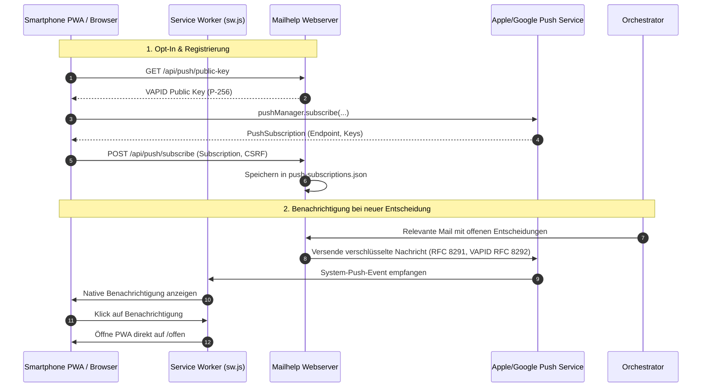
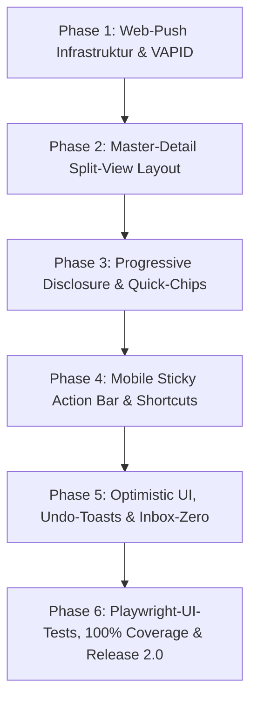

# Mailhelp 2.0 – Konzept und detaillierter Umsetzungsplan: The New Experience & Standalone PWA

**Stand:** 11. Oktober 2026  
**Zielversion:** 2.0.0  
**Status:** In Planung (Folgt auf den Abschluss von Version 1.3)  
**Grundlage:** [Mailhelp-Projektspezifikation](../Mailhelp-Projektspezifikation.md), [Entwicklungsregeln](../AGENTS.md), [Planung-2.0.md](Planung-2.0.md)  
**Vorausgehendes Backend-Release:** [Konzept-1.3-Intelligenter-Workflow.md](Konzept-1.3-Intelligenter-Workflow.md)

---

## 1. Ziel und vollständiger Umfang

Mailhelp 2.0 vollzieht den entscheidenden Generationswechsel von einem begleitenden Telegram-Bot mit Administrations-Webseite zu einer **autonomen, modernen Produktivitätsanwendung** für Smartphone und Desktop.

Das Release ruht auf zwei Kernsäulen:
1. **Pfeiler 1: Mobile Autonomie durch Web-Push:** Vollwertige System-Push-Benachrichtigungen über den W3C VAPID-/Service-Worker-Standard. Mailhelp kann auf iOS Safari (installierte PWA), Android Chrome und Desktop völlig unabhängig von Telegram betrieben werden.
2. **Pfeiler 2: Modernes Web-Redesign nach UX-Design-Patterns:** Die bisherige vertikale Formularabfolge wird durch sieben etablierte Interaktionsmuster ersetzt (Master-Detail Split-View, Progressive Disclosure, Quick-Filter-Chips, Daumenzonen-UI, Keyboard-Shortcuts, Undo-Toasts und motivierender Inbox-Zero-Zustand).

---

## 2. Verbindliche Invarianten und Sicherheitsregeln

Gemäß den [Entwicklungsregeln](../AGENTS.md) gelten für Version 2.0 folgende Grundsätze:

1. **Progressive Enhancement:**
   - Alle wesentlichen Funktionen (Prüfen, Bestätigen, Bearbeiten, Verwerfen) müssen auch bei vollständig deaktiviertem JavaScript garantiert funktionieren. JavaScript veredelt die Oberfläche zu einer rasanten Desktop-/App-Experience, ist aber kein zwingender Single-Point-of-Failure.
2. **Sitzungsprüfung und CSRF-Schutz:**
   - Alle neuen Aktionen (Push-Abonnement, Undo-Befehle, Schnellaktionen) verlangen eine gültige, serverseitig geprüfte Sitzung mit CSRF-Schutz und Idempotenzschlüssel.
3. **Schutz von Geheimnissen:**
   - VAPID Private Keys und Push-Endpunkt-Tokens werden sicher in `config.yaml`/`secrets.yaml` bzw. `push-subscriptions.json` isoliert und niemals in Logs ausgegeben.
4. **Verbindliche 100 % Zeilen- und Branch-Abdeckung:**
   - Für alle neuen Python-Module (`webpush.py`, Subscriptions, API-Handler) gilt die 100-%-Grenze ohne Ausnahmen. Ergänzend sichern automatisierte Playwright-Browsertests das Verhalten der Benutzeroberfläche ab.

---

## 3. Pfeiler 1 im Detail: Web-Push für PWA (Autonomer Standalone-Betrieb)



### 3.1 VAPID-Schlüsselverwaltung & Kryptographie
In einem neuen Modul `src/mailhelp/webpush.py`:
- Generierung und Verwendung eines NIST P-256-Schlüsselpaars.
- RFC-8291-konforme Payload-Verschlüsselung mit AES-128-GCM und ECDH-Schlüsselaustausch.
- Bereitstellung des öffentlichen Schlüssels über `GET /api/push/public-key`.

### 3.2 Abonnementverwaltung (`push-subscriptions.json`)
- Sichere Persistenz aller registrierten Endgeräte mit Verknüpfung zur aktuellen Gerätekennung:
  ```json
  {
    "schema_version": 1,
    "subscriptions": [
      {
        "id": "sub_9a8fbc34",
        "device_id": "dev_iphone_16",
        "endpoint": "https://push.apple.com/...",
        "keys": {
          "p256dh": "...",
          "auth": "..."
        },
        "created_at": "2026-10-15T12:00:00Z",
        "user_agent": "Mozilla/5.0 (iPhone; CPU iPhone OS 18_0...)"
      }
    ]
  }
  ```
- Endpunkte: `POST /api/push/subscribe` und `POST /api/push/unsubscribe` mit CSRF- und Sitzungsschutz.

### 3.3 Service Worker (`sw.js`)
```javascript
self.addEventListener('push', function(event) {
    if (!event.data) return;
    const payload = event.data.json();
    const options = {
        body: payload.body,
        icon: '/assets/icon-192.png',
        badge: '/assets/badge-72.png',
        data: { url: payload.url || '/offen' }
    };
    event.waitUntil(self.registration.showNotification(payload.title, options));
});

self.addEventListener('notificationclick', function(event) {
    event.notification.close();
    event.waitUntil(
        clients.matchAll({ type: 'window' }).then(clientList => {
            for (const client of clientList) {
                if (client.url === event.notification.data.url && 'focus' in client) {
                    return client.focus();
                }
            }
            if (clients.openWindow) {
                return clients.openWindow(event.notification.data.url);
            }
        })
    );
});
```

---

## 4. Pfeiler 2 im Detail: Die 7 UX-Design-Patterns für die Weboberfläche

### 1. Master-Detail / Split-View Pattern (Desktop ab 1024px)
- **Architektur:** Auf breiten Displays schaltet das Layout via CSS Grid automatisch auf zwei Spalten um:
  - **Master-Pane (links, 380px fest):** Vertikale Liste aller offenen Vorgänge mit Typ (📅/✅), Titel, Zeitfenster, Quell-Absender und Status-Badge.
  - **Detail-Pane (rechts, flexibel):** Synchron mitlaufende Vollansicht des selektierten Vorgangs. Enthält die Quell-Mail, Anhangsübersicht, Fristen, Differenz-Boxen bei Terminverschiebungen und die Aktionsleiste.
- **Workflow:** Der Nutzer klickt sich links durch die Liste oder navigiert per Tastatur; die Detailansicht aktualisiert sich sofort ohne Seitenreload.

### 2. Progressive Disclosure (Schrittweise Offenlegung)
- **Ziel:** Schutz vor Informationsüberflutung bei gleichzeitigem Erhalt aller Tiefendaten.
- **Hierarchie:**
  - **Sichtbare Hauptkarte:** Nur das Wesentliche für die Entscheidung (Titel, Datum/Uhrzeit, Zuständigkeit, Zielkalender/-projekt, Hauptaktions-Buttons).
  - **Sekundäre Sektionen (Einklappbare `<details>`-Container):**
    - `[▾ Quellbeleg aus E-Mail / Anhang]`
    - `[▾ Revisionshistorie & Differenzen]`
    - `[▾ Technische LLM-Analyse & Metriken]`

### 3. Quick-Filter-Chips & Faceted Search
- **Komponente:** Klickbare Filter-Chips oberhalb der Listen auf `/offen`, `/mails` und `/verlauf`:
  `[Alle]` `[Termine]` `[Aufgaben]` `[Klärung nötig]` `[Mit Anhängen]` `[Duplikate]`
- **Interaktion:** Ein Klick filtert die Ansicht clientseitig in Millisekunden und synchronisiert den Status sauber in die URL (`?filter=events`), sodass Lesezeichen und Teilen nahtlos funktionieren.

### 4. Mobile-First Sticky Action-Bar (Daumenzone)
- **Komponente:** Auf Smartphones und schmalen Bildschirmen wird die Aktionsleiste fixiert am unteren Bildschirmrand verankert:
  `position: sticky; bottom: 0; padding-bottom: env(safe-area-inset-bottom);`
- **Ergonomie:** Große Touch-Targets (mindestens 48px Höhe).
- **Anordnung:** `[Bestätigen]` (dominant, rechts/Mitte), `[Bearbeiten]` (Mitte), `[Ablehnen]` (links). Nutzer müssen nicht mehr durch seitenlange E-Mails scrollen.

### 5. Power-User Keyboard Shortcuts
- **Tastaturbelegung (Desktop):**
  - `J` / `↓`: Nächsten Vorschlag auswählen.
  - `K` / `↑`: Vorherigen Vorschlag auswählen.
  - `C` / `Enter`: Vorschlag bestätigen (*Confirm*).
  - `E`: Vorschlag bearbeiten (*Edit*).
  - `X` / `D`: Vorschlag verwerfen / ablehnen (*Dismiss*).
  - `?`: Shortcuts-Hilfepanel einblenden.
- **Sicherheit:** Shortcuts sind automatisch inaktiv, sobald ein Eingabefeld (`<input>`, `<textarea>`) den Fokus hat.

### 6. Optimistic Feedback & Toast / Undo-Pattern
- **Interaktion:** Klickt der Nutzer auf *„Bestätigen“* oder drückt `C`, blendet sich die Karte sofort mit einer flüssigen CSS-Transition aus.
- **Undo-Leiste:** Am unteren Bildschirmrand erscheint ein dezenter Toast:  
  *„Termin ‚Projektmeeting‘ bestätigt“* mit einem 5-sekündigen **„Rückgängig“-Button**.
- Erst nach Ablauf der 5 Sekunden wird der versionsbezogene Befehl unwiderruflich zur Ausführung verbucht.

### 7. Motivierender „Inbox-Zero“-Zustand
- **Empty-State:** Sind alle Entscheidungen getroffen, zeigt `/offen` einen ansprechenden Erfolgszustand:
  - Grüner Status-Badge: *„Alles erledigt! Keine offenen Entscheidungen.“*
  - Tagesstatistik: *„Heute 6 Vorgänge verarbeitet: 3 Termine angelegt, 2 Duplikate vorab abgeglichen, 1 Aufgabe erledigt.“*
  - Letzter erfolgreicher E-Mail-Abruf und Server-Status im Überblick.

---

## 5. Phasenweiser Umsetzungsplan für Version 2.0



| Phase | Schwerpunkt | Liefergegenstand |
| :--- | :--- | :--- |
| **Phase 1** | **Web-Push & Autonomie** | VAPID-Kryptographie (`webpush.py`), Subscriptions-Store, Endpunkte `/api/push/*`, Service Worker Push-Event, Opt-In Schalter in `/einstellungen`. |
| **Phase 2** | **Master-Detail Split-View** | Responsives Zweispalten-Layout (Desktop ab 1024px) in `web/review_pages.py` und `app.css`, synchrone Detailanzeige ohne Reload. |
| **Phase 3** | **Karten-Hierarchie & Quick-Chips** | Redesign der Entscheidungskarten mit Progressive Disclosure (Akkordeons), klickbare Filter-Chips auf `/offen`, `/mails`, `/verlauf`. |
| **Phase 4** | **Ergonomie & Shortcuts** | Feste Daumenzonen-Aktionsleiste auf Touch-Geräten, Keyboard-Shortcuts (`J`/`K`/`C`/`E`/`X`) mit Shortcuts-Hilfepanel (`?`). |
| **Phase 5** | **Interaktives Feedback** | Optimistic Ausblendung, Undo-Toasts mit 5-Sekunden-Zeitfenster, animierter Inbox-Zero State mit Tagesauswertung. |
| **Phase 6** | **Qualitätssicherung & 2.0-Release** | Playwright E2E-Browsertests aller neuen UI-Patterns, 100 % Zeilen-/Branch-Coverage, Doku-Aktualisierung und feierliches Release **Mailhelp 2.0.0**. |

---

## 6. Test- und Qualitätssicherungsstrategie ([`AGENTS.md`](../AGENTS.md))

1. **Progressive Enhancement & Barrierefreiheit:**
   - Automatisierte Playwright-Tests verifizieren, dass jede Aktion auch bei deaktiviertem JavaScript über klassische HTTP-POST-Routen funktioniert.
2. **Browsertests für Interaktionsmuster:**
   - Test der Tastaturnavigation (`J`/`K`/`C`) und Shortcuts.
   - Test des Split-View-Layouts unter verschiedenen Viewport-Größen (Desktop vs. Mobile).
   - Test des 5-Sekunden-Undo-Fensters bei Aktionen.
3. **100 % Zeilen- und Branch-Coverage:**
   - Verbindlich für alle serverseitigen Routen und Module (`webpush.py`, API-Handler, Push-Subscriptions-Store).

