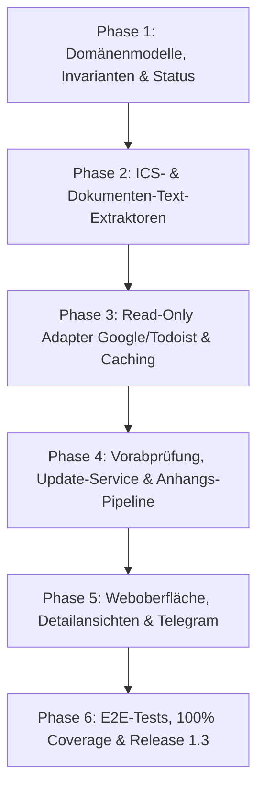

# Mailhelp 1.3 – Release-Planung: „Smart Engine & Attachments“

> Historischer Versionsstand: Dieses Dokument beschreibt die genannte Version oder
> deren damaligen Plan. Ursprüngliche Ziele und Prüfergebnisse sind kein Nachweis
> des heutigen Umfangs. Aktueller Betrieb: [README](../README.md),
> [Release 3.3](Release-3.3.md) und [Projektspezifikation](../Mailhelp-Projektspezifikation.md).

**Zielversion:** 1.3.0  
**Stand:** 11. Oktober 2026  
**Status:** Historischer Plan; Vorabgleich, Terminänderungen und Dokumentenextraktion sind seit 1.3 implementiert. Einzelne ursprüngliche Detailziele sind keine Zusage des aktuellen Funktionsumfangs.
**Detailkonzept:** [Konzept-1.3-Intelligenter-Workflow.md](Konzept-1.3-Intelligenter-Workflow.md)  
**Nachfolge-Release:** [Planung-1.4.md](Planung-1.4.md) (Multimodal & OCR) → [Planung-2.0.md](Planung-2.0.md) (Großes UI-Redesign & Web-Push)

---

## 1. Leitmotiv für Version 1.3

> **„Fokus auf das Wesentliche: Intelligenter Kalenderabgleich (Pre-Check & Reschedule) und ganzheitliche Anhangsauswertung (ICS, PDF, Word).“**

In Version 1.0 und 1.1 lag der Schwerpunkt auf dem korrekten Verarbeiten, Extrahieren und der sicheren, versionsgebundenen Ausführung von Aktionen über Telegram und Web. Mit Version 1.2 wurde die Weboberfläche zur vollwertigen Kontroll- und Analyseeinheit ausgebaut.

**Version 1.3 macht die Verarbeitungs-Engine vorausschauend und smart:**
1. **Keine überflüssigen Fragen mehr:** Bisher wurden alle extrahierten Termine und Aufgaben dem Nutzer zur Entscheidung vorgelegt, selbst wenn sie bereits im Kalender existierten oder bestehende Termine lediglich verschoben wurden.
2. **Keine blinden Flecken bei E-Mail-Anhängen:** Wichtige Aufgaben und Termine stehen häufig nicht im kurzen Anschreiben (*„Anbei das Protokoll...“*), sondern im Anhang (PDF, Word, ICS). Bisher wurden Anhänge ignoriert.

Version 1.3 bündelt **vier Kernpfeiler** für eine hochintelligente Backend- und Extraktions-Engine:
1. **Dubletten-Vorabprüfung:** Stille Bereinigung bereits existierender Termine und Aufgaben vor der Entscheidungsvorlage.
2. **Intelligente Terminaktualisierung & Absagen:** Erkennung von Terminverschiebungen und Stornierungen bestehender Kalendereinträge (`PATCH`) statt doppelter Neuanlagen.
3. **Deterministische ICS-Anhangsauswertung:** Token- und kostenfreie 100-%-Präzision bei Kalendereinladungen (`text/calendar`).
4. **Text-Extraktion aus Dokumenten-Anhängen (PDF, Word, Text):** Einbeziehung von Aufgaben und Fristen aus Protokollen, Verträgen und Tagesordnungen.

*(Hinweis: Das umfassende Web-Redesign nach modernen Design-Patterns sowie die nativen Web-Push-Benachrichtigungen für die PWA folgen unmittelbar in **Version 2.0**).*

---

## 2. Kernanforderungen und Funktionsumfang von Version 1.3

| Bereich | Bisheriges Verhalten (bis 1.2) | Neues Verhalten in 1.3 |
| :--- | :--- | :--- |
| **Pfeiler 1: Dubletten-Vorabprüfung** | Prüfung auf Duplikate erst nach Bestätigungsklick oder beim Schreibversuch (`duplicate_skipped`). | **Vollautomatischer Pre-Check:** Unmittelbar nach der Extraktion; bereits vorhandene Termine/Tasks werden stummgeschaltet, erscheinen nicht in `/offen` oder Telegram, sind aber im Web einsehbar mit Direktlink zum Zielsystem. |
| **Pfeiler 2: Terminaktualisierung & Absagen** | Terminverschiebungen (*„Meeting verschoben auf 14 Uhr“*) führten zu `classification == CHANGE`; konnten nur als Neuanlage-Fallback bestätigt werden (Gefahr von Doppelterminen). | **Gezielte Aktualisierung (`PATCH`):** Auffinden des bestehenden Events im Kalender; Vorlage eines präzisen Änderungsvorschlags (*„Jour-Fixe von 10:00 auf 14:00 Uhr verschieben?“*); keine Doppelung. |
| **Pfeiler 3: ICS-Anhangsauswertung** | `.ics`-Anhänge und `text/calendar`-MIME-Parts wurden ignoriert; LLM musste Datum/Uhrzeit unzuverlässig aus unvollständigem Mail-Text erraten. | **Deterministischer RFC-5545-Parser:** Liest Beginn, Ende, Zeitzone, Ort, Videolink, UID und Status direkt aus dem Anhang. Spart LLM-Tokens, schließt Halluzinationen aus und koppelt direkt an die Vorabprüfung an. |
| **Pfeiler 4: Text-Extraktion aus Dokumenten (PDF, Word, Text)** | E-Mails wie *„Anbei das Protokoll mit den Aufgaben“* führten zu keinen Ergebnissen, da Anhänge ignoriert wurden. | **Sichere Text-Extraktion:** Extrahiert Text aus PDF (`application/pdf`), Word (`.docx`) und Textdateien; speist diesen mit Längenbegrenzung in die Aufgaben- und Fristenextraktion ein. Belegstellen verweisen auf den Dateinamen. |

---

## 3. Architektur- und Spezifikationsbausteine

### 3.1 Pfeiler 1: Dubletten-Vorabprüfung
- **Neuer Status:** `ProposalStatus.ALREADY_EXISTS = "already_exists"`.
- **Datenmodell:** `DuplicateMatchInfo` mit Quelle (`action_ledger`, `google_calendar`, `todoist`), externer ID, Web-Link und Übereinstimmungsdetails.
- **Mehrstufiger Pre-Check:**
  - *Stufe 1:* Lokales `ActionLedger` (sofort, ohne Netzwerk).
  - *Stufe 2:* Google Calendar API (Events im Zeitfenster `[start - 24h, end + 24h]` via `calendar_matcher`).
  - *Stufe 3:* Todoist API (aktive Aufgaben im Projekt mit Frist- und Titelabgleich).
- **Entkopplung:** Ausschluss aus `TelegramOutbox` und Web `/offen`. Sichtbar in `/mails`, `/mail/<id>` und `/verlauf` mit Info-Badge.

### 3.2 Pfeiler 2: Terminaktualisierung & Absagen (Reschedule & Cancellation Sync)
- **Aktionstypen:** Erweiterung der Vorschlagslogik um gezielte Update-Aktionen:
  - `ProposalActionKind.UPDATE_EVENT`: Aktualisierung von Beginn, Ende, Ort oder Beschreibung eines identifizierten Google-Kalender-Events.
  - `ProposalActionKind.CANCEL_EVENT`: Absage / Kennzeichnung eines Termins als storniert.
- **Differenz-Analyse:** Deterministischer Abgleich von `start`, `end`, `location` gegen das bestehende Event; Darstellung der konkreten Änderungen im Bestätigungsdialog:
  *„Beginn: 10:00 Uhr → 14:00 Uhr | Ort: Raum A → Raum B“*.
- **Idempotenter Schreibadapter:** `HttpWriter` führt nach ausdrücklicher Bestätigung ein gezieltes `PATCH /calendars/{target}/events/{existing_id}` aus.

### 3.3 Pfeiler 3: Deterministische ICS-Anhangsauswertung (RFC 5545)
- **MIME-Erweiterung:** `mime.py` extrahiert MIME-Parts mit Content-Type `text/calendar` und Dateianhänge mit Endung `.ics`.
- **Integrierter Kalender-Parser (`calendar_parser.py`):**
  - Parst `VEVENT`-Elemente: `DTSTART`, `DTEND`, `SUMMARY`, `DESCRIPTION`, `LOCATION`, `UID`, `SEQUENCE`, `STATUS` (`CONFIRMED`, `CANCELLED`), `URL`, Konferenzlinks.
  - Sichere Zeitzonenbehandlung via Python `zoneinfo`.
  - Strikte Größenlimits (max. 1 MB pro ICS) gegen DoS.
- **Pipeline-Integration:**
  - Liegt ein valider Terminanhang vor, wird das `Proposal` direkt deterministisch befüllt (`certainty = CERTAIN`).
  - LLM-Extraktionsschritt für Termine wird übersprungen (Kostensenkung & Geschwindigkeitsgewinn).
  - Die `UID` dient als verlässlicher Abgleichschlüssel für die Vorabprüfung (Pfeiler 1) und Terminaktualisierung (Pfeiler 2).

### 3.4 Pfeiler 4: Text-Extraktion aus Dokumenten-Anhängen (PDF, Word, Text)
- **Modul `attachment_extractor.py`:**
  - Extrahiert Text aus Anhängen mit MIME-Typen `application/pdf`, `.docx` (via ZIP/XML ohne schwere Abhängigkeiten), `.txt`, `.md`, `.csv`.
- **Sicherheits- und Ressourcengrenzen:**
  - Konfigurierbares Dateigrößenlimit (Standard: max. 10 MB pro Anhang).
  - Maximales Textbudget für das LLM (z.B. max. 20.000 Zeichen pro Dokument), um Prompt-Token-Grenzen sicher einzuhalten.
  - Timeout-Schutz gegen Decompression-Bombs oder blockierende PDF-Strukturen.
  - Passwortgeschützte oder reine Bild-Scans (ohne Textlayer) werden tolerant übersprungen (`extraction_status: "no_text_found"`).
- **Prompt-Integration & Provenienz:**
  - Extrahierter Text wird im Prompt klar abgegrenzt übergeben:  
    `--- Anhang: Protokoll_Vorstand.pdf --- [Text] --- Ende Anhang ---`.
  - In `Proposal.evidence` wird der Dateiname des Quellanhangs ausgewiesen.

---

## 4. Umsetzungsphasen und Meilensteine

| Phase | Schwerpunkt | Liefergegenstand |
| :--- | :--- | :--- |
| **Phase 1** | **Domänenmodell & Status** | `ProposalStatus.ALREADY_EXISTS`, `DuplicateMatchInfo`, `ExtractedAttachmentText`, Update-/Cancel-Aktionsmodelle, Schema-Validierung, Migrationstests. |
| **Phase 2** | **Anhangs-Extraktion (ICS, PDF, Word)** | `calendar_parser.py` (RFC 5545), `attachment_extractor.py` (PDF via pypdf, DOCX via zipfile/xml), MIME-Erweiterung in `mime.py`, robuste Bounds- & Timeout-Tests. |
| **Phase 3** | **Read-Only Adapter & Caching** | Abfragen `fetch_events_in_window()` und `fetch_active_tasks()`, In-Memory-Laufzeitcache, Fehlerabfang mit Graceful Fallback. |
| **Phase 4** | **Pipeline-Integration Orchestrator** | `DuplicatePreCheckService`, `EventUpdateService`, Anhangstext-Einspeisung in `Analyzer` (Task-/Event-Prompts), Reschedule-Erkennung. |
| **Phase 5** | **Weboberfläche & Telegram** | Bereinigung von `/offen` und Telegram-Outbox; Badge `Bereits vorhanden` und Diff-Ansichten in `/mails` und `/mail/<id>`; Anzeige extrahierter Anhänge. |
| **Phase 6** | **Qualitätssicherung & Release** | E2E-Tests aller vier Pfeiler mit Mock-Transports, Regressionstests, 100 % Zeilen-/Branch-Coverage, Doku-Aktualisierung & Release 1.3.0. |

---

## 5. Abnahme- und Qualitätskriterien ([`AGENTS.md`](../AGENTS.md))

1. **100 % Zeilen- und Branch-Abdeckung:**
   - Verbindlich für alle neuen Module (`calendar_parser.py`, `attachment_extractor.py`, `precheck.py`, Adaptererweiterungen) und modifizierten Komponenten.
2. **Regressionstests:**
   - Reproduktion des Altverhaltens (überflüssige Bestätigungsaufforderung für vorhandene Termine) und Nachweis, dass der Pre-Check dies zuverlässig verhindert.
   - Testfall für Terminaktualisierung: Verifikation, dass bei geänderter Uhrzeit kein neuer Termin erzeugt wird, sondern ein gezielter `PATCH`-Aufruf erfolgt.
   - Testfall für Dokumenten-Anhänge: E-Mail mit reinem Anschreiben und Frist im PDF-Anhang führt zuverlässig zur Extraktion des Vorschlags mit Quellbeleg.
3. **Strikte Trennung von Lese- und Schreiboperationen:**
   - Die Vorabprüfung und Anhangsauswertung führen niemals eigenmächtige Schreibzugriffe aus.
   - Sowohl Neuanlagen als auch Terminaktualisierungen erfordern vor der externen Ausführung eine ausdrückliche, versionsbezogene Bestätigung.
4. **Fehlertoleranz:**
   - Beschädigte, verschlüsselte oder übergroße Anhänge führen niemals zum Absturz des Verarbeitungsdurchlaufs; das System verarbeitet den E-Mail-Text weiter und protokolliert den Status sicher.
5. **Datenschutz & Geheimnisschutz:**
   - Keine Protokollierung von Zugangsdaten oder sensiblen Anhangsinhalten in ungesicherten Logs.

