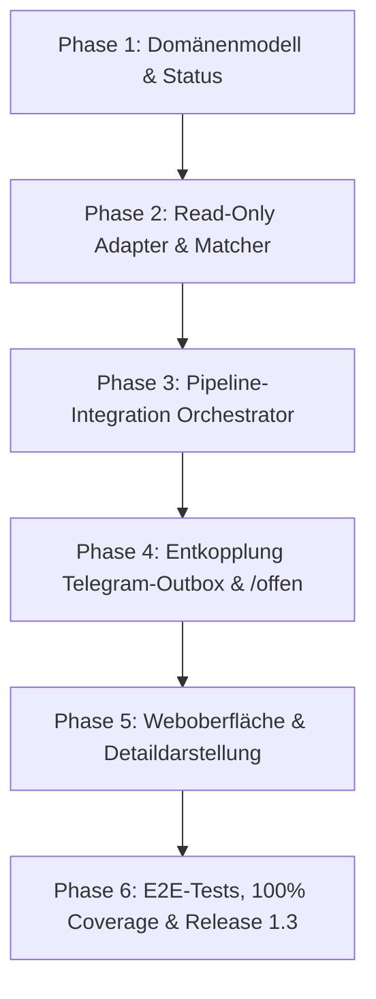

# Mailhelp 1.3 – Release-Planung und Roadmap

**Zielversion:** 1.3.0  
**Stand:** 11. Oktober 2026  
**Status:** In Planung (Folgt auf den Abschluss von Version 1.2)  
**Detailkonzept:** [Konzept-1.3-Dubletten-Vorabpruefung.md](Konzept-1.3-Dubletten-Vorabpruefung.md)

---

## 1. Leitmotiv für Version 1.3

> **„Fokus auf das Wesentliche: Vorabprüfung statt nachträglichem Abbruch.“**

In Version 1.0 und 1.1 lag der Schwerpunkt auf dem korrekten Verarbeiten, Extrahieren und der sicheren, versionsgebundenen Ausführung von Aktionen über Telegram und Web. Mit Version 1.2 wurde die Weboberfläche zur vollwertigen Kontroll- und Analyseeinheit ausgebaut.

**Version 1.3 adressiert die Effizienz des Nutzers:**
Bisher wurden alle extrahierten Termine und Aufgaben dem Nutzer zur Entscheidung vorgelegt, selbst wenn sie bereits im Google Kalender oder in Todoist existierten. Dies führte zu unnötigen Dialogen, Zeitverlust und Alert Fatigue. Version 1.3 verschiebt die Dublettenprüfung an den Anfang des Prozesses (vor die Benachrichtigung) und entlastet so den Entscheidungsalltag.

---

## 2. Kernanforderungen und Funktionsumfang

| Bereich | Bisheriges Verhalten (bis 1.2) | Neues Verhalten in 1.3 |
| :--- | :--- | :--- |
| **Ablaufprüfung** | Prüfung auf Duplikate erst nach Klick auf *„Bestätigen“* (Telegram/Web) oder beim Schreibversuch. | **Vollautomatische Vorabprüfung (Pre-Check):** Unmittelbar nach der Extraktion und vor jeder Benachrichtigung. |
| **Telegram-Dialog** | Jeder extrahierte Vorschlag erzeugt eine Fragekarte (*„Anlegen?“*), blockiert nachfolgende Fragen. | **Stille Abwicklung:** Bereits vorhandene Termine/Aufgaben erzeugen keine Fragekarten und blockieren das Fragen-Gate nicht. |
| **Web-Warteschlange (`/offen`)** | Vorhandene Einträge erscheinen als offene Vorschläge mit primären *„Anlegen“*-Buttons. | **Bereinigt:** `/offen` enthält ausschließlich Einträge, die tatsächlich neu sind und eine Entscheidung erfordern. |
| **Web-Mailübersicht (`/mails`, `/mail/<id>`)** | Bisher keine Unterscheidung zwischen Neu und Vorhanden vor der Bestätigung. | **Volle Transparenz:** Vorhandene Einträge werden mit Badge `[Bereits vorhanden]` und Direktlink zum bestehenden Kalender-/Todoist-Eintrag angezeigt. |
| **Web-Verlauf (`/verlauf`)** | Nur tatsächlich ausgeführte oder verworfene Aktionen. | **Erweiterte Historie:** Vorab abgeglichene Duplikate sind filterbar und lückenlos nachvollziehbar. |
| **Fehlertoleranz** | Fehler beim Kalenderabgleich während des Schreibens führten zu `failed` oder `uncertain`. | **Graceful Fallback:** Scheitert die Vorab-Leseabfrage (z.B. API-Timeout), wird der Vorschlag nicht verworfen, sondern sicher als `pending_confirmation` zur manuellen Prüfung vorgelegt. |

---

## 3. Architektur- und Spezifikationsbausteine

1. **Neuer Status `ProposalStatus.ALREADY_EXISTS`:**
   - Eindeutige Kennzeichnung von vorab identifizierten Duplikaten im Datenmodell (`src/mailhelp/domain/proposal.py`).
   - Speicherung strukturierter Treffermetadaten (`DuplicateMatchInfo`: Quelle, externe ID, Web-Link, Zeitstempel).
2. **`DuplicatePreCheckService`:**
   - Integriert in den `Orchestrator` direkt nach der Normalisierung.
   - Mehrstufiger Abgleich:
     - Stufe 1: Lokales `ActionLedger` (sofort, ohne Netzwerk).
     - Stufe 2: Google Calendar API (Events im Zeitfenster `[start - 24h, end + 24h]` via `calendar_matcher`).
     - Stufe 3: Todoist API (aktive Aufgaben im Zielprojekt via normalisiertem Titel- und Fristenvergleich).
3. **Laufzeit-Caching für externe Leseabfragen:**
   - Verhindert API-Quota-Erschöpfung bei Batch-Verarbeitung vieler E-Mails.
4. **Benutzeroberflächen-Entkopplung:**
   - `TelegramOutbox` ignoriert `ALREADY_EXISTS`.
   - `ReviewViews.overview()` filtert `ALREADY_EXISTS` aus der Liste offener Entscheidungen heraus.
   - Maildetail- und Übersichtskomponenten rendern Info-Karten ohne primäre Schreibaktionen.

---

## 4. Umsetzungsphasen und Meilensteine

Detaillierte Beschreibungen der Phasen 1 bis 6 finden sich im [Detailkonzept](Konzept-1.3-Dubletten-Vorabpruefung.md#8-phasenweiser-umsetzungsplan-für-version-13).

---

## 5. Abnahme- und Qualitätskriterien

Gemäß den verbindlichen Entwicklungsregeln:
- **100 % Zeilen- und Branch-Abdeckung:** Keine Regression in bestehenden Modulen, vollständige Abdeckung aller neuen Codepfade.
- **Regressionstests:** Ein spezifischer Testfall stellt sicher, dass ein bereits existierender Termin dem Nutzer niemals als Bestätigungsanfrage in Telegram oder `/offen` vorgelegt wird.
- **Synthetische Daten:** Vollständige Entkopplung von echten externen Diensten während der Testsuite über Mock-Transports.
- **Aktualisierung der Dokumentation:** Nach Abschluss der Arbeiten werden `CHANGELOG.md`, `Mailhelp-Projektspezifikation.md` und die Betriebsanleitung aktualisiert.

