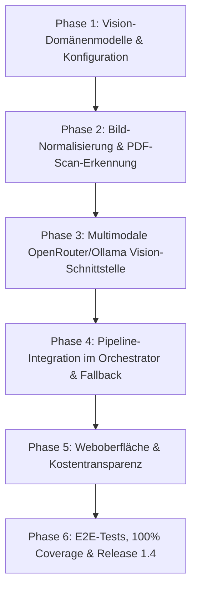

# Mailhelp 1.4 – Release-Planung und Roadmap: „Multimodal & OCR“

**Zielversion:** 1.4.0  
**Stand:** 11. Oktober 2026  
**Status:** In Planung (Folgt auf Version 1.3 und bereitet Version 2.0 vor)  
**Detailkonzept:** [Konzept-1.4-Multimodal-und-OCR.md](Konzept-1.4-Multimodal-und-OCR.md)  
**Vorausgehende Version:** [Planung-1.3.md](Planung-1.3.md) (Smart Engine & digitale Anhänge)  
**Nachfolge-Version:** [Planung-2.0.md](Planung-2.0.md) (Großes UI-Redesign & Web-Push)

---

## 1. Leitmotiv für Version 1.4

> **„Fokus auf das Wesentliche: Echte Texterkennung (OCR) für Bildanhänge und Scans ohne lokale Zusatz-Tools – schlank, multimodale Cloud-Vision und null Systemabhängigkeiten.“**

In Version 1.3 wurde die digitale Anhangsauswertung eingeführt: PDFs mit Textlayer, Word-Dokumente und ICS-Dateien werden rasant und deterministisch verarbeitet. 

**Version 1.4 schließt die Lücke für die verbleibenden Ausnahmefälle:**
Viele Nutzer erhalten Rechnungen, Handwerkerzettel, Einladungsflyer oder Dokumente als:
1. **Reine Bilddateien:** `.jpg`, `.jpeg`, `.png`, `.webp`, `.heic` (z.B. Foto eines Briefes oder Aushangs).
2. **Gescannte Bild-PDFs:** PDFs ohne eingebetteten Textlayer (z.B. vom Scanner als Grafik abgespeicherte mehrseitige Dokumente).

### Warum Vision-Cloud-Modelle über OpenRouter statt lokaler OCR?
Eine Analyse lokaler Python-OCR-Lösungen zeigt:
- Klassische OCR (Tesseract / `pytesseract`) erfordert eine externe Systeminstallation (`tesseract.exe` unter Windows 11 bzw. `tesseract-ocr` im Linux-Container). Dies bricht den Grundsatz von einfachen, leichtgewichtigen Installationen.
- Reine Python-Frameworks (EasyOCR, PaddleOCR) ziehen riesige Machine-Learning-Pakete (PyTorch) mit sich (2–3 GB Download, C-Runtimes), was Docker-Images und Installationen extrem aufbläht.
- **Die Lösung in 1.4:** Mailhelp nutzt die ohnehin vorhandene, gehärtete **OpenRouter-Infrastruktur** mit multimodalen Vision-Modellen (z.B. `google/gemini-2.0-flash`, `anthropic/claude-3-haiku` oder `openai/gpt-4o-mini`).
  - **Zero-Local-Dependencies:** Keinerlei externe Tool-Installationen, keine riesigen ML-Pakete, reine Standard-Python-MIME-Verarbeitung.
  - **Überlegene Erkennung:** Multimodale Modelle erkennen schiefe Scans, Handschrift, Tabellen und Quittungen unvergleichlich besser als klassische OCR.
  - **Kosteneffizient:** Da 90 % aller Mails durch die digitale Extraktion aus Version 1.3 abgedeckt sind, greift die Vision-Erkennung nur als Fallback bei echten Bildern/Scans (wenige Zehntelcent pro Vorgang).
  - **Zukunftssicher:** Auch lokal nutzbar, falls der Nutzer ein lokales Ollama-Vision-Modell (`llama3.2-vision` / `qwen2.5-vl`) konfiguriert hat.

---

## 2. Kernanforderungen und Funktionsumfang von Version 1.4

| Bereich | Stand nach Version 1.3 | Neues Verhalten in 1.4 |
| :--- | :--- | :--- |
| **Bildanhänge (`.png`, `.jpg`, `.webp`)** | Werden ignoriert; keine Text- oder Terminextraktion möglich. | **Multimodale Bild-Analyse:** Bilder werden über Vision-LLM analysiert; Termine, Fristen und Aufgaben werden zuverlässig extrahiert. |
| **Gescannte PDFs (ohne Textlayer)** | Werden mit `no_text_found` übersprungen; keine Aufgaben extrahierbar. | **Automatischer OCR-Fallback:** Erkennt `attachment_extractor`, dass ein PDF keinen Textlayer enthält, wird die Seite als Bild gerendert und per Vision-Modell ausgelesen. |
| **Lokale Systemabhängigkeiten** | Nur Standard-Python-Pakete (`pypdf`, `httpx`). | **Keine extra Tools nötig:** Kein Tesseract, kein PyTorch. Reine API-Kommunikation über den bestehenden `OpenRouterClient`. |
| **Kosten- & Tokenkontrolle** | Bildanalyse nicht vorhanden. | **Budget-Deckelung:** Konfigurierbares Limit für Bildanalysen (max. 3 Seiten/Bilder pro Mail, max. Bildauflösung skaliert); Opt-Out-Möglichkeit in `config.yaml`. |
| **Web-Transparenz** | Detailansicht `/mail/<id>` zeigt Anhangsgröße. | **OCR-Statusanzeige:** Kennzeichnung im Web: `[OCR / Vision: Flyer.jpg analysiert (1 Termin erkannt)]`. |

---

## 3. Architektur- und Spezifikationsbausteine

### 3.1 Erkennungs- und Fallback-Kaskade
1. **Stufe 1 (Digitaler Schnellpfad aus 1.3):**
   - PDF mit Textlayer $\rightarrow$ `pypdf` extrahiert Text in 10 ms (0 Cent Kosten).
   - Word `.docx` $\rightarrow$ XML-Extraktion in 2 ms (0 Cent Kosten).
2. **Stufe 2 (Vision-OCR-Trigger):**
   - Bildanhang (`image/jpeg`, `image/png`, `image/webp`) vorhanden? $\rightarrow$ Trigger Vision-OCR.
   - PDF hat nach Stufe 1 `total_characters < 50` trotz Dateigröße > 50 KB (Scan erkannt)? $\rightarrow$ Trigger PDF-Seiten-Rendering zu Bild & Vision-OCR.

### 3.2 Vision-Payload & API-Integration
- **Modul `vision.py`:**
  - Bereitet Bilder auf: Skalierung auf optimale Erkennungsauflösung (max. 1600px längste Kante, spart Tokens), Base64-Kodierung.
  - Dedizierter Vision-Prompt in `prompts.yaml`:  
    *„Lies den sichtbaren Text dieses Dokuments vollständig und strukturiert aus. Achte besonders auf Datumsangaben, Uhrzeiten, Fristen, Aufgaben und Kontaktdaten.“*
- **Sicherheitsgrenzen:**
  - `limits.max_vision_images_per_mail: 3` (verhindert Kostenexplosion bei Urlaubs-Fotoalben im Anhang).
  - `limits.vision_enabled: true` (vollständig deaktivierbar in `config.yaml`).

---

## 4. Umsetzungsphasen für Version 1.4

| Phase | Schwerpunkt | Liefergegenstand |
| :--- | :--- | :--- |
| **Phase 1** | **Konfiguration & Modelle** | Ergänzung `config.yaml` (`vision`-Sektion, Limits), `VisionExtractionResult`-Modell, Budget-Validierung. |
| **Phase 2** | **Bildvorbereitung & Scan-Erkennung** | Bildskalierung (Pillow/reine Byte-Normalisierung), Erkennung textloser PDFs in `attachment_extractor.py`. |
| **Phase 3** | **Vision-Client** | Erweiterung von `OpenRouterClient` und `OllamaClient` um multimodale Bild-Payloads (Base64 data URLs), dedizierte Prompts in `prompts.yaml`. |
| **Phase 4** | **Pipeline-Integration** | Anbindung im `Orchestrator`: Bildtexte fließen nahtlos in dieselbe Normalisierungs- und Vorabprüfungs-Kette ein wie Mail- und PDF-Texte. |
| **Phase 5** | **Web-Transparenz** | Anzeige in `/mail/<id>` mit Kennzeichnung `[Vision-OCR]`, Ausweisung der Vision-Kosten in `/auswertung`. |
| **Phase 6** | **Qualitätssicherung & 1.4-Release** | Synthetische Bildtests (Kassenzettel, Flyer, Scan-PDF), Mock-Vision-Transports, 100 % Zeilen-/Branch-Coverage, Release **1.4.0**. |

---

## 5. Abnahme- und Qualitätskriterien ([`AGENTS.md`](../AGENTS.md))

1. **Zero External Binaries:**
   - Die Lösung darf weder Tesseract noch C-spezifische OCR-Binaries oder PyTorch verlangen. Reine Python-Abhängigkeiten und API-Kommunikation.
2. **100 % Zeilen- und Branch-Abdeckung:**
   - Vollständige Testsuite für alle Vision-Routen mit simulierten multimodalen Antworten via `httpx.MockTransport`.
3. **Kostenschutz:**
   - Mails mit vielen Bildern (z.B. Urlaubsfotos, Tracking-Pixel, Social-Media-Icons) dürfen niemals unkontrolliert an die Vision-API gesendet werden. Filterung nach Mindestgröße und Seitenlimit.

