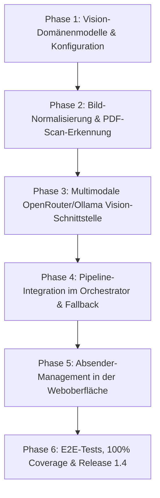

# Mailhelp 1.4 – Release-Planung und Roadmap: „Multimodal, OCR & Absender-Filterung“

**Zielversion:** 1.4.0  
**Stand:** 11. Oktober 2026  
**Status:** Vollständig umgesetzt (100 % Coverage, Phasen 1–6 abgeschlossen)  
**Detailkonzept:** [Konzept-1.4-Multimodal-und-OCR.md](Konzept-1.4-Multimodal-und-OCR.md)  
**Vorausgehende Version:** [Planung-1.3.md](Planung-1.3.md) (Smart Engine & digitale Anhänge)  
**Nachfolge-Version:** [Planung-1.5.md](Planung-1.5.md) (UX-Feinschliff & Kostenübersicht)  
**Refactoring vor 2.0:** [Planung-1.6.md](Planung-1.6.md) (Stabilisieren & Entflechten) 
**Große Roadmap:** [Planung-2.0.md](Planung-2.0.md) (Großes UI-Redesign & Web-Push)

---

## 1. Leitmotiv für Version 1.4

> **„Fokus auf das Wesentliche: Echte Texterkennung (OCR) für Bildanhänge und Scans ohne lokale Zusatz-Tools – schlank, multimodale Cloud-Vision und direktes Absender-Management in der Web-Detailansicht.“**

In Version 1.3 wurde die digitale Anhangsauswertung eingeführt: PDFs mit Textlayer, Word-Dokumente und ICS-Dateien werden rasant und deterministisch verarbeitet. 

**Version 1.4 schließt zwei verbleibende Lücken im Arbeitsalltag:**
1. **Bilddokumente und Scans:** Rechnungen, Handwerkerzettel, Einladungsflyer oder gescannte Dokumente liegen oft als reine Bilddateien (`.jpg`, `.png`, `.webp`) oder als rastergrafische Bild-PDFs ohne Textlayer vor. Version 1.4 macht diese durch **multimodale Cloud-Vision über OpenRouter** lesbar – mit null lokalen Systemtools oder schweren Frameworks (kein Tesseract, kein PyTorch).
2. **Unerwünschte Absender mit einem Klick stoppen:** Erhält der Nutzer wiederholt irrelevante E-Mails oder Newsletter, kann er die Absenderadresse nun **direkt in der Mail-Detailansicht der Weboberfläche** mit einem Klick in die Liste ignorierter Absender aufnehmen. Künftige E-Mails dieser Adresse werden sofort ohne LLM-Kosten und ohne Benachrichtigung als irrelevant aussortiert.

---

## 2. Kernanforderungen und Funktionsumfang von Version 1.4

| Bereich | Stand nach Version 1.3 | Neues Verhalten in 1.4 |
| :--- | :--- | :--- |
| **Bildanhänge (`.png`, `.jpg`, `.webp`)** | Werden ignoriert; keine Text- oder Terminextraktion möglich. | **Multimodale Bild-Analyse:** Bilder werden über Vision-LLM analysiert; Termine, Fristen und Aufgaben werden zuverlässig extrahiert. |
| **Gescannte PDFs (ohne Textlayer)** | Werden mit `no_text_found` übersprungen; keine Aufgaben extrahierbar. | **Automatischer OCR-Fallback:** Erkennt `attachment_extractor`, dass ein PDF keinen Textlayer enthält, wird die Seite gerendert und per Vision-Modell ausgelesen. |
| **Lokale Systemabhängigkeiten** | Nur Standard-Python-Pakete (`pypdf`, `httpx`). | **Keine extra Tools nötig:** Kein Tesseract, kein PyTorch. Reine API-Kommunikation über den bestehenden `OpenRouterClient`. |
| **Kosten- & Tokenkontrolle** | Bildanalyse nicht vorhanden. | **Budget-Deckelung:** Konfigurierbares Limit für Bildanalysen (max. 3 Seiten/Bilder pro Mail, Skalierung auf 1600px); Opt-Out in `config.yaml`. |
| **Absender-Management in Web-UI** | Ignorierte Absender mussten manuell in Konfigurations-/JSON-Dateien editiert werden. | **Ein-Klick-Ignorieren in `/mail/<id>`:** Button `[🚫 Absender ignorieren]` fügt die normalisierte Adresse direkt zu `irrelevant-senders` hinzu. |
| **Reversibilität der Absenderfilterung** | Nur über manuelle JSON-Änderungen. | **Verwaltung & Wiederzulassung:** Bereits ignorierte Absender zeigen Badge `[Ignoriert]` mit Button `[Wieder zulassen]`; zentrale Liste unter `/einstellungen/ignorierte-absender`. |

---

## 3. Architektur- und Spezifikationsbausteine

### 3.1 Erkennungs- und Fallback-Kaskade für Dokumente
1. **Stufe 1 (Digitaler Schnellpfad aus 1.3):**
   - PDF mit Textlayer $\rightarrow$ `pypdf` extrahiert Text in 10 ms (0 Cent Kosten).
   - Word `.docx` $\rightarrow$ XML-Extraktion in 2 ms (0 Cent Kosten).
2. **Stufe 2 (Vision-OCR-Trigger):**
   - Bildanhang (`image/jpeg`, `image/png`, `image/webp`) vorhanden? $\rightarrow$ Trigger Vision-OCR.
   - PDF hat nach Stufe 1 `total_characters < 50` trotz Dateigröße > 50 KB (Scan erkannt)? $\rightarrow$ Trigger PDF-Seiten-Rendering zu Bild & Vision-OCR.

### 3.2 Vision-Payload & API-Integration
- **Modul `vision.py`:**
  - Bereitet Bilder auf: Skalierung auf optimale Erkennungsauflösung (max. 1600px längste Kante, spart Tokens), Base64-Kodierung.
  - Filter gegen Icons/Tracking-Pixel (unter 150×150 Pixel oder unter 10 KB).
  - Dedizierter Vision-Prompt in `prompts.yaml`.
- **Sicherheitsgrenzen:**
  - `limits.max_vision_images_per_mail: 3` (Schutz vor Token-Explosion).
  - `limits.vision_enabled: true` (vollständig deaktivierbar in `config.yaml`).

### 3.3 Absender-Ignorier-Funktion in der Mail-Detailansicht
- **Ablauf in der Weboberfläche (`/mail/<mail_id>`):**
  - Neben dem Absender-Header erscheint ein Formular-Button:  
    `[🚫 Absender ignorieren]`.
  - Bei Klick wird ein gesicherter Request an `POST /mail/<mail_id>/absender-ignorieren` gesendet (inkl. CSRF-Token und Sitzungsprüfung).
  - Mailhelp extrahiert über `sender_filter.sender_addresses()` die normalisierte E-Mail-Adresse und trägt sie atomar in den persistenten Speicher `irrelevant-senders` ein (`add_irrelevant_senders()`).
  - **Sofortige Wirkung:** Künftige E-Mails dieser Adresse werden im `Orchestrator` vor jedem LLM-Aufruf durch `is_irrelevant_sender()` abgefangen und direkt als `decision: "irrelevant"` verbucht.
- **Reversibilität & Verwaltung:**
  - Ist der Absender der aktuellen Mail bereits auf der Ignorier-Liste, zeigt die Detailansicht:  
    `[Absender wird ignoriert]` mit Aktionsbutton `[Wieder zulassen]`.
  - Unter `/einstellungen/ignorierte-absender` wird die vollständige Liste der blockierten Adressen mit Löschoption angezeigt.

---

## 4. Umsetzungsphasen für Version 1.4

| Phase | Schwerpunkt | Liefergegenstand |
| :--- | :--- | :--- |
| **Phase 1** | **Konfiguration & Modelle** | Ergänzung `config.yaml` (`vision`-Sektion, Limits), `VisionExtractionResult`-Modell, Budget-Validierung. |
| **Phase 2** | **Bildvorbereitung & Scan-Erkennung** | Bildskalierung (Pillow/reine Byte-Normalisierung), Erkennung textloser PDFs in `attachment_extractor.py`. |
| **Phase 3** | **Vision-Client** | Erweiterung von `OpenRouterClient` und `OllamaClient` um multimodale Bild-Payloads (Base64 data URLs), dedizierte Prompts in `prompts.yaml`. |
| **Phase 4** | **Pipeline-Integration** | Anbindung im `Orchestrator`: Bildtexte fließen nahtlos in dieselbe Normalisierungs- und Vorabprüfungs-Kette ein wie Mail- und PDF-Texte. |
| **Phase 5** | **Absender-Management in Web-UI** | Routen `POST /mail/<id>/absender-ignorieren` und `absender-zulassen`, Button & Badges in der Detailansicht, Verwaltungsliste in `/einstellungen/ignorierte-absender`. |
| **Phase 6** | **Qualitätssicherung & 1.4-Release** | Synthetische Bildtests, Mock-Vision-Transports, Tests für Absender-Blockieren/Zulassen, 100 % Zeilen-/Branch-Coverage, Release **1.4.0**. |

---

## 5. Abnahme- und Qualitätskriterien ([`AGENTS.md`](../AGENTS.md))

1. **Zero External Binaries:**
   - Die Lösung darf weder Tesseract noch C-spezifische OCR-Binaries oder PyTorch verlangen. Reine Python-Abhängigkeiten und API-Kommunikation.
2. **CSRF-Schutz & Atomare Speicherung für Absender-Aktionen:**
   - Das Hinzufügen oder Entfernen ignorierter Absender erfordert eine gültige Sitzung, CSRF-Schutz und atomares Speichern in `irrelevant-senders`.
3. **100 % Zeilen- und Branch-Abdeckung:**
   - Vollständige Testsuite für alle Vision-Routen und Web-Absenderfilter-Aktionen mit simulierten multimodalen Antworten via `httpx.MockTransport`.
4. **Kostenschutz:**
   - Mails mit vielen Bildern (z.B. Urlaubsfotos, Tracking-Pixel, Social-Media-Icons) dürfen niemals unkontrolliert an die Vision-API gesendet werden. Filterung nach Mindestgröße und Seitenlimit.
