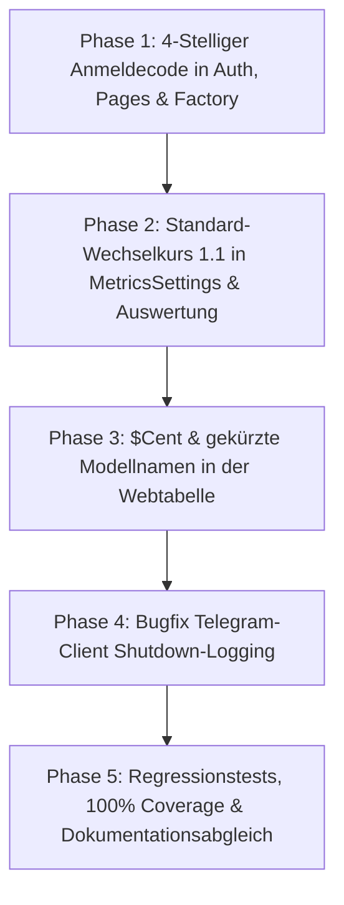

# Mailhelp 1.5 – Release-Planung: „UX-Feinschliff, Kostenübersicht & sauberes Shutdown-Logging“

**Zielversion:** 1.5.0  
**Stand:** 11. Oktober 2026  
**Status:** In Planung (Folgt auf Version 1.4 und geht dem Refactoring 1.6 voraus)  
**Vorausgehende Version:** [Planung-1.4.md](Planung-1.4.md) (Multimodal, OCR & Absender-Filterung)  
**Nachfolge-Version:** [Planung-1.6.md](Planung-1.6.md) (Stabilisieren & Entflechten)  
**Große Roadmap:** [Planung-2.0.md](Planung-2.0.md) (Split-View, Smart Reply Drafts & Web-Push)

---

## 1. Leitmotiv für Version 1.5

> **„Einfachere Anmeldung, sofort verständliche Kosten und saubere Protokolle: 4-stellige Verifizierung ohne Overkill, standardmäßige Euro-Umrechnung, übersichtliche Modell- und Cent-Angaben sowie störungsfreies Shutdown-Logging.“**

Version 1.5 widmet sich fünf gezielten Usability-, Darstellungs- und Stabilitätsverbesserungen im Alltagseinsatz:
1. **Schlanke Anmeldeverifizierung:** Reduzierung des Kopplungscodes von 8 auf 4 Ziffern. Schneller einzugeben am Smartphone, vollkommen ausreichend geschützt durch das bewährte 3-Versuche- und Rate-Limiting.
2. **Hinterlegter Standard-Wechselkurs:** Ein fester Standard-Umrechnungskurs von 1 € = 1,10 $ (`usd_per_eur = 1.1`) sorgt dafür, dass die Euro-Kosten von Beginn an ohne manuelle Konfiguration berechnet und angezeigt werden.
3. **Kosten in $Cent in der Tabellenansicht:** Aufrufkosten von KI-Modellen liegen oft im Bereich von Sekundenbruchteilen und Bruchteilen eines Dollars ($0.0003 bis $0.015). Die Tabellenansicht stellt Beträge direkt in US-Cent dar.
4. **Kompakte Modellnamen:** In der Auswertungstabelle wird der Modellname auf den eigentlichen Modellbezeichner nach dem letzten Schrägstrich (`/`) gekürzt (z. B. `claude-3.5-sonnet` statt `anthropic/claude-3.5-sonnet`), während der vollständige Pfad für Tooltips erhalten bleibt.
5. **Sauberes Shutdown-Logging im Telegram-Client (Bugfix):** Geordnetes Beenden der Anwendung während eines Telegram-Long-Polling-Backoffs (`RetryInterrupted`) wird nicht mehr irreführend als `ERROR poll_failed` mit 50 Zeilen Stacktrace protokolliert, sondern als reguläres Shutdown-Ereignis verarbeitet.

---

## 2. Kernpunkte im Detail

| Punkt | Vorheriger Stand (bis Version 1.4) | Neues Verhalten in Version 1.5 |
| :--- | :--- | :--- |
| **1. Auth-Code Länge** | 8-stelliger Zifferncode (`10 ** 8`), Nachricht `Code 1234 5678`. | **4-stelliger Zifferncode** (`10 ** 4`), Nachricht `Code 1234`. Schnell am Smartphone zu tippen. |
| **2. Auth-Code Formular & Link** | HTML-Input mit `pattern="[0-9 ]{8,9}"`, `maxlength="9"`, URL-Prüfung `len(code) == 8`. | HTML-Input mit `pattern="[0-9]{4}"`, `maxlength="4"`, URL-Prüfung `len(code) == 4`. |
| **3. Wechselkurs (Auswertung)** | `usd_per_eur: None`, Anzeige: `kein Wechselkurs hinterlegt`. | **Default: 1 € = 1,1 $** (`usd_per_eur: 1.1`). Automatische Euro-Berechnung ab Werk. |
| **4. Wechselkurs-Validierung** | Pflicht zur gemeinsamen Angabe von Kurs und Datum (`exchange_rate_pair`). | Datum optional; Default-Kurs greift sofort ohne Datumszwang. |
| **5. Kosten in Tabelle** | Spalte `<th>USD</th>`, Beträge als `$0.0015`. | **Spalte `<th>$Cent</th>`**, Beträge in US-Cent (`0,15` Cent) für intuitive Lesbarkeit. |
| **6. Modellname in Tabelle** | Voller Pfad `anthropic/claude-3.5-sonnet`. | **Kompakt nach dem letzten Slash** (`claude-3.5-sonnet`), voller Pfad im `title`-Tooltip. |
| **7. Shutdown bei Telegram-Polling** | `RetryInterrupted` während Backoff wurde als `ERROR telegram poll_failed` mit 50-Zeilen-Stacktrace geloggt. | **Sauberes Shutdown-Handling:** `RetryInterrupted` wird als regulärer Abbruch erkannt (`INFO telegram poll_interrupted`), kein falscher Alarm im Error-Log. |

---

## 3. Technische Spezifikation und Detailanalysen

### 3.1 Anmeldeverifizierung (4 Ziffern)

#### Sicherheitsanalyse & Brute-Force-Schutz
- Ein 4-stelliger numerischer Code bietet $10^4 = 10.000$ Kombinationen (`0000` bis `9999`).
- Mailhelp implementiert bereits ein mehrschichtiges Schutzkonzept in `src/mailhelp/web/auth.py`:
  - `CODE_ATTEMPTS = 3`: Nach genau 3 Fehlversuchen wird der Code sofort invalidiert und aus dem Zustand gelöscht.
  - `FAILURE_LIMIT = 5`: Nach 5 Fehlversuchen innerhalb des Zeitfensters wird die IP/der Browser-Nonce mit HTTP 429 (`PairingLimited`) temporär gesperrt.
  - `CODE_REQUESTS = 3`: Maximal 3 Code-Anforderungen in 10 Minuten.
  - `CODE_LIFETIME = 600`: Gültigkeit von maximal 10 Minuten.
- **Risikobewertung:** Die Erfolgswahrscheinlichkeit eines Angreifers, den Code innerhalb der 3 erlaubten Versuche blind zu erraten, liegt bei:
  $$\frac{3}{10.000} = 0,03\ \%$$
  Da Mailhelp ausschließlich privat/lokal oder über geschützte Tailscale-/LAN-Verbindungen betrieben wird und der Code direkt in den autorisierten Telegram-Chat des Betreibers zugestellt wird, ist ein 8-stelliger Code unnötig mühsam. Der 4-stellige Code bietet ideale Ergonomie bei voller Sicherheit.

#### Code-Änderungen:
- **`src/mailhelp/web/auth.py`:**
  - `request_code()`: Code-Generierung `f"{secrets.randbelow(10 ** 4):04d}"`.
  - Benachrichtigungstext: `🔐 Mailhelp-Webanmeldung für „{device}“: Code {code}\n...` (ohne Teilung in zwei 4er-Blöcke).
  - `issue_code()`: Code-Generierung `f"{secrets.randbelow(10 ** 4):04d}"`.
- **`src/mailhelp/web/factory.py`:**
  - `/web`-Befehl im Telegram-Bot: `Code: {code} – 10 Minuten gültig, für ein Gerät.`
- **`src/mailhelp/web/pages.py`:**
  - In `login_page()`: Input-Feld `<input id="code" ... pattern="[0-9]{4}" maxlength="4" ...>` (bzw. tolerant `[0-9 ]{4,5}` mit `maxlength="5"`).
- **`src/mailhelp/web/site.py`:**
  - In `_link_code()`: Validierung von `len(value) == 4` (bzw. `len(value) in {4, 8}` für Abwärtskompatibilität).

---

### 3.2 Fester Wechselkurs in Auswertung (1 € = 1,1 $)

#### Spezifikation:
- Standardmäßig ist nun `usd_per_eur = 1.1` in `MetricsSettings` hinterlegt ($1\ \text{EUR} = 1,10\ \text{USD}$).
- Das Bezugsdatum `exchange_rate_date` ist optional (`date | None = None`).
- **Anpassung in `src/mailhelp/metrics.py`:**
  ```python
  class MetricsSettings(BaseModel):
      model_config = ConfigDict(extra="forbid")
      enabled: bool = True
      retention_days: int = Field(default=90, ge=1, le=3650)
      ollama_power_watts: float = Field(default=300, ge=0, le=100000, allow_inf_nan=False)
      electricity_eur_per_kwh: float = Field(default=0.30, ge=0, le=100, allow_inf_nan=False)
      usd_per_eur: float | None = Field(default=1.1, gt=0, allow_inf_nan=False)
      exchange_rate_date: date | None = None

      @model_validator(mode="after")
      def exchange_rate_pair(self):
          if self.exchange_rate_date is not None and self.usd_per_eur is None:
              raise ValueError("Ein Bezugsdatum erfordert einen konfigurierten Wechselkurs")
          return self
  ```
- **Darstellung auf `/auswertung` (`src/mailhelp/web/archive_site.py`):**
  - Wenn `exchange_rate_date` gesetzt ist: `X,XXXX EUR (Wechselkurs vom YYYY-MM-DD)`.
  - Wenn `exchange_rate_date` None ist (Standardkurs): `X,XXXX EUR` (oder mit dezentem Hinweis `(Kurs: 1 € = 1,10 $)`).
  - Wenn `usd_per_eur` explizit durch `None` deaktiviert wurde: `kein Wechselkurs hinterlegt`.
- **Konfigurationsdatei `config.example.yaml`:**
  - `metrics.usd_per_eur: 1.1` als dokumentierter Standard.

---

### 3.3 Kosten in der Tabellenansicht in $Cent

#### Spezifikation:
- In der Tabelle **„Nach Modell und Schritt“** auf `/auswertung`:
  - Der Tabellenkopf wird von `<th>USD</th>` zu `<th>$Cent</th>` geändert.
  - Der Zahlenwert wird in Cent umgerechnet: `Decimal(group["usd"]) * 100`.
  - Formatierung mit deutscher Dezimalkomma-Darstellung über `_number(Decimal(group["usd"]) * 100, 2)`.
  - **Präzision:** 2 Nachkommastellen bei Cent entsprechen exakt 4 Nachkommastellen bei USD ($0.0001\ \text{USD} = 0,01\ \text{Cent}$).
  - Für vollständige Transparenz wird der exakte USD-Betrag im HTML-Attribut `title` hinterlegt:
    `<td title="{_number(group['usd'], 4)} USD">{_number(Decimal(group['usd']) * 100, 2)}</td>`.

---

### 3.4 Gekürzter Modellname in der Tabellenansicht

#### Spezifikation:
- In der Tabelle **„Nach Modell und Schritt“** auf `/auswertung`:
  - Modellnamen mit Namespace/Provider-Präfixen wie z. B. `anthropic/claude-3.5-sonnet`, `meta-llama/llama-3.1-8b-instruct` oder `openrouter/auto` werden gekürzt auf den Teil nach dem letzten `/`:
    `display_name = group["model"].rsplit("/", 1)[-1]`
  - Modelle ohne `/` (z. B. lokale Ollama-Modelle `llama3.2:latest`, `mistral`) bleiben unverändert.
  - Der vollständige Original-Modellname wird als `title`-Attribut hinterlegt:
    `<td title="{e(group['model'])}">{e(group['model'].rsplit('/', 1)[-1])}</td>`.
  - **Vorteil:** Die Tabelle bleibt auch auf mobilen Bildschirmen kompakt und übersichtlich, ohne dass Information verloren geht (Hover zeigt den vollen Pfad).

---

### 3.5 Sauberes Shutdown-Handling im Telegram-Client (`RetryInterrupted`)

#### Problemstellung & Fehleranalyse:
- Telegram-Long-Polling (`/getUpdates`) bricht bei ungenutzter TCP-Verbindung nach ca. 24–30 Sekunden serverseitig mit `RemoteProtocolError: Server disconnected without sending a response` ab. Dies ist bei HTTP-Long-Polling ein normales, wiederholbares Netzwerkereignis.
- Die `RetryPolicy` in `src/mailhelp/adapter.py` fängt diesen Fehler und wartet den Backoff-Delay via `stop_event.wait(delay)` ab.
- Wurde zeitgleich die Anwendung beendet (SIGINT, Docker-Stop, Web-UI „Beenden“), ist `stop_event` gesetzt. `wait()` bricht sofort ab und wirft `RetryInterrupted("Shutdown waehrend Adapter-Backoff")`.
- In `src/mailhelp/telegram/client.py` fing `poll()` bisher pauschal `except Exception as exc:` und protokollierte unweigerlich `ERROR telegram poll_failed` mit vollständigem Stacktrace.
- Dies führte zu verwirrenden False-Positive-Fehlermeldungen im Log, obwohl sich der Hintergrund-Thread nur 3 ms später regulär mit `receiver_stopped` beendete.

#### Spezifikation der Behebung:
- **Anpassung in `src/mailhelp/telegram/client.py` (`poll()`):**
  - Fange `RetryInterrupted` gesondert vor dem allgemeinen `except Exception:` ab.
  - Protokolliere den Abbruch als reguläres `INFO`-Event `poll_interrupted` (ohne Fehler-Stacktrace).
  - Reiche `RetryInterrupted` transparent weiter, damit übergeordnete Steuerungsschleifen (`receiver.py`, `Application`) wie gewohnt sauber terminieren.
- **Verbindlicher Regressionstest ([`AGENTS.md`](../AGENTS.md)):**
  - Ein dedizierter Regressionstest in `tests/test_observability.py` / `tests/test_telegram_client.py` reproduziert das Verhalten:
    - Wenn `self.policy.run(...)` mit `RetryInterrupted` abbricht, wird **kein** `poll_failed`-Event mit Level `ERROR` geloggt, sondern `poll_interrupted` auf Level `INFO`.
    - Echte unerwartete Fehler (z. B. Netzwerkfehler, JSON-Parsingfehler) emittieren weiterhin wie gewohnt `ERROR poll_failed` mit vollständigem Stacktrace.

---

## 4. Umsetzungsphasen



| Phase | Aufgaben | Betroffene Dateien |
| :--- | :--- | :--- |
| **Phase 1** | Umstellung Code-Länge auf 4 Stellen (`10 ** 4`), Formular-Pattern `[0-9]{4}`, URL-Prüfung `len(code) == 4`, Telegram-Meldungen anpassen. | `src/mailhelp/web/auth.py`<br>`src/mailhelp/web/factory.py`<br>`src/mailhelp/web/pages.py`<br>`src/mailhelp/web/site.py` |
| **Phase 2** | Default `usd_per_eur = 1.1`, Anpassung `exchange_rate_pair`-Validator, Kennzahlen-Darstellung in `statistics_page()`. | `src/mailhelp/metrics.py`<br>`src/mailhelp/web/archive_site.py`<br>`config.example.yaml` |
| **Phase 3** | Tabellenspalte `<th>$Cent</th>`, Umrechnung `* 100`, Modellnamenskürzung `rsplit('/', 1)[-1]` mit `title`-Tooltip. | `src/mailhelp/web/archive_site.py` |
| **Phase 4** | Differenziertes Exception-Handling in `telegram.poll()` für `RetryInterrupted` (`poll_interrupted` auf INFO statt ERROR mit Stacktrace). | `src/mailhelp/telegram/client.py` |
| **Phase 5** | Regressionstest für Telegram-Shutdown-Logging gemäß `AGENTS.md`, Anpassung bestehender Tests (Auth, Link, Web-V12, Gaps), 100 % Zeilen- & Branch-Coverage. | `tests/test_telegram_dialog.py`<br>`tests/test_observability.py`<br>`tests/test_web_auth.py`<br>`tests/test_web_link.py`<br>`tests/test_v12_gaps.py`<br>`tests/test_web_v12.py` |

---

## 5. Abnahme- und Qualitätskriterien ([`AGENTS.md`](../AGENTS.md))

1. **Verbindliche 100 % Zeilen- und Branch-Abdeckung:**
   - Alle Modifikationen in `auth.py`, `factory.py`, `pages.py`, `site.py`, `metrics.py`, `archive_site.py` und `telegram/client.py` müssen vollständig abgedeckt sein.
   - Randfälle prüfen: Modellnamen mit und ohne `/`, leere Werte, 0-Kosten, fehlerhafte Codes, ungültige Zeichen.
2. **Regressionstest für Bugfix ([`AGENTS.md`](../AGENTS.md)):**
   - Ein automatisierter Regressionstest belegt, dass `RetryInterrupted` während Telegram-Long-Polling kein `poll_failed`-ERROR-Log mehr auslöst.
3. **Sicherheit:**
   - 4-stellige Codes unterliegen weiterhin strikt `CODE_ATTEMPTS = 3` und dem Rate-Limit `FAILURE_LIMIT = 5`.
4. **Dokumentation & Konfiguration:**
   - `config.example.yaml` dokumentiert den Standardkurs `usd_per_eur: 1.1`.
   - `CHANGELOG.md` und Versionserhöhung bei Fertigstellung.
