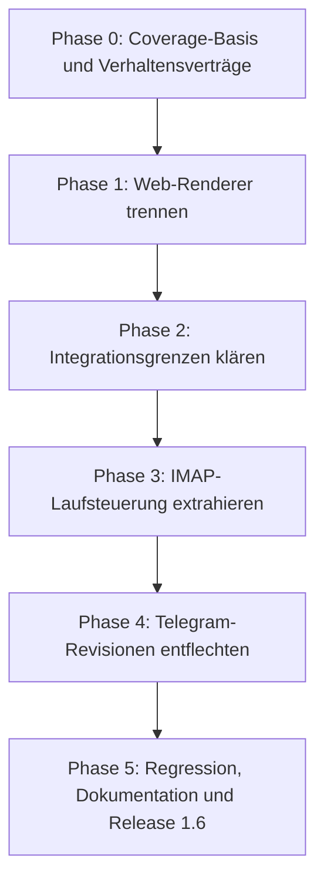

# Mailhelp 1.6 – Release-Planung: „Stabilisieren & Entflechten“

> Historischer Versionsstand: Dieses Dokument beschreibt die genannte Version oder
> deren damaligen Plan. Ursprüngliche Ziele und Prüfergebnisse sind kein Nachweis
> des heutigen Umfangs. Aktueller Betrieb: [README](../README.md),
> [Release 3.3](Release-3.3.md) und [Projektspezifikation](../Mailhelp-Projektspezifikation.md).

**Zielversion:** 1.6.0  
**Stand:** 11. Oktober 2026  
**Status:** Vollständig umgesetzt; lokale Windows-Abnahme abgeschlossen 
**Voraussetzung:** Abschluss der vorgesehenen Funktionsarbeit bis [Planung-1.5.md](Planung-1.5.md)  
**Roadmap-Ziel:** Refactoring vor dem größeren Web- und Produktumbau in [Planung-2.0.md](Planung-2.0.md)

---

## 1. Leitmotiv

> **„Verhalten bewahren, Zuständigkeiten klären: Die gewachsene Mailhelp-Anwendung intern entflechten, ohne den Funktionsumfang zu verändern.“**

Die bisherigen Releases haben Mailhelp um langlebige Mailverarbeitung, Anhangauswertung, externe Schreibaktionen und eine Weboberfläche erweitert. Version 1.6 konzentriert sich auf die internen Grenzen dieser inzwischen umfangreichen Komponenten. Die Refactorings sollen spätere Änderungen – insbesondere das Web-Redesign aus Version 2.0 – leichter isolierbar und überprüfbar machen.

Die vier Refactoring-Schwerpunkte sind:
1. Web-Review- und Statusdarstellung trennen.
2. IMAP-Laufsteuerung und durable Queue aus `Application` herauslösen.
3. Integrationsadapter nach Verantwortlichkeit ordnen.
4. Telegram-Vorschlagsrevision von Antwortinterpretation und Recovery entflechten.

Es werden keine neuen Nutzerfunktionen eingeführt. Persistierte Daten, externe APIs und Nutzerabläufe bleiben kompatibel.

---

## 2. Umfang und Abgrenzung

| Bereich | Ziel in 1.6 | Ausdrücklich nicht Teil von 1.6 |
| :--- | :--- | :--- |
| Webdarstellung | Review-Seiten und Betriebsstatus in klar abgegrenzte Renderer aufteilen. | Neues Layout, Web-Push oder neue Routen aus Version 2.0. |
| Verarbeitungslauf | Polling, Queue, Checkpoint und Wiederaufnahme als zusammenhängende Laufsteuerung kapseln. | Änderung der IMAP-Semantik oder des Mailverarbeitungsablaufs. |
| Integrationen | OAuth, Kalender-, Todoist- und ICS-Verantwortlichkeiten klarer trennen. | Neue externe Dienste oder geänderte Schreibabläufe. |
| Telegram-Revisionen | Interpretation, Revisionsentscheidung und Wiederaufnahme klarer abgrenzen. | Neue Dialogfunktionen oder Änderung an Frage-/Bestätigungsregeln. |

**Planungsannahme zur Coverage:** Vor Beginn der 1.6-Umsetzung ist der aktuelle Arbeitsstand wieder auf die verbindlichen 100 % Zeilen- und Branch-Coverage gebracht. Die vorübergehende Unterschreitung ist kein eigener 1.6-Arbeitspunkt. Die Coverage-Vorgabe bleibt für geänderten Anwendungscode und die Abnahme von 1.6 verbindlich.

---

## 3. Die vier Refactoring-Bausteine

### 3.1 Web-Review und Statusdarstellung trennen

**Ausgangspunkt:** `src/mailhelp/web/review_pages.py` rendert Vorschlagskarten, Relevanzfragen, Mail- und Detailseiten sowie den umfangreichen Laufzeit- und Systemstatus.

**Zielbild:**
- Review-Renderer für Vorschläge, Maildetails und offene Entscheidungen bleiben in einem klaren Bereich.
- Statusseite, Laufzeitinformationen und Statusformatierung erhalten einen eigenständigen Renderer.
- Gemeinsame Escaping-, Layout- und Linkregeln bleiben zentral und werden nicht dupliziert.
- Die bestehenden Web-Routen und das gerenderte Verhalten bleiben unverändert.

**Abnahmepunkte:** Escaping für alle dynamischen Werte, HTTPS-Linkregeln, leere und beschädigte Datensätze, unterschiedliche Statuszustände sowie Statusdaten mit und ohne Laufzeitinformationen sind gezielt getestet.

### 3.2 IMAP-Laufsteuerung aus `Application` lösen

**Ausgangspunkt:** `src/mailhelp/application.py` vereint Application-Lifecycle und Composition mit IMAP-Polling, globaler Mail-Queue, Checkpoints, Resume und Laufzusammenfassung. Die Prozessbeendigung ist bereits separat in `src/mailhelp/lifecycle.py` modelliert und soll dort bleiben.

**Zielbild:**
- Ein zuständiger Lauf-/Mailbox-Service übernimmt die zusammenhängende Verarbeitung aus Discovery, Queue-Materialisierung, Checkpoint-Fortschritt und Wiederaufnahme.
- `Application` bleibt Composition Root und steuert Start, Stop, Telegram/Web-Lifecycle und die Zusammenarbeit der Services.
- Mail-Budget, Laufzusammenfassung und Übergänge werden nur dann mitverschoben, wenn dadurch eine klare Zuständigkeit entsteht.
- Der vollständige UID-Snapshot wird weiterhin vor dem ersten Abruf eines Mailbodys dauerhaft gespeichert.

**Abnahmepunkte:** Reihenfolge nach Empfangszeit, UIDVALIDITY-Wechsel, optionale Ordner, begrenzte Läufe, Neustart, Timeout, Teilfehler und erneutes Ausführen behalten das bisherige Verhalten. Keine Mail wird durch Resume übersprungen oder doppelt verarbeitet.

### 3.3 Integrationsadapter nach Verantwortung ordnen

**Ausgangspunkt:** `src/mailhelp/integrations.py` enthält unter anderem OAuth-Tokenbezug, Todoist- und Kalender-HTTP-Zugriffe, Kalenderüberschneidungen, ICS-Dateierzeugung und bestätigte Schreibabläufe.

**Zielbild:**
- Google-OAuth, Kalenderzugriffe, Todoist-Zugriffe und ICS-Dateierzeugung erhalten klar definierte interne Grenzen.
- Gemeinsame HTTP-, Retry- und Fehlerbehandlung wird nur dort geteilt, wo die Dienste dasselbe Verhalten benötigen.
- Die Bestätigungsschranke bleibt sichtbar vor jedem externen Schreibzugriff; Reconciliation und Idempotenz bleiben Teil des abgesicherten Schreibpfads.
- Bestehende Importe und Konstruktoren werden nach Möglichkeit über kompatible Fassaden erhalten; Änderungen an internen Imports erfolgen kontrolliert.

**Abnahmepunkte:** simulierte Token-Erneuerungen, Providerfehler, Pagination, Retry, unklare Schreibresultate, Reconciliation, Idempotenz und versionsbezogene Bestätigung decken die bisherigen Verträge ab.

### 3.4 Telegram-Vorschlagsrevision entflechten

**Ausgangspunkt:** `src/mailhelp/telegram/revisions.py` bündelt Antwortinterpretation, Vorschlagsrevision, Persistenz und Wiederaufnahme offener Revisionen.

**Zielbild:**
- Eingehende Antworten werden von der Orchestrierung des Revisionsablaufs unterscheidbar.
- Validierung erlaubter Änderungen und Konstruktion des Nachfolge-Vorschlags bleiben als fachliche Grenze erkennbar.
- Persistenz, Zustandsübergänge, erneute Zustellung und Recovery nach Neustart bleiben in einem expliziten koordinierenden Ablauf.
- Es werden keine zusätzlichen Abstraktionen eingeführt, wenn sie nur Code verschieben und keine Abhängigkeit oder Verantwortung klären.

**Abnahmepunkte:** Identität und Versionsfolge, erlaubte Felder, ungelöste Rückfragen, Wiederholung derselben Antwort, Prozessabbruch zwischen Persistenzschritten und Wiederaufnahme behalten ihre vorhandenen Garantien.

---

## 4. Umsetzungsphasen

| Phase | Schwerpunkt | Liefergegenstand |
| :--- | :--- | :--- |
| **0** | **Baseline** | Vollständiger Testlauf auf der wiederhergestellten 100-%-Coverage-Basis; relevante Verhaltenserwartungen und öffentliche Grenzen festhalten. |
| **1** | **Webdarstellung** | Review- und Statusrendering getrennt, gemeinsame HTML-Sicherheitsregeln erhalten, fokussierte Renderer-Tests. |
| **2** | **Integrationen** | Adaptergrenzen für OAuth, Kalender, Todoist und ICS; kompatible Übergänge und Tests der Schreibsicherheit. |
| **3** | **Mail-Laufsteuerung** | Polling-/Run-Service mit Queue, Checkpoints und Recovery; `Application` als schlanker Koordinator. |
| **4** | **Telegram-Revisionen** | Klare Grenze zwischen Antwort, Revision, Persistenz und Wiederaufnahme; Tests für Wiederholungen und Neustarts. |
| **5** | **Abnahme** | Vollständige Regressionstests, 100 % Zeilen- und Branch-Coverage, aktualisierte Architektur-/Betriebsdokumentation und Release 1.6.0. |

Die Reihenfolge minimiert gleichzeitige Änderungen an zustandsbehafteten Sicherheitsgrenzen. Jede Phase bleibt ein eigener, reviewbarer Schritt; ein Verhaltenstest muss vor dem Verschieben der zugehörigen Logik bestehen.

---

## 5. Qualitäts- und Sicherheitskriterien

1. **Verhaltensgleichheit:** Keine Änderung an Mailreihenfolge, Entscheidungstexten, gespeicherten Schemas, Routen oder externen API-Aufrufen ohne separat genehmigte Spezifikationsänderung.
2. **Coverage:** 100 % Zeilen- und Branch-Coverage bleibt verbindlich. Die Coverage wird für jeden abgeschlossenen Refactoring-Schritt vollständig ausgeführt; keine Ausschlüsse und keine wirkungslosen Tests.
3. **Regression:** Für jeden verschobenen Zustandsübergang existiert ein Verhaltenstest, der den bestehenden Vertrag schützt. Fehlerfälle, Wiederholungen, Neustarts und Autorisierung werden berücksichtigt.
4. **Externe Dienste:** Automatisierte Tests verwenden synthetische Daten und simulierte Dienste; der Refactoring-Testlauf führt keine echten Schreibaktionen aus.
5. **Schreibschutz:** Telegram- oder Webbestätigung, Versionsprüfung, CSRF, Sitzungsgültigkeit, Idempotenz und Abgleich unklarer Schreibresultate bleiben unverändert wirksam.
6. **Sicherheit der Darstellung:** Alle untrusted Mail- und Modellwerte bleiben escaped; Links aus Mailinhalten werden nicht durch das Refactoring zu aktiven Links.
7. **Kompatibilität:** JSON-Dateiformate, Migrationsverhalten und bestehende CLI-/Import-Schnittstellen bleiben kompatibel oder werden mit dokumentierten Migrationstests abgesichert.
8. **Release:** `CHANGELOG.md`, Versionsnummern und Release-Dokumentation werden gemäß den Projektregeln aktualisiert. Die Roadmap-Verweise von 1.4/2.0 werden beim Einplanen von 1.6 konsistent nachgezogen.

---

## 6. Risiken und Gegenmaßnahmen

| Risiko | Gegenmaßnahme |
| :--- | :--- |
| Zustands- oder Reihenfolgenänderung beim Verschieben von Polling-Code | Durable Queue und Checkpoint-Tests vor Extraktion als Vertrag sichern; eine Zuständigkeit pro Schritt verschieben. |
| Versehentliche Aufweichung der externen Schreibautorisierung | Schreibpfad vom Bestätigungseingang bis zum Adapter als End-to-End-Vertrag testen. |
| Web-XSS oder unsichere Links durch Renderer-Aufteilung | Escaping-/Link-Helfer zentral belassen und Renderer mit nicht vertrauenswürdigen Eingaben testen. |
| Zirkuläre Importe oder zu viele kleine Module | Zielmodule entlang stabiler Verantwortlichkeiten schneiden; keine Datei nur zur Zeilenreduzierung aufteilen. |
| Zu großer Refactoring-Umfang für ein Release | Phasen separat reviewen; kein Big-Bang-Umbau und keine parallele Verhaltensänderung. |

---

## 7. Erfolgskriterien

Version 1.6 ist abnahmefähig, wenn:
- alle vier Refactoring-Schwerpunkte umgesetzt sind,
- Nutzerabläufe, Zustandsformate und externe Verträge unverändert bleiben,
- die vollständige Suite besteht und 100 % Zeilen- sowie Branch-Coverage erreicht,
- kritische Fehler-, Wiederholungs-, Neustart- und Autorisierungspfade getestet sind,
- die aktualisierte Struktur eine klare Grundlage für die geplanten Webarbeiten in Version 2.0 bildet.

## 8. Umsetzung und Abnahme am 11. Oktober 2026

Alle vier Refactoring-Schwerpunkte und die sechs Phasen sind abgeschlossen.
Die [Architektur](Architektur-1.6.md) ordnet Module und Sicherheitsgrenzen zu;
[Release-1.6.md](Release-1.6.md) beschreibt das Upgrade ohne Datenmigration.

| Phase | Ergebnis |
| --- | --- |
| 0 | Saubere Baseline: 1.562 Tests, 100 % Zeilen und Branches. Bestehende Verhaltenstests schützen die zu verschiebenden Zustandsübergänge. |
| 1 | Statusrenderer nach `web/status_pages.py` getrennt; Review bleibt in `web/review_pages.py`, kompatible Re-Exports und zentrale HTML-Helfer bleiben erhalten. Vollständige Suite: 1.562 Tests, 100 %. |
| 2 | OAuth, Kalender, Todoist, ICS, HTTP-Transport und bestätigte Schreibausführung unter `external/` getrennt; `integrations.py` bleibt Fassade. Vollständige Suite: 1.562 Tests, 100 %. |
| 3 | `MailboxRunService` übernimmt Discovery, Queue, Budgets, Checkpoints und Resume mit explizitem Analyse-Callback. Application koordiniert Lifecycle und Eingaben. Vollständige Suite: 1.562 Tests, 100 %. |
| 4 | Autorisierte Antwortinterpretation, validierter Nachfolge-Vorschlag und Recovery getrennt; Persistenz und Zustellung bleiben koordiniert. Vollständige Suite mit ersten zusätzlichen Vertragstests: 1.564 Tests, 100 %. |
| 5 | Version 1.6.0, Architektur, Spezifikation, Changelog, Roadmap und Release-Dokumentation aktualisiert; Paket und Browser geprüft. |

Abschließende Python-Suite: **1.566 Tests bestanden**, **100 % Zeilen- und
Branch-Coverage** (0 fehlende Zeilen, 0 teilweise abgedeckte Branches). Zusätzliche
Vertragstests sichern kompatible Importe, eigenständige Mailbox-Wiederaufnahme,
Nachfolge-Identität sowie byteidentische Renderer-Ausgaben gegenüber 1.5.

Browser: **54 Tests bestanden** auf Desktop, Smartphone und schmalem Display;
**100 % JavaScript-Blockabdeckung** für `app.js` und `sw.js`. Die veraltete
Kopplungstesthilfe wurde auf den bestehenden vierstelligen Code angepasst und
die synthetische Hauptschleife für unveränderte Renderzustände stabilisiert.
Das produktive Polling-/Recovery-Verhalten wurde dadurch nicht geändert.

Wheel und Source-Archiv wurden gebaut. Das Wheel wurde separat installiert;
beide Paketprüfungen bestanden, einschließlich neuer Module, Ressourcen und
Ausschluss privater Laufzeitdateien. Die lokalen Tests verwenden simulierte
externe Dienste und synthetische Daten. Ein tatsächlicher Linux-/Docker-Lauf
konnte lokal mangels Docker nicht ausgeführt werden; dafür bleibt die bestehende
CI-Matrix zuständig. Es wurden lokal keine Deployments vorgenommen.
