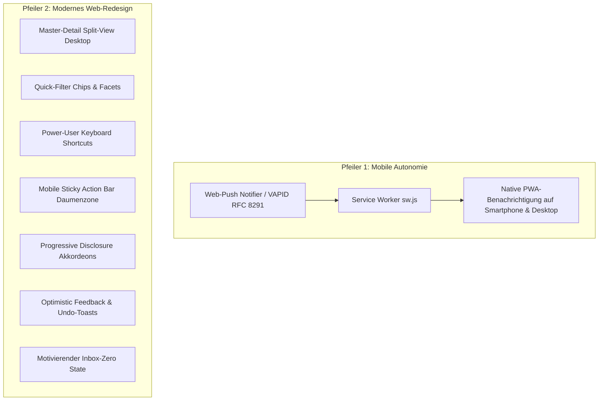
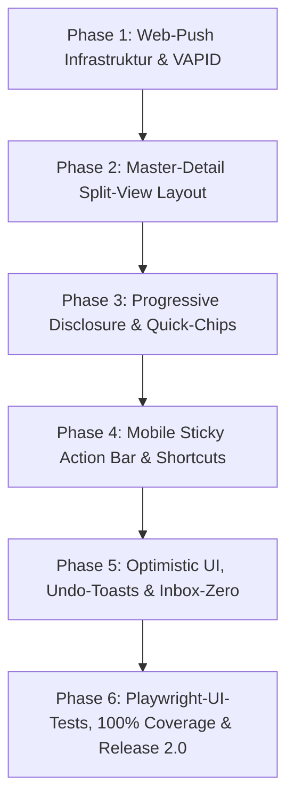

# Mailhelp 2.0 – Release-Planung und Roadmap: „The New Experience & Standalone PWA“

**Zielversion:** 2.0.0  
**Stand:** 11. Oktober 2026  
**Status:** In Planung (Folgt auf den Abschluss von Version 1.3)  
**Detailkonzept:** [Konzept-2.0-Redesign-und-Web-Push.md](Konzept-2.0-Redesign-und-Web-Push.md)  
**Vorausgehende Version:** [Planung-1.4.md](Planung-1.4.md) (Multimodal & OCR)

---

## 1. Leitmotiv für Mailhelp 2.0

> **„Mailhelp 2.0 – Die neue Generation: Volle mobile Unabhängigkeit durch Web-Push und modernes Web-Redesign nach aktuellen UX-Design-Patterns.“**

Mit den Versionen 1.0 bis 1.2 wurde Mailhelp von Grund auf als zuverlässiger, hochgradig abgesicherter persönlicher Assistent aufgebaut. Version 1.3 liefert die smarte Backend-Engine mit Vorabprüfung, Kalenderabgleich und ganzheitlicher Anhangsauswertung.

**Version 2.0 markiert den großen optischen, interaktiven und architektonischen Generationswechsel:**
1. **Volle Autonomie von Telegram (Mobile Standalone PWA):** Dank nativer Web-Push-Benachrichtigungen (VAPID / Service Worker) ist Telegram nicht länger Pflichtkanal. Mailhelp lässt sich direkt auf dem Smartphone (iOS Safari PWA, Android Chrome) und PC als vollwertige, eigenständige Applikation betreiben.
2. **Modernes Web-Redesign nach UX-Design-Patterns:** Die bisherige vertikale Formularführung weicht einem rasanten, zeitgemäßen Produktivitäts-Interface:
   - **Master-Detail / Split-View** am Desktop für unterbrechungsfreies Abarbeiten.
   - **Mobile-First Sticky Action-Bar** in der natürlichen Daumenzone auf Touch-Geräten.
   - **Progressive Disclosure** (aufgeräumte, scannbare Karten mit einblendbaren Tiefen-Details).
   - **Faceted Search & Quick-Filter-Chips** für blitzschnelle Filterung.
   - **Power-User Keyboard Shortcuts** (`J`/`K`/`C`/`E`/`X`) für blitzschnelle Desktop-Bedienung.
   - **Optimistic UI & Undo-Toasts** für flüssige Rückmeldungen.
   - **Motivierender „Inbox-Zero“-Zustand** mit Tagesstatistik.

---

## 2. Kernpfeiler von Version 2.0

| Bereich | Bisheriger Stand (bis v1.3) | Der Generationswechsel in Version 2.0 |
| :--- | :--- | :--- |
| **Benachrichtigungen** | Nur über Telegram Bot; die PWA bot keine System-Push-Meldungen bei anstehenden Entscheidungen. | **Native Web-Push-Notifications (VAPID):** Reiner Standalone-Betrieb ohne Telegram-Account möglich; PWA benachrichtigt gezielt nur bei echten Entscheidungen. |
| **Desktop-Layout** | Sequenzielle Listenansicht; jedes Detail erforderte einen Seitenwechsel mit Ladezeit. | **Master-Detail / Split-View:** Zweispaltige Ansicht ab 1024px; Liste links, synchron mitlaufende Mail- und Detailansicht rechts; kein Seitenwechsel mehr. |
| **Karten-Layout** | Karten waren mit technischen Metadaten, Header-Daten und Tokens optisch überfrachtet. | **Progressive Disclosure:** Aufgeräumte Kernkarten (Was, Wann, Wo, Wer); Belege und technische Historie in einklappbaren Akkordeons. |
| **Listenfilterung** | Statische `<select>`-Formulare mit manuellem Absenden und Seitenreload. | **Reaktive Quick-Filter-Chips:** `[Alle]` `[Termine]` `[Aufgaben]` `[Klärung]` `[Anhänge]` filtern die Ansicht in Millisekunden. |
| **Mobile Ergonomie** | Scrollen bis ans Ende langer E-Mails, um Aktionsbuttons zu erreichen. | **Sticky Action-Bar:** Hauptaktionen fest verankert am unteren Bildschirmrand innerhalb der natürlichen Daumenzone. |
| **Desktop-Steuerung** | Ausschließlich Mausbedienung. | **Keyboard Shortcuts (Superhuman-Style):** `J`/`K` (Navigieren), `C` (Bestätigen), `E` (Bearbeiten), `X` (Verwerfen), `?` (Hilfe). |
| **Aktions-Rückmeldung** | Bildschirm blockierte kurz bis zum Server-POST. | **Optimistic UI mit Undo-Toast:** Sofortiges Ausblenden der Karte mit 5-sekündigem Rückgängig-Button. |
| **Leerzustand** | Grauer Text *„Nichts zu entscheiden.“*. | **Inbox-Zero State:** Grüner Erfolgsindikator, Tagesstatistik verarbeiteter Aktionen und letzter Synchronisationsstatus. |

---

## 3. Umsetzungsphasen für Version 2.0

| Phase | Schwerpunkt | Liefergegenstand |
| :--- | :--- | :--- |
| **Phase 1** | **Web-Push & Autonomie** | VAPID-Kryptographie (`webpush.py`), Subscriptions-Store, Endpunkte `/api/push/*`, Service Worker Push-Event, Opt-In Schalter in `/einstellungen`. |
| **Phase 2** | **Master-Detail Split-View** | Responsives Zweispalten-Layout (Desktop ab 1024px) in `web/review_pages.py` und `app.css`, synchrone Detailanzeige ohne Reload. |
| **Phase 3** | **Karten-Hierarchie & Quick-Chips** | Redesign der Entscheidungskarten mit Progressive Disclosure (Akkordeons), klickbare Filter-Chips auf `/offen`, `/mails`, `/verlauf`. |
| **Phase 4** | **Ergonomie & Shortcuts** | Feste Daumenzonen-Aktionsleiste auf Touch-Geräten, Keyboard-Shortcuts (`J`/`K`/`C`/`E`/`X`) mit Shortcuts-Hilfepanel (`?`). |
| **Phase 5** | **Interaktives Feedback** | Optimistic Ausblendung, Undo-Toasts mit 5-Sekunden-Zeitfenster, animierter Inbox-Zero State mit Tagesauswertung. |
| **Phase 6** | **Qualitätssicherung & 2.0-Release** | Playwright E2E-Browsertests aller neuen UI-Patterns, 100 % Zeilen-/Branch-Coverage, Doku-Aktualisierung und feierliches Release **Mailhelp 2.0.0**. |

---

## 4. Abnahme- und Qualitätskriterien ([`AGENTS.md`](../AGENTS.md))

1. **Progressive Enhancement:**
   - Alle Basisfunktionen (Lesen, Bestätigen, Bearbeiten, Verwerfen) bleiben auch bei vollständig deaktiviertem JavaScript garantiert funktionsfähig.
2. **100 % Zeilen- und Branch-Abdeckung:**
   - Verbindlich für alle neuen serverseitigen Module (`webpush.py`, Subscriptions, API-Routen).
3. **Playwright-Browsertests:**
   - Vollständige automatisierte Browsertests für Split-View, Filter-Chips, Daumenzonen-Buttons und Tastaturnavigation.
4. **Sicherheit & Datenschutz:**
   - Push-Nachrichten enthalten keine sensiblen Mail-Volltexte, sondern neutrale Hinweise (*„Neuer Termin wartet auf Bestätigung“*).
   - VAPID Private Keys bleiben sicher geschützt und werden nicht geloggt.

