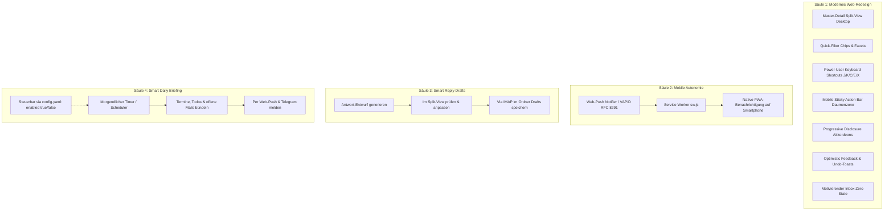
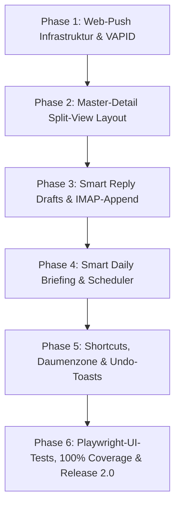

# Mailhelp 2.0 – Release-Planung und Roadmap: „The New Experience & Standalone PWA“

**Zielversion:** 2.0.0  
**Stand:** 11. Oktober 2026  
**Status:** In Planung (Folgt auf den Abschluss von Version 1.4)  
**Detailkonzept:** [Konzept-2.0-Redesign-und-Web-Push.md](Konzept-2.0-Redesign-und-Web-Push.md)  
**Vorausgehende Versionen:** [Planung-1.3.md](Planung-1.3.md) (Smart Engine) → [Planung-1.4.md](Planung-1.4.md) (Multimodal & OCR)

---

## 1. Leitmotiv für Mailhelp 2.0

> **„Mailhelp 2.0 – Die neue Generation: Volle mobile Unabhängigkeit durch Web-Push, modernes Web-Redesign nach aktuellen UX-Design-Patterns, intelligente Antwort-Entwürfe im Entwurfsordner und konfigurierbares Daily Briefing.“**

Mit den Versionen 1.0 bis 1.4 wurde Mailhelp von Grund auf als hochintelligenter, zuverlässiger Backend-Assistent aufgebaut, der Duplikate filtert, Kalendereinträge aktualisiert und Anhänge (PDF, Word, ICS, Bilder) liest.

**Version 2.0 vollzieht den entscheidenden Generationswechsel für den Nutzer:**
1. **Volle Autonomie von Telegram (Mobile Standalone PWA):** Dank nativer Web-Push-Benachrichtigungen (VAPID / Service Worker) ist Telegram nicht länger Pflicht. Mailhelp lässt sich direkt auf dem Smartphone (iOS Safari PWA, Android Chrome) und PC als vollwertige, eigenständige Applikation betreiben.
2. **Modernes Web-Redesign nach 7 UX-Design-Patterns:** Master-Detail Split-View am Desktop, Daumenzonen-Buttons am Smartphone, Progressive Disclosure, Quick-Filter-Chips, Keyboard-Shortcuts (`J`/`K`/`C`/`E`/`X`) und Undo-Toasts.
3. **Intelligente Antwort-Entwürfe (Smart Reply Drafts):** Mailhelp formuliert passende Antwortschreiben vor. Nach Bestätigung werden sie **sicher via IMAP im Entwurfsordner (`Drafts`)** des Nutzers abgelegt – inklusive korrekter Thread-Header (`In-Reply-To`, `References`). Es erfolgt **kein automatischer Direktversand**, der Nutzer behält im eigenen E-Mail-Programm die volle Kontrolle.
4. **Smart Daily Briefing (Tageszusammenfassung):** Jeden Morgen fasst Mailhelp anstehende Termine, fällige Todos und offene Entscheidungen kompakt per Web-Push und Telegram zusammen – flexibel steuerbar über ein `enabled`-Flag in `config.yaml`.

---

## 2. Die vier Säulen von Version 2.0



| Bereich | Bisheriger Stand (bis v1.4) | Der Generationswechsel in Version 2.0 |
| :--- | :--- | :--- |
| **Benachrichtigungen** | Nur über Telegram Bot; die PWA bot keine System-Push-Meldungen bei anstehenden Entscheidungen. | **Native Web-Push-Notifications (VAPID):** Reiner Standalone-Betrieb ohne Telegram-Account möglich; PWA benachrichtigt gezielt nur bei echten Entscheidungen. |
| **Desktop-Layout** | Sequenzielle Listenansicht; jedes Detail erforderte einen Seitenwechsel mit Ladezeit. | **Master-Detail / Split-View:** Zweispaltige Ansicht ab 1024px; Liste links, synchron mitlaufende Mail- und Detailansicht rechts; kein Seitenwechsel mehr. |
| **E-Mail-Beantwortung** | Nutzer musste Mailprogramm öffnen und Text mühsam selbst formulieren. | **Smart Reply Drafts:** Mailhelp formuliert Antwort vor. Bestätigter Text wird via IMAP im `Drafts`-Ordner abgelegt (kein Direktversand!). |
| **Tagesüberblick** | Nutzer musste aktiv nachsehen, was ansteht und was Mailhelp über Nacht verarbeitet hat. | **Smart Daily Briefing:** Morgendliche kompakte Zusammenfassung per Web-Push & Telegram; konfigurierbar via `daily_briefing.enabled`. |
| **Listenfilterung** | Statische `<select>`-Formulare mit manuellem Absenden und Seitenreload. | **Reaktive Quick-Filter-Chips:** `[Alle]` `[Termine]` `[Aufgaben]` `[Klärung]` `[Anhänge]` filtern die Ansicht in Millisekunden. |
| **Mobile Ergonomie** | Scrollen bis ans Ende langer E-Mails, um Aktionsbuttons zu erreichen. | **Sticky Action-Bar:** Hauptaktionen fest verankert am unteren Bildschirmrand innerhalb der natürlichen Daumenzone. |
| **Desktop-Steuerung** | Ausschließlich Mausbedienung. | **Keyboard Shortcuts (Superhuman-Style):** `J`/`K` (Navigieren), `C` (Bestätigen), `E` (Bearbeiten), `X` (Verwerfen), `?` (Hilfe). |
| **Aktions-Rückmeldung** | Bildschirm blockierte kurz bis zum Server-POST. | **Optimistic UI mit Undo-Toast:** Sofortiges Ausblenden der Karte mit 5-sekündigem Rückgängig-Button. |

---

## 3. Detaillierte Spezifikation der neuen Funktionsbausteine

### 3.1 Intelligente Antwort-Entwürfe (Smart Reply Drafts)
1. **Generierung:**
   - Parallel zur Extraktion erzeugt `Analyzer.draft_reply()` einen höflichen, prägnanten Antwortentwurf (Zusage, Rückfrage zu Terminen, Bestätigung von Fristen).
2. **Web-Integration im Split-View:**
   - Im rechten Detail-Panel erscheint eine Sektion *„Antwort-Entwurf“* mit formatiertem Textbereich.
   - Der Nutzer kann den Entwurf direkt im Browser überarbeiten.
3. **Speichern via IMAP-Append im Ordner `Drafts`:**
   - Bei Klick auf `[Als Entwurf im Postfach speichern]` nutzt Mailhelp den bestehenden IMAP-Transport:
     - `APPEND` in den konfigurierten Ordner `imap.drafts_folder` (Standard: `"Drafts"` bzw. `imap_utf7` kodiert).
     - Standardkonforme RFC-5322-MIME-Nachricht mit Flags `\Draft`, `\Seen`.
     - Korrektes Threading: Header `In-Reply-To` und `References` verweisen auf die `Message-ID` der Quellmail; Betreff wird mit `Re: ` versehen.
   - **Sicherheitsgarantie:** Mailhelp versendet die E-Mail **niemals** selbstständig per SMTP. Der Nutzer öffnet sein gewohntes Mail-Programm (Thunderbird, Apple Mail, Outlook), sieht den Entwurf und klickt selbst auf Senden.

### 3.2 Smart Daily Briefing (Tageszusammenfassung)
1. **Konfiguration in `config.yaml`:**
   ```yaml
   daily_briefing:
     enabled: true             # Per Flag ein- oder ausschaltbar
     time: "07:30"             # Uhrzeit (HH:MM in IANA-Zeitzone)
     include_calendar: true    # Heutige Termine aus Google Kalender
     include_tasks: true       # Fällige/überfällige Aufgaben aus Todoist
     include_open: true        # Noch offene Mailhelp-Entscheidungen
   ```
2. **Ablaufsteuerung:**
   - Ein leichtgewichtiger Scheduler im Hintergrund prüft einmal pro Minute die konfigurierte Uhrzeit.
   - Zur Zielzeit ruft Mailhelp schreibgeschützt:
     - Heutige Termine via `fetch_events_in_window()` ab.
     - Heutige / überfällige Tasks via `fetch_active_tasks()` ab.
     - Offene Vorschläge aus `review/views.py` ab.
   - Generiert einen kompakten Text:  
     *„Guten Morgen! ☀️ Heute stehen 2 Termine an (10:00 Jour Fixe, 15:30 Zahnarzt). 3 Aufgaben sind heute fällig. 1 E-Mail wartet auf deine Bestätigung.“*
   - Versendet die Nachricht synchron an registrierte Web-Push-Geräte und optional an Telegram.
3. **Resilienz:**
   - Ist ein Zielsystem offline (z.B. Google Kalender nicht erreichbar), bricht das Briefing nicht ab, sondern informiert transparent über die verfügbaren Daten.

---

## 4. Umsetzungsphasen für Version 2.0



| Phase | Schwerpunkt | Liefergegenstand |
| :--- | :--- | :--- |
| **Phase 1** | **Web-Push & Autonomie** | VAPID-Kryptographie (`webpush.py`), Subscriptions-Store, Endpunkte `/api/push/*`, Service Worker Push-Event, Opt-In Schalter in `/einstellungen`. |
| **Phase 2** | **Master-Detail Split-View** | Responsives Zweispalten-Layout (Desktop ab 1024px) in `web/review_pages.py` und `app.css`, synchrone Detailanzeige ohne Reload. |
| **Phase 3** | **Smart Reply Drafts** | Prompt `draft_reply`, Web-Editor im Detail-Panel, IMAP-Append-Service mit RFC-5322 Thread-Headern im Ordner `Drafts`. |
| **Phase 4** | **Smart Daily Briefing** | `DailyBriefingService`, Konfigurationsabschnitt `daily_briefing`, Hintergrund-Timer, Push-/Telegram-Versand, Graceful Fallback. |
| **Phase 5** | **Ergonomie & Feedback** | Daumenzonen-Aktionsleiste, Keyboard-Shortcuts (`J`/`K`/`C`/`E`/`X`), Quick-Filter-Chips, Optimistic UI mit 5s-Undo-Toast. |
| **Phase 6** | **Qualitätssicherung & 2.0-Release** | Playwright E2E-Browsertests aller neuen UI-Patterns, 100 % Zeilen-/Branch-Coverage, Doku-Aktualisierung und feierliches Release **Mailhelp 2.0.0**. |

---

## 5. Abnahme- und Qualitätskriterien ([`AGENTS.md`](../AGENTS.md))

1. **Progressive Enhancement:**
   - Alle Basisfunktionen (Lesen, Bestätigen, Bearbeiten, Verwerfen, Entwurf-Erstellen) bleiben auch bei vollständig deaktiviertem JavaScript garantiert funktionsfähig.
2. **Kein eigenmächtiger E-Mail-Versand:**
   - Antwort-Entwürfe dürfen **ausschließlich** als Entwurf (`\Draft`) in das IMAP-Postfach geschrieben werden. Ein SMTP-Versand durch Mailhelp ist kategorisch ausgeschlossen.
3. **100 % Zeilen- und Branch-Abdeckung:**
   - Verbindlich für alle neuen serverseitigen Module (`webpush.py`, `drafts.py`, `briefing.py`, Subscriptions, API-Routen).
4. **Playwright-Browsertests:**
   - Vollständige automatisierte Browsertests für Split-View, Entwurf-Editor, Filter-Chips, Daumenzonen-Buttons und Tastaturnavigation.
5. **Datenschutz & Geheimnisschutz:**
   - Push-Nachrichten enthalten keine vertraulichen Volltexte, sondern neutrale Hinweise.
   - VAPID Private Keys und IMAP-Zugangsdaten bleiben sicher geschützt und werden nicht geloggt.
