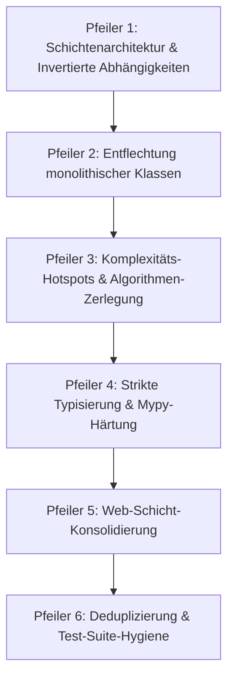
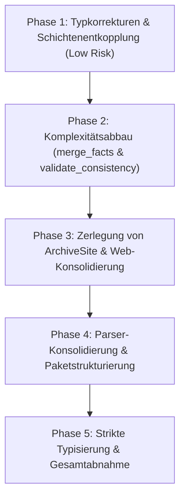

# Mailhelp 3.3 – Technische Konsolidierung, Architektur-Refactoring & Code-Qualität

**Zielversion:** 3.3.0  
**Stand:** 14. Oktober 2026  
**Status:** In Umsetzung (ab 3.2.3; Messwerte vom 14. Oktober 2026 auf Stand 3.2.1)  
**Grundlage:** [Entwicklungsregeln](../AGENTS.md), [Projektspezifikation](../Mailhelp-Projektspezifikation.md), [Planung 3.0](Planung-3.0.md), [Planung 3.1](Planung-3.1.md), [Planung 3.2](Planung-3.2.md)

---

## 1. Leitmotiv und Zielsetzung

> **„Strukturelle Klarheit, schlagkräftige Modularisierung und drastische Komplexitätsreduktion zur Absicherung des Multi-Postfach-Betriebs.“**

Mit den Versionen 3.0 (Einrichtungs- und Diagnoseassistent, Benachrichtigungssteuerung), 3.1 (Unterstützung mehrerer IMAP-Postfächer) und 3.2 (profilbasierte Einstellungen je Postfach für Kalender, Aufgaben, Filter und Themen) erreicht Mailhelp seine volle funktionale Ausbaustufe.

Dabei wurde das verbindliche Qualitätskriterium aus [`AGENTS.md`](../AGENTS.md) – **100 % Zeilen- und 100 % Branch-Abdeckung** – zu jedem Zeitpunkt strikt gewahrt (über 2.100 automatisierte Tests).

Durch das kontinuierliche Hinzufügen neuer Subsysteme von Version 1.0 bis 3.2 haben sich jedoch erhebliche **architektonische Schulden und Komplexitätsballungen** akkumuliert:
1. **Invertierte Abhängigkeiten:** Analyse (`analysis.py`) und Rückfragenauflösung (`mail_questions.py`) holen die
   deterministische Zeitauflösung per spätem Import aus `telegram/temporal.py`, das seinerseits `analysis`
   importiert (Importkreis). Persistenzbausteine (`ActionLedger`, `ProposalRepository`) liegen im Telegram-Paket.
   Die Domänenschicht selbst ist bereits Telegram-frei (`domain/temporal.py`).
2. **Monolithische Klassen („God Classes“):** `ArchiveSite` (710 Zeilen) vereint Archiv, Verlauf,
   Vorschlagsbearbeitung, Einstellungen, Themen und Beenden.
3. **Verzweigungskomplexität:** 8 Funktionen liegen über einer McCabe-Komplexität von 15, 51 über 10
   (gemessen mit ruff C901); Spitzenreiter `merge_facts` (29) und `validate_consistency` (26).
4. **Wurzelverzeichnis-Überfrachtung:** 65 `.py`-Dateien liegen direkt in `src/mailhelp/`.
5. **Typisierungs-Lücken:** Unter `mypy --check-untyped-defs` treten 18 Fehler in 7 Dateien auf.

**Ziel von Version 3.3 ist ein reines, risikofreies Refactoring- und Konsolidierungs-Release.**
Das externe Fachverhalten (CLI, Telegram, Web, Schnittstellen zu Google Kalender, CalDAV, Todoist und Microsoft Graph) bleibt zu 100 % funktionsidentisch. Sämtliche Bestandstests bleiben gültig und werden durch das Refactoring modularer, lesbarer und wartungsfreundlicher.

---

## 2. Die sechs Kernpfeiler des Refactorings



---

### Pfeiler 1: Bereinigung der Schichtenarchitektur & invertierter Abhängigkeiten

| Bereich | Ist-Zustand (Architektur-Bruch) | Soll-Zustand (Version 3.3) |
| :--- | :--- | :--- |
| **Analyse hängt an Telegram** | `analysis.py` und `mail_questions.py` importieren die deterministische Zeitauflösung spät aus `telegram.temporal`; dieses importiert `analysis.ContradictoryRevision` (Importkreis). | Neutrales Modul `mailhelp.temporal_answers`; `ContradictoryRevision` liegt in der Domäne; normale Importe ohne Kreis. Kein Modul außerhalb von `telegram/` importiert `mailhelp.telegram.*` außer den Kompositions- und Weboberflächen-Modulen. |
| **Fehlplatzierte Persistenz & Business-Logik** | `ActionLedger` liegt in `telegram/ledger.py`, wird aber auch von `precheck.py` und der Weboberfläche genutzt.<br>`ProposalRepository` liegt in `telegram/persistence.py`, wird aber von `storage.py` und `proposal_reconciliation.py` benötigt. | Umzug von `ActionLedger` und `ProposalRepository` in das Paket `mailhelp.persistence`. Das Modul `telegram/` kümmert sich ausschließlich um Telegram-spezifische Anliegen (Bot-API, Nachrichtenformatierung, Chat-Status). |
| **Legacy-Modellfassade** | 32 Module importieren Typen über die Alt-Fassade `mailhelp.models` per Wildcard-Reexport (`from .models import *`). | Direkte, explizite Importe aus `mailhelp.domain.*` und `mailhelp.persistence.schemas`. `models.py` wird als reine, veraltete Fassade markiert und von internen Aufrufern bereinigt. |
| **Root-Namespace-Bündelung** | Über 50 Python-Dateien liegen direkt im Wurzelverzeichnis `src/mailhelp/`. | Logische Strukturierung in Subpackages: `mailhelp.extraction`, `mailhelp.pipeline`, `mailhelp.reconciliation`, `mailhelp.notifications`, `mailhelp.ai`. |

---

### Pfeiler 2: Entflechtung monolithischer Klassen („God Classes“)

| Klasse / Modul | Umfang | Befund & Refactoring-Maßnahme |
| :--- | :---: | :--- |
| **`ArchiveSite`**<br>([`web/archive_site.py`](../src/mailhelp/web/archive_site.py)) | 641 Zeilen<br>17 Methoden | Bündelt Mail-Archiv (`/mails`, `/mail/<id>`), Verlauf (`/verlauf`, `/aktion/<id>`), Vorschlagsbearbeitung (`/vorschlag/...`), Systemeinstellungen (`/einstellungen`), Themen (`/themen`) und Shutdown (`/beenden`).<br>**Lösung:** Zerlegung in 5 Einheiten: `MailArchiveSite`, `AuditHistorySite`, `ProposalEditSite`, `SettingsSite` und `ShutdownSite`. |
| **`Application`**<br>([`application.py`](../src/mailhelp/application.py)) | 398 Zeilen<br>20+ Attribute | Vermischt IMAP-Polling mehrerer Postfächer, Telegram-Receiver-Thread, Webserver-Lebenszyklus, OAuth-Recovery und Live-Settings.<br>Enthält schwach typisierte Felder (`lifecycle: Any`, `configuration: object`, `notifications: Any`).<br>**Lösung:** Entkopplung der Lebenszyklus-Steuerung in einen `ServiceCoordinator` und Einführung typisierter Protokolle. |
| **`config.py`**<br>([`config.py`](../src/mailhelp/config.py)) | 825 Zeilen | Vermengt 15+ Pydantic-Modelle, Pfadauflösungen, Secret-Dekodierungen und YAML-Parsing.<br>**Lösung:** Aufteilung in `config/models.py` (reine Datenmodelle/Schemas) und `config/loader.py` (Umgebungsvariablen, Pfade und Dateioperationen). |
| **`Analyzer`**<br>([`analysis.py`](../src/mailhelp/analysis.py)) | 595 Zeilen<br>21 Methoden | Handhabt Prompt-Zusammenbau, LLM-Aufruf, Formatvalidierung, Fallback-Schleifen und Revisionsübergänge.<br>**Lösung:** Trennung in Prompt-Builder, LLM-Invoker/Validator und Revisions-Controller. |

---

### Pfeiler 3: Komplexitäts-Hotspots & Algorithmen-Zerlegung

Die AST-Analyse identifiziert Funktionen mit extrem hoher zyklomatischer Komplexität:

McCabe-Komplexität laut `ruff check --select C901` (Stand 3.2.1), alle Funktionen über 15:

```
proposal_merge.py        merge_facts               29
domain/proposal.py       validate_consistency      26
telegram/commands.py     overview                  21
                         execute                   19
imap.py                  _discover_since           17
                         _observe                  17
review/cards.py          proposal_card             17
web/reconciliation_site  preview                   16
```

**Verbindliches Ziel:** `merge_facts` und `validate_consistency` unter 10, alle übrigen Funktionen höchstens 15.
Die Grenze 15 wird als ruff-Regel `C901` (`max-complexity = 15`) dauerhaft in die CI aufgenommen.

#### 3.1 Refactoring von `merge_facts` (Komplexität 29 → < 10)
Die Funktion [`merge_facts`](../src/mailhelp/proposal_merge.py) in `proposal_merge.py` wird in eigenständige, reine Einzelfunktionen zerlegt:
- `_merge_sources(previous, incoming, uncertain)`: Verknüpfung bekannter und ausstehender Quellen.
- `_merge_temporal_fields(previous, incoming, newer)`: Deterministischer Abgleich von Beginn, Ende, Frist und bekannten Zeitfakten.
- `_merge_descriptions(previous, incoming)`: Ergänzung zusätzlicher Textfragmente unter Schutz bestehender Abschnitte.
- `_evaluate_temporal_conflicts(candidate, previous, incoming)`: Erkennung inkonsistenter Intervalle und Widersprüche zu manuell fixierten Daten.
- `_determine_clarifications(candidate, changes)`: Filterung und Bereinigung offener Fragen.

#### 3.2 Refactoring von `validate_consistency` (Komplexität 26 → < 10)
Die Pydantic-Validierung in [`domain/proposal.py`](../src/mailhelp/domain/proposal.py) umfasst über 25 aufeinanderfolgende `if ...: raise ValueError(...)`-Blöcke. Sie wird in dedizierte Invarianten-Prüfer aufgeteilt:
- `_validate_merge_and_reference_invariants(self)`: Kanonische Referenzen, Selbstverweise und Merge-Status.
- `_validate_simulation_and_cancellation_invariants(self)`: Externe IDs, Simulationsmarker und Stornierungs-Ziele.
- `_validate_task_invariants(self)`: Fristen, Zeitzonenversätze und Ausschluss von Kalenderattributen.
- `_validate_event_invariants(self)`: Beginn, Ende, Ganztägigkeit, Zeitzonen und Gültigkeit von Intervallen.

---

### Pfeiler 4: Strikte Typisierung & Mypy-Härtung

#### 4.1 Beseitigung der 18 Mypy-Fehler (`--check-untyped-defs`)
1. **[`web/setup_site.py`](../src/mailhelp/web/setup_site.py)**: Behebung der Typinkonsistenz bei `choices` (von vornherein als `list[str]` typisieren; Vermeidung von `.append()` auf Tupel oder `None`).
2. **[`web/archive_site.py`](../src/mailhelp/web/archive_site.py)**: Korrektur des Parameters für `settings_page`.
3. **[`evaluation.py`](../src/mailhelp/evaluation.py)**: Ersetzung von `client: object` durch ein formales Protocol `LlmCompleter` mit `complete(...)`-Methode.
4. **[`experience.py`](../src/mailhelp/experience.py)**: Behebung der Varianz-Inkompatibilität (`Mapping` statt invariantem `dict` für Callbacks).
5. **[`setup.py`](../src/mailhelp/setup.py)**: Explizite Typisierung von `result: dict[str, Any]`.
6. **[`web/mailbox_site.py`](../src/mailhelp/web/mailbox_site.py)** (3.2): Typisierung der Ergebnisliste und
   getrennte Variablen für Themen und Wahrheitswerte.

`mypy --check-untyped-defs` wird nach Phase 1 als zusätzlicher CI-Schritt ohne Befund verbindlich.

#### 4.2 Ausweitung der Mypy Strictness
In [`pyproject.toml`](../pyproject.toml) wird die Liste der strikt geprüften Module (`disallow_untyped_defs = true`, `strict_equality = true`) schrittweise erweitert:
- **Phase A:** `mailhelp.persistence.*`, `mailhelp.action_normalization`, `mailhelp.proposal_merge`, `mailhelp.precheck`.
- **Phase B:** `mailhelp.pipeline.*`, `mailhelp.evaluation`, `mailhelp.configuration`.
- **Phase C:** `mailhelp.web.*` und `mailhelp.telegram.*`.

---

### Pfeiler 5: Konsolidierung der Web-Schicht

1. **Einheitliches Architekturmuster (`*_site.py` vs. `*_pages.py`)**:
   - Trennung von Handler/Routing-Logik (`*_site.py`) und HTML-Generierung (`*_pages.py`).
   - Auslagerung des Inline-HTMLs aus [`reconciliation_site.py`](../src/mailhelp/web/reconciliation_site.py), [`sender_site.py`](../src/mailhelp/web/sender_site.py) und [`login_site.py`](../src/mailhelp/web/login_site.py) in saubere Rendering-Funktionen.
2. **Entschlackung der HTML-String-Konkatenation**:
   - Bereitstellung robuster Hilfsfunktionen für wiederkehrende UI-Elemente (Formularfelder, Badges, Tabellenzeilen, Aktionen-Menüs).

---

### Pfeiler 6: Deduplizierung & Test-Suite-Hygiene

1. **Konsolidierung deutscher Zeit- und Datums-Parser**:
   - Zusammenführung redundanter Parsing-Muster aus [`action_normalization.py`](../src/mailhelp/action_normalization.py) und [`telegram/temporal.py`](../src/mailhelp/telegram/temporal.py) in ein zentrales, deterministisches Parsing-Modul.
2. **Bereinigung von Laufzeitwarnungen**:
   - **Pydantic-Serialisierung:** Behebung der `PydanticSerializationUnexpectedValue`-Warnung in [`tests/web/test_activity_web.py`](../tests/web/test_activity_web.py#L189) durch Erzeugung valider `FolderProgress`-Instanzen anstelle unstrukturierter Dictionaries.
   - **Pytest-Rewrite-Warnung:** Saubere Paketierung der Test-Fakes in `tests/fakes/` zur Vermeidung von `PytestAssertRewriteWarning`.

---

## 3. Umsetzungsphasen und Meilensteine



| Phase | Schwerpunkt | Konkrete Liefergegenstände |
| :--- | :--- | :--- |
| **Phase 1** | **Typkorrekturen & Entkopplung** | - Behebung aller 18 Fehler aus `mypy --check-untyped-defs`<br>- Verschiebung von `ActionLedger` und `ProposalRepository` nach `mailhelp.persistence`<br>- Verschiebung der temporalen Auflösung aus `telegram/temporal.py` nach `domain/temporal.py`<br>- Bereinigung der Pydantic-Testwarnung in `test_activity_web.py` |
| **Phase 2** | **Komplexitätsabbau (Hotspots)** | - Zerlegung von `merge_facts` in Einzelfunktionen mit Komplexität < 10<br>- Zerlegung von `validate_consistency` in Invarianten-Prüfer<br>- Modularisierung von `validate_revision_successor` und `commands.py:overview` |
| **Phase 3** | **Web-Architektur (`ArchiveSite`)** | - Aufteilung von `ArchiveSite` in 5 Einzel-Controller (`MailArchiveSite`, `HistorySite`, `ProposalEditSite`, `SettingsSite`, `ShutdownSite`)<br>- Trennung von Routing und HTML in `reconciliation_site.py` und `sender_site.py` |
| **Phase 4** | **Parser-Konsolidierung & Config** | - Zusammenführung der deutschen Datums-/Zeitparser<br>- Aufteilung von `config.py` in Modelle und Loader<br>- Entlastung von `Application` über Protokolle und Service-Koordinator |
| **Phase 5** | **Qualitätssicherung & Mypy-Strictness** | - Erweiterung der Mypy-Strictness auf alle Kernpakete<br>- Verifikation von 100 % Zeilen- und Branch-Coverage<br>- Überprüfung der vollständigen Plattformmatrix (Windows 11 & Docker Linux) |

---

## 4. Abnahme- und Qualitätskriterien ([`AGENTS.md`](../AGENTS.md))

1. **100 % Zeilen- und Branch-Abdeckung:**
   - Jeder Refactoring-Schritt muss zu jedem Zeitpunkt die vollständige Abdeckung (100 % Zeilen, 100 % Branches) einhalten.
   - Kein Einsatz von Coverage-Ausschlüssen (`# pragma: no cover`) zur Umgehung von Vorgaben.
2. **Funktionserhalt & Regressionstests:**
   - Keine Verhaltensänderung bestehender Schnittstellen (CLI-Befehle, Telegram-Kommandos, Web-Routen).
   - Sämtliche Bestandstests müssen ohne semantische Modifikation erfolgreich durchlaufen.
3. **Schutz vor eigenmächtigem Schreiben:**
   - Sämtliche Invarianten bezüglich Google Kalender, CalDAV und Todoist (ausdrückliche, versionsbezogene Bestätigung vor Schreibzugriff, CSRF-Schutz, Idempotenzschlüssel) bleiben unverändert intakt.
4. **Fehler- und Warnungsfreiheit:**
   - `ruff check src tests` meldet 0 Fehler.
   - `mypy --check-untyped-defs src/mailhelp` meldet 0 Fehler.
   - `ruff check --select C901` mit `max-complexity = 15` meldet 0 Funktionen.
   - Pytest läuft ohne Serialisierungs- oder Import-Warnungen durch.

