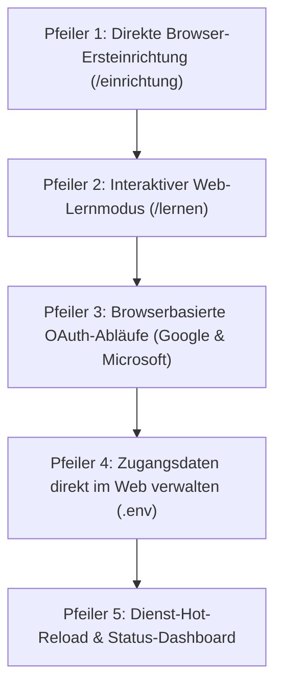
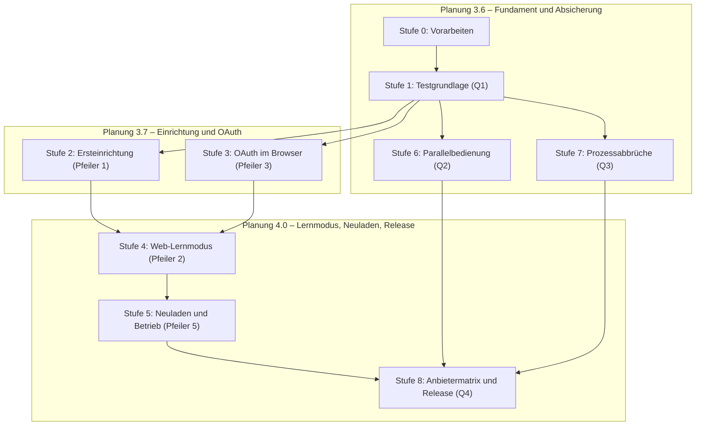

# Mailhelp 4.0 – Browser-First Inbetriebnahme & Web-Lernmodus

**Zielversion:** 4.0.0  
**Stand:** 4. November 2026<br>
**Status:** In Planung (Haupt-Release nach Abschluss von [Planung 3.6](Planung-3.6.md) und [Planung 3.7](Planung-3.7.md))  
**Ausgangsstand:** 3.5.9  
**Fortschritt:** Fundament, Parallelbedienung und Prozessabbruchtests aus 3.6 sind im
Arbeitsstand 3.6.38 implementiert; [Abnahmebericht](Release-3.6.md).
Ersteinrichtung und Browser-OAuth aus 3.7 sind im Arbeitsstand 3.7.19 implementiert;
die bestandene Gesamtabnahme ist in [Release 3.7](Release-3.7.md) dokumentiert. Die folgende
Ausgangsstand-Tabelle dokumentiert weiterhin die ursprüngliche Planungsbasis 3.5.9.
**Teilpläne:** [Planung 3.6](Planung-3.6.md) (Fundament und Absicherung), [Planung 3.7](Planung-3.7.md) (Ersteinrichtung und OAuth) · **Nachfolger:** [Planung 4.1](Planung-4.1.md) (Qualitätsoffensive und Testinfrastruktur)  
**Grundlage:** [Entwicklungsregeln](../AGENTS.md), [Projektspezifikation](../Mailhelp-Projektspezifikation.md), [Planung 3.0](Planung-3.0.md), [Planung 3.1](Planung-3.1.md), [Planung 3.2](Planung-3.2.md), [Planung 3.3](Planung-3.3.md), [Planung 3.4](Planung-3.4.md), [Planung 3.5](Planung-3.5.md)

---

## 1. Leitmotiv und Vision

> **„Nach dem Erstzugang mit einem beim Start im Terminal ausgegebenen Code finden Inbetriebnahme, Konfiguration, Zugangsdaten und Lernmodus im Webbrowser statt.“**

Mit den Versionen 1.0 bis 3.3 wurde Mailhelp zu einer zuverlässigen, deterministischen E-Mail-Assistenz ausgebaut: bis zu zehn IMAP-Postfächer, flexible Zielprofile (Google Kalender, CalDAV, Todoist, Microsoft 365), Anhangsauswertung, Dubletten-Vorabprüfung, Zusammenführen offener Vorschläge und Web-Push.

Bisher erforderte die Ersteinrichtung und der Betrieb jedoch an mehreren Stellen den Rückgriff auf die Kommandozeile (CLI):
1. **Erstanmeldung:** Die Browser-Kopplung benötigt derzeit `mailhelp --pair` am lokalen Host oder einen über Telegram angeforderten Code; es gibt keinen ungekoppelten Browser-Erststart.
2. **Geheimnisse:** `.env` musste manuell per Texteditor angelegt werden (`MAILHELP_WEB_SECRET`, Passwörter, API-Keys).
3. **OAuth-Autorisierung:** Google- und Microsoft-Tokens erforderten CLI-Aufrufe (`mailhelp --google-auth` oder Device-Code im Terminal).
4. **Lernmodus:** Der Lernmodus zur Ersteinmessung (`--learn`) lief ausschließlich im Terminal mit Einzelfragen (`j/n`).

**Version 4.0 verlagert Einrichtung und Lernmodus in den Browser:**
Nach der Programminstallation und dem Start (`pip install` beziehungsweise `docker compose up`) übernimmt der Nutzer den automatisch im Terminal ausgegebenen Einmalcode in die Weboberfläche. Ein geführter Onboarding-Assistent richtet Postfächer, Passwörter und Dienste ein. Der Lernmodus wird zu einer interaktiven, visuellen Webanwendung mit Fortschrittsanzeige und komfortabler Kartenauswahl. Terminal-Codes über `mailhelp --pair` bleiben dauerhaft neben Telegram-Codes und der geplanten Passwortanmeldung verfügbar; die Entscheidung ist in [Planung 3.7](Planung-3.7.md#212-terminal-code-als-dauerhafter-anmeldeweg) festgehalten.

Das beschreibt das geplante Ziel, keine Funktion des aktuellen Stands 3.5.9.

### 1.1 Ausgangsstand 3.5.9

| Bereich | Vorhanden | Offen für 4.0 |
| :--- | :--- | :--- |
| Pfeiler 1 Ersteinrichtung | Authentifizierte Einrichtung `/einrichtung` mit Entwurf, Übernahme und IMAP-Prüfung samt Ordnerliste; Postfächer und IServ-Konten im Web hinzufügen (3.5); lokale Kopplung über `/api/local-pair`; Ordnerliste je Postfach in `mailbox-folders.json` (3.5.6). | Start ohne `config.yaml` (bricht in der Ausgangsversion mit `FileNotFoundError` ab), automatischer Erstzugangscode im Terminal, Web-Passwort zusätzlich zu Terminal-/Telegram-Kopplung, automatisches `MAILHELP_WEB_SECRET`, KI-Test, Ollama-Modellliste, geführter 5-Schritte-Assistent. |
| Pfeiler 2 Web-Lernmodus | Bausteine: Themenpflege `/themen`, Absenderfilter je Postfach, Tätigkeitsberichte `/berichte`. Lernmodus nur als `--learn` im Terminal ([learning.py](../src/mailhelp/llm/learning.py) fragt per `input()`). | Lernkern ohne Terminal, Hintergrundjob, Fortschritt, Review-Maske, gemeinsame Übernahme. |
| Pfeiler 3 OAuth | Google nur über `--google-auth` mit lokalem Loopback-Server (`127.0.0.1:<Zufallsport>`), Microsoft nur per Device-Code im Terminal. | Beide Abläufe im Browser. |
| Pfeiler 4 Zugangsdaten | Seit 3.4 umgesetzt: maskiert, nur schreibend unter `/einstellungen?bereich=zugangsdaten` (statt des ursprünglich geplanten `/einstellungen/geheimnisse`). | `MAILHELP_WEB_SECRET` (Pfeiler 1) und OAuth-Tokens (Pfeiler 3). |
| Pfeiler 5 Betrieb | `/status`, `/diagnose`, `/auswertung` (Kosten), kontrollierter Neustart (seit 3.5.7 auch unter Windows), Live-Aktivierung neuer Postfächer und IServ-Konten, Live-Übernahme einzelner Einstellungen. | Neuladen geänderter/entfernter Postfächer, Zugangsdaten, Themen und Ziele ohne Neustart (in 3.5 ausdrücklich ausgeklammert); Selbsttest mit Handlungsempfehlungen. |
| Testausbau Q1–Q4 ([3.6](Planung-3.6.md), Abschnitt 7) | Einzelne Tests zu Wiederholung, Idempotenz, Sitzungsprüfung und Merge-Journal. | Teststeuerung, persistenter Simulationsdienst, P1–P7, A1–A7, Anbietermatrix, Abschlussbericht. |

---

## 2. Die fünf Kernsäulen von Version 4.0



---

### Pfeiler 1: Direkte Browser-Ersteinrichtung (Onboarding-Wizard)

Beschrieben und in Schritte zerlegt in [Planung 3.7](Planung-3.7.md).

### Pfeiler 2: Interaktiver Web-Lernmodus (`/lernen`)

Der bisherige Terminal-Dialog `mailhelp --learn [N]` wird zu einer intuitiven Webanwendung ausgebaut.

#### 2.1 Konfiguration des Lernlaufs
Auf `/lernen` wählt der Nutzer:
- **Postfach:** Ein konkretes Postfach oder alle aktivierten Postfächer.
- **Umfang:** Schnellauswahl (z. B. 25, 50 oder 100 Mails) oder freie Zahl.
- **Ordner:** Zu durchsuchende Ordner (z. B. Posteingang und Gesendet).
- **Kostentransparenz:** Anzeige der geschätzten Tokenanzahl und maximalen Kosten vor dem Start.

#### 2.2 Asynchroner Hintergrundlauf mit Live-Fortschritt
- Der Lernlauf läuft als Hintergrund-Job und blockiert weder den Server noch den Browser.
- Die Weboberfläche zeigt den Status in Echtzeit:
  - Fortschrittsbalken: *„34 von 50 Mails analysiert (68 %)“*.
  - Aktuelle Aktivität (z. B. Betreffzeile der gerade analysierten Mail).
  - Zwischenstand: Anzahl gefundener Themen, erkannter Newsletter und verbrauchter Tokens.
  - Schaltflächen zum **Pausieren** und **Abbrechen**.

#### 2.3 Die interaktive Review-Maske
Nach Abschluss der Analyse zeigt die Weboberfläche die Ergebnisse übersichtlich in Reitern:

1. **Relevante Themen (`topics.yaml`):**
   - Ansicht als Themenkarten:
     - **Titel:** Direkt editierbares Textfeld.
     - **Beschreibung:** Mehrzeiliges Textfeld zum Präzisieren der Definition.
     - **Beleg-Mails:** Ausklappbare Liste der Mails, aus denen das Thema abgeleitet wurde.
     - **Postfächer:** Zuordnung zu bestimmten Postfächern (gemäß Version 3.2) oder global.
     - **Checkbox:** Thema übernehmen / abwählen.
2. **Ausschluss-Themen (`irrelevant_topics.yaml`):**
   - Automatisch erkannte Infomails und Newsletterbereiche, die mit einem Klick ignoriert werden können.
3. **Absenderfilter (`irrelevant-senders.json`):**
   - Liste erkannter Newsletter- und Info-Absender.
   - Checkboxen zur Übernahme in die Sperrliste (global oder postfachbezogen).
4. **Erkannte Ordner:**
   - Im Postfach gefundene Ordner, die mit einem Klick zur Überwachung in `config.yaml` hinzugefügt werden können.

Ein Klick auf **„Ausgewählte Ergebnisse übernehmen“** speichert die Themen, Filter und Ordner atomar ab.

### Pfeiler 3: Browserbasierte OAuth-Abläufe (Google & Microsoft)

Beschrieben und in Schritte zerlegt in [Planung 3.7](Planung-3.7.md).
Die Google-Ersteinrichtung enthält zusätzlich die
[Anleitung zum OAuth 2.0 Playground](Google-OAuth-Playground.md), einschließlich
eigener Clientdaten und Übernahme des Refresh-Tokens für das gewählte Zielprofil.

### Pfeiler 4: Zugangsdaten direkt im Web verwalten (`.env`)

> Seit 3.4 weitgehend umgesetzt unter `/einstellungen?bereich=zugangsdaten`; offen sind
> nur `MAILHELP_WEB_SECRET` und OAuth-Tokens, beide in [Planung 3.7](Planung-3.7.md) (Schritte 2.5 und 3.2).

Zugangsdaten können direkt im Browser gepflegt werden:

* **Einfache Verwaltung:** IMAP-Passwörter, API-Keys (OpenRouter), Tokens (Todoist) und OAuth-Secrets direkt über Eingabefelder aktualisieren.
* **Maskierte Anzeige:** Bereits hinterlegte Passwörter und Tokens werden im Formular als `••••••••••••` dargestellt.
* **Atomares Speichern:** Der Editor aktualisiert gezielt die Werte in der `.env`-Datei, ohne Kommentare oder andere Zeilen zu beschädigen.

### Pfeiler 5: Dienst-Hot-Reload & Status-Dashboard

* **Hot-Reload per Mausklick (`/dienst/neu-laden`):** Nach Änderungen an Postfächern, Themen oder Zugangsdaten genügt ein Klick im Web, um die Dienste sauber neu zu initialisieren – ganz ohne Prozess- oder Container-Neustart.
* **Dashboard (`/status`):**
  * Statusanzeige aller Postfächer (Erreichbarkeit, letzte Abfrage, Fehler).
  * Übersicht verarbeiteter Mails und offener Vorschläge.
  * Token- und Kostenverbrauch des laufenden Monats.
  * 1-Klick-Selbsttest aller Komponenten mit verständlichen Handlungsempfehlungen.

---

## 3. Web-Routen und Schnittstellen

Einrichtungs- und OAuth-Routen werden in [Planung 3.7](Planung-3.7.md) umgesetzt, die übrigen in 4.0.

| Methode | Pfad | Zweck |
| :--- | :--- | :--- |
| `GET` | `/einrichtung/start` | Einstieg in den Ersteinrichtungs-Wizard |
| `POST` | `/einrichtung/test/imap` | Live-Verbindungstest für IMAP-Zugangsdaten |
| `POST` | `/einrichtung/test/llm` | Live-Test für OpenRouter / Ollama |
| `POST` | `/einrichtung/speichern` | Atomare Initial-Konfiguration speichern |
| `GET` | `/lernen` | Startseite des Web-Lernmodus (Auswahl Postfach/Umfang) |
| `POST` | `/lernen/api/start` | Startet den asynchronen Lernlauf im Hintergrund |
| `GET` | `/lernen/api/status/<id>` | Live-Status und Fortschritt des Lernlaufs |
| `POST` | `/lernen/api/control/<id>` | Lernlauf pausieren, fortsetzen oder abbrechen |
| `GET` | `/lernen/review/<id>` | Interaktive Review-Maske für Themen und Filter |
| `POST` | `/lernen/api/apply/<id>` | Ausgewählte Themen und Filter verbindlich speichern |
| `GET` | `/auth/google/start` | Startet Google OAuth Web-Redirect |
| `GET` | `/auth/google/callback` | Nimmt Auth-Code von Google entgegen und speichert Token |
| `POST` | `/auth/microsoft/device` | Fordert Microsoft Device-Code an |
| `GET` | `/auth/microsoft/poll` | Pollt Microsoft Token-Status bis zur Bestätigung |
| `GET` | `/einstellungen?bereich=zugangsdaten` | Übersicht der Zugangsdaten (maskiert) – **seit 3.4 vorhanden** |
| `POST` | `/einstellungen/zugangsdaten/speichern` | Aktualisiert Passwörter und Schlüssel in `.env` – **seit 3.4 vorhanden** |
| `POST` | `/dienst/neu-laden` | Lädt Konfiguration und Adapter im laufenden Betrieb neu |

---
## 4. UI-Wireframes

Der Onboarding-Assistent steht in [Planung 3.7](Planung-3.7.md).

### 4.2 Web-Lernmodus (Live-Fortschritt)

```text
┌────────────────────────────────────────────────────────────────────────┐
│  LERNMODUS: POSTFACH KALIBRIEREN                                       │
├────────────────────────────────────────────────────────────────────────┤
│                                                                        │
│  Analysiere Postfach „Privat“ ...                                      │
│                                                                        │
│  [████████████████████████░░░░░░░░░░░░░░░░░░░░] 48 % (24 / 50 Mails)   │
│                                                                        │
│  Aktueller Schritt: Relevanz und Themen aus Mail 24 extrahieren         │
│  Betreff:           „Einladung zur Jahreshauptversammlung“             │
│                                                                        │
│  Zwischenstand:                                                        │
│  • 5 relevante Themen gefunden                                         │
│  • 8 Newsletter / Werbe-Absender erkannt                               │
│  • Verbrauchte Tokens: 38.410 (Geschätzte Kosten: 0,06 €)              │
│                                                                        │
│  [ Pausieren ]                                [ Lernlauf abbrechen ]   │
└────────────────────────────────────────────────────────────────────────┘
```

### 4.3 Web-Lernmodus (Review der Themen)

```text
┌────────────────────────────────────────────────────────────────────────┐
│  LERNERGEBNISSE PRÜFEN & ÜBERNEHMEN                                    │
├────────────────────────────────────────────────────────────────────────┤
│  [ Relevante Themen (5) ]  [ Newsletter (3) ]  [ Absenderfilter (8) ]  │
├────────────────────────────────────────────────────────────────────────┤
│                                                                        │
│  [✓] THEMA: Sportverein TSV                                            │
│      Beschreibung: [ Angelegenheiten rund um Training, Termine und   ] │
│                    [ Mitgliedschaft beim TSV Musterstadt.            ] │
│      Postfächer:   [x] Privat   [ ] Arbeit                             │
│      Belege (3):   • 12.10. „Training fällt aus am Freitag“            │
│                    • 08.10. „Mitgliedsbeitrag 2026“                    │
│                                                                        │
│  [✓] THEMA: Hausverwaltung                                             │
│      Beschreibung: [ Nebenkostenabrechnung und Beschlüsse der WEG.   ] │
│      Postfächer:   [x] Privat   [ ] Arbeit                             │
│      Belege (2):   • 05.10. „Protokoll der Beiratssitzung“             │
│                                                                        │
│  [ Vorheriges ]                                                        │
│                                      [ Ausgewählte Themen übernehmen ] │
└────────────────────────────────────────────────────────────────────────┘
```

---

## 5. Umsetzungsschritte

### 5.1 Regeln für die Schritte

Die Regeln gelten für die Pläne 3.6, 3.7 und 4.0; Schrittnummern sind über alle drei hinweg eindeutig.

- Jeder Schritt ist für sich lieferbar: eigener Commit mit Patch-Version, Tests mit
  100 % Zeilen- und Branch-Abdeckung, CHANGELOG, README und – bei Verhaltensänderung –
  Spezifikation und Konfigurationsbeispiel (siehe [`AGENTS.md`](../AGENTS.md)).
- **Umfang:** S = höchstens ein Arbeitstag, M = ein bis zwei Arbeitstage. Ein Schritt,
  der sich bei der Umsetzung als größer erweist, wird vor dem Weiterarbeiten geteilt
  und hier nachgetragen; es gibt keine L-Schritte.
- **Voraussetzung** nennt die Schritte, die vorher abgeschlossen sein müssen.
  Schritte ohne gegenseitige Abhängigkeit dürfen in beliebiger Reihenfolge laufen.
- Ein Schritt gilt erst als erledigt, wenn sein „Fertig, wenn …“ nachweislich erfüllt
  ist. Erledigte Schritte werden hier mit Version markiert (z. B. „✓ 3.6.2“).

### Gesamtfahrplan



| Plan | Stufen | Schritte |
| :--- | :--- | :--- |
| [3.6](Planung-3.6.md) | 0, 1, 6, 7 | 38 (nach Aufteilung) |
| [3.7](Planung-3.7.md) | 2, 3 | 20 |
| 4.0 (dieser Plan) | 4, 5, 8 | 28 |

Die Schritte dieses Plans werden bis zum Release als Patchversionen 3.8.x geliefert;
Die Schritte 4.1–8.7 sind in 3.8.0–3.8.26 umgesetzt; die Gesamtabnahme ist in 3.8.28 bestanden.
Offen ist nur Schritt 8.8 (Release 4.0.0).
Siehe [Teilplan 3.8](Planung-3.8.md) und [Abnahmebericht](Release-3.8.md).
Schritt 8.8 hebt die Version erst bei gesonderter Release-Freigabe auf 4.0.0.

### 5.2 Stufe 4 – Web-Lernmodus (Pfeiler 2)

| Schritt | Inhalt | Fertig, wenn … | Umfang | Voraussetzung |
| :--- | :--- | :--- | :--- | :--- |
| 4.1 ✓ 3.8.0 | Lernkern ohne Terminal | Der Lernkern sammelt Ergebnisse als Datenstruktur statt per `input()` zu fragen; `--learn` nutzt denselben Kern und bleibt unverändert bedienbar. | M | – |
| 4.2 ✓ 3.8.1 | Lernjob: Zustandsmodell | Persistierter Job (Parameter, Fortschritt, Zwischenergebnisse, Status) als lesbare JSON-Datei; Neustart setzt fort oder schließt sauber ab. | S | 4.1 ✓ 3.8.0 |
| 4.3 ✓ 3.8.2 | Lernjob: Hintergrundausführung | Ausführung in eigenem Thread, ohne Abruf und Web zu blockieren; höchstens ein Lernjob gleichzeitig. | M | 4.2, 0.5 |
| 4.4 ✓ 3.8.3 | Pausieren und Abbrechen | Wirksam zwischen zwei Mails, auch nach Neustart; Tests mit Barrieren aus 1.3. | S | 4.3, 1.3 |
| 4.5 ✓ 3.8.4 | Kostenschätzung | Geschätzte Tokens und Höchstkosten vor dem Start; Abbruch bei Erreichen des Budgets. | S | 4.2 ✓ 3.8.1 |
| 4.6 ✓ 3.8.5 | Startseite `/lernen` | Auswahl von Postfach, Umfang und Ordnern (aus `mailbox-folders.json`), Anzeige der Schätzung, Start mit Bestätigung. | S | 4.3, 4.5 |
| 4.7 ✓ 3.8.6 | Fortschrittsseite | Fortschritt, aktueller Schritt und Zwischenstand; ohne JavaScript per Neuladen, mit JavaScript über die Status-API. | S | 4.6 ✓ 3.8.5 |
| 4.8 ✓ 3.8.7 | Review: Themen | Themenkarten mit editierbarem Titel und Beschreibung, Belegmails, Postfachzuordnung und Auswahl. | M | 4.7 ✓ 3.8.6 |
| 4.9 ✓ 3.8.8 | Review: Ausschlussthemen und Absender | Erkannte Newsletter und Absender zur Übernahme, global oder je Postfach. | S | 4.8 ✓ 3.8.7 |
| 4.10 ✓ 3.8.9 | Review: Ordner | Erkannte, noch nicht abgerufene Ordner zur Aufnahme in `folders`; Spam- und Papierkorbordner (Rolle `junk`/`trash`) standardmäßig abgewählt. | S | 4.8 ✓ 3.8.7 |
| 4.11 ✓ 3.8.10 | Atomare Übernahme | Ausgewählte Themen, Filter und Ordner gemeinsam mit Versionsprüfung, CSRF und Idempotenzschlüssel gespeichert; keine externen Schreibzugriffe. | M | 4.9, 4.10 |
| 4.12 ✓ 3.8.11 | Browsertest Lernmodus | Durchlauf Start → Fortschritt → Review → Übernahme mit simulierten Diensten; Weiterleitung aus dem Assistenten (2.11). | S | 4.11, 2.11 |

### 5.3 Stufe 5 – Neuladen und Betrieb (Pfeiler 5)

> Themen, Prompts und `config.yaml` gehen in den Konfigurations-Fingerprint ein. Neuladen
> darf halb verarbeitete Mails nicht mit `configuration_changed` liegen lassen; 5.1 legt fest,
> ob vor dem Wechsel laufende Mails abgeschlossen oder bewusst neu begonnen werden.

| Schritt | Inhalt | Fertig, wenn … | Umfang | Voraussetzung |
| :--- | :--- | :--- | :--- | :--- |
| 5.1 ✓ 3.8.12 | Neuladekonzept | Je Komponente festgelegt, was ohne Neustart getauscht werden kann, an welchem sicheren Punkt und wie mit dem Fingerprint umgegangen wird. | S | 0.5 |
| 5.2 ✓ 3.8.13 | Themen und Prompts neu laden | Wechsel am sicheren Punkt zwischen zwei Mails, ohne verwaiste Mails. | M | 5.1 ✓ 3.8.12 |
| 5.3 ✓ 3.8.14 | Postfach ändern oder entfernen | Reader-Austausch für bestehende Postfächer, Checkpoints und Warteschlangen bleiben konsistent. | M | 5.1 ✓ 3.8.12 |
| 5.4 ✓ 3.8.15 | Zugangsdaten tauschen | Neue Zugangsdaten werden ohne Neustart wirksam; alte Verbindungen werden geschlossen. | S | 5.3 ✓ 3.8.14 |
| 5.5 ✓ 3.8.16 | Ziele und OAuth neu laden | Zielprofile und Tokens werden ohne Neustart übernommen; keine laufende Schreibaktion wird unterbrochen. | M | 5.1, 3.6 |
| 5.6 ✓ 3.8.17 | `/dienst/neu-laden` | Bestätigtes Neuladen aller Bereiche mit Ergebnisbericht; Assistent (2.11) nutzt es statt eines Neustarts. | S | 5.2–5.5 |
| 5.7 ✓ 3.8.18 | Selbsttest mit Empfehlungen | Ein Klick prüft alle Komponenten und nennt je Befund eine verständliche Handlungsempfehlung. | S | – |
| 5.8 ✓ 3.8.19 | Dashboard-Ergänzungen | Kosten des laufenden Monats und letzte Abfrage je Postfach auf `/status`. | S | – |

### 5.4 Stufe 8 – Anbietermatrix, CI und Release (Q4)

| Schritt | Inhalt | Umfang | Voraussetzung |
| :--- | :--- | :--- | :--- |
| 8.1 ✓ 3.8.20 | Matrix Google Kalender (Q2 + A1–A4, Anlage/Änderung/Löschung soweit unterstützt) | S | Stufen 6, 7 |
| 8.2 ✓ 3.8.21 | Matrix Todoist | S | 8.1 ✓ 3.8.20 |
| 8.3 ✓ 3.8.22 | Matrix Microsoft-Kalender und Microsoft To Do | M | 8.1 ✓ 3.8.20 |
| 8.4 ✓ 3.8.23 | Matrix CalDAV-Kalender und -Aufgaben | M | 8.1 ✓ 3.8.20 |
| 8.5 ✓ 3.8.24 | Nicht unterstützte Kombinationen begründet dokumentiert | S | 8.1–8.4 |
| 8.6 ✓ 3.8.25 | CI für Windows und Linux, ein Abbruch mit Wiederanlauf im Docker-Betrieb | M | 8.1–8.4 |
| 8.7 ✓ 3.8.26 | Abschlussbericht nach Q4.6 | S | 8.5, 8.6 |
| 8.8 | Release 4.0.0: Spezifikation, README, Betriebsanleitung, Konfigurationsbeispiele, Wheel unter Windows 11 und Linux/Docker | S | alle Schritte |

Nach Änderungen in 3.7 und 4.0 (Ersteinrichtung, OAuth, Lernjob, Neuladen) werden die
Szenarien aus [Planung 3.6](Planung-3.6.md) erneut ausgeführt; neue Einstiegspunkte werden
in P1–P7 und A1–A7 aufgenommen, bevor 8.1 beginnt.

**Umfangsübersicht 4.0:** 28 Schritte, davon 18 S und 10 M. Release 4.0 bleibt bis zum
Abschluss von Stufe 8 und der Abnahme von 3.6 und 3.7 gesperrt.

## 6. Abnahme- und Qualitätskriterien ([`AGENTS.md`](../AGENTS.md))

1. **Browser-Einrichtung nach authentifiziertem Erstzugang:**
   - Mailhelp gibt beim ersten Start ohne Konfiguration automatisch einen Einmalcode im Terminal aus. Erst nach dessen Eingabe im Browser sind Einrichtung, Autorisierung, Training und Betrieb zugänglich.
   - Nach dem Start ist kein zusätzlicher Einrichtungsbefehl erforderlich. `mailhelp --pair` bleibt als reguläre Anmeldealternative zum Telegram-Code verfügbar, auch ohne Telegram; `--google-auth` und `--learn` bleiben als CLI-Alternativen erhalten.
2. **100 % Zeilen- und Branch-Abdeckung:**
   - Verbindlich für alle neuen Web-Handler, Controller, OAuth-Module und den Jobrunner.
   - Jeder Bugfix erhält einen Regressionstest.
3. **Schutz vor eigenmächtigem Schreiben:**
   - Auch der Web-Lernmodus erzeugt keine Kalender- oder Todoist-Einträge.
   - Externe Schreibzugriffe erfordern weiterhin die ausdrückliche Bestätigung konkreter Vorschläge.
4. **Fehler- und Warnungsfreiheit:**
   - `ruff check src tests` meldet 0 Fehler.
   - `mypy` meldet 0 Fehler.
5. **Konkurrierende Bedienung und Wiederanlauf:**
   - Die Szenarien aus [Planung 3.6](Planung-3.6.md), Abschnitt 4, sind verbindliche Releasekriterien für 4.0.
   - Gleichzeitige Aktionen und Prozessabbrüche erzeugen weder unberechtigte Schreibzugriffe
     noch unbeabsichtigte Doppelaktionen oder verlorene Änderungen.

## 7. Abschluss des Testausbaus (Q4)

Q1–Q3 gehören zu [Planung 3.6](Planung-3.6.md); Q4 schließt die Abnahme in 4.0 ab.

### Q4: Anbietermatrix, CI und Abschluss

1. Q2 und A1–A4 als gemeinsame Sicherheitsszenarien für Google Kalender, Todoist,
   Microsoft-Kalender, Microsoft To Do sowie CalDAV-Kalender und -Aufgaben ausführen.
   Anlage, Änderung und Löschung berücksichtigen, soweit Mailhelp diese Operation für
   den jeweiligen Anbieter unterstützt. Nicht unterstützte Kombinationen explizit begründen.
2. Anbieteradapter mit simuliertem Transport in die Szenarien einbeziehen, damit auch
   Idempotenzmarker und der tatsächliche Abgleich des jeweiligen Adapters geprüft werden.
   Merge-Abbrüche A5–A7 zusätzlich an der gemeinsamen Persistenzschicht testen.
3. Die Tests in die bestehende CI für Windows und Linux aufnehmen. Einen repräsentativen
   Abbruch mit Wiederanlauf zusätzlich im Docker-Betrieb unter Linux prüfen.
4. Sämtlicher eigener Anwendungscode erreicht weiterhin 100 % Zeilen- und 100 %
   Branch-Abdeckung; Unterschreitung eines Werts lässt die Prüfung scheitern.
   Coverage-Ausschlüsse und wirkungslose Tests sind unzulässig. Bei Unterprozessen
   sicherstellen, dass deren Ausführung für die Coverage-Messung korrekt erfasst wird.
5. Jeder gefundene Bug erhält einen Regressionstest mit dokumentiertem Fehlschlag vor
   dem Fix und Erfolg danach. Sicherheitsprüfungen nicht abschwächen, um Tests zu bestehen.
6. Einen Abschlussbericht mit Szenario-ID, Anbieter/Operation, Plattform, Testreferenz,
   Prüfergebnis, gefundenen Fehlern und begründeten Einschränkungen liefern.
   Spezifikation und README aktualisieren; bei Verhaltensänderungen auch relevante
   Konfigurationsbeispiele. Version und Changelog gemäß `AGENTS.md` pflegen.

**Reihenfolge:** Q1 vor Q2/Q3 umsetzen; Q2 hat die höchste Priorität. Q4 schließt die
Abnahme ab. Testinfrastruktur früh einführen und nach Änderungen an Onboarding,
OAuth, Hintergrundjobs und Hot-Reload erneut prüfen. Release 4.0 bleibt bis zur
vollständigen Abnahme dieser Arbeitspakete gesperrt.
