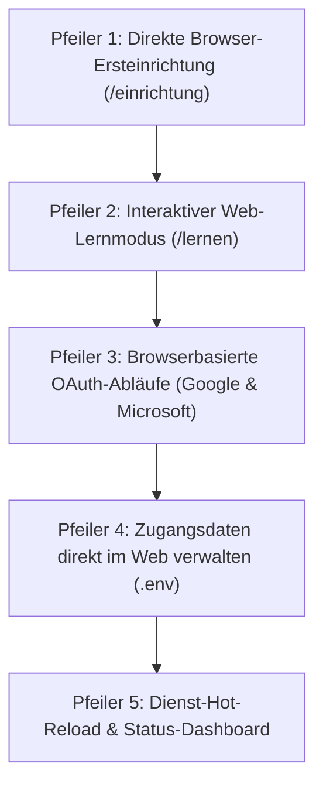
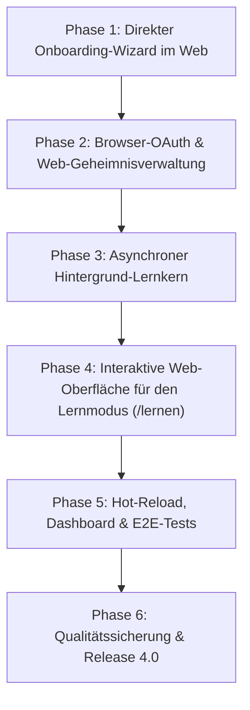

# Mailhelp 4.0 – Browser-First Inbetriebnahme & Web-Lernmodus (Zero-CLI)

**Zielversion:** 4.0.0  
**Stand:** 14. Oktober 2026  
**Status:** In Planung (Großes Haupt-Release nach Abschluss der 3.x-Reihe)  
**Grundlage:** [Entwicklungsregeln](../AGENTS.md), [Projektspezifikation](../Mailhelp-Projektspezifikation.md), [Planung 3.0](Planung-3.0.md), [Planung 3.1](Planung-3.1.md), [Planung 3.2](Planung-3.2.md), [Planung 3.3](Planung-3.3.md)

---

## 1. Leitmotiv und Vision

> **„Von der Installation bis zur ersten verarbeiteten E-Mail – Inbetriebnahme, Konfiguration, Zugangsdaten und der Lernmodus finden vollständig und direkt im Webbrowser statt (Zero-CLI).“**

Mit den Versionen 1.0 bis 3.3 wurde Mailhelp zu einer zuverlässigen, deterministischen E-Mail-Assistenz ausgebaut: bis zu zehn IMAP-Postfächer, flexible Zielprofile (Google Kalender, CalDAV, Todoist, Microsoft 365), Anhangsauswertung, Dubletten-Vorabprüfung, Zusammenführen offener Vorschläge und Web-Push.

Bisher erforderte die Ersteinrichtung und der Betrieb jedoch an mehreren Stellen den Rückgriff auf die Kommandozeile (CLI):
1. **Erstanmeldung:** Die Browser-Kopplung benötigt derzeit `mailhelp --pair` am lokalen Host oder einen über Telegram angeforderten Code; es gibt keinen ungekoppelten Browser-Erststart.
2. **Geheimnisse:** `.env` musste manuell per Texteditor angelegt werden (`MAILHELP_WEB_SECRET`, Passwörter, API-Keys).
3. **OAuth-Autorisierung:** Google- und Microsoft-Tokens erforderten CLI-Aufrufe (`mailhelp --google-auth` oder Device-Code im Terminal).
4. **Lernmodus:** Der Lernmodus zur Ersteinmessung (`--learn`) lief ausschließlich im Terminal mit Einzelfragen (`j/n`).

**Version 4.0 beseitigt alle Terminal-Schritte vollständig:**  
Nach der Programminstallation (`pip install` oder `docker compose up`) öffnet der Nutzer einfach `http://localhost:8765` im Browser. Ein geführter Onboarding-Assistent richtet Postfächer, Passwörter und Dienste ein. Der Lernmodus wird zu einer interaktiven, visuellen Webanwendung mit Fortschrittsanzeige und komfortabler Kartenauswahl.

Das beschreibt das geplante Ziel, keine Funktion des aktuellen 3.3.1-Stands.
Die bestehende authentifizierte Einrichtung unter `/einrichtung`, Diagnose,
Postfachverwaltung und das Web-Facelift sind bereits verfügbar. Seit 3.4 sind außerdem
Postfächer, IServ-Konten und Zugangsdaten (Pfeiler 4, nur schreibend, ohne
`MAILHELP_WEB_SECRET`) im Web pflegbar. Web-Lernmodus, browsergesteuerte OAuth-Einrichtung
und ein Erststart ohne gültige Basiskonfiguration bleiben zukünftige Arbeiten.

---

## 2. Die fünf Kernsäulen von Version 4.0



---

### Pfeiler 1: Direkte Browser-Ersteinrichtung (Onboarding-Wizard)

#### 1.1 Direkter Einstieg ohne Hürden
Wenn Mailhelp gestartet wird und noch keine `config.yaml` existiert:
- Der Server startet direkt im Einrichtungsmodus.
- Der Aufruf der Weboberfläche im Browser (`http://localhost:8765` bzw. die Server-IP) öffnet unmittelbar den Ersteinrichtungs-Assistenten.
- Es ist **kein** vorheriger Terminal-Befehl (`mailhelp --pair`), kein Einrichtungs-Token und keine manuelle Datei-Vorbereitung erforderlich.

#### 1.2 Der 5-stufige Onboarding-Flow

```
[1. Web-Zugang] ──► [2. Postfach] ──► [3. KI-Anbieter] ──► [4. Kalender & Aufgaben] ──► [5. Fertig & Lernen]
```

1. **Schritt 1: Web-Zugang & Zeitzone**
   - Vergabe eines Passworts für die Weboberfläche.
   - `MAILHELP_WEB_SECRET` wird im Hintergrund automatisch generiert und in `.env` gespeichert.
   - Die Systemzeitzone wird automatisch anhand des Browsers vorbelegt (z. B. `Europe/Berlin`) und kann angepasst werden.
2. **Schritt 2: Erstes IMAP-Postfach**
   - Eingabe von Host, Port, Verschlüsselung (SSL/TLS/STARTTLS), Benutzername und Passwort.
   - **Schaltfläche „Verbindung jetzt prüfen“:**
     - Testet die Erreichbarkeit und listet gefundene Ordner auf.
     - Automatische Vorauswahl für `INBOX` und den Entwurfsordner (`Drafts`, `Entwürfe`).
3. **Schritt 3: KI-Anbindung (LLM)**
   - Auswahl zwischen:
     - *OpenRouter (Cloud):* Eingabe des API-Keys mit Schaltfläche zum Prüfen des Guthabens und der Modellverfügbarkeit.
     - *Ollama (Lokal):* Eingabe der URL (`http://localhost:11434`) mit automatischem Abruf der lokal installierten Modelle.
4. **Schritt 4: Kalender- und Aufgabenziele**
   - Auswahl der Zieldienste (Google Kalender, CalDAV, Todoist, Microsoft 365).
   - Direkte Autorisierung im Browser per Klick (siehe Pfeiler 3).
5. **Schritt 5: Abschluss & Direktsprung in den Lernmodus**
   - Speichert die Konfiguration atomar in `config.yaml` und `.env`.
   - Der Dienst startet direkt im Hintergrund und leitet den Nutzer nahtlos zum **Web-Lernmodus** weiter.

---

### Pfeiler 2: Interaktiver Web-Lernmodus (`/lernen`)

Der bisherige Terminal-Dialog `mailhelp --learn [N]` wird zu einer intuitiven Webanwendung ausgebaut.

#### 2.1 Konfiguration des Lernlaufs
Auf `/lernen` wählt der Nutzer:
- **Postfach:** Ein konkretes Postfach oder alle aktivierten Postfächer.
- **Umfang:** Schnellauswahl (z. B. 25, 50 oder 100 Mails) oder freie Zahl.
- **Ordner:** Zu durchsuchende Ordner (z. B. Posteingang und Gesendet).
- **Kostentransparenz:** Anzeige der geschätzten Tokenanzahl und maximalen Kosten vor dem Start.

#### 2.2 Asynchroner Hintergrundlauf mit Live-Fortschritt
- Der Lernlauf läuft als Hintergrund-Job und blockiert weder den Server noch den Browser.
- Die Weboberfläche zeigt den Status in Echtzeit:
  - Fortschrittsbalken: *„34 von 50 Mails analysiert (68 %)“*.
  - Aktuelle Aktivität (z. B. Betreffzeile der gerade analysierten Mail).
  - Zwischenstand: Anzahl gefundener Themen, erkannter Newsletter und verbrauchter Tokens.
  - Schaltflächen zum **Pausieren** und **Abbrechen**.

#### 2.3 Die interaktive Review-Maske
Nach Abschluss der Analyse zeigt die Weboberfläche die Ergebnisse übersichtlich in Reitern:

1. **Relevante Themen (`topics.yaml`):**
   - Ansicht als Themenkarten:
     - **Titel:** Direkt editierbares Textfeld.
     - **Beschreibung:** Mehrzeiliges Textfeld zum Präzisieren der Definition.
     - **Beleg-Mails:** Ausklappbare Liste der Mails, aus denen das Thema abgeleitet wurde.
     - **Postfächer:** Zuordnung zu bestimmten Postfächern (gemäß Version 3.2) oder global.
     - **Checkbox:** Thema übernehmen / abwählen.
2. **Ausschluss-Themen (`irrelevant_topics.yaml`):**
   - Automatisch erkannte Infomails und Newsletterbereiche, die mit einem Klick ignoriert werden können.
3. **Absenderfilter (`irrelevant-senders.json`):**
   - Liste erkannter Newsletter- und Info-Absender.
   - Checkboxen zur Übernahme in die Sperrliste (global oder postfachbezogen).
4. **Erkannte Ordner:**
   - Im Postfach gefundene Ordner, die mit einem Klick zur Überwachung in `config.yaml` hinzugefügt werden können.

Ein Klick auf **„Ausgewählte Ergebnisse übernehmen“** speichert die Themen, Filter und Ordner atomar ab.

---

### Pfeiler 3: Browserbasierte OAuth-Abläufe (Google & Microsoft)

Keine Terminal-Befehle mehr für OAuth:

* **Google Kalender (Web-Redirect):**
  1. Klick auf *„Google Kalender verbinden“* im Browser.
  2. Weiterleitung zur Google-Zustimmungsseite.
  3. Automatische Rückleitung auf `http://localhost:8765/auth/google/callback`.
  4. Das Backend speichert den Refresh-Token direkt in `.env` und lädt die verfügbaren Kalender.
* **Microsoft 365 (Device-Code im Web-Modal):**
  1. Klick auf *„Microsoft-Konto verbinden“*.
  2. Ein Modal-Dialog im Browser zeigt den Microsoft-Code (z. B. `ABCD-EFGH`) mit Kopier-Button und Direktlink zu `https://microsoft.com/devicelogin`.
  3. Die Web-UI pollt im Hintergrund, erkennt die erfolgreiche Anmeldung automatisch und schließt das Modal.
* **Todoist & CalDAV:**
  * Direkte Eingabe von API-Token bzw. Zugangsdaten im Webformular mit Test-Button.

---

### Pfeiler 4: Zugangsdaten direkt im Web verwalten (`.env`)

Unter `/einstellungen/geheimnisse` können Zugangsdaten direkt im Browser gepflegt werden:

* **Einfache Verwaltung:** IMAP-Passwörter, API-Keys (OpenRouter), Tokens (Todoist) und OAuth-Secrets direkt über Eingabefelder aktualisieren.
* **Maskierte Anzeige:** Bereits hinterlegte Passwörter und Tokens werden im Formular als `••••••••••••` dargestellt.
* **Atomares Speichern:** Der Editor aktualisiert gezielt die Werte in der `.env`-Datei, ohne Kommentare oder andere Zeilen zu beschädigen.

---

### Pfeiler 5: Dienst-Hot-Reload & Status-Dashboard

* **Hot-Reload per Mausklick (`/dienst/neu-laden`):** Nach Änderungen an Postfächern, Themen oder Zugangsdaten genügt ein Klick im Web, um die Dienste sauber neu zu initialisieren – ganz ohne Prozess- oder Container-Neustart.
* **Dashboard (`/status`):**
  * Statusanzeige aller Postfächer (Erreichbarkeit, letzte Abfrage, Fehler).
  * Übersicht verarbeiteter Mails und offener Vorschläge.
  * Token- und Kostenverbrauch des laufenden Monats.
  * 1-Klick-Selbsttest aller Komponenten mit verständlichen Handlungsempfehlungen.

---

## 3. Web-Routen und Schnittstellen

| Methode | Pfad | Zweck |
| :--- | :--- | :--- |
| `GET` | `/einrichtung/start` | Einstieg in den Ersteinrichtungs-Wizard |
| `POST` | `/einrichtung/test/imap` | Live-Verbindungstest für IMAP-Zugangsdaten |
| `POST` | `/einrichtung/test/llm` | Live-Test für OpenRouter / Ollama |
| `POST` | `/einrichtung/speichern` | Atomare Initial-Konfiguration speichern |
| `GET` | `/lernen` | Startseite des Web-Lernmodus (Auswahl Postfach/Umfang) |
| `POST` | `/lernen/api/start` | Startet den asynchronen Lernlauf im Hintergrund |
| `GET` | `/lernen/api/status/<id>` | Live-Status und Fortschritt des Lernlaufs |
| `POST` | `/lernen/api/control/<id>` | Lernlauf pausieren, fortsetzen oder abbrechen |
| `GET` | `/lernen/review/<id>` | Interaktive Review-Maske für Themen und Filter |
| `POST` | `/lernen/api/apply/<id>` | Ausgewählte Themen und Filter verbindlich speichern |
| `GET` | `/auth/google/start` | Startet Google OAuth Web-Redirect |
| `GET` | `/auth/google/callback` | Nimmt Auth-Code von Google entgegen und speichert Token |
| `POST` | `/auth/microsoft/device` | Fordert Microsoft Device-Code an |
| `GET` | `/auth/microsoft/poll` | Pollt Microsoft Token-Status bis zur Bestätigung |
| `GET` | `/einstellungen/geheimnisse` | Übersicht der Zugangsdaten (maskiert) |
| `POST` | `/einstellungen/geheimnisse/speichern` | Aktualisiert Passwörter und Schlüssel in `.env` |
| `POST` | `/dienst/neu-laden` | Lädt Konfiguration und Adapter im laufenden Betrieb neu |

---

## 4. UI-Wireframes

### 4.1 Onboarding-Assistent (Postfach-Einrichtung)

```text
┌────────────────────────────────────────────────────────────────────────┐
│  MAILHELP ERSTEINRICHTUNG                          Schritt 2 von 5     │
├────────────────────────────────────────────────────────────────────────┤
│  [✓ 1. Web-Zugang] ──► [● 2. Postfach] ──► [○ 3. KI] ──► [○ 4. Ziele]  │
├────────────────────────────────────────────────────────────────────────┤
│                                                                        │
│  E-Mail-Postfach verbinden (IMAP)                                      │
│                                                                        │
│  Bezeichnung:       [ Privat                     ]                     │
│  Server-Adresse:    [ imap.web.de                ]   Port: [ 993   ]   │
│  Verschlüsselung:   (•) SSL/TLS    ( ) STARTTLS    ( ) Keine           │
│  Benutzername:      [ max.mustermann@web.de      ]                     │
│  Passwort:          [ •••••••••••••••••••••••••• ]                     │
│                                                                        │
│  [ Verbindung jetzt testen ]                                           │
│  ✓ Verbindung erfolgreich hergestellt!                                 │
│                                                                        │
│  Gefundene Ordner:                                                     │
│  Haupt-Posteingang: [ INBOX                    ▼ ]                     │
│  Entwurfsordner:    [ Entwürfe                 ▼ ] (Erkannt)           │
│                                                                        │
│  [ Zurück ]                                            [ Weiter zu KI ]│
└────────────────────────────────────────────────────────────────────────┘
```

### 4.2 Web-Lernmodus (Live-Fortschritt)

```text
┌────────────────────────────────────────────────────────────────────────┐
│  LERNMODUS: POSTFACH KALIBRIEREN                                       │
├────────────────────────────────────────────────────────────────────────┤
│                                                                        │
│  Analysiere Postfach „Privat“ ...                                      │
│                                                                        │
│  [████████████████████████░░░░░░░░░░░░░░░░░░░░] 48 % (24 / 50 Mails)   │
│                                                                        │
│  Aktueller Schritt: Relevanz und Themen aus Mail 24 extrahieren         │
│  Betreff:           „Einladung zur Jahreshauptversammlung“             │
│                                                                        │
│  Zwischenstand:                                                        │
│  • 5 relevante Themen gefunden                                         │
│  • 8 Newsletter / Werbe-Absender erkannt                               │
│  • Verbrauchte Tokens: 38.410 (Geschätzte Kosten: 0,06 €)              │
│                                                                        │
│  [ Pausieren ]                                [ Lernlauf abbrechen ]   │
└────────────────────────────────────────────────────────────────────────┘
```

### 4.3 Web-Lernmodus (Review der Themen)

```text
┌────────────────────────────────────────────────────────────────────────┐
│  LERNERGEBNISSE PRÜFEN & ÜBERNEHMEN                                    │
├────────────────────────────────────────────────────────────────────────┤
│  [ Relevante Themen (5) ]  [ Newsletter (3) ]  [ Absenderfilter (8) ]  │
├────────────────────────────────────────────────────────────────────────┤
│                                                                        │
│  [✓] THEMA: Sportverein TSV                                            │
│      Beschreibung: [ Angelegenheiten rund um Training, Termine und   ] │
│                    [ Mitgliedschaft beim TSV Musterstadt.            ] │
│      Postfächer:   [x] Privat   [ ] Arbeit                             │
│      Belege (3):   • 12.10. „Training fällt aus am Freitag“            │
│                    • 08.10. „Mitgliedsbeitrag 2026“                    │
│                                                                        │
│  [✓] THEMA: Hausverwaltung                                             │
│      Beschreibung: [ Nebenkostenabrechnung und Beschlüsse der WEG.   ] │
│      Postfächer:   [x] Privat   [ ] Arbeit                             │
│      Belege (2):   • 05.10. „Protokoll der Beiratssitzung“             │
│                                                                        │
│  [ Vorheriges ]                                                        │
│                                      [ Ausgewählte Themen übernehmen ] │
└────────────────────────────────────────────────────────────────────────┘
```

---

## 5. Umsetzungsphasen und Meilensteine



| Phase | Schwerpunkt | Fertig, wenn … |
| :--- | :--- | :--- |
| **Phase 1** | **Onboarding-Wizard** | - Uninitialisierter Start öffnet direkt `/einrichtung/start`.<br>- Wizard erfasst Passwort, IMAP (mit Test), KI und Ziele.<br>- Erzeugt `config.yaml` und `.env` atomar. |
| **Phase 2** | **OAuth & Geheimnisse** | - Google OAuth Callback-Handler im Webserver aktiv.<br>- Microsoft Device-Code Modal mit Polling im Web funktionsfähig.<br>- Zugangsdaten-Editor unter `/einstellungen/geheimnisse` maskiert Passwörter und schreibt `.env`. |
| **Phase 3** | **Lernmodus-Backend** | - Hintergrund-Jobrunner führt Mailabruf und Themenanalyse entkoppelt aus.<br>- REST-Schnittstellen für Status, Zwischenergebnisse und Kostenüberwachung aktiv.<br>- Pausieren und Abbrechen abgesichert. |
| **Phase 4** | **Lernmodus-Frontend** | - Konfigurationsmaske und Live-Fortschrittsanzeige im Web verfügbar.<br>- Kartenbasierte Review-Maske zum Prüfen, Editieren und Auswählen von Themen und Filtern.<br>- Speichern aktualisiert `topics.yaml` und `irrelevant-senders.json`. |
| **Phase 5** | **Hot-Reload & Dashboard** | - Klick auf `/dienst/neu-laden` reinitialisiert Reader und Adapter im laufenden Betrieb.<br>- Nahtloser Übergang: Onboarding leitet nach Abschluss direkt zum Lernmodus weiter.<br>- Playwright E2E-Tests für den gesamten Browser-Ablauf. |
| **Phase 6** | **Qualitätssicherung** | - 100 % Zeilen- und Branch-Coverage.<br>- Verifikation auf Windows 11 und Docker.<br>- Doku in Spezifikation, Betriebsanleitung und `README.md` aktualisiert. |

---

## 6. Abnahme- und Qualitätskriterien ([`AGENTS.md`](../AGENTS.md))

1. **Vollständige Terminal-Freiheit:**
   - Mailhelp kann nach `pip install` oder `docker compose up` komplett im Browser eingerichtet, autorisiert, trainiert und betrieben werden.
   - Kein einziger Aufruf von `mailhelp --pair`, `mailhelp --google-auth` oder `mailhelp --learn` ist zwingend erforderlich (die CLI-Befehle bleiben als Headless-Alternative erhalten).
2. **100 % Zeilen- und Branch-Abdeckung:**
   - Verbindlich für alle neuen Web-Handler, Controller, OAuth-Module und den Jobrunner.
   - Jeder Bugfix erhält einen Regressionstest.
3. **Schutz vor eigenmächtigem Schreiben:**
   - Auch der Web-Lernmodus erzeugt keine Kalender- oder Todoist-Einträge.
   - Externe Schreibzugriffe erfordern weiterhin die ausdrückliche Bestätigung konkreter Vorschläge.
4. **Fehler- und Warnungsfreiheit:**
   - `ruff check src tests` meldet 0 Fehler.
   - `mypy` meldet 0 Fehler.
