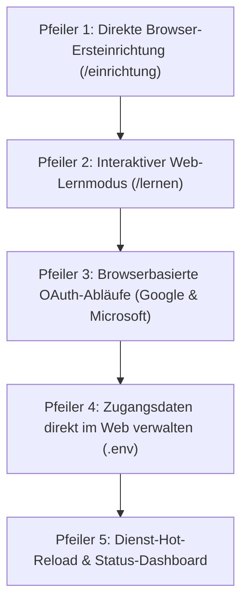
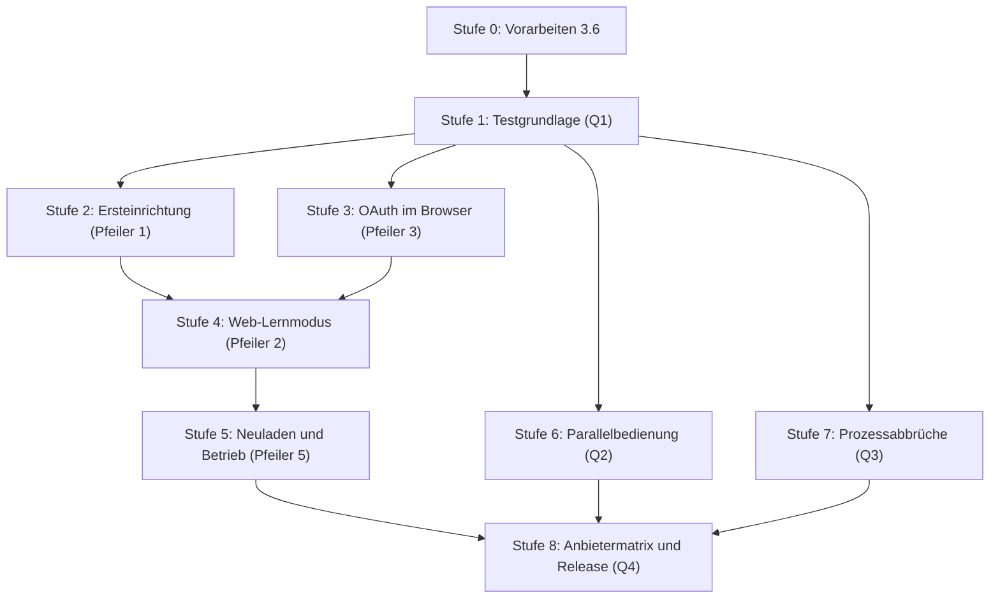

# Mailhelp 4.0 – Browser-First Inbetriebnahme & Web-Lernmodus (Zero-CLI)

**Zielversion:** 4.0.0  
**Stand:** 3. November 2026<br>
**Status:** In Planung (Großes Haupt-Release nach Abschluss der 3.x-Reihe)  
**Ausgangsstand:** 3.5.8  
**Grundlage:** [Entwicklungsregeln](../AGENTS.md), [Projektspezifikation](../Mailhelp-Projektspezifikation.md), [Planung 3.0](Planung-3.0.md), [Planung 3.1](Planung-3.1.md), [Planung 3.2](Planung-3.2.md), [Planung 3.3](Planung-3.3.md), [Planung 3.4](Planung-3.4.md), [Planung 3.5](Planung-3.5.md)

---

## 1. Leitmotiv und Vision

> **„Von der Installation bis zur ersten verarbeiteten E-Mail – Inbetriebnahme, Konfiguration, Zugangsdaten und der Lernmodus finden vollständig und direkt im Webbrowser statt (Zero-CLI).“**

Mit den Versionen 1.0 bis 3.3 wurde Mailhelp zu einer zuverlässigen, deterministischen E-Mail-Assistenz ausgebaut: bis zu zehn IMAP-Postfächer, flexible Zielprofile (Google Kalender, CalDAV, Todoist, Microsoft 365), Anhangsauswertung, Dubletten-Vorabprüfung, Zusammenführen offener Vorschläge und Web-Push.

Bisher erforderte die Ersteinrichtung und der Betrieb jedoch an mehreren Stellen den Rückgriff auf die Kommandozeile (CLI):
1. **Erstanmeldung:** Die Browser-Kopplung benötigt derzeit `mailhelp --pair` am lokalen Host oder einen über Telegram angeforderten Code; es gibt keinen ungekoppelten Browser-Erststart.
2. **Geheimnisse:** `.env` musste manuell per Texteditor angelegt werden (`MAILHELP_WEB_SECRET`, Passwörter, API-Keys).
3. **OAuth-Autorisierung:** Google- und Microsoft-Tokens erforderten CLI-Aufrufe (`mailhelp --google-auth` oder Device-Code im Terminal).
4. **Lernmodus:** Der Lernmodus zur Ersteinmessung (`--learn`) lief ausschließlich im Terminal mit Einzelfragen (`j/n`).

**Version 4.0 beseitigt alle Terminal-Schritte vollständig:**  
Nach der Programminstallation (`pip install` oder `docker compose up`) öffnet der Nutzer einfach `http://localhost:8765` im Browser. Ein geführter Onboarding-Assistent richtet Postfächer, Passwörter und Dienste ein. Der Lernmodus wird zu einer interaktiven, visuellen Webanwendung mit Fortschrittsanzeige und komfortabler Kartenauswahl.

Das beschreibt das geplante Ziel, keine Funktion des aktuellen Stands 3.5.8.

### 1.1 Ausgangsstand 3.5.8

| Bereich | Vorhanden | Offen für 4.0 |
| :--- | :--- | :--- |
| Pfeiler 1 Ersteinrichtung | Authentifizierte Einrichtung `/einrichtung` mit Entwurf, Übernahme und IMAP-Prüfung samt Ordnerliste; Postfächer und IServ-Konten im Web hinzufügen (3.5); lokale Kopplung über `/api/local-pair`; Ordnerliste je Postfach in `mailbox-folders.json` (3.5.6). | Start ohne `config.yaml` (bricht heute mit `FileNotFoundError` ab), Web-Passwort statt Kopplung, automatisches `MAILHELP_WEB_SECRET`, KI-Test, Ollama-Modellliste, geführter 5-Schritte-Assistent. |
| Pfeiler 2 Web-Lernmodus | Bausteine: Themenpflege `/themen`, Absenderfilter je Postfach, Tätigkeitsberichte `/berichte`. Lernmodus nur als `--learn` im Terminal ([learning.py](../src/mailhelp/learning.py) fragt per `input()`). | Lernkern ohne Terminal, Hintergrundjob, Fortschritt, Review-Maske, gemeinsame Übernahme. |
| Pfeiler 3 OAuth | Google nur über `--google-auth` mit lokalem Loopback-Server (`127.0.0.1:<Zufallsport>`), Microsoft nur per Device-Code im Terminal. | Beide Abläufe im Browser. |
| Pfeiler 4 Zugangsdaten | Seit 3.4 umgesetzt: maskiert, nur schreibend unter `/einstellungen?bereich=zugangsdaten` (statt des ursprünglich geplanten `/einstellungen/geheimnisse`). | `MAILHELP_WEB_SECRET` (Pfeiler 1) und OAuth-Tokens (Pfeiler 3). |
| Pfeiler 5 Betrieb | `/status`, `/diagnose`, `/auswertung` (Kosten), kontrollierter Neustart (seit 3.5.7 auch unter Windows), Live-Aktivierung neuer Postfächer und IServ-Konten, Live-Übernahme einzelner Einstellungen. | Neuladen geänderter/entfernter Postfächer, Zugangsdaten, Themen und Ziele ohne Neustart (in 3.5 ausdrücklich ausgeklammert); Selbsttest mit Handlungsempfehlungen. |
| Abschnitt 7 (Q1–Q4) | Einzelne Tests zu Wiederholung, Idempotenz, Sitzungsprüfung und Merge-Journal. | Teststeuerung, persistenter Simulationsdienst, P1–P7, A1–A7, Anbietermatrix, Abschlussbericht. |

---

## 2. Die fünf Kernsäulen von Version 4.0



---

### Pfeiler 1: Direkte Browser-Ersteinrichtung (Onboarding-Wizard)

#### 1.1 Direkter Einstieg ohne Hürden
Wenn Mailhelp gestartet wird und noch keine `config.yaml` existiert:
- Der Server startet direkt im Einrichtungsmodus.
- Der Aufruf der Weboberfläche im Browser (`http://localhost:8765` bzw. die Server-IP) öffnet unmittelbar den Ersteinrichtungs-Assistenten.
- Es ist **kein** vorheriger Terminal-Befehl (`mailhelp --pair`), kein Einrichtungs-Token und keine manuelle Datei-Vorbereitung erforderlich.

#### 1.2 Der 5-stufige Onboarding-Flow

```
[1. Web-Zugang] ──► [2. Postfach] ──► [3. KI-Anbieter] ──► [4. Kalender & Aufgaben] ──► [5. Fertig & Lernen]
```

1. **Schritt 1: Web-Zugang & Zeitzone**
   - Vergabe eines Passworts für die Weboberfläche.
   - `MAILHELP_WEB_SECRET` wird im Hintergrund automatisch generiert und in `.env` gespeichert.
   - Die Systemzeitzone wird automatisch anhand des Browsers vorbelegt (z. B. `Europe/Berlin`) und kann angepasst werden.
2. **Schritt 2: Erstes IMAP-Postfach**
   - Eingabe von Host, Port, Verschlüsselung (SSL/TLS/STARTTLS), Benutzername und Passwort.
   - **Schaltfläche „Verbindung jetzt prüfen“:**
     - Testet die Erreichbarkeit und listet gefundene Ordner auf.
     - Automatische Vorauswahl für `INBOX` und den Entwurfsordner (`Drafts`, `Entwürfe`).
3. **Schritt 3: KI-Anbindung (LLM)**
   - Auswahl zwischen:
     - *OpenRouter (Cloud):* Eingabe des API-Keys mit Schaltfläche zum Prüfen des Guthabens und der Modellverfügbarkeit.
     - *Ollama (Lokal):* Eingabe der URL (`http://localhost:11434`) mit automatischem Abruf der lokal installierten Modelle.
4. **Schritt 4: Kalender- und Aufgabenziele**
   - Auswahl der Zieldienste (Google Kalender, CalDAV, Todoist, Microsoft 365).
   - Direkte Autorisierung im Browser per Klick (siehe Pfeiler 3).
5. **Schritt 5: Abschluss & Direktsprung in den Lernmodus**
   - Speichert die Konfiguration atomar in `config.yaml` und `.env`.
   - Der Dienst startet direkt im Hintergrund und leitet den Nutzer nahtlos zum **Web-Lernmodus** weiter.

---

### Pfeiler 2: Interaktiver Web-Lernmodus (`/lernen`)

Der bisherige Terminal-Dialog `mailhelp --learn [N]` wird zu einer intuitiven Webanwendung ausgebaut.

#### 2.1 Konfiguration des Lernlaufs
Auf `/lernen` wählt der Nutzer:
- **Postfach:** Ein konkretes Postfach oder alle aktivierten Postfächer.
- **Umfang:** Schnellauswahl (z. B. 25, 50 oder 100 Mails) oder freie Zahl.
- **Ordner:** Zu durchsuchende Ordner (z. B. Posteingang und Gesendet).
- **Kostentransparenz:** Anzeige der geschätzten Tokenanzahl und maximalen Kosten vor dem Start.

#### 2.2 Asynchroner Hintergrundlauf mit Live-Fortschritt
- Der Lernlauf läuft als Hintergrund-Job und blockiert weder den Server noch den Browser.
- Die Weboberfläche zeigt den Status in Echtzeit:
  - Fortschrittsbalken: *„34 von 50 Mails analysiert (68 %)“*.
  - Aktuelle Aktivität (z. B. Betreffzeile der gerade analysierten Mail).
  - Zwischenstand: Anzahl gefundener Themen, erkannter Newsletter und verbrauchter Tokens.
  - Schaltflächen zum **Pausieren** und **Abbrechen**.

#### 2.3 Die interaktive Review-Maske
Nach Abschluss der Analyse zeigt die Weboberfläche die Ergebnisse übersichtlich in Reitern:

1. **Relevante Themen (`topics.yaml`):**
   - Ansicht als Themenkarten:
     - **Titel:** Direkt editierbares Textfeld.
     - **Beschreibung:** Mehrzeiliges Textfeld zum Präzisieren der Definition.
     - **Beleg-Mails:** Ausklappbare Liste der Mails, aus denen das Thema abgeleitet wurde.
     - **Postfächer:** Zuordnung zu bestimmten Postfächern (gemäß Version 3.2) oder global.
     - **Checkbox:** Thema übernehmen / abwählen.
2. **Ausschluss-Themen (`irrelevant_topics.yaml`):**
   - Automatisch erkannte Infomails und Newsletterbereiche, die mit einem Klick ignoriert werden können.
3. **Absenderfilter (`irrelevant-senders.json`):**
   - Liste erkannter Newsletter- und Info-Absender.
   - Checkboxen zur Übernahme in die Sperrliste (global oder postfachbezogen).
4. **Erkannte Ordner:**
   - Im Postfach gefundene Ordner, die mit einem Klick zur Überwachung in `config.yaml` hinzugefügt werden können.

Ein Klick auf **„Ausgewählte Ergebnisse übernehmen“** speichert die Themen, Filter und Ordner atomar ab.

---

### Pfeiler 3: Browserbasierte OAuth-Abläufe (Google & Microsoft)

Keine Terminal-Befehle mehr für OAuth:

* **Google Kalender (Web-Redirect):**
  1. Klick auf *„Google Kalender verbinden“* im Browser.
  2. Weiterleitung zur Google-Zustimmungsseite.
  3. Automatische Rückleitung auf `http://localhost:8765/auth/google/callback`.
  4. Das Backend speichert den Refresh-Token direkt in `.env` und lädt die verfügbaren Kalender.
* **Microsoft 365 (Device-Code im Web-Modal):**
  1. Klick auf *„Microsoft-Konto verbinden“*.
  2. Ein Modal-Dialog im Browser zeigt den Microsoft-Code (z. B. `ABCD-EFGH`) mit Kopier-Button und Direktlink zu `https://microsoft.com/devicelogin`.
  3. Die Web-UI pollt im Hintergrund, erkennt die erfolgreiche Anmeldung automatisch und schließt das Modal.
* **Todoist & CalDAV:**
  * Direkte Eingabe von API-Token bzw. Zugangsdaten im Webformular mit Test-Button.

---

### Pfeiler 4: Zugangsdaten direkt im Web verwalten (`.env`)

> Seit 3.4 weitgehend umgesetzt unter `/einstellungen?bereich=zugangsdaten`; offen sind
> nur `MAILHELP_WEB_SECRET` (Schritt 2.5) und OAuth-Tokens (Pfeiler 3).

Zugangsdaten können direkt im Browser gepflegt werden:

* **Einfache Verwaltung:** IMAP-Passwörter, API-Keys (OpenRouter), Tokens (Todoist) und OAuth-Secrets direkt über Eingabefelder aktualisieren.
* **Maskierte Anzeige:** Bereits hinterlegte Passwörter und Tokens werden im Formular als `••••••••••••` dargestellt.
* **Atomares Speichern:** Der Editor aktualisiert gezielt die Werte in der `.env`-Datei, ohne Kommentare oder andere Zeilen zu beschädigen.

---

### Pfeiler 5: Dienst-Hot-Reload & Status-Dashboard

* **Hot-Reload per Mausklick (`/dienst/neu-laden`):** Nach Änderungen an Postfächern, Themen oder Zugangsdaten genügt ein Klick im Web, um die Dienste sauber neu zu initialisieren – ganz ohne Prozess- oder Container-Neustart.
* **Dashboard (`/status`):**
  * Statusanzeige aller Postfächer (Erreichbarkeit, letzte Abfrage, Fehler).
  * Übersicht verarbeiteter Mails und offener Vorschläge.
  * Token- und Kostenverbrauch des laufenden Monats.
  * 1-Klick-Selbsttest aller Komponenten mit verständlichen Handlungsempfehlungen.

---

## 3. Web-Routen und Schnittstellen

| Methode | Pfad | Zweck |
| :--- | :--- | :--- |
| `GET` | `/einrichtung/start` | Einstieg in den Ersteinrichtungs-Wizard |
| `POST` | `/einrichtung/test/imap` | Live-Verbindungstest für IMAP-Zugangsdaten |
| `POST` | `/einrichtung/test/llm` | Live-Test für OpenRouter / Ollama |
| `POST` | `/einrichtung/speichern` | Atomare Initial-Konfiguration speichern |
| `GET` | `/lernen` | Startseite des Web-Lernmodus (Auswahl Postfach/Umfang) |
| `POST` | `/lernen/api/start` | Startet den asynchronen Lernlauf im Hintergrund |
| `GET` | `/lernen/api/status/<id>` | Live-Status und Fortschritt des Lernlaufs |
| `POST` | `/lernen/api/control/<id>` | Lernlauf pausieren, fortsetzen oder abbrechen |
| `GET` | `/lernen/review/<id>` | Interaktive Review-Maske für Themen und Filter |
| `POST` | `/lernen/api/apply/<id>` | Ausgewählte Themen und Filter verbindlich speichern |
| `GET` | `/auth/google/start` | Startet Google OAuth Web-Redirect |
| `GET` | `/auth/google/callback` | Nimmt Auth-Code von Google entgegen und speichert Token |
| `POST` | `/auth/microsoft/device` | Fordert Microsoft Device-Code an |
| `GET` | `/auth/microsoft/poll` | Pollt Microsoft Token-Status bis zur Bestätigung |
| `GET` | `/einstellungen?bereich=zugangsdaten` | Übersicht der Zugangsdaten (maskiert) – **seit 3.4 vorhanden** |
| `POST` | `/einstellungen/zugangsdaten/speichern` | Aktualisiert Passwörter und Schlüssel in `.env` – **seit 3.4 vorhanden** |
| `POST` | `/dienst/neu-laden` | Lädt Konfiguration und Adapter im laufenden Betrieb neu |

---

## 4. UI-Wireframes

### 4.1 Onboarding-Assistent (Postfach-Einrichtung)

```text
┌────────────────────────────────────────────────────────────────────────┐
│  MAILHELP ERSTEINRICHTUNG                          Schritt 2 von 5     │
├────────────────────────────────────────────────────────────────────────┤
│  [✓ 1. Web-Zugang] ──► [● 2. Postfach] ──► [○ 3. KI] ──► [○ 4. Ziele]  │
├────────────────────────────────────────────────────────────────────────┤
│                                                                        │
│  E-Mail-Postfach verbinden (IMAP)                                      │
│                                                                        │
│  Bezeichnung:       [ Privat                     ]                     │
│  Server-Adresse:    [ imap.web.de                ]   Port: [ 993   ]   │
│  Verschlüsselung:   (•) SSL/TLS    ( ) STARTTLS    ( ) Keine           │
│  Benutzername:      [ max.mustermann@web.de      ]                     │
│  Passwort:          [ •••••••••••••••••••••••••• ]                     │
│                                                                        │
│  [ Verbindung jetzt testen ]                                           │
│  ✓ Verbindung erfolgreich hergestellt!                                 │
│                                                                        │
│  Gefundene Ordner:                                                     │
│  Haupt-Posteingang: [ INBOX                    ▼ ]                     │
│  Entwurfsordner:    [ Entwürfe                 ▼ ] (Erkannt)           │
│                                                                        │
│  [ Zurück ]                                            [ Weiter zu KI ]│
└────────────────────────────────────────────────────────────────────────┘
```

### 4.2 Web-Lernmodus (Live-Fortschritt)

```text
┌────────────────────────────────────────────────────────────────────────┐
│  LERNMODUS: POSTFACH KALIBRIEREN                                       │
├────────────────────────────────────────────────────────────────────────┤
│                                                                        │
│  Analysiere Postfach „Privat“ ...                                      │
│                                                                        │
│  [████████████████████████░░░░░░░░░░░░░░░░░░░░] 48 % (24 / 50 Mails)   │
│                                                                        │
│  Aktueller Schritt: Relevanz und Themen aus Mail 24 extrahieren         │
│  Betreff:           „Einladung zur Jahreshauptversammlung“             │
│                                                                        │
│  Zwischenstand:                                                        │
│  • 5 relevante Themen gefunden                                         │
│  • 8 Newsletter / Werbe-Absender erkannt                               │
│  • Verbrauchte Tokens: 38.410 (Geschätzte Kosten: 0,06 €)              │
│                                                                        │
│  [ Pausieren ]                                [ Lernlauf abbrechen ]   │
└────────────────────────────────────────────────────────────────────────┘
```

### 4.3 Web-Lernmodus (Review der Themen)

```text
┌────────────────────────────────────────────────────────────────────────┐
│  LERNERGEBNISSE PRÜFEN & ÜBERNEHMEN                                    │
├────────────────────────────────────────────────────────────────────────┤
│  [ Relevante Themen (5) ]  [ Newsletter (3) ]  [ Absenderfilter (8) ]  │
├────────────────────────────────────────────────────────────────────────┤
│                                                                        │
│  [✓] THEMA: Sportverein TSV                                            │
│      Beschreibung: [ Angelegenheiten rund um Training, Termine und   ] │
│                    [ Mitgliedschaft beim TSV Musterstadt.            ] │
│      Postfächer:   [x] Privat   [ ] Arbeit                             │
│      Belege (3):   • 12.10. „Training fällt aus am Freitag“            │
│                    • 08.10. „Mitgliedsbeitrag 2026“                    │
│                                                                        │
│  [✓] THEMA: Hausverwaltung                                             │
│      Beschreibung: [ Nebenkostenabrechnung und Beschlüsse der WEG.   ] │
│      Postfächer:   [x] Privat   [ ] Arbeit                             │
│      Belege (2):   • 05.10. „Protokoll der Beiratssitzung“             │
│                                                                        │
│  [ Vorheriges ]                                                        │
│                                      [ Ausgewählte Themen übernehmen ] │
└────────────────────────────────────────────────────────────────────────┘
```

---

## 5. Umsetzungsschritte

### 5.1 Regeln für die Schritte

- Jeder Schritt ist für sich lieferbar: eigener Commit mit Patch-Version, Tests mit
  100 % Zeilen- und Branch-Abdeckung, CHANGELOG, README und – bei Verhaltensänderung –
  Spezifikation und Konfigurationsbeispiel (siehe [`AGENTS.md`](../AGENTS.md)).
- **Umfang:** S = höchstens ein Arbeitstag, M = ein bis zwei Arbeitstage. Ein Schritt,
  der sich bei der Umsetzung als größer erweist, wird vor dem Weiterarbeiten geteilt
  und hier nachgetragen; es gibt keine L-Schritte.
- **Voraussetzung** nennt die Schritte, die vorher abgeschlossen sein müssen.
  Schritte ohne gegenseitige Abhängigkeit dürfen in beliebiger Reihenfolge laufen.
- Ein Schritt gilt erst als erledigt, wenn sein „Fertig, wenn …“ nachweislich erfüllt
  ist. Erledigte Schritte werden hier mit Version markiert (z. B. „✓ 3.6.2“).



### 5.2 Stufe 0 – Vorarbeiten in 3.6.x (vor 4.0)

Diese Schritte beheben bekannte Mängel und schaffen Voraussetzungen, ohne 4.0-Funktionen
vorwegzunehmen.

| Schritt | Inhalt | Fertig, wenn … | Umfang | Voraussetzung |
| :--- | :--- | :--- | :--- | :--- |
| 0.1 | Fehlende `config.yaml` beim Start | Statt Traceback eine verständliche Meldung mit Hinweis auf `config.example.yaml` und Exitcode ≠ 0; Regressionstest. | S | – |
| 0.2 | „Erneut prüfen“: Backend | Ein Befehl setzt eine als irrelevant abgeschlossene Mail kontrolliert auf die Relevanzprüfung zurück und verarbeitet sie mit der aktuellen Konfiguration neu; Checkpoints, Dublettenschutz und Verlauf bleiben konsistent; Wiederholung ist idempotent. | M | – |
| 0.3 | „Erneut prüfen“: Web | Schaltfläche in Maildetail und Archiv mit Sitzung, CSRF, Versionsprüfung und Idempotenzschlüssel; Ergebnis im Verlauf sichtbar. | S | 0.2 |
| 0.4 | Entkopplung B1: Analyse | Gemeinsam genutzter Zustand von Abrufzyklus und Review-Befehlen dokumentiert (Store-Sperren, Ledger, Telegram-Dialog); Liste der nötigen Sperren und Reihenfolgen. | S | – |
| 0.5 | Entkopplung B2: Arbeitsthread | Web-Befehle laufen in einem eigenen Arbeitsthread statt im Abrufzyklus; ein laufender LLM-Aufruf verzögert Web-Aktionen nicht mehr. | M | 0.4 |
| 0.6 | Entkopplung B3: Nachweis | Tests für gleichzeitigen Abruf und Web-Befehl (ohne `sleep()`); gemessene Antwortzeiten während eines Zyklus im Log belegt. | S | 0.5 |
| 0.7 | mypy strikt für `web.*` (Teil 1) | Seiten- und Formularmodule (`pages`, `forms`, `*_pages.py`) bestehen die strikte Prüfung. | M | – |
| 0.8 | mypy strikt für `web.*` (Teil 2) | Site-, Server- und Authentifizierungsmodule bestehen die strikte Prüfung; `pyproject.toml` erzwingt sie dauerhaft. | M | 0.7 |
| 0.9 | Paketbündelung: Zuordnung | Zielstruktur der über 50 Wurzelmodule festgelegt (z. B. `imap/`, `mailbox/`, `notifications/`, `proposals/`), Kompatibilitätsimporte entschieden. | S | – |
| 0.10 | Paketbündelung: je Gruppe | Je Zielpaket ein eigener Schritt (0.10a, 0.10b, …), jeweils ohne Verhaltensänderung, mit grüner Suite und unveränderten Zustandsnamen. | je S | 0.9 |

### 5.3 Stufe 1 – Testgrundlage (Q1)

Abschnitt 7 verlangt Q1 vor Q2/Q3; die Infrastruktur wird außerdem von den Stufen 2–5 genutzt.

| Schritt | Inhalt | Fertig, wenn … | Umfang | Voraussetzung |
| :--- | :--- | :--- | :--- | :--- |
| 1.1 | Zustandsregeln Review und Command-Inbox | Übergänge, Persistenzgrenzen und der Zeitpunkt, ab dem eine konkurrierende Entscheidung verbindlich ist, in der Spezifikation dokumentiert. | S | – |
| 1.2 | Zustandsregeln Schreibausführung, Ledger, Merge-Journal | Wie 1.1 für Schreibauftrag, Ledger und Merge; beide Reihenfolgen konkurrierender Entscheidungen beschrieben. | S | 1.1 |
| 1.3 | Teststeuerung mit Barrieren | Wiederverwendbare Haltepunkte (Events/Barrieren) mit festen Zeitgrenzen und Aufräumen bei Fehlern; unter Windows und Linux lauffähig. | M | – |
| 1.4 | Persistenter Simulationsdienst | Simulierter externer Dienst mit eigener, prozessunabhängiger Ablage und Aufrufhistorie; kann eine Änderung übernehmen und die Antwort zurückhalten oder abbrechen. | M | – |
| 1.5 | Unterprozess-Harness | Anwendungsablauf im Unterprozess startbar, an benannten Punkten hart beendbar (kein Exception-Abbruch), Coverage der Unterprozesse wird erfasst. | M | 1.3 |

### 5.4 Stufe 2 – Ersteinrichtung im Browser (Pfeiler 1)

> **Offene Entscheidung (vor 2.2):** Ein ungeschützter Erststart ist gefährlich, wenn die
> Weboberfläche im Netz erreichbar ist (`web.host: 0.0.0.0`). Vorschlag: Bis ein
> Web-Passwort gesetzt ist, nimmt der Einrichtungsmodus Anfragen nur von `localhost` an
> oder verlangt einen einmaligen Code aus der Konsolenausgabe. Das weicht vom Ziel
> „kein Einrichtungs-Token“ in 1.1 ab und muss bestätigt werden.

| Schritt | Inhalt | Fertig, wenn … | Umfang | Voraussetzung |
| :--- | :--- | :--- | :--- | :--- |
| 2.1 | Einrichtungsmodus ohne `config.yaml` | Der Start ohne Konfiguration öffnet einen minimalen Webserver, der nur Einrichtungsrouten bedient; kein Abruf, keine Adapter. | M | 0.1 |
| 2.2 | Schutz des Erstzugangs | Umsetzung der offenen Entscheidung oben; Tests für Zugriff von außen vor und nach Passwortvergabe. | S | 2.1 |
| 2.3 | Web-Passwort: Speicherung | Passwort als langsamer Hash (z. B. scrypt) außerhalb von `config.yaml`; Ändern und Zurücksetzen definiert. | S | 2.2 |
| 2.4 | Web-Passwort: Anmeldung | Anmeldung per Passwort neben der Kopplung, mit bestehenden Sitzungen, CSRF und Sperre nach Fehlversuchen. | M | 2.3 |
| 2.5 | `MAILHELP_WEB_SECRET` automatisch | Wird beim Abschluss von Schritt 1 erzeugt und atomar in `.env` geschrieben; nie angezeigt oder protokolliert. | S | 2.1 |
| 2.6 | Assistent: Rahmen und Schritt 1 | Fünfstufige Navigation mit Zwischenspeicherung im Entwurf; Zeitzone aus dem Browser vorbelegt, ohne JavaScript manuell wählbar. | M | 2.4 |
| 2.7 | Assistent: Postfach | Nutzt die vorhandene Postfachprüfung inklusive Ordnerliste; Vorauswahl von `INBOX` und Entwurfsordner über die Special-Use-Rollen. | S | 2.6 |
| 2.8 | Assistent: OpenRouter | API-Schlüssel prüfen, Guthaben und Verfügbarkeit der konfigurierten Modelle anzeigen. | S | 2.6 |
| 2.9 | Assistent: Ollama | Adresse prüfen, installierte Modelle abrufen und zur Auswahl anbieten. | S | 2.6 |
| 2.10 | Assistent: Ziele ohne OAuth | Todoist-Token und CalDAV-Zugang eingeben und prüfen; Google und Microsoft verweisen auf Stufe 3. | S | 2.6 |
| 2.11 | Abschluss und Übergang | `config.yaml` und `.env` atomar geschrieben; Übergang in den Normalbetrieb (zunächst per kontrolliertem Neustart, ab Stufe 5 ohne). | M | 2.7–2.10 |
| 2.12 | Browsertest Ersteinrichtung | Playwright-Durchlauf vom leeren Verzeichnis bis zum ersten Abruf mit simulierten Diensten. | S | 2.11 |

### 5.5 Stufe 3 – OAuth im Browser (Pfeiler 3)

> **Offene Entscheidung (vor 3.1):** Der heutige Google-Client nutzt eine Loopback-Adresse
> (`127.0.0.1`) und funktioniert nur, wenn Browser und Mailhelp auf demselben Rechner laufen.
> Für den Zugriff über die Server-IP oder Docker auf einem anderen Rechner ist entweder ein
> Webclient mit registrierter Rückleitungsadresse oder ein Device-Flow nötig. Die Wahl
> bestimmt den Umfang von 3.1–3.3.

| Schritt | Inhalt | Fertig, wenn … | Umfang | Voraussetzung |
| :--- | :--- | :--- | :--- | :--- |
| 3.1 | Google: Start | `/auth/google/start` erzeugt `state` und PKCE, an die Websitzung gebunden und dauerhaft gespeichert. | S | 2.4 |
| 3.2 | Google: Rückleitung | `/auth/google/callback` prüft `state`, Sitzung und Ablauf, tauscht den Code und speichert den Refresh-Token über den Zugangsdatendienst; Fehler- und Abbruchfälle getestet. | M | 3.1 |
| 3.3 | Google: Kalenderauswahl | Verfügbare Kalender laden und als Ziel im Zielprofil übernehmen. | S | 3.2 |
| 3.4 | Microsoft: Device-Code | Anforderung und Abfrage laufen im Hintergrund, Status dauerhaft gespeichert; Ablauf, Ablehnung und Neustart während des Wartens getestet. | M | 2.4 |
| 3.5 | Microsoft: Oberfläche | Code mit Kopierknopf und Link; Statusanzeige ohne JavaScript per Neuladen, mit JavaScript automatisch. | S | 3.4 |
| 3.6 | Einbindung in Assistent und Zielprofile | Verbinden aus Schritt 4 des Assistenten und aus `/einstellungen/zielprofile`; CLI-Befehle bleiben als Alternative. | S | 2.10, 3.3, 3.5 |

### 5.6 Stufe 4 – Web-Lernmodus (Pfeiler 2)

| Schritt | Inhalt | Fertig, wenn … | Umfang | Voraussetzung |
| :--- | :--- | :--- | :--- | :--- |
| 4.1 | Lernkern ohne Terminal | Der Lernkern sammelt Ergebnisse als Datenstruktur statt per `input()` zu fragen; `--learn` nutzt denselben Kern und bleibt unverändert bedienbar. | M | – |
| 4.2 | Lernjob: Zustandsmodell | Persistierter Job (Parameter, Fortschritt, Zwischenergebnisse, Status) als lesbare JSON-Datei; Neustart setzt fort oder schließt sauber ab. | S | 4.1 |
| 4.3 | Lernjob: Hintergrundausführung | Ausführung in eigenem Thread, ohne Abruf und Web zu blockieren; höchstens ein Lernjob gleichzeitig. | M | 4.2, 0.5 |
| 4.4 | Pausieren und Abbrechen | Wirksam zwischen zwei Mails, auch nach Neustart; Tests mit Barrieren aus 1.3. | S | 4.3, 1.3 |
| 4.5 | Kostenschätzung | Geschätzte Tokens und Höchstkosten vor dem Start; Abbruch bei Erreichen des Budgets. | S | 4.2 |
| 4.6 | Startseite `/lernen` | Auswahl von Postfach, Umfang und Ordnern (aus `mailbox-folders.json`), Anzeige der Schätzung, Start mit Bestätigung. | S | 4.3, 4.5 |
| 4.7 | Fortschrittsseite | Fortschritt, aktueller Schritt und Zwischenstand; ohne JavaScript per Neuladen, mit JavaScript über die Status-API. | S | 4.6 |
| 4.8 | Review: Themen | Themenkarten mit editierbarem Titel und Beschreibung, Belegmails, Postfachzuordnung und Auswahl. | M | 4.7 |
| 4.9 | Review: Ausschlussthemen und Absender | Erkannte Newsletter und Absender zur Übernahme, global oder je Postfach. | S | 4.8 |
| 4.10 | Review: Ordner | Erkannte, noch nicht abgerufene Ordner zur Aufnahme in `folders`; Spam- und Papierkorbordner (Rolle `junk`/`trash`) standardmäßig abgewählt. | S | 4.8 |
| 4.11 | Atomare Übernahme | Ausgewählte Themen, Filter und Ordner gemeinsam mit Versionsprüfung, CSRF und Idempotenzschlüssel gespeichert; keine externen Schreibzugriffe. | M | 4.9, 4.10 |
| 4.12 | Browsertest Lernmodus | Durchlauf Start → Fortschritt → Review → Übernahme mit simulierten Diensten; Weiterleitung aus dem Assistenten (2.11). | S | 4.11, 2.11 |

### 5.7 Stufe 5 – Neuladen und Betrieb (Pfeiler 5)

> Themen, Prompts und `config.yaml` gehen in den Konfigurations-Fingerprint ein. Neuladen
> darf halb verarbeitete Mails nicht mit `configuration_changed` liegen lassen; 5.1 legt fest,
> ob vor dem Wechsel laufende Mails abgeschlossen oder bewusst neu begonnen werden.

| Schritt | Inhalt | Fertig, wenn … | Umfang | Voraussetzung |
| :--- | :--- | :--- | :--- | :--- |
| 5.1 | Neuladekonzept | Je Komponente festgelegt, was ohne Neustart getauscht werden kann, an welchem sicheren Punkt und wie mit dem Fingerprint umgegangen wird. | S | 0.5 |
| 5.2 | Themen und Prompts neu laden | Wechsel am sicheren Punkt zwischen zwei Mails, ohne verwaiste Mails. | M | 5.1 |
| 5.3 | Postfach ändern oder entfernen | Reader-Austausch für bestehende Postfächer, Checkpoints und Warteschlangen bleiben konsistent. | M | 5.1 |
| 5.4 | Zugangsdaten tauschen | Neue Zugangsdaten werden ohne Neustart wirksam; alte Verbindungen werden geschlossen. | S | 5.3 |
| 5.5 | Ziele und OAuth neu laden | Zielprofile und Tokens werden ohne Neustart übernommen; keine laufende Schreibaktion wird unterbrochen. | M | 5.1, 3.6 |
| 5.6 | `/dienst/neu-laden` | Bestätigtes Neuladen aller Bereiche mit Ergebnisbericht; Assistent (2.11) nutzt es statt eines Neustarts. | S | 5.2–5.5 |
| 5.7 | Selbsttest mit Empfehlungen | Ein Klick prüft alle Komponenten und nennt je Befund eine verständliche Handlungsempfehlung. | S | – |
| 5.8 | Dashboard-Ergänzungen | Kosten des laufenden Monats und letzte Abfrage je Postfach auf `/status`. | S | – |

### 5.8 Stufe 6 – Parallelbedienung (Q2)

Je Szenario aus Abschnitt 7, Q2, ein Schritt mit beiden Reihenfolgen, Prüfung von Version,
Status, Command-Inbox, Journal/Ledger und Nutzerrückmeldung sowie gültigen, fehlenden,
falschen und sitzungsfremden CSRF-Tokens.

| Schritt | Szenario | Umfang | Voraussetzung |
| :--- | :--- | :--- | :--- |
| 6.1 | P1 Web und Telegram bestätigen dieselbe Version | S | 1.2, 1.3, 1.4 |
| 6.2 | P2 Zwei Websitzungen mit unterschiedlichen Idempotenzschlüsseln | S | 6.1 |
| 6.3 | P3 Bearbeiten gegen Bestätigen | M | 6.1 |
| 6.4 | P4 Verwerfen gegen Bestätigen | S | 6.1 |
| 6.5 | P5 Merge gegen Bestätigen | M | 6.1 |
| 6.6 | P6 Sitzung widerrufen oder abgelaufen vor Ausführung | S | 6.1 |
| 6.7 | P7 Wiederholte identische Anfragen | S | 6.1 |
| 6.8 | Browsertest mit zwei Kontexten (sichtbare Konfliktmeldung) | S | 6.3 |

### 5.9 Stufe 7 – Prozessabbrüche (Q3)

Je Abbruchpunkt ein Schritt: harter Abbruch im Unterprozess (1.5), Neustart mit
unverändertem Simulationszustand (1.4), zweiter Neustart zum Nachweis der Idempotenz.
Bei A1–A4 zusätzlich Abgleich mit Treffer, ohne Treffer, mit temporärem Fehler und mit
ungültiger Antwort.

| Schritt | Abbruchpunkt | Umfang | Voraussetzung |
| :--- | :--- | :--- | :--- |
| 7.1 | A1 Schreibauftrag gespeichert, Aufruf nicht begonnen | S | 1.2, 1.4, 1.5 |
| 7.2 | A2 Änderung übernommen, Antwort zurückgehalten | M | 7.1 |
| 7.3 | A3 Antwort empfangen, Ergebnis nicht gespeichert | S | 7.1 |
| 7.4 | A4 Ergebnis gespeichert, Journal/Ledger unvollständig | S | 7.1 |
| 7.5 | A5 Merge-Journal gespeichert, Vorschlag nicht aktualisiert | S | 1.5 |
| 7.6 | A6 Vorschlag gespeichert, Aliasakte fehlt | S | 7.5 |
| 7.7 | A7 Vorschlag und Aliasakte gespeichert, Journal offen | S | 7.5 |
| 7.8 | Beschädigte oder fehlende maßgebliche Akten | S | 7.1 |

### 5.10 Stufe 8 – Anbietermatrix, CI und Release (Q4)

| Schritt | Inhalt | Umfang | Voraussetzung |
| :--- | :--- | :--- | :--- |
| 8.1 | Matrix Google Kalender (Q2 + A1–A4, Anlage/Änderung/Löschung soweit unterstützt) | S | Stufen 6, 7 |
| 8.2 | Matrix Todoist | S | 8.1 |
| 8.3 | Matrix Microsoft-Kalender und Microsoft To Do | M | 8.1 |
| 8.4 | Matrix CalDAV-Kalender und -Aufgaben | M | 8.1 |
| 8.5 | Nicht unterstützte Kombinationen begründet dokumentiert | S | 8.1–8.4 |
| 8.6 | CI für Windows und Linux, ein Abbruch mit Wiederanlauf im Docker-Betrieb | M | 8.1–8.4 |
| 8.7 | Abschlussbericht nach Q4.6 | S | 8.5, 8.6 |
| 8.8 | Release 4.0.0: Spezifikation, README, Betriebsanleitung, Konfigurationsbeispiele, Wheel unter Windows 11 und Linux/Docker | S | alle Schritte |

**Umfangsübersicht:** 77 Schritte, davon 51 S und 26 M; Stufe 0 bleibt bei offener
Teilung von 0.10 variabel. Release 4.0 bleibt bis zum Abschluss von Stufe 8 gesperrt.

## 6. Abnahme- und Qualitätskriterien ([`AGENTS.md`](../AGENTS.md))

1. **Vollständige Terminal-Freiheit:**
   - Mailhelp kann nach `pip install` oder `docker compose up` komplett im Browser eingerichtet, autorisiert, trainiert und betrieben werden.
   - Kein einziger Aufruf von `mailhelp --pair`, `mailhelp --google-auth` oder `mailhelp --learn` ist zwingend erforderlich (die CLI-Befehle bleiben als Headless-Alternative erhalten).
2. **100 % Zeilen- und Branch-Abdeckung:**
   - Verbindlich für alle neuen Web-Handler, Controller, OAuth-Module und den Jobrunner.
   - Jeder Bugfix erhält einen Regressionstest.
3. **Schutz vor eigenmächtigem Schreiben:**
   - Auch der Web-Lernmodus erzeugt keine Kalender- oder Todoist-Einträge.
   - Externe Schreibzugriffe erfordern weiterhin die ausdrückliche Bestätigung konkreter Vorschläge.
4. **Fehler- und Warnungsfreiheit:**
   - `ruff check src tests` meldet 0 Fehler.
   - `mypy` meldet 0 Fehler.
5. **Konkurrierende Bedienung und Wiederanlauf:**
   - Die Szenarien in Abschnitt 7 sind verbindliche Releasekriterien für 4.0.
   - Gleichzeitige Aktionen und Prozessabbrüche erzeugen weder unberechtigte Schreibzugriffe
     noch unbeabsichtigte Doppelaktionen oder verlorene Änderungen.

## 7. Verbindlicher Testausbau: Parallelbedienung und Absturzsicherheit

### Ziel und Umfang

Zusätzlich zu den Browserfunktionen erhält Version 4.0 reproduzierbare Tests für das
Zusammenspiel von Web, Telegram, Vorschlagsversionen, externen Schreibaktionen und
persistiertem Zustand. Vorhandene Tests für Wiederholungen, Sitzungsprüfung,
Schreibunsicherheit und Merge-Journale werden erweitert und nach Möglichkeit wiederverwendet.
Dieser Abschnitt beschreibt geplante Arbeit, keine bereits nachgewiesene Absicherung.

Alle Tests verwenden synthetische Daten und simulierte externe Dienste. Produktivkonten,
echte Zugangsdaten und externe Produktivzugriffe sind ausgeschlossen.

### Q1: Zustandsregeln und Testinfrastruktur festlegen

1. Die verbindlichen Zustandsübergänge und Persistenzgrenzen in Review, Command-Inbox,
   Schreibausführung, Ledger und Merge-Journal erfassen. Insbesondere festlegen, wann
   eine konkurrierende Entscheidung verbindlich wird und wann eine Aktion bereits läuft.
2. Erwartete Ergebnisse für beide Reihenfolgen konkurrierender Entscheidungen in der
   Projektspezifikation dokumentieren. Bereits laufende Schreibaktionen dürfen nicht
   durch eine nachträgliche Bearbeitung oder Verwerfung scheinbar rückgängig gemacht werden.
3. Eine wiederverwendbare Teststeuerung mit Events oder Barrieren einrichten.
   Zeitabhängige Zufallstests und `sleep()` als Synchronisation sind unzulässig.
   Warteoperationen erhalten feste Zeitgrenzen; Fehler müssen Prozesse und Ressourcen aufräumen.
4. Einen simulierten externen Dienst bereitstellen, dessen Einträge und Aufrufhistorie
   unabhängig vom Anwendungsprozess erhalten bleiben. Er muss eine Änderung übernehmen
   und die Antwort anschließend gezielt zurückhalten oder abbrechen können.

**Abnahme:** Die Synchronisationspunkte, erwarteten Zustandsübergänge und verwendeten
Testhilfen sind dokumentiert. Die Infrastruktur funktioniert unter Windows und Linux.

### Q2: Gleichzeitige Bedienung absichern (Priorität 1)

Integrationstests an den tatsächlichen Web- und Telegram-Einstiegspunkten ergänzen.
Die Ausführung der wartenden Befehle und die externe Schreibgrenze müssen enthalten sein.
Die Betriebssperre nicht umgehen; konkurrierende Oberflächen innerhalb einer laufenden
Instanz prüfen. Bei zwei konkurrierenden Entscheidungen beide Reihenfolgen erzwingen.

| ID | Szenario | Erwartetes Ergebnis |
| :--- | :--- | :--- |
| P1 | Web und Telegram bestätigen dieselbe Version. | Höchstens eine externe Aktion; die zweite Bestätigung erzeugt keine weitere Anlage. |
| P2 | Zwei Websitzungen bestätigen dieselbe Version mit unterschiedlichen Idempotenzschlüsseln. | Auch unterschiedliche Anfrageschlüssel umgehen die fachliche Dublettensperre nicht. |
| P3 | Eine Oberfläche bearbeitet, die andere bestätigt die bisherige Version. | Gewinnt die Bearbeitung, ist die alte Freigabe ungültig; gewinnt die Ausführung, bleibt die Änderung gemäß Zustandsregeln gesperrt oder ausdrücklich separat prüfbar. |
| P4 | Eine Oberfläche verwirft, die andere bestätigt. | Nur ein zulässiger Zustandsübergang gewinnt; eine bereits verworfene Version wird nicht ausgeführt. |
| P5 | Ein Merge konkurriert mit der Bestätigung einer beteiligten bisherigen Version. | Alias, kanonische Version und Freigabe bleiben konsistent; laufende Aktionen werden nicht überschrieben. |
| P6 | Eine angenommene Webaktion wartet; die Sitzung wird vor Ausführung widerrufen oder läuft ab. | Erneute Sitzungsprüfung verhindert die externe Aktion und liefert ein nachvollziehbares Ergebnis. |
| P7 | Identische Anfragen werden während der Verarbeitung und nach Abschluss wiederholt. | Wiederholungen führen zu keiner weiteren externen Aktion; Ergebnis und Status bleiben nachvollziehbar. |

Für jedes Szenario zusätzlich gespeicherte Vorschlagsversion, Status, Command-Inbox,
vorhandene Journal-/Ledger-Einträge und das Ergebnis für den Nutzer prüfen. An den
Web-Einstiegspunkten gültige sowie fehlende, falsche und sitzungsfremde CSRF-Tokens
berücksichtigen. Bearbeiten oder Speichern allein darf keine externe Anlage autorisieren.
Ein zusätzlicher Browsertest mit zwei getrennten Browserkontexten prüft die sichtbare
Konfliktrückmeldung; die deterministischen Integrationstests bleiben maßgeblich.

**Abnahme:** Alle P-Szenarien bestehen reproduzierbar. Keine aktuelle manuelle Änderung
geht verloren, kein veralteter Vorschlag wird freigegeben und keine nicht mehr gültige
Websitzung autorisiert die Ausführung.

### Q3: Echte Prozessabbrüche und Wiederherstellung prüfen (Priorität 2)

Den betroffenen Anwendungsablauf in einem Unterprozess ausführen und an folgenden
kontrollierten Punkten hart beenden. Eine bloß ausgelöste Python-Exception genügt nicht,
da sie reguläre Aufräumlogik ausführen kann.

| ID | Abbruchpunkt |
| :--- | :--- |
| A1 | Schreibauftrag dauerhaft gespeichert, externer Aufruf noch nicht begonnen. |
| A2 | Externer Dienst hat die Änderung übernommen, Antwort wird noch zurückgehalten. |
| A3 | Erfolgreiche Antwort empfangen, Ergebnis lokal noch nicht gespeichert. |
| A4 | Vorschlagsergebnis gespeichert, weitere Journal-/Ledger-Einträge noch nicht abgeschlossen, soweit diese getrennt geschrieben werden. |
| A5 | Merge-Journal gespeichert, kanonischer Vorschlag noch nicht aktualisiert. |
| A6 | Kanonischer Vorschlag gespeichert, Aliasakte noch nicht gespeichert. |
| A7 | Kanonischer Vorschlag und Aliasakte gespeichert, Merge-Journal noch nicht abgeschlossen. |

Nach jedem Abbruch einen frischen Anwendungsprozess mit demselben Datenverzeichnis
und unverändertem simuliertem externem Zustand starten. Anschließend mindestens einen
weiteren Neustart durchführen, um die Idempotenz der Wiederherstellung zu prüfen.
Bei A1–A4 außerdem Abgleich mit Treffer, ohne Treffer, mit temporärem Fehler und mit
ungültiger Antwort berücksichtigen, soweit der jeweilige Ablauf einen Abgleich benötigt.

Verbindliche Prüfungen:

- Bereits ausgeführte Aktionen werden erkannt und nicht erneut angelegt.
- Unklare Resultate bleiben geschützt, bis ein belastbarer Abgleich möglich ist.
  Ein fehlgeschlagener oder ergebnisloser Abgleich allein beweist keine ausgebliebene Anlage.
- Noch nicht ausgeführte Aktionen erfolgen nur mit weiterhin gültiger Autorisierung;
  der Neustart ersetzt weder Sitzungs- noch Versionsprüfung oder ausdrückliche Freigabe.
- Lokale Wiederherstellung vervollständigt fehlende Schritte idempotent. Eine weitere
  Wiederherstellung verändert ein bereits konsistentes Ergebnis nicht erneut.
- Merge-Wiederherstellung erhält Quellen und geschützte manuelle Werte. Zwischenzeitlich
  geänderte maßgebliche Akten werden nicht überschrieben; Konflikte bleiben sichtbar.
- Beschädigte oder fehlende maßgebliche Akten werden nicht als leerer Bestand behandelt,
  der eine neue externe Anlage erlauben würde.

**Abnahme:** Alle A-Szenarien bestehen unter Windows und Linux. Die unabhängig
gespeicherte externe Aufrufhistorie belegt, dass keine zusätzliche Schreibaktion erfolgt.
Nicht vorhandene Persistenzgrenzen werden begründet dokumentiert, nicht künstlich eingeführt.

### Q4: Anbietermatrix, CI und Abschluss

1. Q2 und A1–A4 als gemeinsame Sicherheitsszenarien für Google Kalender, Todoist,
   Microsoft-Kalender, Microsoft To Do sowie CalDAV-Kalender und -Aufgaben ausführen.
   Anlage, Änderung und Löschung berücksichtigen, soweit Mailhelp diese Operation für
   den jeweiligen Anbieter unterstützt. Nicht unterstützte Kombinationen explizit begründen.
2. Anbieteradapter mit simuliertem Transport in die Szenarien einbeziehen, damit auch
   Idempotenzmarker und der tatsächliche Abgleich des jeweiligen Adapters geprüft werden.
   Merge-Abbrüche A5–A7 zusätzlich an der gemeinsamen Persistenzschicht testen.
3. Die Tests in die bestehende CI für Windows und Linux aufnehmen. Einen repräsentativen
   Abbruch mit Wiederanlauf zusätzlich im Docker-Betrieb unter Linux prüfen.
4. Sämtlicher eigener Anwendungscode erreicht weiterhin 100 % Zeilen- und 100 %
   Branch-Abdeckung; Unterschreitung eines Werts lässt die Prüfung scheitern.
   Coverage-Ausschlüsse und wirkungslose Tests sind unzulässig. Bei Unterprozessen
   sicherstellen, dass deren Ausführung für die Coverage-Messung korrekt erfasst wird.
5. Jeder gefundene Bug erhält einen Regressionstest mit dokumentiertem Fehlschlag vor
   dem Fix und Erfolg danach. Sicherheitsprüfungen nicht abschwächen, um Tests zu bestehen.
6. Einen Abschlussbericht mit Szenario-ID, Anbieter/Operation, Plattform, Testreferenz,
   Prüfergebnis, gefundenen Fehlern und begründeten Einschränkungen liefern.
   Spezifikation und README aktualisieren; bei Verhaltensänderungen auch relevante
   Konfigurationsbeispiele. Version und Changelog gemäß `AGENTS.md` pflegen.

**Reihenfolge:** Q1 vor Q2/Q3 umsetzen; Q2 hat die höchste Priorität. Q4 schließt die
Abnahme ab. Testinfrastruktur früh einführen und nach Änderungen an Onboarding,
OAuth, Hintergrundjobs und Hot-Reload erneut prüfen. Release 4.0 bleibt bis zur
vollständigen Abnahme dieser Arbeitspakete gesperrt.
