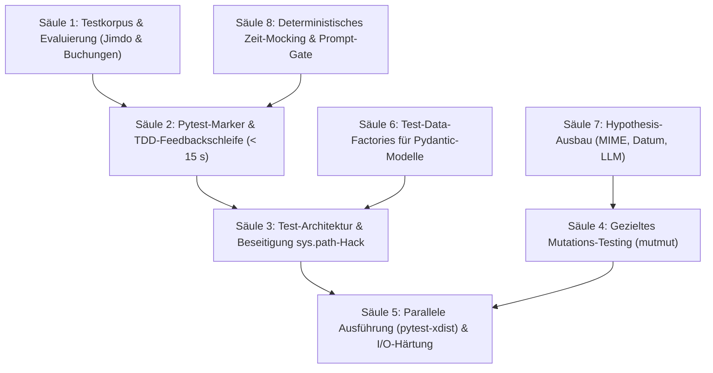

# Mailhelp 4.1 – Qualitätsoffensive und Testinfrastruktur

**Zielversion:** 4.1.0 (Schritte als Patchversionen 4.1.x)  
**Stand:** 4. November 2026  
**Status:** In Umsetzung  
**Grundlage:** [Entwicklungsregeln](../AGENTS.md), [Projektspezifikation](../Mailhelp-Projektspezifikation.md), [Planung 4.0](Planung-4.0.md) (Gesamtfahrplan)  
**Vorgänger:** [Planung 4.0](Planung-4.0.md) · **Nachfolger:** [Planung 4.2](Planung-4.2.md) (Reaktionsschnelle Web-Aktionen und Entscheidungspfad „Schon erledigt“)

---

## 1. Leitmotiv und Ziel

> **„Eine Testsuite, die beim Entwickeln in unter 15 Sekunden belastbares Feedback liefert, architektonische Altlasten beseitigt, brüchige Testdaten durch wiederverwendbare Factories ersetzt und die fachliche Tiefe durch gezieltes Mutations-Testing, Fuzzing und Zeit-Determinismus dauerhaft absichert – bei unverändert verbindlicher 100 % Zeilen- und Branch-Abdeckung.“**

Mailhelp verfügt über eine außergewöhnlich disziplinierte Testkultur: 100 % Zeilen- und Branch-Abdeckung, keine `pragma: no cover`-Ausschlüsse und strikte Verifikation von Prozessabbrüchen (A1–A7) und Konkurrenz (P1–P7).

Mit dem Anwachsen der Testsuite auf über 2.860 Tests und der Einführung von echten Unterprozessen sind jedoch praktische Reibungspunkte und qualitative Lücken entstanden:
1. **Lange Gesamtlaufzeit:** Ein vollständiger Lauf dauert auf Windows über 8 Minuten (495 s).
2. **Erzwungene Coverage bei Einzelläufen:** Da `--cov-fail-under=100` global in `pyproject.toml` vorgegeben ist, schlägt der isolierte Aufruf einzelner Testdateien (`pytest tests/unit/test_core.py`) sofort fehl, wenn nicht manuell `--no-cov` ergänzt wird.
3. **Flakiness durch I/O-Last:** Bei extrem hoher I/O- und Spawning-Last unter Windows geraten starre Checkpoint-Limits (`LIMIT = 20`) in Mehrprozess-Sicherheitstests vereinzelt an Timeout-Grenzen, während dieselben Tests isoliert in rund 2 Sekunden fehlerfrei bestehen.
4. **Architektonische Test-Schulden:** `tests/conftest.py` manipuliert `sys.path`, um alle Test-Unterordner importierbar zu machen (Planung 2.1, T1/T2).
5. **Coverage vs. Testtiefe:** 100 % Codeabdeckung belegen das Durchlaufen aller Zweige, testen jedoch nicht zwingend die Härte der Assertions gegen veränderte Fachlogik (Mutations-Testing).
6. **Brüchige Testdaten (Manual Dictionaries):** Hunderte Tests bauen Konfigurationen und Modelle (`Settings`, `Proposal`, `MailState`) aus rohen Dictionaries zusammen; Schema-Änderungen brechen Tests in unbeteiligten Modulen.
7. **Unterrepräsentiertes Fuzzing:** `hypothesis` wird nur für 8 kleine Hilfsfunktionen genutzt; komplexe Parser (MIME, relative Daten, LLM-JSON) sind nicht gegen feindselige Eingaben gefuzzt.
8. **Fehleranfälliges Zeit-Mocking:** Zeitkritische Logiken (Sitzungsablauf, Token-Refresh, relative Fristen) nutzen Ad-hoc-Lambdas und unvollständige Monkeypatches statt deterministischer Zeitreisen.
9. **Fehlende Prompt-Regressionsprüfung:** Prompt-Änderungen in `prompts.yaml` werden nicht automatisch gegen den Qualitätskorpus auf Genauigkeitsverlust geprüft.
10. **Aktuelle Korpuslücke:** Die in Commit `7277269` hinzugefügten Themen (`jimdo-anfragen-und-nachrichten` und `camping-und-stellplatzbuchungen`) besitzen noch keine synthetischen Test-Mails im Qualitätskorpus.

Planung 4.1 schließt diese Lücken systematisch nach dem Release von Version 4.0.

---

## 2. Die acht Kernsäulen



---

### Säule 1: Ergänzung des synthetischen Testkorpus

Die in `topics.yaml` und `prompts.yaml` neu eingeführten Themenbereiche werden vollständig in die Testkorpora integriert:
* **Jimdo-Anfragen:**
  - Echte Kontaktformular-Payloads mit Name, E-Mail-Adresse, Freitextanfrage und Betreff.
  - Abgrenzung gegen allgemeine Werbe- und Systemmails von Jimdo.
* **Camping- & Stellplatzbuchungen:**
  - Buchungsbestätigungen, Umbuchungen und Stornierungen von Nomady, Campspace und Roadsurfer mit Datumsspannen (Anreise/Abreise) und Stellplatzbezeichnungen.
  - Abgrenzung gegen Plattform-Newsletter und Sonderangebote.
* **Ablage:** Aufnahme in `tests/fixtures/mail_corpus_v3/` und Verifikation in `test_quality_corpus.py` sowie `mailhelp-evaluate`.

---

### Säule 2: Pytest-Markierung & Schnelle Entwickler-Feedbackschleife

Einführung semantischer Marker in `pyproject.toml`:
* `@pytest.mark.slow`: Tests mit Laufzeiten > 1 s (z. B. komplexe E2E-Läufe, aufwendige Property-Tests).
* `@pytest.mark.process`: Mehrprozess-Sicherheitstests (`test_process_safety.py`, `ProcessHarness`, A1–A7).
* `@pytest.mark.e2e`: Gesamtabläufe mit Container- oder Lifecycle-Kontext.

**Entwickler-Modus:**
* Schneller TDD-Standard: `pytest -m "not (slow or process or e2e)" --no-cov` führt über 2.500 Tests in wenigen Sekunden aus.
* Volle Abnahme bleibt unverändert: `pytest --cov=mailhelp --cov-branch --cov-fail-under=100` läuft weiterhin vor Commits und in der CI.

---

### Säule 3: Bereinigung der Test-Architektur-Schulden (`sys.path`-Hack)

In `tests/conftest.py` existiert seit Planung 2.1 folgende Übergangslösung:
```python
for _folder in sorted(Path(__file__).resolve().parent.iterdir()):
    if _folder.is_dir() and _folder.name not in {"fixtures", "__pycache__"} and str(_folder) not in sys.path:
        sys.path.insert(0, str(_folder))
```

**Zielarchitektur:**
* Die Ordner `tests/fakes/` und `tests/scenarios/` werden zu regulären Python-Paketen mit `__init__.py`.
* Alle Testmodule nutzen standardkonforme absolute Importe:
  ```python
  from tests.fakes.shared_core import prompt_config, proposal
  from tests.fakes.safety_harness import ProcessHarness, Gate
  from tests.scenarios.web_scenario import save_mail
  ```
* Die dynamische Schleife in `conftest.py` wird ersatzlos entfernt. Dies schützt vor unbemerkten Namenskollisionen und Modulüberdeckungen.

---

### Säule 4: Gezieltes Mutations-Testing (`mutmut`)

Um die tatsächliche Testtiefe jenseits der 100 % Coverage messbar zu machen, wird ein stichprobenartiger Mutations-Testlauf für sicherheitskritische Kernmodule etabliert:
* **Fokusmodule:**
  - `mailhelp.domain`: Validierung von Akten, Revisionsinvarianz, `confirmed_web_actor`.
  - `mailhelp.storage`: Atomare Dateierstellung, Lock-Reihenfolge, Isolation beschädigter Daten.
  - `mailhelp.external.confirmed`: Idempotenzprüfung und Ausführungssperren vor externen Schreibaufrufen.
* **Mutationslogik:** `mutmut` ersetzt Operatoren (`==` zu `!=`, `>` zu `>=`, Auslassen von Bedingungen `if x:` zu `if True:`).
* **Ziel:** Alle überlebenden Mutanten werden analysiert; laxe Assertions in den Tests werden durch präzise Invarianten-Prüfungen ersetzt (angestrebter Mutation-Score für Kernmodule: **≥ 90 %**).

---

### Säule 5: Parallele Testausführung (`pytest-xdist`) & Windows-I/O-Entlastung

* **Paralleles Testen:** Einführung von `pytest -n auto` für alle markierten Unit-Tests.
* **I/O-Isolation:** Entkopplung der temporären Testdateien je Prozess-Worker (`tmp_path_factory`), um parallele Zugriffe auf dieselben Coverage-Dateien oder Windows-Scannersperren zu verhindern.
* **Timeout-Resilienz:** Dynamische Anpassung des `LIMIT`-Wächters im `ProcessHarness` bei hoher Systemlast, um Zufallstimeouts bei sequentiellen Gesamtlaufbündeln unter Windows auszuschließen.

---

### Säule 6: Test-Data-Factories für Pydantic-Modelle

* **Problem:** Manuell erstellte Mock-Dictionaries in Testdateien brechen bei jeder Modellerweiterung (z. B. neuen Pflichtfeldern oder Validierungen).
* **Ziel:** Einführung von standardisierten Factories (z. B. via Builder-Funktionen oder `polyfactory`) für:
  - `Proposal` / `ProposalRevision`
  - `MailState` / `DisplayHeaders`
  - `Settings` (vollständige und minimale Konfigurationen)
* **Vorteil:** Tests definieren nur die für den Testfall relevanten Abweichungen (`ProposalFactory.build(status="confirmed")`); Default-Integrität ist zentral garantiert.

---

### Säule 7: Ausbau von Hypothesis (Property-Based & Fuzz-Testing)

Erweiterung von `tests/unit/test_properties.py` auf sicherheits- und parsingkritische Komponenten:
1. **MIME- & Mail-Parsing:** Fuzzing mit willkürlich mutierten Multipart-Strukturen, ungültigen Boundary-Tags, Zeichensatz-Konflikten und fehlerhaften Base64-/Quoted-Printable-Blöcken.
2. **Datums- und Fristenlogik:** Fuzzing von `german_dates.py` und `temporal_answers.py` über breite Datumsspannen, Schaltjahre und Sommer-/Winterzeit-Umstellungen (MESZ/MEZ).
3. **LLM-Ausgabetoleranz:** Fuzzing des Response-Parsers mit unvollständigen JSON-Fragmenten, Markdown-Wrapper-Varianten und unerwarteten Root-Objekten zur Absicherung defensiver Fehlerbehandlung.

---

### Säule 8: Deterministisches Zeit-Mocking & Prompt-Regressions-Gate

1. **Deterministische Zeit mit `time-machine`:**
   - Ersatz von instabilen `clock`-Lambdas und Monkeypatches durch die bewährte, C-basierte Bibliothek `time-machine`.
   - Sichere Zeitreisen für Sitzungsabläufe (30 Tage), OAuth-Token-Gültigkeiten (1 Stunde) und fristbezogene Filterungen.
2. **Automatisiertes Evaluierungs-Gate (`mailhelp-evaluate`):**
   - Einbindung eines schnellen, deterministischen Evaluierungs-Laufs gegen den synthetischen Korpus.
   - Scheitern der Pipeline, falls Änderungen an `prompts.yaml` oder `topics.yaml` die Zuordnungs- und Extraktionsgenauigkeit verschlechtern.
3. **Lokale UI-Test-Integration:**
   - Schneller Headless-Smoke-Befehl für Playwright-Tests (`ui_tests`), damit Render- und Aktionsfehler vor dem Push auffallen.

---

## 3. Umsetzungsschritte (Stufe 9)

Es gelten die Regeln aus [Planung 4.0, Abschnitt 5.1](Planung-4.0.md#51-regeln-für-die-schritte): Jeder Schritt ist als eigener Commit mit Patchversion lieferbar, Umfang S (≤ 1 Tag) oder M (≤ 2 Tage), 100 % Coverage-Erhalt.

| Schritt | Inhalt | Fertig, wenn … | Umfang | Voraussetzung |
| :--- | :--- | :--- | :---: | :--- |
| **9.1** ✓ 4.1.0 | Korpus für Jimdo & Buchungen | Synthetische Mails in `mail_corpus_v3/` abgelegt; `test_quality_corpus.py` und `mailhelp-evaluate` weisen Erkennung und Newsletter-Ausschluss nach. *Umgesetzt:* fünf Fälle; der Nachweis liegt in `tests/evaluation/test_evaluation.py`, weil dort der simulierte Anbieter für `evaluate()` (den Kern von `mailhelp-evaluate`) liegt. | S | – |
| **9.2** ✓ 4.1.1 | Pytest-Marker in `pyproject.toml` | Marker `slow`, `process`, `e2e` registriert; relevante Tests markiert; schneller Entwicklungsbefehl dokumentiert und verifiziert. *Umgesetzt:* 35 `slow`, 77 `process` und 18 `e2e`; `--strict-markers` und ein Wächtertest halten die Markierung aktuell. Der schnelle Lauf umfasst 3.099 Tests in rund 4 Minuten unter Windows; die Zielzeit unter 15 s folgt mit Schritt 9.8. | S | – |
| **9.3** ✓ 4.1.2 | Paketstruktur `tests.fakes` und `tests.scenarios` | `__init__.py` ergänzt; Test-Doubles klar gegliedert; saubere Re-Exporte definiert. *Umgesetzt:* Die Paketbeschreibungen gliedern Doubles, Harnesses, Bereichs-Fixtures und Plugins; `pythonpath = ["."]` macht beide Pakete importierbar. Die Pakete re-exportieren bewusst nichts, damit ein Import nicht alle Doubles lädt. | S | – |
| **9.4** ✓ 4.1.3 | Beseitigung `sys.path`-Hack in `conftest.py` | Alle Testdateien auf `from tests.fakes...` umgestellt; dynamische `sys.path`-Schleife in `conftest.py` vollständig entfernt; Gesamtsuite grün. *Umgesetzt:* 478 Importe in 162 Dateien umgestellt, auch in `ui_tests` und im Docker-Smoke (`PYTHONPATH=/`); zwei dynamische Importe anderer Testmodule (`__import__("test_…")`) durch die gemeinsamen Doubles ersetzt. Der Grenztest erkennt jetzt auch solche Importe und verbietet nackte Helfernamen. | M | 9.3 |
| **9.5** ✓ 4.1.4 | Timeout-Resilienz im `ProcessHarness` | Checkpoint-Warten im `ProcessHarness` gegen hohe Systemlast abgesichert; kein Scheitern durch I/O-Stau auf Windows. *Umgesetzt:* Der Harness wartet, solange der Kindprozess lebt, bis höchstens 120 s (`MAILHELP_TEST_PROCESS_SECONDS`); stirbt der Prozess ohne Ergebnis, scheitert der Test sofort. | S | 9.2 |
| **9.6** | Konfiguration von `mutmut` & Baseline-Audit | `mutmut`-Konfiguration für `domain`, `storage` und `confirmed` angelegt; Mutationsbericht erstellt und überlebende Mutanten erfasst. | S | 9.2 |
| **9.7** | Härtung der Assertions gegen Mutationen | Bestehende Tests für Kernmodule nachgeschärft, bis Mutation-Score ≥ 90 % erreicht ist; keine wirkungslosen Assertions. | M | 9.6 |
| **9.8** | Parallele Unit-Tests (`pytest-xdist`) | `pytest-xdist` für schnelle Tests integriert; Worker-Isolation für Coverage und `.test-tmp` sichergestellt; TDD-Laufzeit < 15 s. | M | 9.4, 9.5 |
| **9.9** ✓ 4.1.5 | Test-Data-Factories für Pydantic-Modelle | Wiederverwendbare Model-Factories für `Proposal`, `MailState` und `Settings` eingeführt; brüchige Roh-Dictionaries in Basistests ersetzt. *Umgesetzt:* `tests/fakes/factories.py` mit `build_proposal`, `build_mail_state`, `minimal_settings` und `complete_settings` (Builder-Funktionen ohne neue Abhängigkeit); die vier bisherigen Builder delegieren daran, Roh-`MailState` in Profil- und Laufschleifentests ersetzt. | S | 9.3 |
| **9.10** ✓ 4.1.6 | Ausbau Hypothesis für Parser & LLM-JSON | Property-Tests für MIME-Decoder, `german_dates.py` und unvollständige LLM-JSON-Strukturen implementiert. *Umgesetzt:* sechs Eigenschaften: feindselige Multipart-Strukturen (Grenzen, Zeichensätze, Transferkodierungen), Wochentage und Jahre 1900–2099 einschließlich Schalttagen, Ortszeiten an MEZ/MESZ-Umstellungen gegen ein unabhängiges UTC-Orakel, Client-Antworten (abgeschnitten, Markdown, Prosa) und Schemaprüfung der Analyse. | M | 9.2 |
| **9.11** ✓ 4.1.7 | Zeit-Mocking mit `time-machine` | Ad-hoc `clock`-Lambdas und Monkeypatches durch `time-machine` ersetzt; Zeit- und Sitzungs-Tests stabilisiert. *Umgesetzt:* `time-machine==3.6.0` ersetzt alle Monkeypatches von `time.time` und `_now` in Kalender-, iCalendar- und Telegram-Tests; neue Zeitreisetests prüfen die Standarduhren für 30-Tage-Sitzungen, 10-Minuten-Codes und Google-Tokens. Eingespeiste `clock`-Parameter bleiben, wo der Anwendungscode sie bewusst anbietet. Gefunden: Der alte Patch gab für Änderungsnotizen UTC statt der Kalenderzeitzone zurück; der Test erwartet jetzt die tatsächliche Ortszeit. | S | 9.2 |
| **9.12** ✓ 4.1.8 | Automatisiertes Evaluierungs-Regressions-Gate | Schneller `mailhelp-evaluate`-Smoketest schlägt fehl, wenn Prompt-Änderungen die Erkennungsquote senken. *Umgesetzt:* `tests/evaluation/test_prompt_gate.py` führt Korpus v3 mit dem echten `prompts.yaml` und `topics.yaml` durch `evaluate()`; nur die Modellantworten sind simuliert. Er scheitert bei fehlenden oder umbenannten Stufen, nicht auflösbaren Routen und entfernten oder deaktivierten Korpusthemen, ohne einen bezahlten Aufruf. Ob eine neue Formulierung echte Modelle verbessert, misst weiterhin `mailhelp-evaluate` mit echtem Anbieter. | S | 9.1 |
| **9.13** ✓ 4.1.9 | Lokaler UI-Smoke-Testlauf (`ui_tests`) | Schneller Playwright-Smoke-Befehl für lokale Läufe definiert; PWA-Offline-Verhalten bei Aktionen abgesichert. *Umgesetzt:* Marker `smoke` für sieben Browsertests (18 Fälle, rund 40 s); neuer Test: Eine offline ausgelöste Bestätigung wird weder ausgeführt noch nach der Rückkehr ins Netz wiederholt. | S | 9.2 |
| **9.14** | Entwickler-Skripte & Abschlussdokumentation | Praktische Aliase/Tasks für Schnelltest, Volltest und UI-Test dokumentiert; `README.md` und `Einrichtung-und-Qualitaetspruefung.md` aktualisiert. | S | 9.1–9.13 |

**Umfangsübersicht:** 14 Schritte, davon 10 S und 4 M.

---

## 4. Abnahme- und Qualitätskriterien

1. **Unveränderte Abdeckungsvorgabe:**
   - 100 % Zeilen- und 100 % Branch-Abdeckung für den gesamten Anwendungscode bleiben zwingend (`--cov-fail-under=100`).
   - Keine `pragma: no cover`-Ausschlüsse.
2. **Feedbackzeit (TDD):**
   - Der Befehl `pytest -m "not (slow or process or e2e)" --no-cov` liefert auf Windows und Linux in **unter 15 Sekunden** ein vollständiges Ergebnis für alle Standard-Unit-Tests.
3. **Architekturintegrität:**
   - Kein `sys.path.insert` in `tests/conftest.py`. Sämtliche Test-Hilfsmodule liegen in dedizierten Modulen unter `tests.fakes` oder `tests.scenarios`.
4. **Semantische Güte (Mutation Testing):**
   - In den Kernmodulen (`domain`, `storage`, `confirmed`) erreichen die Tests einen Mutation-Score von mindestens 90 %.
5. **Testdaten-Integrität:**
   - Zentrale Testmodule nutzen Model-Factories statt unstrukturierter Dictionaries; Schema-Erweiterungen bleiben rückwärtskompatibel.
6. **Fuzzing- & Parser-Härtung:**
   - Hypothesis prüft MIME-Dekodierung, deutsche Datumsberechnungen und LLM-Parser auf Robustheit gegen unerwartete Eingaben.
7. **Deterministische Zeit:**
   - Sitzungsabläufe und Zeittests laufen ohne unvollständige Monkeypatches deterministisch über `time-machine`.
8. **Prompt-Regressionsschutz:**
   - Automatisierte Evaluation sichert die Erkennungsrate gegen unbeabsichtigte Verschlechterungen ab.
9. **Plattformstabilität:**
   - Die gesamte Testsuite läuft auf Windows 11 und Ubuntu in der CI fehler- und flakinessfrei durch.
