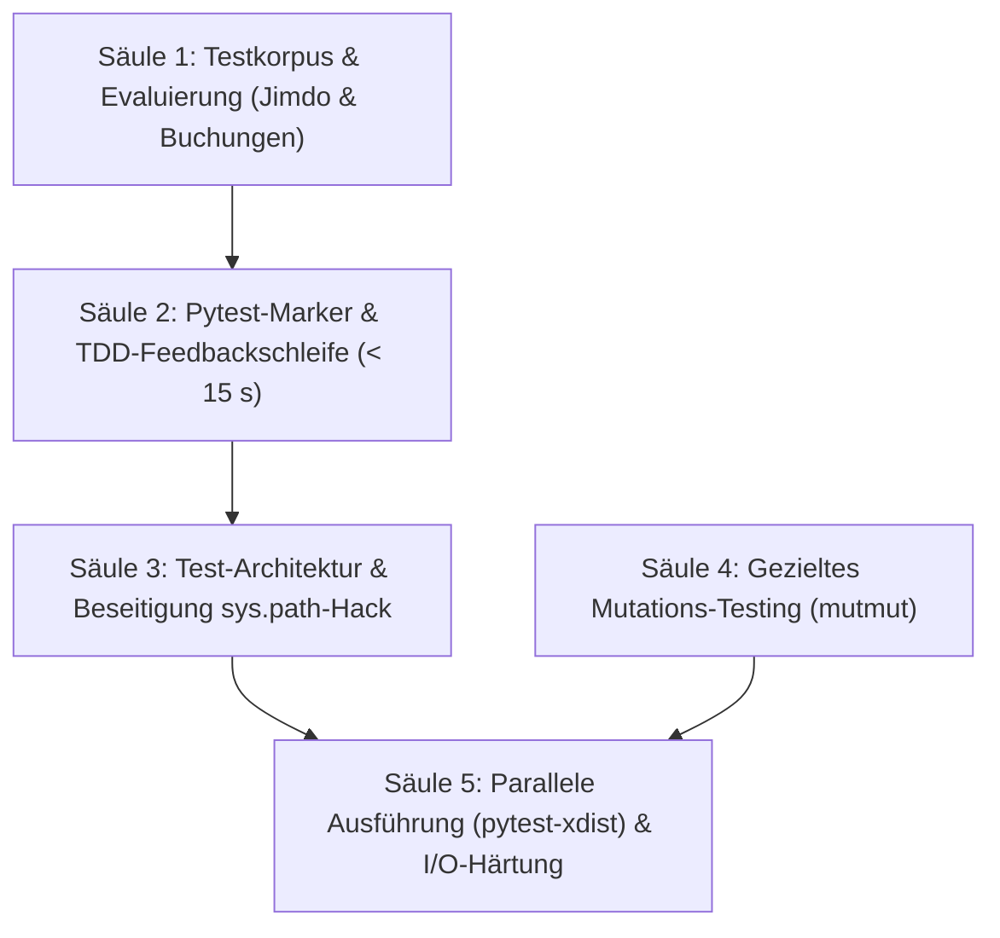

# Mailhelp 4.1 – Qualitätsoffensive und Testinfrastruktur

**Zielversion:** 4.1.0 (Schritte als Patchversionen 4.1.x)  
**Stand:** 4. November 2026  
**Status:** In Planung  
**Grundlage:** [Entwicklungsregeln](../AGENTS.md), [Projektspezifikation](../Mailhelp-Projektspezifikation.md), [Planung 4.0](Planung-4.0.md) (Gesamtfahrplan)  
**Vorgänger:** [Planung 4.0](Planung-4.0.md)

---

## 1. Leitmotiv und Ziel

> **„Eine Testsuite, die beim Entwickeln in unter 15 Sekunden belastbares Feedback liefert, architektonische Altlasten beseitigt und die fachliche Tiefe durch gezieltes Mutations-Testing sowie vollständige Korpusdaten dauerhaft absichert – bei unverändert verbindlicher 100 % Zeilen- und Branch-Abdeckung.“**

Mailhelp verfügt über eine außergewöhnlich disziplinierte Testkultur: 100 % Zeilen- und Branch-Abdeckung, keine `pragma: no cover`-Ausschlüsse und strikte Verifikation von Prozessabbrüchen (A1–A7) und Konkurrenz (P1–P7).

Mit dem Anwachsen der Testsuite auf über 2.860 Tests und der Einführung von echten Unterprozessen sind jedoch praktische Reibungspunkte und Qualitätsgrenzen entstanden:
1. **Lange Gesamtlaufzeit:** Ein vollständiger Lauf dauert auf Windows über 8 Minuten (495 s).
2. **Erzwungene Coverage bei Einzelläufen:** Da `--cov-fail-under=100` global in `pyproject.toml` vorgegeben ist, schlägt der isolierte Aufruf einzelner Testdateien (`pytest tests/unit/test_core.py`) sofort fehl, wenn nicht manuell `--no-cov` ergänzt wird.
3. **Flakiness durch I/O-Last:** Bei extrem hoher I/O- und Spawning-Last unter Windows geraten starre Checkpoint-Limits (`LIMIT = 20`) in Mehrprozess-Sicherheitstests vereinzelt an Timeout-Grenzen, während dieselben Tests isoliert in rund 2 Sekunden fehlerfrei bestehen.
4. **Architektonische Test-Schulden:** `tests/conftest.py` manipuliert `sys.path`, um alle Test-Unterordner importierbar zu machen (Planung 2.1, T1/T2).
5. **Coverage vs. Testtiefe:** 100 % Codeabdeckung belegen das Durchlaufen aller Zweige, testen jedoch nicht zwingend die Härte der Assertions gegen veränderte Fachlogik (Mutations-Testing).
6. **Aktuelle Korpuslücke:** Die in Commit `7277269` hinzugefügten Themen (`jimdo-anfragen-und-nachrichten` und `camping-und-stellplatzbuchungen`) besitzen noch keine synthetischen Test-Mails im Qualitätskorpus.

Planung 4.1 schließt diese Lücken systematisch nach dem Release von Version 4.0.

---

## 2. Die fünf Kernsäulen



---

### Säule 1: Ergänzung des synthetischen Testkorpus

Die in `topics.yaml` und `prompts.yaml` neu eingeführten Themenbereiche werden vollständig in die Testkorpora integriert:
* **Jimdo-Anfragen:**
  - Echte Kontaktformular-Payloads mit Name, E-Mail-Adresse, Freitextanfrage und Betreff.
  - Abgrenzung gegen allgemeine Werbe- und Systemmails von Jimdo.
* **Camping- & Stellplatzbuchungen:**
  - Buchungsbestätigungen, Umbuchungen und Stornierungen von Nomady, Campspace und Roadsurfer mit Datumsspannen (Anreise/Abreise) und Stellplatzbezeichnungen.
  - Abgrenzung gegen Plattform-Newsletter und Sonderangebote.
* **Ablage:** Aufnahme in `tests/fixtures/mail_corpus_v3/` und Verifikation in `test_quality_corpus.py` sowie `mailhelp-evaluate`.

---

### Säule 2: Pytest-Markierung & Schnelle Entwickler-Feedbackschleife

Einführung semantischer Marker in `pyproject.toml`:
* `@pytest.mark.slow`: Tests mit Laufzeiten > 1 s (z. B. komplexe E2E-Läufe, aufwendige Property-Tests).
* `@pytest.mark.process`: Mehrprozess-Sicherheitstests (`test_process_safety.py`, `ProcessHarness`, A1–A7).
* `@pytest.mark.e2e`: Gesamtabläufe mit Container- oder Lifecycle-Kontext.

**Entwickler-Modus:**
* Schneller TDD-Standard: `pytest -m "not (slow or process or e2e)" --no-cov` führt über 2.500 Tests in wenigen Sekunden aus.
* Volle Abnahme bleibt unverändert: `pytest --cov=mailhelp --cov-branch --cov-fail-under=100` läuft weiterhin vor Commits und in der CI.

---

### Säule 3: Bereinigung der Test-Architektur-Schulden (`sys.path`-Hack)

In `tests/conftest.py` existiert seit Planung 2.1 folgende Übergangslösung:
```python
for _folder in sorted(Path(__file__).resolve().parent.iterdir()):
    if _folder.is_dir() and _folder.name not in {"fixtures", "__pycache__"} and str(_folder) not in sys.path:
        sys.path.insert(0, str(_folder))
```

**Zielarchitektur:**
* Die Ordner `tests/fakes/` und `tests/scenarios/` werden zu regulären Python-Paketen mit `__init__.py`.
* Alle Testmodule nutzen standardkonforme absolute Importe:
  ```python
  from tests.fakes.shared_core import prompt_config, proposal
  from tests.fakes.safety_harness import ProcessHarness, Gate
  from tests.scenarios.web_scenario import save_mail
  ```
* Die dynamische Schleife in `conftest.py` wird ersatzlos entfernt. Dies schützt vor unbemerkten Namenskollisionen und Modulüberdeckungen.

---

### Säule 4: Gezieltes Mutations-Testing (`mutmut`)

Um die tatsächliche Testtiefe jenseits der 100 % Coverage messbar zu machen, wird ein stichprobenartiger Mutations-Testlauf für sicherheitskritische Kernmodule etabliert:
* **Fokusmodule:**
  - `mailhelp.domain`: Validierung von Akten, Revisionsinvarianz, `confirmed_web_actor`.
  - `mailhelp.storage`: Atomare Dateierstellung, Lock-Reihenfolge, Isolation beschädigter Daten.
  - `mailhelp.external.confirmed`: Idempotenzprüfung und Ausführungssperren vor externen Schreibaufrufen.
* **Mutationslogik:** `mutmut` ersetzt Operatoren (`==` zu `!=`, `>` zu `>=`, Auslassen von Bedingungen `if x:` zu `if True:`).
* **Ziel:** Alle überlebenden Mutanten werden analysiert; laxe Assertions in den Tests werden durch präzise Invarianten-Prüfungen ersetzt (angestrebter Mutation-Score für Kernmodule: **≥ 90 %**).

---

### Säule 5: Parallele Testausführung (`pytest-xdist`) & Windows-I/O-Entlastung

* **Paralleles Testen:** Einführung von `pytest -n auto` für alle markierten Unit-Tests.
* **I/O-Isolation:** Entkopplung der temporären Testdateien je Prozess-Worker (`tmp_path_factory`), um parallele Zugriffe auf dieselben Coverage-Dateien oder Windows-Scannersperren zu verhindern.
* **Timeout-Resilienz:** Dynamische Anpassung des `LIMIT`-Wächters im `ProcessHarness` bei hoher Systemlast, um Zufallstimeouts bei sequentiellen Gesamtlaufbündeln unter Windows auszuschließen.

---

## 3. Umsetzungsschritte (Stufe 9)

Es gelten die Regeln aus [Planung 4.0, Abschnitt 5.1](Planung-4.0.md#51-regeln-für-die-schritte): Jeder Schritt ist als eigener Commit mit Patchversion lieferbar, Umfang S (≤ 1 Tag) oder M (≤ 2 Tage), 100 % Coverage-Erhalt.

| Schritt | Inhalt | Fertig, wenn … | Umfang | Voraussetzung |
| :--- | :--- | :--- | :--- | :--- |
| **9.1** | Korpus für Jimdo & Buchungen | Synthetische Mails in `mail_corpus_v3/` abgelegt; `test_quality_corpus.py` und `mailhelp-evaluate` weisen Erkennung und Newsletter-Ausschluss nach. | S | – |
| **9.2** | Pytest-Marker in `pyproject.toml` | Marker `slow`, `process`, `e2e` registriert; relevante Tests markiert; schneller Entwicklungsbefehl dokumentiert und verifiziert. | S | – |
| **9.3** | Paketstruktur `tests.fakes` und `tests.scenarios` | `__init__.py` ergänzt; Test-Doubles klar gegliedert; saubere Re-Exporte definiert. | S | – |
| **9.4** | Beseitigung `sys.path`-Hack in `conftest.py` | Alle Testdateien auf `from tests.fakes...` umgestellt; dynamische `sys.path`-Schleife in `conftest.py` vollständig entfernt; Gesamtsuite grün. | M | 9.3 |
| **9.5** | Timeout-Resilienz im `ProcessHarness` | Checkpoint-Warten im `ProcessHarness` gegen hohe Systemlast abgesichert; kein Scheitern durch I/O-Stau auf Windows. | S | 9.2 |
| **9.6** | Konfiguration von `mutmut` & Baseline-Audit | `mutmut`-Konfiguration für `domain`, `storage` und `confirmed` angelegt; Mutationsbericht erstellt und überlebende Mutanten erfasst. | S | 9.2 |
| **9.7** | Härtung der Assertions gegen Mutationen | Bestehende Tests für Kernmodule nachgeschärft, bis Mutation-Score ≥ 90 % erreicht ist; keine wirkungslosen Assertions. | M | 9.6 |
| **9.8** | Parallele Unit-Tests (`pytest-xdist`) | `pytest-xdist` für schnelle Tests integriert; Worker-Isolation für Coverage und `.test-tmp` sichergestellt; TDD-Laufzeit < 15 s. | M | 9.4, 9.5 |
| **9.9** | Entwickler-Skripte & Abschlussdokumentation | Praktische Aliase/Tasks für Schnelltest, Volltest und UI-Test dokumentiert; `README.md` und `Einrichtung-und-Qualitaetspruefung.md` aktualisiert. | S | 9.1–9.8 |

**Umfangsübersicht:** 9 Schritte, davon 6 S und 3 M.

---

## 4. Abnahme- und Qualitätskriterien

1. **Unveränderte Abdeckungsvorgabe:**
   - 100 % Zeilen- und 100 % Branch-Abdeckung für den gesamten Anwendungscode bleiben zwingend (`--cov-fail-under=100`).
   - Keine `pragma: no cover`-Ausschlüsse.
2. **Feedbackzeit (TDD):**
   - Der Befehl `pytest -m "not (slow or process or e2e)" --no-cov` liefert auf Windows und Linux in **unter 15 Sekunden** ein vollständiges Ergebnis für alle Standard-Unit-Tests.
3. **Architekturintegrität:**
   - Kein `sys.path.insert` in `tests/conftest.py`. Sämtliche Test-Hilfsmodule liegen in dedizierten Modulen unter `tests.fakes` oder `tests.scenarios`.
4. **Semantische Güte (Mutation Testing):**
   - In den Kernmodulen (`domain`, `storage`, `confirmed`) erreichen die Tests einen Mutation-Score von mindestens 90 %.
5. **Vollständiger Themenkorpus:**
   - Alle in `topics.yaml` definierten Themen verfügen über belegte, synthetische Testfälle im Korpus.
6. **Plattformstabilität:**
   - Die gesamte Testsuite läuft auf Windows 11 und Ubuntu in der CI fehler- und flakinessfrei durch.

