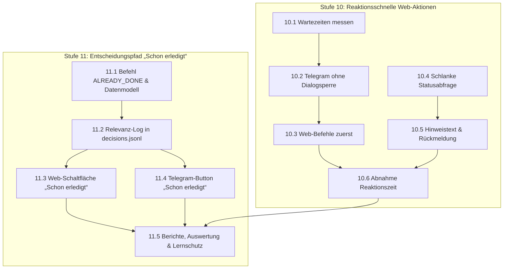

# Mailhelp 4.2 – Reaktionsschnelle Web-Aktionen und Entscheidungspfad „Schon erledigt“

**Zielversion:** 4.2.0 (Schritte als Patchversionen 4.2.x)  
**Stand:** 6. November 2026
**Status:** Vollständig umgesetzt und abgenommen in 4.2.0
**Grundlage:** [Entwicklungsregeln](../AGENTS.md), [Projektspezifikation](../Mailhelp-Projektspezifikation.md), [Planung 4.0](Planung-4.0.md) (Gesamtfahrplan)  
**Vorgänger:** [Planung 4.1](Planung-4.1.md) · **Nachfolger:** [Planung 4.3](Planung-4.3.md) (Entschärfung von Zählerkonflikten und zielgerichtete Aufgaben-Extraktion)

---

## 1. Anlass und Ziel

> **„Eine im Browser gewählte Aktion beginnt innerhalb einer Sekunde, auch während eine Mail analysiert wird, und offene Entscheidungen lassen sich als ‚schon erledigt‘ verwerfen, ohne ihre erkannte Relevanz im Lernbestand zu verlieren.“**

Version 4.2 adressiert zwei konkrete Praxisanforderungen aus dem täglichen Betrieb:

### Teil 1: Reaktionsschnelle Web-Aktionen (Wartezeiten beseitigen)

Nach der Auswahl einer Aktion zeigt die Weboberfläche oft mehrere Sekunden lang „Wird
ausgeführt … Mailhelp bearbeitet die Aktion, sobald die aktuelle Mail analysiert ist.“

**Befund vom 5. November 2026** (Produktionslog, 13 Web-Aktionen, und Messung auf einer
Kopie der Zustandsablage mit 1.532 Mails und 403 Vorschlägen):

| Messgröße | Wert |
| :--- | :--- |
| Wartezeit vom Absenden bis zum Ausführungsbeginn | 1,3–5,8 s |
| Ausführung (Verwerfen / Bestätigen mit externer Anlage) | 0,3–0,6 s / 4–6 s |
| Antwortzeit der Statusseite `/aktion/<id>`, die sich jede Sekunde neu lädt | 1,5–2,6 s |
| Lesezugriffe der Ablage (`recover()`, `current()`, Startseite) | je etwa 0,1 s |
| `views.system()` | 0,6 s |

**Ursachen:**
1. **Der Text ist veraltet.** Seit 3.6.4 führt der eigene Bedien-Thread (`mailhelp-operator`)
   Web-Befehle aus. Er wartet nicht auf das Ende der Mailanalyse, und die LLM-Aufrufe der
   Analyse laufen ohne Sperre. Ein zusätzlicher Thread würde deshalb wenig bringen.
2. **Die Sperre des Telegram-Dialogs wird über Netzwerkaufrufe gehalten.** Die Mailanalyse
   sendet Vorschläge, Rückfragen und Hinweise unter `TelegramDialogController.lock`
   (`send`, `send_proposal`, `send_relevance`, `flush_outbox`). Jede Nachricht dauert rund
   0,3 s, und so lange wartet der Bedien-Thread. Umgekehrt hält der Bedien-Thread die Sperre
   für seinen ganzen Durchlauf in `poll_once`.
3. **Web-Befehle stehen hinten in der Reihe.** `poll_once` arbeitet vor `_process_commands`
   zuerst `write_executor.resume()`, `revisions.resume()` und die Telegram-Eingaben ab und
   versendet danach unter derselben Sperre die Outbox.
4. **Die Statusseite erzeugt selbst Last.** Jede Sekunde wird die ganze Seite neu gerendert.
   Jedes Neuladen wartet auf die Sperre der Zustandsablage und reiht sich damit hinter den
   anderen Threads ein.

---

### Teil 2: Relevanz-erhaltende Entscheidung „Schon erledigt“

Bei vielen E-Mails mit Handlungsbedarf (z. B. Überweisungen, Terminbestätigungen, Rechnungen oder kurze Rückfragen) hat der Nutzer die anstehende Aufgabe bereits direkt nach dem Maileingang außerhalb von Mailhelp erledigt. 

**Bisheriges Problem:**
* Dem Nutzer steht bisher nur die Option **„Verwerfen“** (`CommandKind.REJECT`) zur Verfügung.
* Ein Klick auf „Verwerfen“ speichert den Vorschlag intern als abgelehnt (`rejected`).
* Im Entscheidungs-Log ([`learning/decisions.jsonl`](../src/mailhelp/review/learning_log.py)) und für den Lernmodus ([`/lernen`](../src/mailhelp/llm/learning.py)) sendet dies das falsche Signal: Es wirkt so, als sei der Vorschlag ein Fehler des Sprachmodells oder das Thema der Mail irrelevant gewesen.

**Ziel mit „Schon erledigt“:**
1. **Internes Verhalten (Zielsysteme):** Die Aufgabe wird **verworfen** (`ProposalStatus.REJECTED` mit Kennzeichen `resolution="already_done"`). Es erfolgt garantiert **kein externer Schreibzugriff** auf Google Kalender, CalDAV oder Todoist.
2. **Entscheidungs- und Lernlog:** Im Protokoll ([`learning/decisions.jsonl`](../src/mailhelp/review/learning_log.py)) wird explizit festgehalten:
   * Die Aktion wurde vom Nutzer als **„bereits erledigt“** abgeschlossen (`operation="already_done"`).
   * Die E-Mail und der extrahierte Vorschlag waren **trotzdem positiv relevant** (`decision="relevant"`, `relevance_preserved=True`).
   * Der Lernmodus wertet den Fall als erfolgreiche Erkennung und schlägt das Thema **nicht** zur Sperrung oder Abwertung vor.
3. **Bedienoberfläche:** Auf den Aktionskarten der Weboberfläche und im Telegram-Bot erscheint neben „Bestätigen“ und „Verwerfen“ die neue Schaltfläche **„Schon erledigt“**.
4. **Tätigkeitsberichte:** `/berichte` und `/status` unterscheiden transparent zwischen echten Fehlvorschlägen („Verworfen“) und bereits erledigten Aufgaben („Schon erledigt“).

---

## 2. Umsetzungsschritte

Es gelten die Regeln aus [Planung 4.0, Abschnitt 5.1](Planung-4.0.md#51-regeln-für-die-schritte):
Jeder Schritt wird als eigener Commit mit Patchversion geliefert, hat den Umfang S (≤ 1 Tag)
oder M (≤ 2 Tage) und erhält 100 % Zeilen- und Branch-Abdeckung.

---

### Stufe 10 – Reaktionsschnelle Web-Aktionen

| Schritt | Inhalt | Fertig, wenn … | Umfang | Voraussetzung |
| :--- | :--- | :--- | :---: | :--- |
| **10.1** ✓ 4.2.0 | Wartezeiten messen | `command_finished` enthält neben `latency_ms` und `execution_ms` die Wartezeit in der Warteschlange und je Sperre (`dialog_lock_wait_ms`, `store_lock_wait_ms`), ohne Inhalte zu protokollieren; `/status` zeigt Median und Maximum der letzten Web-Aktionen. | S | – |
| **10.2** ✓ 4.2.0 | Telegram-Versand ohne Dialogsperre | Unter der Dialogsperre werden Nachrichten nur in die dauerhafte Outbox eingetragen; der Versand läuft danach ohne Dialogsperre. Reihenfolge, Outbox-Sperren (Rückfragen) und Absturzsicherheit bleiben erhalten. Regressionstest: Eine Web-Aktion beginnt, während ein simulierter Telegram-Versand hängt. | M | 10.1 |
| **10.3** ✓ 4.2.0 | Web-Befehle zuerst | `poll_once` führt wartende Web-Befehle vor den Wiederaufnahmen und dem Outbox-Versand aus; nach Neustarts werden unterbrochene Befehle weiterhin zuerst abgeglichen. Regressionstest: Ein wartender Befehl beginnt vor einer langen Wiederaufnahme. | S | 10.2 |
| **10.4** ✓ 4.2.0 | Schlanke Statusabfrage | `/api/aktion/<id>` liefert nur Status und Ziel aus dem Befehlseingang (Sitzungsprüfung bleibt); die Statusseite fragt diesen Endpunkt ab, statt sich jede Sekunde ganz neu zu laden. Ohne JavaScript bleibt das Neuladen der Seite als Rückfall erhalten. | S | – |
| **10.5** ✓ 4.2.0 | Hinweistext und Rückmeldung | Der Text lautet „Wird ausgeführt … Danach geht es automatisch zur Übersicht.“; dauert eine Bestätigung wegen externer Anlage länger, nennt die Seite das Ziel (Kalender oder Todoist). Browsertests für Desktop, Mobilgerät und ohne JavaScript. | S | 10.4 |
| **10.6** ✓ 4.2.0 | Abnahme Reaktionszeit | Simulierter Lastlauf (laufende Mailanalyse, Telegram-Versand, Benachrichtigungen, fünf gleichzeitige Browser) unter Windows, Linux und Docker: Ausführungsbeginn im Median unter 0,5 s, im Maximum unter 1 s; keine doppelten oder unberechtigten Aktionen; Release-Bericht `docs/Release-4.2.md`. | M | 10.1–10.5 |

---

### Stufe 11 – Entscheidungsweg „Schon erledigt“

| Schritt | Inhalt | Fertig, wenn … | Umfang | Voraussetzung |
| :--- | :--- | :--- | :---: | :--- |
| **11.1** ✓ 4.2.0 | Datenmodell & Befehl `ALREADY_DONE` | `CommandKind.ALREADY_DONE` und `DecisionAction.ALREADY_DONE` eingeführt; `ReviewService` überführt den Vorschlag atomar in `ProposalStatus.REJECTED` mit `resolution="already_done"`; keine externe Anlage in Kalender oder Aufgaben; Idempotenz und Revisionsprüfung greifen unverändert. | S | – |
| **11.2** ✓ 4.2.0 | Relevanz-Protokoll in `decisions.jsonl` | `DecisionLearningLog` erfasst `operation="already_done"`, markiert den Eintrag explizit als relevant (`decision="relevant"`, `relevance_preserved=True`) und dokumentiert den verworfenen Vorschlag; Ereignisprotokoll (`record_event`) verbucht `already_done`. | S | 11.1 |
| **11.3** ✓ 4.2.0 | Web-Schaltfläche „Schon erledigt“ | Auf den Vorschlagskarten (`src/mailhelp/web/actions.py`) erscheint neben „Bestätigen“ und „Verwerfen“ die Schaltfläche „Schon erledigt“; Statusmeldung bestätigt: „Als schon erledigt erfasst (Aufgabe bleibt als relevant vermerkt)“; Tastaturbedienung und Barrierefreiheit geprüft. | S | 11.2 |
| **11.4** ✓ 4.2.0 | Telegram-Button „Schon erledigt“ | Telegram-Tastatur für Vorschläge erhält den Inline-Button `[✓ Schon erledigt]`; Bot bestätigt die Erfassung und löscht die Aktionsbuttons; dieselbe Idempotenz- und Relevanzbehandlung wie im Web. | S | 11.2 |
| **11.5** ✓ 4.2.0 | Berichte, Auswertung & Lernschutz | Tätigkeitsberichte (`/berichte`) und Statusansichten weisen „Schon erledigte“ Vorschläge separat aus; der Web-Lernmodus (`/lernen`) wertet diese Mails als belegt relevant; Regressionstests schließen falsches Verlernen aus. | S | 11.3, 11.4 |

**Umfangsübersicht Version 4.2:** 11 Schritte, davon 9 S und 2 M.

---

## 3. Abnahmekriterien

1. **Reaktionszeit:** Eine Web-Aktion beginnt im Median nach weniger als 0,5 s und im
   Maximum nach weniger als 1 s, auch während Mailanalyse und Telegram-Versand.
2. **Keine Netzwerkaufrufe unter gemeinsamen Sperren:** Weder die Dialogsperre noch die
   Sperre der Zustandsablage wird über Telegram-, Push-, LLM- oder Zielanbieteraufrufe gehalten.
3. **Schon-erledigt-Garantie (Schreibsperre):**
   - Ein Klick auf „Schon erledigt“ führt **zu keinem Zeitpunkt** zu einem Schreibzugriff auf Google Kalender, CalDAV oder Todoist (0 externe Schreibaufrufe).
   - Der interne Status der Aufgabe ist `rejected` mit `resolution="already_done"`.
4. **Relevanz-Erhaltung im Lernbestand:**
   - In [`learning/decisions.jsonl`](../src/mailhelp/review/learning_log.py) wird der Datensatz mit `operation="already_done"` gespeichert.
   - Die Relevanz der zugehörigen E-Mail bleibt dauerhaft positiv verbucht; der Lernmodus (`--learn` / `/lernen`) schlägt das Thema weder zur Deaktivierung noch zum Ausschluss vor.
5. **Transparenz in Berichten:**
   - In den Tätigkeitsberichten ([`/berichte`](../src/mailhelp/web/activity_site.py)) werden „Schon erledigte“ Aktionen mit eigenem Badge getrennt von „Verworfenen“ Vorschlägen geführt.
6. **Unveränderte Sicherheit:**
   - Versionsbindung, CSRF, Idempotenz, erneute Sitzungsprüfung und Abgleich unklarer Schreibresultate bleiben bestehen; die Prozessabbruch- und Konkurrenzszenarien aus 3.6 (A1–A7, P1–P7) bestehen weiterhin.
7. **Abdeckung:**
   - 100 % Zeilen- und 100 % Branch-Abdeckung für sämtliche neuen Pfade ohne Ausschlüsse.

## 4. Abschluss 4.2.0

Alle elf Schritte sind umgesetzt. Die vollständigen Windows- und Linux-Läufe erreichen
100 % Zeilen- und Branch-Abdeckung. Die 233 Browsertests erreichen 100 % JavaScript-
Blockabdeckung. Die Lastprüfung mit fünf Browsern besteht auf Windows, Linux und Docker;
das Maximum bis zum Ausführungsbeginn liegt in allen drei Messungen unter einer Sekunde.
Messbeginn ist der Eingang des abgesendeten Befehls, nach der bestehenden Rückgängig-Frist.
Laufende externe Schreibaufrufe und beliebige Systemüberlastung sind keine Laufzeitgarantie.

Details, Upgrade und Grenzen: [Release 4.2](Release-4.2.md).
Maschinenlesbare Nachweise: [Gesamtabnahme](../quality-reports/quality-4.2.json) und
[Mutationsaudit](../quality-reports/mutation-4.2.json).
