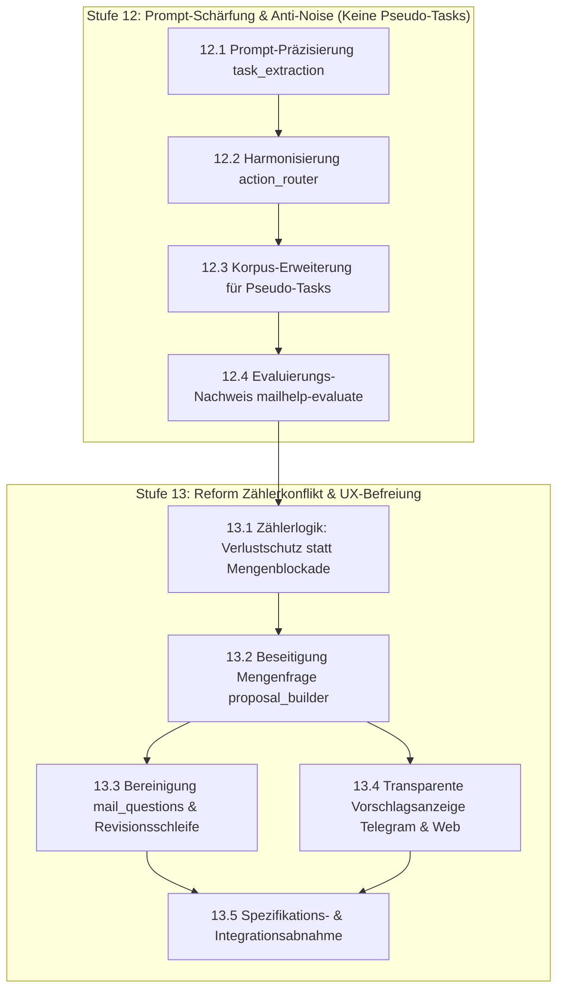

# Mailhelp 4.3 – Entschärfung von Zählerkonflikten und zielgerichtete Aufgaben-Extraktion

**Zielversion:** 4.3.0 (Schritte als Patchversionen 4.3.x)  
**Stand:** 6. November 2026  
**Status:** In Planung  
**Grundlage:** [Entwicklungsregeln](../AGENTS.md), [Projektspezifikation](../Mailhelp-Projektspezifikation.md), [Planung 4.0](Planung-4.0.md) (Gesamtfahrplan)  
**Vorgänger:** [Planung 4.2](Planung-4.2.md) (Reaktionsschnelle Web-Aktionen und Entscheidungspfad „Schon erledigt“)

---

## 1. Anlass und Ziel

> **„E-Mails erzeugen ohne verwirrende Mengenfragen sofort bestätigbare Vorschläge; optionale Nebensätze wie Weiterleitungsbitten oder Download-Links werden nicht mehr als Aufgaben missverstanden, und Zählerabweichungen zwischen Router und Extraktor sichern vor Datenverlust ab, statt den Nutzer mit Zahlenrätseln zu blockieren.“**

### 1.1 Das Problem im täglichen Betrieb

Im Alltag erhalten Nutzer in Telegram und der Weboberfläche regelmäßig die scheinbar unklare und blockierende Rückfrage:
> **„Wie viele Aufgaben enthält diese Mail tatsächlich?“**

Der betroffene Vorschlag wird auf den Status `needs_clarification` gesetzt und kann nicht direkt bestätigt werden. Eine Eingabe wie `1` oder `2` im Telegram-Klären-Dialog führt zudem in eine Sackgasse: Das System entfernt lediglich die offene Frage (`changes: {}`), löscht aber überzählige Vorschläge nicht automatisch – der Nutzer muss die überflüssige Aufgabe ohnehin manuell über „Verwerfen“ ablehnen.

### 1.2 Befund und Ursachenanalyse (anhand von Produktionsdaten)

Eine Analyse der Produktivdaten ([`data/production/`](../data/production)) und Logs vom November 2026 zeigt die genauen Auslöser:

1. **VLF-Einladung (`mail-4056d380860bdad23846294d.json`):**
   - **Router (`action_router`):** Erkennt 1 Aufgabe (`task_count: 1`) – die fristgebundene Anmeldung bis zum 27.11.2026.
   - **Extraktion (`task_extraction`):** Findet 2 Aufgaben (`actual_count: 2`):
     1. *„Anmeldung zur Verbandsausschusssitzung“*
     2. *„Einladung weiterleiten“* (abgeleitet aus der reinen Höflichkeitsfloskel: *„Leiten Sie die Einladung gerne an weitere interessierte Personen weiter.“*)
   - **Konflikt:** `expected: 1 != actual: 2` → Zählerabweichung.

2. **EnBW-Newsletter (`mail-545c00ec5802a625c348e541.json`):**
   - **Router (`action_router`):** Zählt 2 Aufgaben (`task_count: 2`) – Webinar-Anmeldung und Meldefrist.
   - **Extraktion (`task_extraction`):** Findet 3 Aufgaben (`actual_count: 3`):
     1. *„Förderende der Anlage melden“*
     2. *„Webinar-Anmeldung (optional)“*
     3. *„Whitepaper herunterladen (optional)“* (aus einem werblichen Link: *„Jetzt herunterladen“*)
   - **Konflikt:** `expected: 2 != actual: 3` → Zählerabweichung.

### Die drei systemischen Schwachstellen:
1. **Unpräzise Aufgabengrenzen im Prompt ([`prompts.yaml`](../prompts.yaml)):**  
   Der Extraktions-Prompt filtert rein optionale Nebenhandlungen (Weiterleiten von Mails, Herunterladen von Werbematerial / Whitepapern, Durchklicken von Links) nicht scharf genug heraus. Der Router übergeht diese Nebenhandlungen meist, wodurch zwangsläufig Zähler-Diskrepanzen entstehen.
2. **Überharte Zähler-Konfliktlogik ([`proposal_builder.py`](../src/mailhelp/proposals/proposal_builder.py)):**  
   Bisher gilt jede Diskrepanz (`expected_count != actual_count`) als fataler Klärungsfall. Jedem Vorschlag wird pauschal die offene Frage `Wie viele Aufgaben enthält diese Mail tatsächlich?` aufgeprägt. Dabei ist das Auffinden von *mehr* Aufgaben (`actual > expected`) gar kein Informationsverlust, sondern eine granulare Aufteilung, die der Nutzer am besten direkt per Knopfdruck („Bestätigen“, „Verwerfen“ oder „Schon erledigt“) entscheidet.
3. **Sackgasse in der Revision ([`mail_questions.py`](../src/mailhelp/processing/mail_questions.py) & [`prompts.yaml`](../prompts.yaml)):**  
   `mail_questions.py` verbietet dem LLM ausdrücklich die Selbstauflösung von Mengenfragen (`question.startswith("Wie viele ")`), und der Revisions-Prompt ignoriert Mengenänderungen (`changes darf nur Einträge aus allowed_changes enthalten`). Die Frage bindet den Nutzer in einen Dialog ein, der programmatisch gar keine sinnvolle Mutation am Vorschlagsbestand durchführen kann.

---

## 2. Die Kernsäulen von Version 4.3

---

### Stufe 12 – Prompt-Schärfung & Anti-Noise (Keine Pseudo-Tasks)

* **Ziel:** Das Sprachmodell unterscheidet klar zwischen echten, handlungsrelevanten Aufgaben und rein werblichen oder unverbindlichen Nebenoptionen.
* **Kernregeln:**
  - Rein unverbindliche Lese- und Downloadangebote (*„Whitepaper herunterladen“*, *„Mehr erfahren“*, *„Hier klicken“*) sind **keine** Aufgaben.
  - Optionale Weiterleitungs-Bitten (*„Leiten Sie diese Einladung gerne weiter“*) sind **keine** Aufgaben.
  - Echte Aufgaben erfordern eine persönliche Verantwortung oder Frist (z. B. verbindliche Anmeldungen, Rückmeldungen, Fristen zur Vertragsänderung).
* Router und Extraktor verwenden dieselben Kriterien, wodurch Zählerabweichungen bereits im Vorfeld drastisch reduziert werden.

---

### Stufe 13 – Reform der Zählerkonflikt-Logik & UX-Befreiung

* **Verlustschutz statt Nutzerbefragung:**
  - **Echter Verlustfall (`expected > 0`, `actual == 0`):** Der Router sieht Aufgaben, der Extraktor liefert 0. Hier droht Informationsverlust! Mailhelp erfasst eine Warnung und signalisiert Klärungsbedarf zur Mail.
  - **Granularer Fall (`actual >= expected > 0`):** Der Extraktor findet mehr Aufgaben als der Router grob geschätzt hat. Die Aufgaben werden **direkt im Status `pending_confirmation`** angelegt (sofern keine fachlichen Fakten wie Fristen fehlen). Der Nutzer sieht die Aufgaben direkt und entscheidet per Knopfdruck („Bestätigen“, „Verwerfen“, „Schon erledigt“).
* **Vollständige Entfernung der Mengenfrage:**
  - Die künstliche Frage `„Wie viele Aufgaben enthält diese Mail tatsächlich?“` wird ersatzlos aus `proposal_builder.py` gestrichen.
  - Zählerabweichungen bleiben weiterhin als `ExtractionCountConflict` im Zustand und in den Logs protokolliert (zu Diagnose- und Qualitätssicherungszwecken), blockieren aber nicht mehr den Benutzer-Workflow.
  - In `mail_questions.py` und der Dialogsteuerung entfallen die Sonderregeln für `"Wie viele "`.

---

## 3. Umsetzungsschritte

Es gelten die Regeln aus [Planung 4.0, Abschnitt 5.1](Planung-4.0.md#51-regeln-für-die-schritte):  
Jeder Schritt wird als eigener Commit mit Patchversion geliefert, hat den Umfang S (≤ 1 Tag) oder M (≤ 2 Tage) und erhält 100 % Zeilen- und Branch-Abdeckung.

### Stufe 12 – Prompt-Schärfung & Anti-Noise

| Schritt | Inhalt | Fertig, wenn … | Umfang | Voraussetzung |
| :--- | :--- | :--- | :---: | :--- |
| **12.1** | Prompt-Präzisierung `task_extraction` | `prompts.yaml` schließt rein werbliche Aufforderungen („Whitepaper herunterladen“, Links anklicken) und bloße Höflichkeitsweiterleitungen („gerne weiterleiten“) explizit von den extrahierten Aufgaben aus. | S | – |
| **12.2** | Harmonisierung `action_router` | `action_router`-Prompt in `prompts.yaml` gleicht die Zählkriterien mit `task_extraction` ab; keine Erfassung von Werbe- und Weiterleitungsfloskeln im `task_count`. | S | 12.1 |
| **12.3** | Synthetischer Korpus für Pseudo-Tasks | Aufnahme synthetischer Testmails in `tests/fixtures/mail_corpus_v3/` mit Weiterleitungsfloskeln und Marketing-Download-Links; Testfälle belegen, dass keine Pseudo-Tasks extrahiert werden. | S | 12.1, 12.2 |
| **12.4** | Evaluierungsnachweis & Prompt-Gate | `mailhelp-evaluate` und `tests/evaluation/test_prompt_gate.py` bestätigen die Unversehrtheit des Gesamtkorpus (Erkennungsrate bleibt ≥ Ausgangsbasis). | S | 12.3 |

---

### Stufe 13 – Reform der Zählerkonflikt-Logik & UX-Befreiung

| Schritt | Inhalt | Fertig, wenn … | Umfang | Voraussetzung |
| :--- | :--- | :--- | :---: | :--- |
| **13.1** | Zählerkonflikt als Diagnose statt Blockade | `orchestrator.record_count_conflict` behält die Speicherung von `ExtractionCountConflict` für Monitoring bei, löst aber bei `actual >= expected > 0` keine Blockade mehr aus; echte Verlustfälle (`expected > 0`, `actual == 0`) werden als `unclear`-Mailhinweis verbucht. | S | 12.4 |
| **13.2** | Beseitigung der Mengenfrage im Proposal-Builder | In `proposal_builder.py` wird das Anhängen von `f"Wie viele {'Aufgaben' if kind == 'task' else 'Termine'} enthält diese Mail tatsächlich?"` ersatzlos entfernt; schema-valide Vorschläge gehen ohne Mengenfrage direkt in `pending_confirmation`. | S | 13.1 |
| **13.3** | Bereinigung `mail_questions` & Revisionslogik | Der Sonderfall `if question.startswith("Wie viele "): break` in `mail_questions.py` und ungenutzte Mengenfilter im Telegram-Revisionshandler werden sauber entfernt. | S | 13.2 |
| **13.4** | Telegram & Web-UX bei Mehrfachvorschlägen | Keine kryptischen Warnmeldungen (*„Zählerabweichung für task...“*) mehr an Telegram-Nutzer; stattdessen transparente Anzeige der gefundenen Aufgaben mit direkten Aktionsbuttons („Bestätigen“, „Verwerfen“, „Schon erledigt“). | S | 13.2 |
| **13.5** | Spezifikationsanpassung & Gesamtabnahme | `Mailhelp-Projektspezifikation.md` bzgl. Router-Zählern aktualisiert; bestehende Tests (inkl. `test_spec_implementation.py`) angepasst; 100 % Zeilen- und Branch-Coverage; Release-Bericht `docs/Release-4.3.md`. | M | 13.1–13.4 |

**Umfangsübersicht Version 4.3:** 9 Schritte, davon 8 S und 1 M.

---

## 4. Abnahmekriterien

1. **Keine Mengenfragen mehr:**
   - Der Satz *„Wie viele Aufgaben enthält diese Mail tatsächlich?“* (sowie die Terminvariante) wird in keinem Fall mehr als offene Frage an einen Vorschlag gehängt.
2. **Direkte Bestätigbarkeit (`pending_confirmation`):**
   - Extrahiert Mailhelp aus einer Mail mit `task_count: 1` zwei vollständig spezifizierte Aufgaben, gehen beide sofort in `pending_confirmation`. Der Nutzer kann jede Aufgabe mit einem Klick annehmen, verwerfen oder als „schon erledigt“ markieren.
3. **Verlustschutz garantiert:**
   - Erwartet der Router Aufgaben (`task_count >= 1`), der Extraktor liefert jedoch `0` Aufgaben, wird der Informationsverlust sicher erkannt und dem Nutzer als unklare Mail zur Prüfung gemeldet.
4. **Keine Pseudo-Tasks aus Werbelinks & Floskeln:**
   - Synthetische und reale Mails mit Textbausteinen wie *„Leiten Sie diese Einladung gerne weiter“* oder *„Whitepaper jetzt herunterladen“* erzeugen keine Todoist-Vorschläge.
5. **Keine nervigen Telegram-Zählerwarnungen:**
   - Der Bot versendet keine technischen `Zählerabweichung für task: Router X, Extraktion Y`-Nachrichten mehr in den Chat.
6. **Spezifikationskonformität & 100 % Testabdeckung:**
   - `Mailhelp-Projektspezifikation.md` ist mit dem neuen Verhalten synchronisiert.
   - Sämtliche Tests laufen unter Windows und Linux durch; 100 % Zeilen- und 100 % Branch-Abdeckung für allen Anwendungscode bleiben unverändert strikt gewahrt.

