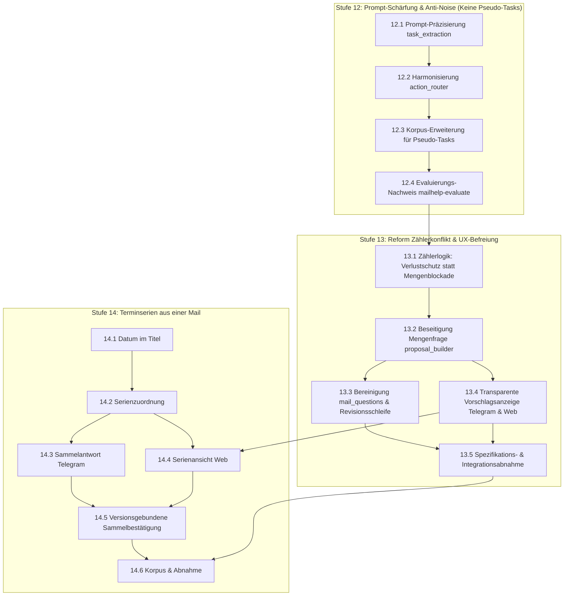

# Mailhelp 4.3 – Entschärfung von Zählerkonflikten, zielgerichtete Aufgaben-Extraktion und Terminserien

**Zielversion:** 4.3.0 (Schritte als Patchversionen 4.3.x)  
**Stand:** 6. November 2026  
**Status:** Umsetzung und automatisierte Abnahme abgeschlossen in 4.3.0
**Grundlage:** [Entwicklungsregeln](../AGENTS.md), [Projektspezifikation](../Mailhelp-Projektspezifikation.md), [Planung 4.0](Planung-4.0.md) (Gesamtfahrplan)  
**Vorgänger:** [Planung 4.2](Planung-4.2.md) (Reaktionsschnelle Web-Aktionen und Entscheidungspfad „Schon erledigt“)

---

## 1. Anlass und Ziel

> **„E-Mails erzeugen ohne verwirrende Mengenfragen sofort bestätigbare Vorschläge; optionale Nebensätze wie Weiterleitungsbitten oder Download-Links werden nicht mehr als Aufgaben missverstanden, und Zählerabweichungen zwischen Router und Extraktor sichern vor Datenverlust ab, statt den Nutzer mit Zahlenrätseln zu blockieren.“**

### 1.1 Das Problem im täglichen Betrieb

Im Alltag erhalten Nutzer in Telegram und der Weboberfläche regelmäßig die scheinbar unklare und blockierende Rückfrage:
> **„Wie viele Aufgaben enthält diese Mail tatsächlich?“**

Der betroffene Vorschlag wird auf den Status `needs_clarification` gesetzt und kann nicht direkt bestätigt werden. Eine Eingabe wie `1` oder `2` im Telegram-Klären-Dialog führt zudem in eine Sackgasse: Das System entfernt lediglich die offene Frage (`changes: {}`), löscht aber überzählige Vorschläge nicht automatisch – der Nutzer muss die überflüssige Aufgabe ohnehin manuell über „Verwerfen“ ablehnen.

### 1.2 Befund und Ursachenanalyse (anhand von Produktionsdaten)

Eine Analyse der Produktivdaten ([`data/production/`](../data/production)) und Logs vom November 2026 zeigt die genauen Auslöser:

1. **VLF-Einladung (`mail-4056d380860bdad23846294d.json`):**
   - **Router (`action_router`):** Erkennt 1 Aufgabe (`task_count: 1`) – die fristgebundene Anmeldung bis zum 27.11.2026.
   - **Extraktion (`task_extraction`):** Findet 2 Aufgaben (`actual_count: 2`):
     1. *„Anmeldung zur Verbandsausschusssitzung“*
     2. *„Einladung weiterleiten“* (abgeleitet aus der reinen Höflichkeitsfloskel: *„Leiten Sie die Einladung gerne an weitere interessierte Personen weiter.“*)
   - **Konflikt:** `expected: 1 != actual: 2` → Zählerabweichung.

2. **EnBW-Newsletter (`mail-545c00ec5802a625c348e541.json`):**
   - **Router (`action_router`):** Zählt 2 Aufgaben (`task_count: 2`) – Webinar-Anmeldung und Meldefrist.
   - **Extraktion (`task_extraction`):** Findet 3 Aufgaben (`actual_count: 3`):
     1. *„Förderende der Anlage melden“*
     2. *„Webinar-Anmeldung (optional)“*
     3. *„Whitepaper herunterladen (optional)“* (aus einem werblichen Link: *„Jetzt herunterladen“*)
   - **Konflikt:** `expected: 2 != actual: 3` → Zählerabweichung.

### Die drei systemischen Schwachstellen:
1. **Unpräzise Aufgabengrenzen im Prompt ([`prompts.yaml`](../prompts.yaml)):**  
   Der Extraktions-Prompt filtert rein optionale Nebenhandlungen (Weiterleiten von Mails, Herunterladen von Werbematerial / Whitepapern, Durchklicken von Links) nicht scharf genug heraus. Der Router übergeht diese Nebenhandlungen meist, wodurch zwangsläufig Zähler-Diskrepanzen entstehen.
2. **Überharte Zähler-Konfliktlogik ([`proposal_builder.py`](../src/mailhelp/proposals/proposal_builder.py)):**  
   Bisher gilt jede Diskrepanz (`expected_count != actual_count`) als fataler Klärungsfall. Jedem Vorschlag wird pauschal die offene Frage `Wie viele Aufgaben enthält diese Mail tatsächlich?` aufgeprägt. Dabei ist das Auffinden von *mehr* Aufgaben (`actual > expected`) gar kein Informationsverlust, sondern eine granulare Aufteilung, die der Nutzer am besten direkt per Knopfdruck („Bestätigen“, „Verwerfen“ oder „Schon erledigt“) entscheidet.
3. **Sackgasse in der Revision ([`mail_questions.py`](../src/mailhelp/processing/mail_questions.py) & [`prompts.yaml`](../prompts.yaml)):**  
   `mail_questions.py` verbietet dem LLM ausdrücklich die Selbstauflösung von Mengenfragen (`question.startswith("Wie viele ")`), und der Revisions-Prompt ignoriert Mengenänderungen (`changes darf nur Einträge aus allowed_changes enthalten`). Die Frage bindet den Nutzer in einen Dialog ein, der programmatisch gar keine sinnvolle Mutation am Vorschlagsbestand durchführen kann.

### 1.3 Terminserien aus einer Mail (Befund vom 6. November 2026)

Die Mail „Sitzungstermine 2027“ der Stadt Forchtenberg (`mail-8f5080145953fb9e940d6a3b.json`)
listet die elf Gemeinderatssitzungen 2027 und die Haushaltsklausur auf, jeweils nur mit Datum.
Die Extraktion ist inhaltlich richtig: Mailhelp erzeugt zwölf Terminvorschläge. Für die
Bedienung ist das Ergebnis aber ungünstig:

1. **Gleich aussehende Karten:** Elf Vorschläge heißen „Gemeinderatssitzung Forchtenberg“.
   Sie unterscheiden sich nur im Datum, und das steht nicht im Titel. In Telegram und in der
   Übersicht sind sie kaum auseinanderzuhalten.
2. **Zwölfmal dieselbe Rückfrage:** Ohne Uhrzeit steht jeder Vorschlag auf
   `needs_clarification` mit „Wann beginnt der Termin?“ und „Wann endet der Termin?“. Die
   Antwort ist für alle Sitzungen dieselbe, muss aber für jeden Vorschlag einzeln gegeben
   werden.
3. **Keine Sammelbestätigung:** Selbst nach den Antworten muss jeder Termin einzeln bestätigt
   werden.

Sobald die Beginnzeit feststeht, ergänzt `proposals/event_defaults.py` das Ende schon heute
über die Standarddauer (`event_defaults`, 180 Minuten in Präsenz). Für eine Serie genügt
deshalb im Normalfall eine einzige Antwort wie „19 Uhr“.

---

## 2. Die Kernsäulen von Version 4.3

---

### Stufe 12 – Prompt-Schärfung & Anti-Noise (Keine Pseudo-Tasks)

* **Ziel:** Das Sprachmodell unterscheidet klar zwischen echten, handlungsrelevanten Aufgaben und rein werblichen oder unverbindlichen Nebenoptionen.
* **Kernregeln:**
  - Rein unverbindliche Lese- und Downloadangebote (*„Whitepaper herunterladen“*, *„Mehr erfahren“*, *„Hier klicken“*) sind **keine** Aufgaben.
  - Optionale Weiterleitungs-Bitten (*„Leiten Sie diese Einladung gerne weiter“*) sind **keine** Aufgaben.
  - Echte Aufgaben erfordern eine persönliche Verantwortung oder Frist (z. B. verbindliche Anmeldungen, Rückmeldungen, Fristen zur Vertragsänderung).
* Router und Extraktor verwenden dieselben Kriterien, wodurch Zählerabweichungen bereits im Vorfeld drastisch reduziert werden.

---

### Stufe 13 – Reform der Zählerkonflikt-Logik & UX-Befreiung

* **Verlustschutz statt Nutzerbefragung:**
  - **Echter Verlustfall (`expected > 0`, `actual == 0`):** Der Router sieht Aufgaben, der Extraktor liefert 0. Hier droht Informationsverlust! Mailhelp erfasst eine Warnung und signalisiert Klärungsbedarf zur Mail.
  - **Granularer Fall (`actual >= expected > 0`):** Der Extraktor findet mehr Aufgaben als der Router grob geschätzt hat. Die Aufgaben werden **direkt im Status `pending_confirmation`** angelegt (sofern keine fachlichen Fakten wie Fristen fehlen). Der Nutzer sieht die Aufgaben direkt und entscheidet per Knopfdruck („Bestätigen“, „Verwerfen“, „Schon erledigt“).
* **Vollständige Entfernung der Mengenfrage:**
  - Die künstliche Frage `„Wie viele Aufgaben enthält diese Mail tatsächlich?“` wird ersatzlos aus `proposal_builder.py` gestrichen.
  - Zählerabweichungen bleiben weiterhin als `ExtractionCountConflict` im Zustand und in den Logs protokolliert (zu Diagnose- und Qualitätssicherungszwecken), blockieren aber nicht mehr den Benutzer-Workflow.
  - In `mail_questions.py` und der Dialogsteuerung entfallen die Sonderregeln für `"Wie viele "`.

---

### Stufe 14 – Terminserien aus einer Mail

* **Unterscheidbare Titel:** Haben mehrere Terminvorschläge einer Mail denselben Titel, hängt
  Mailhelp das Datum deterministisch an („Gemeinderatssitzung Forchtenberg – 23.02.2027“). Das
  geschieht im Code, nicht im Prompt, damit es unabhängig vom Modell gilt. Einzeltermine
  behalten ihren Titel.
* **Serie = gleiche Quelle, gleicher Grundtitel:** Vorschläge derselben Mail mit demselben
  Grundtitel bilden eine Serie (im Beispiel die elf Sitzungen; die Haushaltsklausur nicht).
  Abweichende Termine wie die Montagssitzung bleiben Teil der Serie, lassen sich aber einzeln
  ausnehmen.
* **Eine Antwort für alle:** Wer eine Zeitfrage für einen Serientermin beantwortet, wird
  gefragt, ob die Antwort für alle offenen Termine der Serie gelten soll. Für jeden Termin
  entsteht dabei eine eigene neue Vorschlagsversion über die bestehende deterministische
  Zeitauswertung (`temporal_answers.py`). Vorschläge, die inzwischen eine andere Version
  haben, bestätigt oder verworfen sind, bleiben unberührt.
* **Sammelbestätigung ohne Abstriche bei der Sicherheit:** Eine Bestätigung „Alle N Termine
  anlegen“ bindet sich an die ausdrücklich angezeigte Liste aus Vorschlags-ID und Version.
  Ändert sich auch nur ein Eintrag, wird die ganze Sammelbestätigung abgelehnt und neu
  angezeigt. Jeder Termin erhält einen eigenen Idempotenzschlüssel. Teilfehler bei der
  externen Anlage werden je Termin abgeglichen, bevor wiederholt wird; Sitzungs- und
  CSRF-Prüfung gelten unverändert.

---

## 3. Umsetzungsschritte

Es gelten die Regeln aus [Planung 4.0, Abschnitt 5.1](Planung-4.0.md#51-regeln-für-die-schritte):  
Jeder Schritt wird als eigener Commit mit Patchversion geliefert, hat den Umfang S (≤ 1 Tag) oder M (≤ 2 Tage) und erhält 100 % Zeilen- und Branch-Abdeckung.

### Stufe 12 – Prompt-Schärfung & Anti-Noise

| Schritt | Inhalt | Fertig, wenn … | Umfang | Voraussetzung |
| :--- | :--- | :--- | :---: | :--- |
| **12.1** ✓ 4.3.0 | Prompt-Präzisierung `task_extraction` | `prompts.yaml` schließt rein werbliche Aufforderungen („Whitepaper herunterladen“, Links anklicken) und bloße Höflichkeitsweiterleitungen („gerne weiterleiten“) explizit von den extrahierten Aufgaben aus. | S | – |
| **12.2** ✓ 4.3.0 | Harmonisierung `action_router` | `action_router`-Prompt in `prompts.yaml` gleicht die Zählkriterien mit `task_extraction` ab; keine Erfassung von Werbe- und Weiterleitungsfloskeln im `task_count`. | S | 12.1 |
| **12.3** ✓ 4.3.0 | Synthetischer Korpus für Pseudo-Tasks | Aufnahme synthetischer Testmails in `tests/fixtures/mail_corpus_v3/` mit Weiterleitungsfloskeln und Marketing-Download-Links; Testfälle belegen, dass keine Pseudo-Tasks extrahiert werden. | S | 12.1, 12.2 |
| **12.4** ✓ 4.3.0 | Evaluierungsnachweis & Prompt-Gate | `mailhelp-evaluate` und `tests/evaluation/test_prompt_gate.py` bestätigen die Unversehrtheit des Gesamtkorpus (Erkennungsrate bleibt ≥ Ausgangsbasis). | S | 12.3 |

---

### Stufe 13 – Reform der Zählerkonflikt-Logik & UX-Befreiung

| Schritt | Inhalt | Fertig, wenn … | Umfang | Voraussetzung |
| :--- | :--- | :--- | :---: | :--- |
| **13.1** ✓ 4.3.0 | Zählerkonflikt als Diagnose statt Blockade | `orchestrator.record_count_conflict` behält die Speicherung von `ExtractionCountConflict` für Monitoring bei, löst aber bei `actual >= expected > 0` keine Blockade mehr aus; echte Verlustfälle (`expected > 0`, `actual == 0`) werden als `unclear`-Mailhinweis verbucht. | S | 12.4 |
| **13.2** ✓ 4.3.0 | Beseitigung der Mengenfrage im Proposal-Builder | In `proposal_builder.py` wird das Anhängen von `f"Wie viele {'Aufgaben' if kind == 'task' else 'Termine'} enthält diese Mail tatsächlich?"` ersatzlos entfernt; schema-valide Vorschläge gehen ohne Mengenfrage direkt in `pending_confirmation`. | S | 13.1 |
| **13.3** ✓ 4.3.0 | Bereinigung `mail_questions` & Revisionslogik | Der Sonderfall `if question.startswith("Wie viele "): break` in `mail_questions.py` und ungenutzte Mengenfilter im Telegram-Revisionshandler werden sauber entfernt. | S | 13.2 |
| **13.4** ✓ 4.3.0 | Telegram & Web-UX bei Mehrfachvorschlägen | Keine kryptischen Warnmeldungen (*„Zählerabweichung für task...“*) mehr an Telegram-Nutzer; stattdessen transparente Anzeige der gefundenen Aufgaben mit direkten Aktionsbuttons („Bestätigen“, „Verwerfen“, „Schon erledigt“). | S | 13.2 |
| **13.5** ✓ 4.3.0 | Spezifikationsanpassung & Gesamtabnahme | `Mailhelp-Projektspezifikation.md` bzgl. Router-Zählern aktualisiert; bestehende Tests (inkl. `test_spec_implementation.py`) angepasst; 100 % Zeilen- und Branch-Coverage; Release-Bericht `docs/Release-4.3.md`. | M | 13.1–13.4 |

---

### Stufe 14 – Terminserien aus einer Mail

| Schritt | Inhalt | Fertig, wenn … | Umfang | Voraussetzung |
| :--- | :--- | :--- | :---: | :--- |
| **14.1** ✓ 4.3.0 | Datum im Titel bei gleichnamigen Terminen | `proposal_builder.py` ergänzt bei zwei oder mehr Terminvorschlägen derselben Mail mit gleichem Titel das Datum im Format `TT.MM.JJJJ`; Einzeltermine und Termine ohne aufgelöstes Datum bleiben unverändert; Abgleich mit bestehenden Kalendereinträgen und Duplikatprüfung nutzen weiterhin den Grundtitel. Regressionstest mit der synthetischen Sitzungsliste. | S | – |
| **14.2** ✓ 4.3.0 | Serienzuordnung im Datenmodell | `Proposal` erhält einen stabilen Serienschlüssel (Quellmail + normalisierter Grundtitel); er übersteht Neustarts, Revisionen und den Abgleich (`proposal_reconciliation.py`) und wird bei der Migration bestehender Vorschläge nachgetragen. Kein Einfluss auf die externe Anlage. | S | 14.1 |
| **14.3** ✓ 4.3.0 | Sammelantwort in Telegram | Nach einer Zeitantwort zu einem Serientermin fragt der Bot: „Für alle N offenen Termine dieser Serie übernehmen?“ mit `[Alle]` und `[Nur diesen]`. „Alle“ erzeugt je Termin eine neue Version über `deterministic_temporal_revision`; Termine mit inzwischen geänderter Version oder abgeschlossenem Status werden ausgelassen und genannt. Wiederholte Tastendrücke und Neustarts erzeugen keine doppelten Versionen. | M | 14.2 |
| **14.4** ✓ 4.3.0 | Serienansicht in der Weboberfläche | Die Übersicht fasst Serientermine zu einer aufklappbaren Gruppe zusammen; Beginn (und optional Ende) lassen sich einmal für alle oder je Termin eintragen; einzelne Termine lassen sich ausnehmen. Eintragen und Speichern erzeugen nur neue Versionen und autorisieren keine Anlage. Browsertests für Desktop, Mobilgerät und ohne JavaScript; Barrierefreiheit geprüft. | M | 14.2, 13.4 |
| **14.5** ✓ 4.3.0 | Versionsgebundene Sammelbestätigung | Web und Telegram bieten „Alle N Termine anlegen“ für vollständig spezifizierte Serientermine an. Die Bestätigung trägt die angezeigte Liste aus (Vorschlags-ID, Version); weicht ein Eintrag ab, wird sie insgesamt abgelehnt. Je Termin eigener Idempotenzschlüssel; unklare Schreibresultate werden je Termin abgeglichen. Tests für Erfolg, Teilfehler, Wiederholung, Neustart mitten in der Serie, abgelaufene Sitzung und fehlendes CSRF-Token. | M | 14.3, 14.4 |
| **14.6** ✓ 4.3.0 | Korpusfall und Abnahme | Qualitätskorpus v3 enthält eine synthetische Sitzungsliste mit zehn gleichnamigen Terminen und einem abweichenden Einzeltermin; das Evaluierungs-Gate prüft unterscheidbare Titel und die Seriengrenze. Spezifikation, README und `docs/Release-4.3.md` beschreiben Sammelantwort und Sammelbestätigung. | S | 14.5, 13.5 |

**Umfangsübersicht Version 4.3:** 15 Schritte, davon 11 S und 4 M.

---

## 4. Abnahmekriterien

1. **Keine Mengenfragen mehr:**
   - Der Satz *„Wie viele Aufgaben enthält diese Mail tatsächlich?“* (sowie die Terminvariante) wird in keinem Fall mehr als offene Frage an einen Vorschlag gehängt.
2. **Direkte Bestätigbarkeit (`pending_confirmation`):**
   - Extrahiert Mailhelp aus einer Mail mit `task_count: 1` zwei vollständig spezifizierte Aufgaben, gehen beide sofort in `pending_confirmation`. Der Nutzer kann jede Aufgabe mit einem Klick annehmen, verwerfen oder als „schon erledigt“ markieren.
3. **Verlustschutz garantiert:**
   - Erwartet der Router Aufgaben (`task_count >= 1`), der Extraktor liefert jedoch `0` Aufgaben, wird der Informationsverlust sicher erkannt und dem Nutzer als unklare Mail zur Prüfung gemeldet.
4. **Keine Pseudo-Tasks aus Werbelinks & Floskeln:**
   - Synthetische und reale Mails mit Textbausteinen wie *„Leiten Sie diese Einladung gerne weiter“* oder *„Whitepaper jetzt herunterladen“* erzeugen keine Todoist-Vorschläge.
5. **Keine nervigen Telegram-Zählerwarnungen:**
   - Der Bot versendet keine technischen `Zählerabweichung für task: Router X, Extraktion Y`-Nachrichten mehr in den Chat.
6. **Unterscheidbare Serientermine:**
   - Eine Mail mit elf gleichnamigen Sitzungsterminen erzeugt elf Vorschläge, deren Titel jeweils das Datum tragen; ein abweichend benannter Termin derselben Mail gehört nicht zur Serie.
7. **Eine Antwort für die ganze Serie:**
   - Eine einzige Antwort „19 Uhr“ macht alle offenen Termine der Serie vollständig (Ende über die Standarddauer); jeder Termin erhält genau eine neue Version, auch nach Wiederholung oder Neustart.
8. **Sammelbestätigung bleibt versionsgebunden:**
   - „Alle N Termine anlegen“ schreibt nur die angezeigten Versionen; eine zwischenzeitliche Änderung an einem Termin verhindert die gesamte Sammelanlage. Bearbeiten und Speichern allein lösen keine externe Anlage aus; doppelte Kalendereinträge entstehen auch bei Teilfehlern und Wiederholungen nicht.
9. **Spezifikationskonformität & 100 % Testabdeckung:**
   - `Mailhelp-Projektspezifikation.md` ist mit dem neuen Verhalten synchronisiert.
   - Sämtliche Tests laufen unter Windows und Linux durch; 100 % Zeilen- und 100 % Branch-Abdeckung für allen Anwendungscode bleiben unverändert strikt gewahrt.

## 5. Abschluss 4.3.0

Alle 15 Umsetzungsschritte sind enthalten. Windows und Linux bestehen die vollständige
Abnahme mit 100 % Zeilen- und Branch-Abdeckung; 237 Browsertests erreichen 100 %
JavaScript-Blockabdeckung. Die Serienbedienung funktioniert auch ohne JavaScript.
Versionsbindung, Sitzungswiderruf, CSRF, Teilfehler, Wiederholung und Neustart sind geprüft.

Der Nachweis zu 12.4 ist eine Offline-Vertragsprüfung aller 31 synthetischen Korpusfälle
mit simulierten Modellantworten. Er erhält die bisherige Vertragsabdeckung und behauptet
keine gemessene Erkennungsrate realer Modelle; die Baseline führt weiterhin
`model_quality_proven=false`. Es wurden keine privaten Produktionsmails für Tests verwendet.

Ergebnisse, Upgrade und Grenzen: [Release 4.3](Release-4.3.md).
Maschinenlesbare Nachweise: [Gesamtabnahme](../quality-reports/quality-4.3.json),
[Mutationsaudit](../quality-reports/mutation-4.3.json) und
[Offline-Evaluierung](../quality-reports/evaluation-4.3-offline.json).
