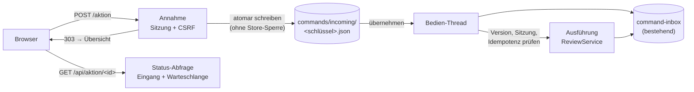
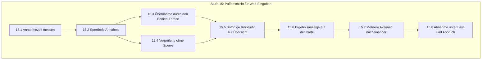

# Mailhelp 4.4 – Pufferschicht für Web-Eingaben und Bedienung ohne Wartezeit

**Zielversion:** 4.4.0 (Schritte als Patchversionen 4.4.x)  
**Stand:** 7. November 2026  
**Status:** Umsetzung und automatisierte Abnahme abgeschlossen in 4.4.0 ([Release 4.4](Release-4.4.md))  
**Grundlage:** [Entwicklungsregeln](../AGENTS.md), [Projektspezifikation](../Mailhelp-Projektspezifikation.md), [Planung 4.0](Planung-4.0.md) (Gesamtfahrplan)  
**Vorgänger:** [Planung 4.3](Planung-4.3.md) (Zählerkonflikte, Aufgaben-Extraktion und Terminserien) · **Nachfolger:** [Planung 4.5](Planung-4.5.md) (Eigene Mails, Notizen an sich selbst und Weiterleitungen)

---

## 1. Anlass und Ziel

> **„Ein Klick in der Weboberfläche ist nach weniger als 0,1 Sekunden quittiert. Die
> Oberfläche bleibt sofort bedienbar, während Mailhelp die Eingabe im Hintergrund sicher
> und genau einmal verarbeitet.“**

Die Reaktionsgeschwindigkeit der Weboberfläche ist im Alltag nicht zufriedenstellend. Planung
4.2 (Stufe 10) beseitigt die größten Ursachen: Sie hält keine Sperren mehr über
Netzwerkaufrufe, führt Web-Befehle zuerst aus und ersetzt das Neuladen der Statusseite durch
eine schlanke Abfrage. Der Nutzer wartet aber weiterhin auf der Seite „Aktion läuft“, bis
das Ergebnis vorliegt, beim Bestätigen einschließlich der Anlage in Kalender oder Todoist
(4–6 s). Version 4.4 trennt die Oberfläche vollständig von der Verarbeitung.

### 1.1 Heutiger Ablauf

1. `POST /aktion` ([`web/site.py`](../src/mailhelp/web/site.py), `act`) prüft Sitzung und
   CSRF, führt mit `_stale` eine Vorprüfung der Version durch und legt den Befehl mit
   `CommandInbox.submit` ([`review/inbox.py`](../src/mailhelp/review/inbox.py)) in der
   dauerhaften Warteschlange `command-inbox` ab.
2. Der Bedien-Thread (`mailhelp-operator`, `TelegramDialogController._process_commands` in
   [`telegram/dialog.py`](../src/mailhelp/telegram/dialog.py)) führt den Befehl aus und prüft
   dabei Version, Sitzung und Idempotenz erneut.
3. Der Browser wird auf `/aktion/<id>` umgeleitet. Die Seite fragt `/api/aktion/<id>` ab und
   kehrt erst nach dem Ergebnis zur Übersicht zurück.

Die Pufferschicht ist also im Kern schon vorhanden. Zwei Dinge verhindern, dass die
Oberfläche davon profitiert.

### 1.2 Verbleibende Ursachen der Wartezeit

1. **Die Oberfläche wartet absichtlich auf das Ergebnis.** Die Statusseite blockiert den
   Nutzer für die gesamte Ausführungszeit, obwohl die Webanfrage selbst längst beantwortet ist.
2. **Die Annahme braucht die gemeinsame Sperre der Zustandsablage.** `CommandInbox._submit`
   läuft unter `store.locked()`, und `_stale` liest Vorschläge und Warteschlange ebenfalls
   darüber. Hält die Mailanalyse, der Benachrichtigungs-Thread oder der Bedien-Thread diese
   Sperre, wartet schon das Absenden. Eine eigene Sperre für die Warteschlange wurde früher
   wegen einer Verklemmung mit dem Benachrichtigungs-Thread wieder entfernt (Kommentar in
   `CommandInbox.__init__`). Die Lösung muss deshalb ganz ohne zusätzliche gemeinsame Sperre
   auskommen.

### 1.3 Ziel

* **Sperrfreie Annahme:** Ein Web-Befehl wird als eigene Datei atomar in einem
  Eingangsverzeichnis abgelegt. Dafür ist keine Sperre der Zustandsablage nötig.
* **Sofortige Rückkehr:** Nach dem Absenden zeigt der Browser sofort die Übersicht. Die
  betroffene Karte trägt den Hinweis „Wird verarbeitet …“ und ist gegen erneute Aktionen
  gesperrt. Das Ergebnis erscheint auf der Karte und als kurze Meldung.
* **Unveränderte Sicherheit:** Sitzung und CSRF werden bei der Annahme geprüft. Versionsbindung,
  erneute Sitzungsprüfung, Idempotenz und der Abgleich unklarer Schreibresultate gelten
  unverändert bei der Ausführung. Bearbeiten und Speichern autorisieren weiterhin keine externe
  Anlage.

---

## 2. Architektur

**Eingangsverzeichnis:** Jeder angenommene Web-Befehl wird als
`commands/incoming/<hash-des-idempotenzschlüssels>.json` geschrieben: erst in eine temporäre
Datei, dann per `os.replace` an den endgültigen Namen. Weil der Dateiname aus dem
Idempotenzschlüssel abgeleitet ist, ergibt ein doppelter Klick dieselbe Datei und keinen
zweiten Befehl. Ein abweichender Inhalt unter demselben Schlüssel wird bei der Übernahme als
Konflikt abgelehnt, genau wie heute in `CommandInbox._submit`.

**Übernahme:** Der Bedien-Thread übernimmt die Eingangsdateien in der Reihenfolge ihres
Annahmezeitpunkts in die bestehende `command-inbox` und löscht sie erst, nachdem die Übernahme
dauerhaft gespeichert ist. Die Übernahme ist idempotent. Ein Absturz zwischen Annahme und
Übernahme verliert keinen Befehl, und ein Absturz zwischen Übernahme und Löschen erzeugt keinen
doppelten.

**Statusabfrage:** `/api/aktion/<id>` und die Übersicht lesen offene Befehle aus dem
Eingangsverzeichnis und aus der Warteschlange. Für das Eingangsverzeichnis ist keine Sperre der
Zustandsablage nötig.

**Telegram:** Telegram-Befehle laufen schon heute im Bedien-Thread und bleiben unverändert.

---

## 3. Umsetzungsschritte

Es gelten die Regeln aus [Planung 4.0, Abschnitt 5.1](Planung-4.0.md#51-regeln-für-die-schritte):
Jeder Schritt wird als eigener Commit mit Patchversion geliefert, hat den Umfang S (≤ 1 Tag)
oder M (≤ 2 Tage) und erhält 100 % Zeilen- und Branch-Abdeckung.

### Stufe 15 – Pufferschicht für Web-Eingaben

| Schritt | Inhalt | Fertig, wenn … | Umfang | Voraussetzung |
| :--- | :--- | :--- | :---: | :--- |
| **15.1** ✓ 4.4.0 | Annahmezeit messen | `command_submitted` enthält die Dauer der Annahme (`accept_ms`) und die Wartezeit auf die Store-Sperre, ohne Inhalte zu protokollieren; `/status` zeigt Median und Maximum der letzten Web-Annahmen neben den Messwerten aus Planung 4.2, Schritt 10.1. Ausgangswerte sind im Release-Bericht festgehalten. | S | 4.2: 10.1 |
| **15.2** ✓ 4.4.0 | Sperrfreie Annahme | `POST /aktion` schreibt den geprüften Befehl atomar nach `commands/incoming/<schlüssel>.json` (temporäre Datei und `os.replace`), ohne `store.locked()`. Gleicher Schlüssel ergibt dieselbe Datei; die Höchstzahl wartender Befehle (`MAX_QUEUED`) gilt über Eingang und Warteschlange zusammen. Unter Windows und Linux getestet, auch mit gleichzeitigen Schreibern und vollem Datenträger. | M | 15.1 |
| **15.3** ✓ 4.4.0 | Übernahme durch den Bedien-Thread | Der Bedien-Thread übernimmt Eingangsdateien vor allen anderen Arbeiten in `command-inbox`, in der Reihenfolge der Annahme; Konflikte (gleicher Schlüssel, anderer Inhalt) werden wie bisher abgelehnt und gemeldet. Absturztests: Abbruch nach dem Schreiben, nach der Übernahme und vor dem Löschen; jeder Befehl wird genau einmal ausgeführt. Beschädigte Eingangsdateien werden isoliert und gemeldet, nicht stillschweigend gelöscht. | S | 15.2 |
| **15.4** ✓ 4.4.0 | Vorprüfung ohne Sperre | Die Versionsvorprüfung (`_stale`) liest aus einem vom Bedien-Thread gepflegten Versionsindex im Speicher statt unter der Store-Sperre. Ein veralteter Index führt höchstens dazu, dass ein Befehl angenommen und bei der Ausführung abgelehnt wird; die maßgebliche Prüfung bei der Ausführung bleibt unverändert. Regressionstest: Annahme gelingt, während ein anderer Thread die Store-Sperre 5 s hält. | S | 15.2 |
| **15.5** ✓ 4.4.0 | Sofortige Rückkehr zur Übersicht | `POST /aktion` antwortet mit `303` auf die Übersicht mit Sprungmarke zur Karte; die Karte zeigt „Wird verarbeitet …“, ihre Schaltflächen sind gesperrt, und die Übersicht fragt den Status über `/api/aktion/<id>` ab. Ohne JavaScript zeigt die Übersicht den Hinweis und lädt sich selbst neu. Die Seite `/aktion/<id>` bleibt als direkter Link erhalten. | M | 15.3, 15.4, 4.2: 10.4 |
| **15.6** ✓ 4.4.0 | Ergebnisanzeige auf der Karte | Erfolg erscheint als kurze Meldung (`aria-live`); Fehler und abgelehnte Versionen bleiben auf der Karte sichtbar, bis der Nutzer sie zur Kenntnis nimmt. Die Entscheidung „wurde schon einmal angelegt“ wird auf der Karte angeboten, mit denselben versionsgebundenen Formularen wie heute. Ergebnisse sind auch nach Neuladen oder auf einem anderen Gerät sichtbar, solange die Warteschlange sie aufbewahrt (ein Tag). | S | 15.5 |
| **15.7** ✓ 4.4.0 | Mehrere Aktionen nacheinander | Der Nutzer kann weitere Karten bearbeiten, während frühere Aktionen laufen; Befehle zu verschiedenen Vorschlägen werden in Annahmereihenfolge ausgeführt, ein zweiter Befehl zur selben Karte wird bis zum Ergebnis des ersten nicht angeboten. Browsertests für Desktop, Mobilgerät und ohne JavaScript; Barrierefreiheit geprüft. | S | 15.6 |
| **15.8** ✓ 4.4.0 | Abnahme unter Last und Abbruch | Simulierter Lastlauf (laufende Mailanalyse, gehaltene Store-Sperre, Telegram-Versand, fünf gleichzeitige Browser) unter Windows, Linux und Docker: Antwort auf `POST /aktion` im Median unter 0,1 s, im Maximum unter 0,3 s; Prozessabbruch an jeder Stelle zwischen Annahme und Ergebnis ohne verlorene, doppelte oder unberechtigte Aktionen. Spezifikation, README und `docs/Release-4.4.md` beschreiben den neuen Ablauf. | M | 15.1–15.7 |

**Umfangsübersicht Version 4.4:** 8 Schritte, davon 5 S und 3 M.

---

## 4. Abnahmekriterien

1. **Sofortige Quittung:** `POST /aktion` antwortet im Median nach weniger als 0,1 s und im
   Maximum nach weniger als 0,3 s, auch während Mailanalyse, Benachrichtigungen und
   Telegram-Versand laufen und die Sperre der Zustandsablage gehalten wird.
2. **Kein Warten im Browser:** Nach jeder Web-Aktion steht sofort die Übersicht zur Verfügung;
   keine Aktion führt mehr zwingend über die Seite „Aktion läuft“.
3. **Genau einmal:** Jeder angenommene Befehl wird genau einmal ausgeführt, auch nach
   Doppelklick, Neuladen, Prozessabbruch oder Neustart an beliebiger Stelle. Ein Befehl geht
   nach der Quittung nicht mehr verloren.
4. **Unveränderte Sicherheit:** Sitzung und CSRF werden bei der Annahme geprüft; Versionsbindung,
   erneute Sitzungsprüfung bei Ausführung, Idempotenzschlüssel und Abgleich unklarer
   Schreibresultate bleiben bestehen. Eine abgelaufene Sitzung zwischen Annahme und Ausführung
   verhindert die Ausführung. Bearbeiten und Speichern autorisieren keine externe Anlage.
5. **Keine neue gemeinsame Sperre:** Die Annahme verwendet weder die Sperre der
   Zustandsablage noch eine andere zwischen Threads geteilte Sperre; die Verklemmungsszenarien
   aus 4.0.1 und die Prozessabbruch- und Konkurrenzszenarien aus 3.6 (A1–A7, P1–P7) bestehen
   weiterhin.
6. **Sichtbare Ergebnisse:** Fehler und abgelehnte Versionen bleiben auf der Karte sichtbar,
   bis der Nutzer sie zur Kenntnis nimmt; kein Ergebnis verschwindet unbemerkt.
7. **Abdeckung:** 100 % Zeilen- und 100 % Branch-Abdeckung für sämtlichen neuen und geänderten
   Code ohne Ausschlüsse.

---

## 5. Risiken und offene Punkte

* **Fehler werden später sichtbar:** Ein abgelehnter Befehl erscheint nicht mehr auf einer
  eigenen Seite, sondern auf der Karte. Schritt 15.6 muss sicherstellen, dass er auffällt.
* **Veralteter Versionsindex:** Die sperrfreie Vorprüfung kann eine veraltete Version durchlassen.
  Das ist unkritisch, weil die Ausführung erneut prüft, verschiebt die Ablehnung aber vom Absenden
  zur Ergebnisanzeige.
* **Dateisystem unter Windows:** Virenscanner und Indexdienste können `os.replace` kurzzeitig
  blockieren. Schritt 15.2 braucht eine begrenzte Wiederholung mit klarer Fehlermeldung statt
  eines stillen Verlusts.
* **Abhängigkeit von 4.2:** Messung (10.1) und Status-API (10.4) aus Planung 4.2 werden
  vorausgesetzt. Verzögert sich 4.2, lässt sich 15.2–15.4 vorziehen, 15.5 nicht.
