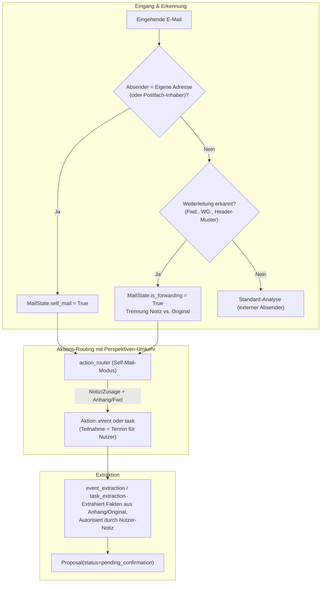
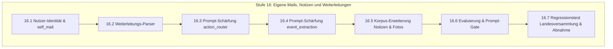

# Mailhelp 4.5 – Eigene Mails, Notizen an sich selbst und Weiterleitungen

**Zielversion:** 4.5.0 (Schritte als Patchversionen 4.5.x)  
**Stand:** 7. November 2026  
**Status:** In Planung  
**Grundlage:** [Entwicklungsregeln](../AGENTS.md), [Projektspezifikation](../Mailhelp-Projektspezifikation.md), [Planung 4.0](Planung-4.0.md) (Gesamtfahrplan)  
**Vorgänger:** [Planung 4.4](Planung-4.4.md) (Pufferschicht für Web-Eingaben) · **Nachfolger:** [Planung 4.6](Planung-4.6.md) (Terminänderungen, Verschiebungen und Absagen)

---

## 1. Anlass und Ziel

> **„Vom Smartphone an das eigene Postfach gesendete Notizen, Fotos und weitergeleitete E-Mails werden zuverlässig als Arbeitsanweisungen des Nutzers erkannt; die Perspektive kehrt sich um, sodass persönliche Notizen wie ‚Ich nehme teil‘ oder angehängte Einladungen direkt als Kalendertermin oder Aufgabe für den Nutzer erfasst werden.“**

### 1.1 Das Problem im täglichen Betrieb

Mailhelp geht historisch davon aus, dass eine eingehende Nachricht von einer externen Person stammt, die an den Postfachinhaber schreibt. In der Praxis nutzen viele Anwender ihr eigenes Postfach jedoch von unterwegs als **digitales Notizbuch** oder leiten E-Mails an sich selbst weiter:
- Ein Foto eines Einladungsschreibens oder Aushangs wird vom Smartphone an die eigene Adresse geschickt, versehen mit einer kurzen Zeile: *„Ich nehme teil“* oder *„Bitte eintragen“*.
- Eine E-Mail wird mit dem Vermerk *„WG: Rückmeldung bis Freitag erforderlich“* an sich selbst weitergeleitet.

### 1.2 Konkreter Befund aus den Produktivdaten (November 2026)

Bei der E-Mail **„Landesversammlung Bayern“** (`data/production/mail-7e84d7e85ab71622067f6a1b.json`):
- **Absender:** Stefan Hartmann (der Nutzer selbst, gesendet vom iPhone).
- **Text:** *„Ich bin angemeldet und nehme teil. Von meinem iPhone gesendet“*.
- **Anhänge:** Drei hochauflösende Fotos der gedruckten Einladung (Samstag, 5. Dezember 2026, 9:30 Uhr in Hohenstadt).
- **Verhalten der Pipeline:**
  1. Relevanzprüfung und Vision-OCR liefen fehlerfrei (~3.200 Zeichen Text erkannt).
  2. Im `action_router` brach das System mit `action_state: "none"` ab.
  3. **Wörtliche LLM-Begründung:** *„Die aktuelle Nachricht bestätigt lediglich die eigene Anmeldung und Teilnahme des Absenders. Die angehängte Einladung mit Termin und Rückmeldebitte ist eine ältere, an den Absender gerichtete Nachricht und enthält keine aktuelle Aufgabe oder Einladung an die nutzende Person.“*

**Ursache:**  
Das Sprachmodell unterlag einem **Perspektivenfehler**: Es nahm an, dass der Absender dem Nutzer mitteilt, dass *er selbst* weggeht, und stufte die Fotos als alten Ballast ein. Es erkannte nicht, dass der Nutzer seinem Assistenten mitteilte: *„Ich gehe zu dieser Veranstaltung aus dem Anhang, trage mir den Termin ein!“*

---

## 2. Architektur

### Die drei Kernbausteine:

1. **Erkennung der Nutzer-Identität (`self_mail`):**
   - Mailhelp prüft die Absenderadresse gegen die in `config.yaml` konfigurierten Postfächer, Aliase und `personal_info`.
   - Stimmen Absender und Postfach überein, wird die Mail als `self_mail: True` markiert.
2. **Weiterleitungs-Parser (`is_forwarding`):**
   - Erkennung gängiger Weiterleitungsmuster im Betreff (`WG:`, `Fwd:`, `Fw:`) und im Textkörper (*„-------- Weitergeleitete Nachricht --------“*, *„Begin forwarded message“* etc.).
   - Saubere Trennung: Die Notiz des Nutzers (oben) steuert die Absicht; der weitergeleitete Nachrichtentext (unten) liefert Datum, Zeit, Ort und Kontext.
3. **Perspektiven-Umkehr in den Prompts ([`prompts.yaml`](../prompts.yaml)):**
   - **`action_router`:** Ist `self_mail` aktiv, gelten Notizen wie *„Ich nehme teil“*, *„Ich bin angemeldet“* oder *„Termin eintragen“* in Kombination mit Terminfotos oder Original-Einladungen als verbindlicher Kalendertermin (`event`) für den Nutzer.
   - **`event_extraction`:** Das Modell entnimmt den Termin den Fotos oder dem weitergeleiteten Text und formuliert einen klaren Terminvorschlag.

---

## 3. Umsetzungsschritte (Stufe 16)

Es gelten die Regeln aus [Planung 4.0, Abschnitt 5.1](Planung-4.0.md#51-regeln-für-die-schritte):
Jeder Schritt wird als eigener Commit mit Patchversion geliefert, hat den Umfang S (≤ 1 Tag) oder M (≤ 2 Tage) und erhält 100 % Zeilen- und Branch-Abdeckung.

### Stufe 16 – Eigene Mails, Notizen und Weiterleitungen

| Schritt | Inhalt | Fertig, wenn … | Umfang | Voraussetzung |
| :--- | :--- | :--- | :---: | :--- |
| **16.1** | Nutzer-Identität & `self_mail`-Flag | `mailhelp.models.MailState` erhält `self_mail: bool` und `user_note: str \| None`; die Pipeline gleicht den Absender gegen konfigurierte Postfachadressen und `personal_info` ab. | S | – |
| **16.2** | Weiterleitungs-Parser | Erkennt Weiterleitungen anhand Betreff (`Fwd:`, `WG:`) und Inhaltsmarkern; trennt vorangestellte Notizen des Nutzers vom weitergeleiteten Originalkörper; isoliert strukturierte Header der Originalnachricht. | S | 16.1 |
| **16.3** | Prompt-Schärfung `action_router` | `action_router` in `prompts.yaml` erhält explizite Regeln für `self_mail`: Sendet der Nutzer sich selbst Notizen (*„Ich nehme teil“*, *„Ich bin angemeldet“*, *„Bitte eintragen“*) mit Terminfotos oder Einladungen, zählt dies als `event` (oder bei Aufgabenanweisung als `task`). | S | 16.1, 16.2 |
| **16.4** | Prompt-Schärfung `event_extraction` | `event_extraction` wertet bei `self_mail` die Anhänge und den weitergeleiteten Text als Beleg für den eigenen Termin des Nutzers aus; die Nutzer-Notiz liefert die Zusage/Relevanz. | S | 16.3 |
| **16.5** | Synthetischer Korpus für Mobile-Notizen | Ergänzung synthetischer Testfälle in `tests/fixtures/mail_corpus_v3/`: (1) iPhone-Notiz „Ich nehme teil“ mit Foto-Anhang, (2) Weitergeleitete Einladung mit Notiz „Bitte eintragen“, (3) Selbstnotiz mit Todo-Aufgabe. | S | 16.4 |
| **16.6** | Evaluierung & Prompt-Gate | `mailhelp-evaluate` und `tests/evaluation/test_prompt_gate.py` belegen, dass bestehende externe Einladungen unbeeinträchtigt bleiben und die neuen Self-Mail-Fälle zuverlässig erkannt werden. | S | 16.5 |
| **16.7** | Regressionstest Landesversammlung & Abnahme | End-to-End-Regressionstest mit den echten Daten der Mail `7e84d7e85ab71622067f6a1b` (synthetisiert): Termin zur Landesversammlung am 05.12.2026 wird fehlerfrei als bestätigbarer Terminvorschlag generiert; 100 % Coverage; `docs/Release-4.5.md`. | M | 16.1–16.6 |

**Umfangsübersicht Version 4.5:** 7 Schritte, davon 6 S und 1 M.

---

## 4. Abnahmekriterien

1. **Selbstnotizen erzeugen Termine:**  
   Sendet der Nutzer eine E-Mail von seiner eigenen Adresse mit Aussagen wie *„Ich bin angemeldet und nehme teil“* oder *„Bitte eintragen“* und Fotos/PDFs einer Veranstaltung, erzeugt Mailhelp zuverlässig einen Kalendervorschlag (`kind="event"`).
2. **Korrektes Datum und Zeit:**  
   Datum, Beginnzeit und Ort werden aus den ausgelesenen Bildanhängen oder dem weitergeleiteten Text extrahiert.
3. **Keine Verwechslung von Absender und Empfänger:**  
   Das Sprachmodell stuft den Nutzer bei Self-Mails nicht als Dritten ein; die Begründung (*reason*) reflektiert, dass der Nutzer die Teilnahme für sich selbst erfasst.
4. **Weiterleitungen sauber getrennt:**  
   Die eigene Notiz wird nicht mit dem Text der weitergeleiteten Nachricht vermischt; Evidenzzitate belegen sauber den Termin.
5. **100 % Testabdeckung:**  
   Sämtliche neuen Codepfade in Parser, Domain und Pipeline erreichen 100 % Zeilen- und Branch-Coverage.

