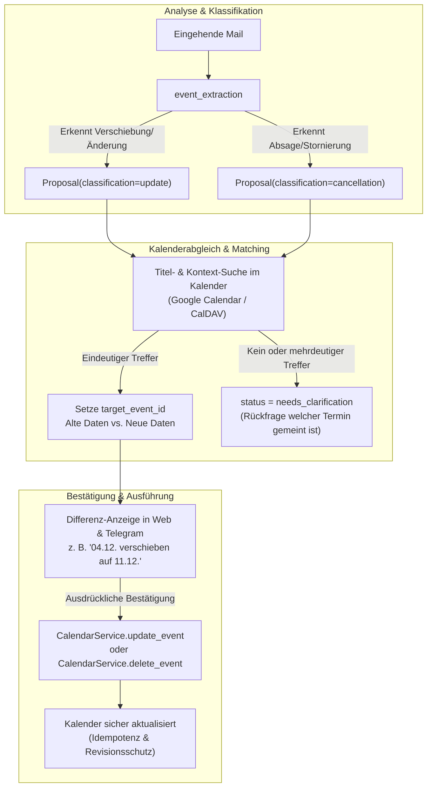
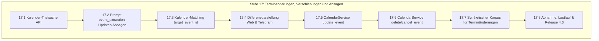

# Mailhelp 4.6 – Terminänderungen, Verschiebungen und Absagen im Kalender

**Zielversion:** 4.6.0 (Schritte als Patchversionen 4.6.x)  
**Stand:** 7. November 2026  
**Status:** In Umsetzung (17.1 in 4.6.0, 17.2 in 4.6.1, 17.3 in 4.6.2)  
**Grundlage:** [Entwicklungsregeln](../AGENTS.md), [Projektspezifikation](../Mailhelp-Projektspezifikation.md), [Planung 4.0](Planung-4.0.md) (Gesamtfahrplan)  
**Vorgänger:** [Planung 4.5](Planung-4.5.md) (Eigene Mails, Notizen an sich selbst und Weiterleitungen) · **Nachfolger:** [Planung 4.7](Planung-4.7.md) (Deep-Links zur Original-Mail in Kalender und Aufgaben)

---

## 1. Anlass und Ziel

> **„Folgemails zu bestehenden Terminen (Verschiebungen auf einen anderen Tag, geänderte Uhrzeiten, neue Räume oder Absagen) werden mit existierenden Kalendereinträgen abgeglichen; statt Dateileichen oder doppelten Terminen bietet Mailhelp die sichere Aktualisierung oder Stornierung des existierenden Eintrags an.“**

### 1.1 Das Problem im täglichen Betrieb

Im Alltag kommt es regelmäßig vor, dass bereits im Google Kalender oder CalDAV eingetragene Termine geändert oder abgesagt werden:
- *„Achtung: Die Sitzung am 4.12. wird um eine Woche auf den 11.12. verschoben.“*
- *„Die Besprechung morgen beginnt erst um 10:30 Uhr statt 09:30 Uhr.“*
- *„Die Veranstaltung am 15. Januar entfällt krankheitsbedingt leider ersatzlos.“*

### 1.2 Bisheriges Verhalten & Schwachstellen

Bisher ist der Kalenderabgleich von Mailhelp primär auf **zeitgleiche Dubletten** ausgelegt (`calendar_duplicate` prüft Events im selben Zeitfenster):
1. **Terminverschiebung:**  
   Wird ein Termin vom 4.12. auf den 11.12. verlegt, sucht der Dubletten-Check am 11.12. nach Kollisionen. Am 11.12. liegt noch kein Termin vor, also legt Mailhelp einen **neuen** Termin an. Der alte Eintrag am 4.12. bleibt als falsche Dateileiche im Kalender stehen.
2. **Terminabsage:**  
   Wird ein Termin abgesagt, erzeugt Mailhelp entweder gar keinen Kalenderbezug oder schlägt eine unverständliche Todoist-Aufgabe vor.
3. **Schreibdienst-Unterstützung:**  
   Die Datenmodelle (`ProposalClassification.UPDATE` und `ProposalClassification.CANCELLATION` mit `target_event_id`) sind im Domainmodell bereits angelegt, wurden aber bisher nicht vollumfänglich von der Extraktion bis zur externen Google- und CalDAV-Aktualisierung durchgeschleift.

---

## 2. Architektur

### Die drei Kernbausteine:

1. **Erweiterte Extraktion ([`prompts.yaml`](../prompts.yaml)):**  
   `event_extraction` erkennt anhand von Signalwörtern (*„Verschiebung“*, *„Terminänderung“*, *„verschoben auf“*, *„abgesagt“*, *„entfällt“*), ob es sich um eine Neuanlage (`new`), eine Änderung (`update`) oder eine Absage (`cancellation`) handelt. Das Modell extrahiert sowohl das ursprüngliche Referenzdatum als auch das neue Zieldatum.
2. **Titel- und Referenzsuche im Kalender:**  
   Statt nur das neue Datumsfenster abzufragen, sucht Mailhelp im Kalender nach dem Event-Titel (z. B. im Zeitraum ±3 Monate um das genannte Referenzdatum). Bei genau einem Treffer wird die `target_event_id` automatisch verknüpft.
3. **Sichere Ausführung mit Revisionsschutz:**  
   - **Verschiebung:** Der bestehende Termin wird per Google Calendar API `events().patch()` bzw. CalDAV aktualisiert.
   - **Stornierung:** Der Termin wird als abgesagt markiert (`status: cancelled`) oder gelöscht.
   - **Ausdrückliche Bestätigung:** Keine automatische Änderung ohne ausdrückliche Freigabe durch den Nutzer.

---

## 3. Umsetzungsschritte (Stufe 17)

Es gelten die Regeln aus [Planung 4.0, Abschnitt 5.1](Planung-4.0.md#51-regeln-für-die-schritte):
Jeder Schritt wird als eigener Commit mit Patchversion geliefert, hat den Umfang S (≤ 1 Tag) oder M (≤ 2 Tage) und erhält 100 % Zeilen- und Branch-Abdeckung.

### Stufe 17 – Terminänderungen, Verschiebungen und Absagen

| Schritt | Inhalt | Fertig, wenn … | Umfang | Voraussetzung |
| :--- | :--- | :--- | :---: | :--- |
| **17.1** ✓ 4.6.0 | Kalender-Titelsuche in Adaptern | Google Calendar- und CalDAV-Adapter erhalten `search_events(title_query, time_range)`; liefert Treffer mit `id`, `summary`, `start`, `end`. Keine Store-Sperre über Netzwerkaufrufe. | S | – |
| **17.2** ✓ 4.6.1 | Prompt-Schärfung `event_extraction` | `event_extraction` in `prompts.yaml` klassifiziert Terminverschiebungen als `classification: "update"` und Absagen als `classification: "cancellation"`; extrahiert früheres Datum (`original_date_text`) und neues Datum. | S | – |
| **17.3** ✓ 4.6.2 | Kalender-Matching & `target_event_id` | Pipeline sucht bei `update` oder `cancellation` im Zielkalender nach passenden Terminen; bei eindeutigem Match wird `target_event_id` gesetzt; bei 0 oder mehreren Treffern wechselt der Vorschlag in `needs_clarification`. | M | 17.1, 17.2 |
| **17.4** | Differenzdarstellung in Web & Telegram | Vorschlagskarten und Telegram-Nachrichten heben Änderungen visuell hervor: Altes Datum durchgestrichen, neues Datum fett; bei Absage roter Hinweis „Termin im Kalender stornieren“. | S | 17.3 |
| **17.5** | Schreibdienst `update_event` | `ConfirmedCalendarWriter` implementiert die Aktualisierung bestehender Termine (Datum, Zeit, Ort, Beschreibung) mit unverändertem `mailhelp_key`; idempotente Wiederaufnahme nach Crash. | M | 17.3, 17.4 |
| **17.6** | Schreibdienst `cancel_event` | `ConfirmedCalendarWriter` implementiert die Stornierung/Löschung bestätigter `cancellation`-Vorschläge; Wiederanlauf löscht nicht doppelt. | S | 17.5 |
| **17.7** | Synthetischer Korpus für Änderungen | Ergänzung von Testfällen in `tests/fixtures/mail_corpus_v3/`: (1) Datumsverschiebung um eine Woche, (2) Uhrzeitänderung, (3) Raumänderung, (4) Komplette Terminabsage. | S | 17.2 |
| **17.8** | Gesamtabnahme & Lastlauf | Vollständige Tests unter Windows & Linux (Erfolg, Teilfehler, abgelaufene Sitzungen, Reversion); 100 % Zeilen- und Branch-Coverage; Release-Bericht `docs/Release-4.6.md`. | M | 17.1–17.7 |

**Umfangsübersicht Version 4.6:** 8 Schritte, davon 5 S und 3 M.

---

## 4. Abnahmekriterien

1. **Keine Dateileichen bei Terminverschiebungen:**  
   Wird eine Verschiebung bestätigt, wird der bestehende Kalendereintrag am alten Tag verschoben. Es verbleibt kein alter Eintrag am ursprünglichen Tag.
2. **Eindeutiges Matching:**  
   Findet die Kalendersuche mehrere gleichnamige Termine oder keinen passenden Eintrag, wird niemals blind ein falscher Termin überschrieben; der Vorschlag geht mit einer konkreten Klärungsfrage an den Nutzer.
3. **Sichere Stornierung:**  
   Eine Absage-Mail löscht oder storniert den Kalendereintrag erst nach ausdrücklicher Bestätigung durch den Nutzer.
4. **Unveränderte Schreibsicherheit:**  
   Idempotenzschlüssel, Versionsprüfung, CSRF und die Überprüfung unklarer Schreibresultate gelten uneingeschränkt auch für `update` und `cancel`.
5. **100 % Testabdeckung:**  
   100 % Zeilen- und 100 % Branch-Abdeckung für sämtliche neuen Adapter-, Domain- und Review-Pfade.

