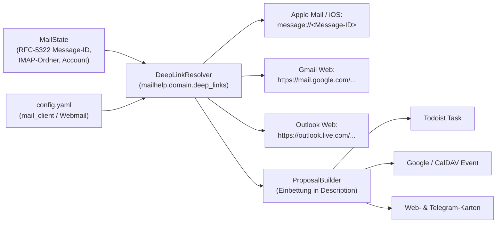
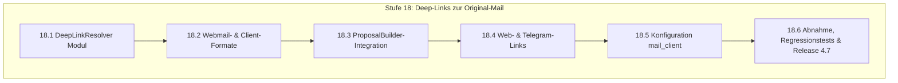

# Mailhelp 4.7 – Deep-Links zur Original-Mail in Kalender und Aufgaben

**Zielversion:** 4.7.0 (Schritte als Patchversionen 4.7.x)  
**Stand:** 7. November 2026  
**Status:** In Umsetzung (18.1 in 4.7.0, 18.2 in 4.7.1, 18.3 in 4.7.2, 18.4 in 4.7.3)  
**Grundlage:** [Entwicklungsregeln](../AGENTS.md), [Projektspezifikation](../Mailhelp-Projektspezifikation.md), [Planung 4.0](Planung-4.0.md) (Gesamtfahrplan)  
**Vorgänger:** [Planung 4.6](Planung-4.6.md) (Terminänderungen, Verschiebungen und Absagen) · **Nachfolger:** [Planung 4.8](Planung-4.8.md) (Antwortentwürfe direkt im Postfach)

---

## 1. Anlass und Ziel

> **„Jeder erzeugte Kalendereintrag und jede Todoist-Aufgabe enthält einen direkt klickbaren Deep-Link, der die zugehörige Original-E-Mail mit einem einzigen Klick in Apple Mail, Gmail oder Outlook Web öffnet.“**

### 1.1 Das Problem im täglichen Betrieb

Wenn ein Nutzer in Todoist oder im Google Kalender eine anstehende Aufgabe oder einen Termin sieht (z. B. *„Angebot an Firma Müller schicken“* oder *„Vorbereitung Verbandsausschuss“*), muss er zur Bearbeitung häufig noch einmal in die ursprüngliche Konversation, die genauen Formulierungen oder die Anhänge schauen.
- **Bisheriger Ablauf:** Der Nutzer muss sein E-Mail-Programm öffnen, den Absender oder Betreff manuell in die Suchleiste eintippen und die passende Nachricht heraussuchen. Das kostet Zeit und erzeugt Medienbrüche.
- **Ziel:** In der Beschreibung der Aufgabe bzw. des Termins befindet sich ein klickbarer Link. Ein Klick darauf öffnet die exakte Original-E-Mail direkt im bevorzugten E-Mail-Client des Nutzers.

---

## 2. Architektur



### Die drei technischen Link-Formate:

1. **Nativer System-Link (`message://`):**  
   - Format: `message://<Message-ID>`
   - Funktioniert nahtlos unter **macOS und iOS** (Apple Mail): Ein Klick öffnet sofort das native Mail-Fenster mit der genauen Nachricht.
   - Funktioniert auch unter Windows/Linux, wenn ein MAPI- bzw. URL-Protokoll-Handler für `message://` registriert ist (z. B. Thunderbird).
2. **Webmail-Direktsuche (Gmail & Outlook):**  
   - **Google Workspace / Gmail:**  
     `https://mail.google.com/mail/u/0/#search/rfc822msgid%3A<Message-ID-UrlEncoded>`
   - **Outlook Web / Microsoft 365:**  
     `https://outlook.live.com/mail/0/deeplink?ItemID=...` bzw. Message-ID-Suche.
3. **Formatierung in Beschreibungen:**  
   Am Ende der externen Beschreibung (unterhalb von Absender und Datum) ergänzt Mailhelp:
   ```markdown
   ---
   📧 Original-E-Mail öffnen: message://<Message-ID>
   ```
   In Todoist wird daraus ein klickbarer Markdown-Link `[📧 Original-E-Mail öffnen](message://...)`, im Google Kalender ein klickbarer Hyperlink.

---

## 3. Umsetzungsschritte (Stufe 18)

Es gelten die Regeln aus [Planung 4.0, Abschnitt 5.1](Planung-4.0.md#51-regeln-für-die-schritte):
Jeder Schritt wird als eigener Commit mit Patchversion geliefert, hat den Umfang S (≤ 1 Tag) oder M (≤ 2 Tage) und erhält 100 % Zeilen- und Branch-Abdeckung.



### Stufe 18 – Deep-Links zur Original-Mail

| Schritt | Inhalt | Fertig, wenn … | Umfang | Voraussetzung |
| :--- | :--- | :--- | :---: | :--- |
| **18.1** ✓ 4.7.0 | `DeepLinkResolver` Kernmodul | Neues Modul `mailhelp.domain.deep_links`; extrahiert und bereinigt RFC-5322 `Message-ID` (inkl. Entklammerung `<...>` und URL-Escaping); generiert standardkonforme `message://`-URIs. | S | – |
| **18.2** ✓ 4.7.1 | Webmail-Provider-Profile | Ergänzt Generatoren für Gmail-Websuche (`rfc822msgid:`) und Outlook-Web; erkennt den Provider anhand der konfigurierten IMAP-Host-Einstellungen oder expliziter Konfiguration. | S | 18.1 |
| **18.3** ✓ 4.7.2 | Integration in `ProposalBuilder` | `ProposalBuilder._description` hängt den formatierten Link deterministisch an; Idempotenzschlüssel und Invarianten bleiben stabil; Beschreibungs-Längenbegrenzung (`_DESCRIPTION_LIMIT`) berücksichtigt den Linkblock. | S | 18.1, 18.2 |
| **18.4** ✓ 4.7.3 | Deep-Link auf Web- und Telegram-Karten | Die Weboberfläche (`actions.py`) und der Telegram-Presenter (`presenter.py`) zeigen einen direkten Button oder Hyperlink *„Original-Mail öffnen“*; öffnet die Mail im konfigurierten Ziel-Client. | S | 18.3 |
| **18.5** | Konfigurationsoption `mail_client` | `config.yaml` und `/einstellungen` erhalten `mail_client: "apple_mail" \| "gmail_web" \| "outlook_web" \| "auto"`; Standard ist `auto` (erkennt Gmail/Outlook oder fällt auf `message://` zurück). | S | 18.2 |
| **18.6** | Abnahme & Release 4.7 | Vollständige Tests für alle Linkformate, Sonderzeichen in Message-IDs, Fallbacks ohne Message-ID; 100 % Zeilen- und Branch-Abdeckung; Release-Bericht `docs/Release-4.7.md`. | M | 18.1–18.5 |

**Umfangsübersicht Version 4.7:** 6 Schritte, davon 5 S und 1 M.

---

## 4. Abnahmekriterien

1. **Funktionierende Links:**  
   In Todoist und Google Kalender führt der Link *„Original-E-Mail öffnen“* direkt zum Aufruf der Nachricht im konfigurierten E-Mail-Programm.
2. **Stabile Idempotenz:**  
   Das Hinzufügen des Deep-Links verändert weder die Proposal-ID noch bricht es bestehende Wiederanläufe oder Dublettenprüfungen.
3. **Robuste Zeichenbehandlung:**  
   Sonderzeichen, Leerzeichen oder ungewöhnliche Zeichenfolgen in Message-IDs werden RFC-konform prozentkodiert.
4. **Fehlertoleranz:**  
   Fehlt einer Mail ausnahmsweise der `Message-ID`-Header, wird kein ungültiger Link erzeugt, sondern die Beschreibung ohne Deep-Link formatiert (kein Absturz).
5. **100 % Testabdeckung:**  
   Alle neuen Pfade erreichen 100 % Zeilen- und Branch-Abdeckung.

