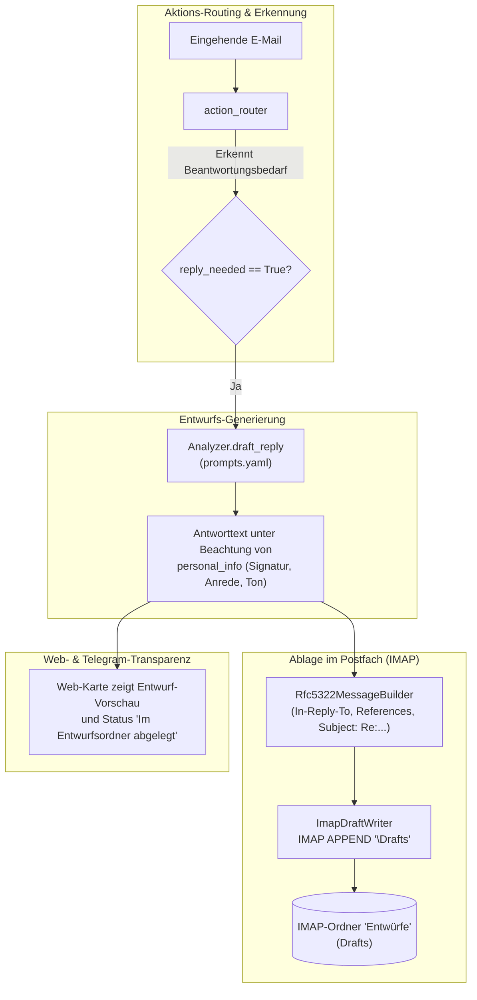
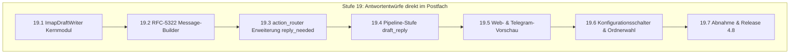

# Mailhelp 4.8 – Antwortentwürfe direkt im Postfach (`draft_reply`)

**Zielversion:** 4.8.0 (Schritte als Patchversionen 4.8.x)  
**Stand:** 7. November 2026  
**Status:** In Umsetzung (19.1 in 4.8.0, 19.2 in 4.8.1, 19.3 in 4.8.2)  
**Grundlage:** [Entwicklungsregeln](../AGENTS.md), [Projektspezifikation](../Mailhelp-Projektspezifikation.md), [Planung 4.0](Planung-4.0.md) (Gesamtfahrplan)  
**Vorgänger:** [Planung 4.7](Planung-4.7.md) (Deep-Links zur Original-Mail) · **Nachfolger:** [Planung 4.9](Planung-4.9.md) (Konfigurierbare E-Mail-Briefings)

---

## 1. Anlass und Ziel

> **„Beantwortungsbedürftige E-Mails erhalten automatisch einen KI-vorformulierten Antwortentwurf, der direkt im IMAP-Entwurfsordner abgelegt wird – bereit zum schnellen Prüfen, Anpassen und Absenden im gewohnten Mailprogramm.“**

### 1.1 Das Problem im täglichen Betrieb

Viele eingehende E-Mails enthalten weder einen Kalendertermin noch eine Todoist-Aufgabe, sondern verlangen eine **inhaltliche Rückmeldung** (z. B. Preisanfragen über das Jimdo-Kontaktformular, Rückfragen zu Angeboten, Terminanfragen oder organisatorische Mails).
- **Bisheriger Ablauf:** Der Nutzer muss die Antwort von Grund auf selbst formulieren. In `prompts.yaml` existiert zwar bereits der Prompt `draft_reply`, dieser wird jedoch nicht produktiv als fertiger Entwurf in das Postfach des Nutzers zurückgeschrieben.
- **Ziel in Version 4.8:** Mailhelp formuliert automatisch eine passende Antwort und legt diese als echten E-Mail-Entwurf per `IMAP APPEND` mit dem Kennzeichen `\Draft` im Entwurfsordner des Nutzers ab. Der Nutzer öffnet sein E-Mail-Programm, findet den Entwurf vor, liest kurz drüber, passt bei Bedarf Details an und klickt auf „Senden“.

---

## 2. Architektur

### Kernprinzipien & Sicherheitsregeln:

1. **Kein eigenmächtiger Versand (Schreibsperre):**  
   Mailhelp versendet **zu keinem Zeitpunkt eigenständig E-Mails per SMTP**. Die generierte Nachricht wird ausschließlich als Entwurf (`\Draft`) im Postfach abgelegt. Das Absenden obliegt immer und ausnahmslos der bewussten Aktion des Nutzers in seinem E-Mail-Programm.
2. **Saubere RFC-5322-E-Mail-Struktur:**  
   Der Entwurf wird mit allen korrekten Threading-Headern gebaut:
   - `To: <Ursprünglicher Absender>`
   - `Subject: Re: <Ursprünglicher Betreff>`
   - `In-Reply-To: <Message-ID der Quellmail>`
   - `References: <References der Quellmail>`
   - Korrekte Absenderadresse (Account-Adresse des Nutzers) und formatierte Signatur aus `personal_info`.
3. **Automatische Erkennung des Entwurfsordners:**  
   Mailhelp erkennt den Entwurfsordner über die standardisierte IMAP-Kennzeichnung `\Drafts` (SPECIAL-USE, RFC 6154) oder fällt auf gängige Namen (`Drafts`, `Entwürfe`, `INBOX.Drafts`) zurück.

---

## 3. Umsetzungsschritte (Stufe 19)

Es gelten die Regeln aus [Planung 4.0, Abschnitt 5.1](Planung-4.0.md#51-regeln-für-die-schritte):
Jeder Schritt wird als eigener Commit mit Patchversion geliefert, hat den Umfang S (≤ 1 Tag) oder M (≤ 2 Tage) und erhält 100 % Zeilen- und Branch-Abdeckung.

### Stufe 19 – Antwortentwürfe direkt im Postfach

| Schritt | Inhalt | Fertig, wenn … | Umfang | Voraussetzung |
| :--- | :--- | :--- | :---: | :--- |
| **19.1** ✓ 4.8.0 | `ImapDraftWriter` & Ordner-Erkennung | Neues Modul `mailhelp.mailbox.draft_writer`; erkennt den Entwurfsordner via IMAP `SPECIAL-USE \Drafts`; schreibt Nachrichten per `IMAP APPEND` mit Flag `\Draft`; idempotenter Schutz vor Doppelentwürfen. | S | – |
| **19.2** ✓ 4.8.1 | RFC-5322 Draft-Message-Builder | Generiert eine vollständige MIME-Nachricht (UTF-8, Text & optional einfaches HTML); setzt `In-Reply-To`, `References`, `To`, `Subject` und bindet die Signatur aus `personal_info` ein. | S | 19.1 |
| **19.3** ✓ 4.8.2 | `action_router` um `reply_needed` erweitert | `action_router` in `prompts.yaml` erkennt, ob eine Mail eine schriftliche Antwort verlangt (`reply_needed: bool`, `reply_reason: str`); getrennt von Terminen und Aufgaben. | S | – |
| **19.4** | Pipeline-Stufe `draft_reply` aktivieren | Bei `reply_needed == True` führt die Pipeline den LLM-Schritt `draft_reply` aus und legt den fertigen Entwurf im Postfach ab; speichert `draft_status` im `MailState`. | S | 19.2, 19.3 |
| **19.5** | Vorschau & Anzeige in Web & Telegram | Vorschlagskarte im Web und Telegram-Zusammenfassung zeigen den generierten Entwurfstext an mit dem Hinweis *„Als Entwurf im Postfach abgelegt“*; Text kann direkt in die Zwischenablage kopiert werden. | S | 19.4 |
| **19.6** | Einstellungen & Deaktivierbarkeit | `config.yaml` und `/einstellungen` erhalten `drafts.enabled: bool` und optionale manuelle Ordnerauswahl; Standard ist aktiv. | S | 19.1 |
| **19.7** | Gesamtabnahme & Release 4.8 | Simulationstests mit Offline-IMAP (Erfolg, voller Ordner, getrennter Verbindungsabbruch); 100 % Zeilen- und Branch-Coverage; Release-Bericht `docs/Release-4.8.md`. | M | 19.1–19.6 |

**Umfangsübersicht Version 4.8:** 7 Schritte, davon 6 S und 1 M.

---

## 4. Abnahmekriterien

1. **Ausschließlich Entwurfsablage:**  
   Es findet kein SMTP-Versand statt. Der Entwurf wird ausschließlich mit `\Draft`-Flag im IMAP-Ordner abgelegt.
2. **Korrektes Threading im Mailclient:**  
   Wird der Entwurf im E-Mail-Programm geöffnet und abgesendet, erkennt das empfangende Mailprogramm die Nachricht korrekt als Antwort im bestehenden Konversationsfaden (`In-Reply-To` / `References`).
3. **Schutz vor Mehrfachentwürfen:**  
   Bei Wiederaufnahmen nach Neustart oder erneutem Abruf wird für dieselbe Mail-ID nicht mehrfach derselbe Entwurf angelegt.
4. **Fehlertoleranz bei IMAP:**  
   Schlägt das Schreiben des Entwurfs fehl (z. B. Postfach voll), bricht die Mailverarbeitung nicht ab; der Fehler wird strukturiert protokolliert und der Entwurfstext bleibt auf der Webkarte abrufbar.
5. **100 % Testabdeckung:**  
   Alle neuen Pfade erreichen 100 % Zeilen- und Branch-Abdeckung.

