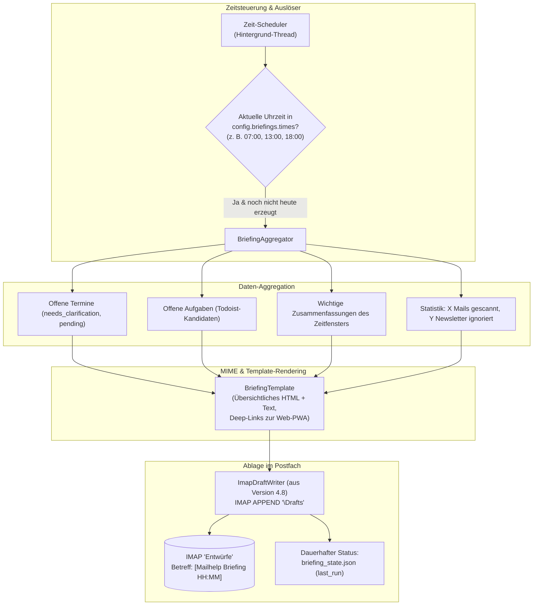
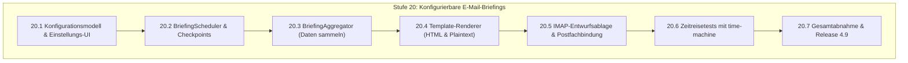

# Mailhelp 4.9 – Konfigurierbare E-Mail-Briefings als Postfach-Entwürfe

**Zielversion:** 4.9.0 (Schritte als Patchversionen 4.9.x)  
**Stand:** 8. November 2026
**Status:** In Umsetzung (bis 20.3 in 4.9.2)
**Grundlage:** [Entwicklungsregeln](../AGENTS.md), [Projektspezifikation](../Mailhelp-Projektspezifikation.md), [Planung 4.0](Planung-4.0.md) (Gesamtfahrplan)  
**Vorgänger:** [Planung 4.8](Planung-4.8.md) (Antwortentwürfe direkt im Postfach)

---

## 1. Anlass und Ziel

> **„Zu frei wählbaren Tageszeiten (z. B. morgens um 07:00, mittags um 13:00 oder zum Feierabend um 18:00 Uhr) fasst Mailhelp anstehende Entscheidungen, Termine und Aufgaben in einem übersichtlichen Briefing zusammen und legt dieses als Entwurf direkt im E-Mail-Postfach ab.“**

### 1.1 Das Problem im täglichen Betrieb

Bisher informiert Mailhelp über offene Entscheidungen entweder per Telegram oder über die Weboberfläche. Viele Anwender möchten sich jedoch nicht ständig aktiv einloggen oder Push-Nachrichten erhalten, sondern bevorzugen feste Routine-Checkpunkte in ihrem gewohnten Arbeitsablauf:
- Ein Handwerker oder Außendienstler startet morgens um **07:00 Uhr** und möchte wissen: *Welche neuen Termine und To-dos gab es seit gestern Abend?*
- Eine Kanzlei oder Agentur macht um **13:00 Uhr** Mittagspause und möchte einen Zwischenstand.
- Um **18:00 Uhr** soll ein Feierabend-Briefing alle noch offenen Punkte des Tages bündeln.

### 1.2 Die Lösung: E-Mail-Briefings als Postfach-Entwurf

Statt E-Mails über SMTP zu versenden (was zusätzliche SMTP-Zugangsdaten, Spam-Filter-Probleme und Versandrisiken erzeugt), nutzt Mailhelp die in Version 4.8 geschaffene **IMAP-Entwurfs-Infrastruktur**:
- Mailhelp generiert zu den konfigurierten Uhrzeiten ein formatiertes Briefing und legt es als **Entwurf im IMAP-Ordner „Entwürfe“ (Drafts)** ab.
- **Betreff:** `[Mailhelp Briefing 07:00] 3 Termine und 2 Aufgaben zur Freigabe`
- Der Nutzer öffnet einfach sein normales Mailprogramm, sieht das Briefing an oberster Stelle, überfliegt die Zusammenfassung und kann offene Aktionen mit einem Klick über Deep-Links zur Mailhelp-PWA freigeben.

---

## 2. Architektur



### Kernmerkmale:

1. **Frei konfigurierbare Uhrzeitenliste:**  
   In den Einstellungen wählt der Nutzer beliebig viele Tageszeiten im Format `HH:MM`:
   ```yaml
   briefings:
     enabled: true
     times:
       - "07:00"
       - "13:00"
       - "18:00"
     mailbox: "default"  # oder Postfach-ID
   ```
2. **Idempotenz & Zeitzonensicherheit:**  
   - Die Prüfung erfolgt minutengenau anhand der konfigurierten `user_timezone` (z. B. `Europe/Berlin`).
   - `briefing_state.json` protokolliert Datum und Uhrzeit des letzten erfolgreichen Briefings (`YYYY-MM-DD HH:MM`).  
   - Ein Neustart des Mailhelp-Dienstes erzeugt kein doppeltes Briefing für dieselbe Zeitspanne.
3. **Inhalt des Briefings:**
   - **Kompakte Übersicht:** Anstehende Termine mit Datum/Uhrzeit, neue Aufgaben mit Frist.
   - **Direkte Sprungmarken:** Jeder Eintrag enthält einen Link `https://meine-domain.de/aktion/<id>`, der bei Klick direkt zur Bestätigungskarte in der Weboberfläche führt.
   - **Gefilterte Ruhe:** Gab es im Zeitraum keine relevanten Mails oder Aufgaben, kann konfiguriert werden, ob ein kurzes *„Alles ruhig“-Briefing* abgelegt oder der Entwurf stillschweigend ausgelassen wird (`skip_empty: true`).

---

## 3. Umsetzungsschritte (Stufe 20)

Es gelten die Regeln aus [Planung 4.0, Abschnitt 5.1](Planung-4.0.md#51-regeln-für-die-schritte):
Jeder Schritt wird als eigener Commit mit Patchversion geliefert, hat den Umfang S (≤ 1 Tag) oder M (≤ 2 Tage) und erhält 100 % Zeilen- und Branch-Abdeckung.



### Stufe 20 – Konfigurierbare E-Mail-Briefings

| Schritt | Inhalt | Fertig, wenn … | Umfang | Voraussetzung |
| :--- | :--- | :--- | :---: | :--- |
| **20.1** ✓ 4.9.0 | Konfigurationsmodell & Einstellungsmaske | `BriefingSettings` in `mailhelp.models.settings`; Eingabe einer Liste von Uhrzeiten (`HH:MM`), Schalter für `skip_empty` und Postfachauswahl; Web-Maske unter `/einstellungen?bereich=briefing`. | S | – |
| **20.2** ✓ 4.9.1 | `BriefingScheduler` & Checkpoint-Ablage | Scheduler-Thread prüft fällige Zeiten in `user_timezone`; `briefing_state.json` sichert `last_briefing_at`; verhindert Doppelläufe nach Neustarts oder bei Prozessunterbrechungen. | S | 20.1 |
| **20.3** ✓ 4.9.2 | `BriefingAggregator` | Sammelt alle offenen Vorschläge (`pending_confirmation`, `needs_clarification`) sowie abgeschlossene Mails seit dem letzten Briefing; extrahiert Termine, Aufgaben und Kennzahlen. | S | 20.2 |
| **20.4** | Briefing-Template (HTML & Plaintext) | Gestaltetes, barrierefreies E-Mail-Template mit Datumsübersicht, Aufgabenliste und Deep-Links zur Weboberfläche; responsive Darstellung für Smartphone und Desktop. | S | 20.3 |
| **20.5** | IMAP-Entwurfsablage | Verwendet `ImapDraftWriter` (aus 4.8); legt das Briefing als Entwurf mit Betreff `[Mailhelp Briefing HH:MM] X Termine, Y Aufgaben` im Entwurfsordner des Zielpostfachs ab. | S | 20.4, 4.8: 19.1 |
| **20.6** | Deterministische Zeittests | Tests mit `time-machine` über verschiedene Tageszeiten (07:00, 13:00, 18:00), Sommer-/Winterzeit-Wechsel und Wochenenden; Nachweis der exakten Einmal-Ablage. | S | 20.2, 20.5 |
| **20.7** | Gesamtabnahme & Release 4.9 | Vollständige Tests unter Windows und Linux; 100 % Zeilen- und Branch-Coverage; Release-Bericht `docs/Release-4.9.md`. | M | 20.1–20.6 |

**Umfangsübersicht Version 4.9:** 7 Schritte, davon 6 S und 1 M.

---

## 4. Abnahmekriterien

1. **Pünktliche und einmalige Ablage:**  
   Zu jeder konfigurierten Uhrzeit (z. B. 07:00, 13:00, 18:00) wird genau ein Briefing-Entwurf im Postfach abgelegt; Neustarts oder verzögerte Abrufe erzeugen keine Duplikate.
2. **Volle Flexibilität:**  
   Die Uhrzeitenliste ist beliebig erweiterbar (z. B. nur morgens, oder dreimal täglich, oder deaktiviert).
3. **Klickbare Deep-Links:**  
   Aus dem Briefing heraus kann der Nutzer direkt auf die Web-Karten springen, um Termine und Aufgaben mit einem Klick freizugeben.
4. **Kein SMTP-Risiko:**  
   Das Briefing wird ausnahmslos als lokaler Entwurf (`\Draft`) via IMAP angelegt und niemals unaufgefordert extern versendet.
5. **100 % Testabdeckung:**  
   Alle neuen Klassen und Methoden erreichen 100 % Zeilen- und Branch-Coverage.

