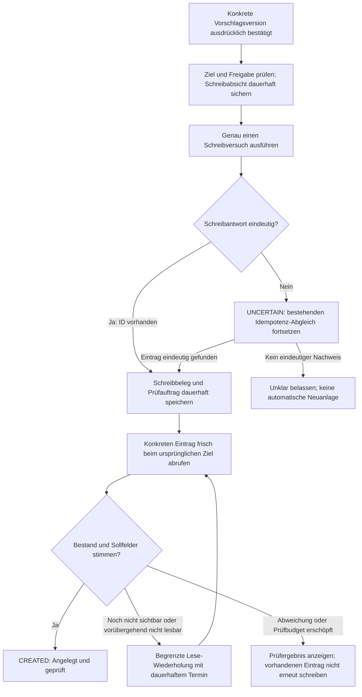

# Mailhelp 5.2 – Aufgaben und Termine nach dem Eintragen überprüfen

**Zielversion:** 5.2.0, Umsetzung in Patchversionen 5.2.x
**Stand:** 9. November 2026
**Status:** Abgeschlossen (5.2.0 bis 5.2.9; V2–V4 gemeinsam in 5.2.1, die folgenden Schritte rückten je eine Patchversion vor). Abnahme und Grenzen: [Release 5.2](Release-5.2.md)
**Grundlage:** [Entwicklungsregeln](../AGENTS.md), [Projektspezifikation](../Mailhelp-Projektspezifikation.md), [Gesamtfahrplan](Planung-4.0.md)
**Vorgänger:** [Planung 5.1](Planung-5.1.md) – Zuverlässigere Erkennung und nachvollziehbare Entscheidungen
**Technischer Ausgangsstand:** 4.9.6. Änderungen aus zwischenzeitlichen Versionen werden vor der Umsetzung abgeglichen.

## 1. Ziel und heutiges Verhalten

Nach jeder unterstützten Eintragung ruft Mailhelp die konkrete Aufgabe oder den konkreten
Termin erneut beim Anbieter ab. Erst wenn dieser unabhängige Lesezugriff den Eintrag und
die bestätigten Angaben nachweist, erscheint die endgültige Erfolgsmeldung
**„Angelegt und geprüft“**.

Beispiel: Die bestätigte Aufgabe „Unterlagen senden“ soll morgen fällig sein. Der Anbieter
bestätigt die Anlage und liefert eine ID. Mailhelp lädt anschließend genau diese Aufgabe
aus dem bestätigten Projekt. Stimmen Titel und Fälligkeit, wird der Erfolg bestätigt.
Fehlt die Aufgabe noch oder fehlt die Fälligkeit, zeigt Mailhelp den Prüfstand und legt
keine weitere Aufgabe an.

Heute führt [execute_confirmed](../src/mailhelp/external/confirmed.py) zunächst einen
Abgleich über den Idempotenzschlüssel aus. Das schützt vor wiederholten Schreibzugriffen
und hilft bei unklarem Schreiberfolg. Nach einer erfolgreichen Schreibantwort mit ID
setzt `_with_external_result` jedoch unmittelbar `CREATED`. Eine anschließende
unabhängige Inhaltsprüfung fehlt. Auch ein beim Abgleich gefundener Eintrag wird derzeit
direkt als angelegt übernommen.

Die neue Nachprüfung ergänzt diesen bestehenden Abgleich. Eine erfolgreiche HTTP-Antwort,
eine ID oder ein Treffer in einer zwischengespeicherten Liste reicht für „geprüft“ nicht aus.

## 2. Umfang und verbindliche Entscheidungen

1. Neu angelegte Aufgaben und Termine aller bereits unterstützten Online-Zielanbieter
   erhalten die Nachprüfung standardmäßig und verbindlich.
2. Vorhandene Kalenderoperationen zum Ändern, Ergänzen und Absagen erhalten eine passende
   Ergebnisprüfung. Es werden dadurch keine neuen Schreiboperationen für Aufgaben eingeführt.
3. Die Prüfung ist deterministisch und benötigt keine zusätzlichen LLM-Aufrufe.
4. Wiederholungen der Nachprüfung führen ausschließlich Lesezugriffe aus. Sie dürfen
   weder eine zweite Anlage noch eine automatische Reparatur, Änderung oder Löschung auslösen.
5. Kalenderdateien haben einen eigenen Ausgang: **„Kalenderdatei bereitgestellt;
   Übernahme in den Kalender nicht prüfbar“**. Eine zugestellte ICS-Datei beweist keinen Import.
6. Die Weboberfläche bleibt während externer Aufrufe bedienbar. Netzwerkzugriffe finden
   außerhalb der Zustandssperren statt; Wartezeiten blockieren keinen Bedienablauf.

## 3. Ablauf und Zustände



### 3.1 Schreib- und Prüfergebnis auseinanderhalten

Geplant ist ein zusätzlicher Vorschlagsstatus `VERIFYING` für bekannte Schreibresultate,
deren Nachprüfung noch nicht erfolgreich ist. `UNCERTAIN` bleibt dem tatsächlich
unklaren Schreibresultat vorbehalten. Ein Lesefehler nach bestätigter Anlage setzt den
Vorschlag weder auf `CONFIRMED` zurück noch auf einen Zustand, der einen neuen POST erlaubt.

Ein gesonderter, typisierter Prüfnachweis enthält mindestens:

| Feld | Bedeutung |
| --- | --- |
| Identität | Mail-ID, Vorschlags-ID und -Version, Idempotenzschlüssel, Operationsart |
| Ursprüngliches Ziel | Zielprofil, Anbieter, stabile Kontobindung und konkrete Kalender-/Projekt-/Listen-ID beziehungsweise geprüfte CalDAV-Ressource |
| Schreibbeleg | Externe ID, Zeitpunkt, gegebenenfalls Revision/ETag, Ergebnis der Schreiboperation |
| Sollstand | Normalisierte, tatsächlich zum Schreiben vorbereitete Fachfelder und deren Fingerabdruck |
| Prüfstand | `pending`, `verified`, `not_found`, `mismatch`, `unavailable`, `unsupported`, `legacy_unverified` oder `simulated` |
| Wiederanlauf | Versuche, `checked_at`, `next_check_at`, Prüfende und strukturierter letzter Fehlercode |
| Ergebnis | Abweichende Feldnamen und begrenzte, für die Anzeige erforderliche Vergleichswerte |

Schreibbeleg, Prüfauftrag und Vorschlagsübergang werden über die bestehende
[Persistenzschicht](../src/mailhelp/persistence/proposals.py) konsistent und wiederanlauffähig
gesichert. Als Dateiformat sind lesbare JSON-Datensätze vorgesehen, etwa
`write-verification-<stabile-operationskennung>.json`; Ereignisse stehen separat in JSONL.
Die genaue Schemaerweiterung wird im ersten Umsetzungsschritt festgelegt und getestet.

Bei erschöpftem Budget bleibt der Eintrag ausdrücklich **ungeprüft**. `VERIFYING` darf dann
keinen endlosen Fortschrittsindikator zeigen: Der detaillierte Prüfstand nennt den Grund
und bietet gegebenenfalls einen erneuten reinen Leseversuch an.

### 3.2 Dauerhaftigkeit und Schutz vor Doppelaktionen

- Der vorhandene Zustand `WRITING` wird weiterhin vor dem Schreibzugriff gespeichert.
- Sobald eine eindeutige Schreibantwort vorliegt, werden externe ID und Prüfauftrag
  **vor dem ersten nachgelagerten Lesezugriff** dauerhaft gespeichert.
- Absturz nach dem Schreiben, aber vor dem Schreibbeleg: Der bisherige Idempotenz-Abgleich
  sucht den vorhandenen Eintrag; ein eindeutiger Treffer startet anschließend die Nachprüfung.
- Absturz während oder nach der Nachprüfung: Der gespeicherte Auftrag wird fortgesetzt
  beziehungsweise das bereits verifizierte Ergebnis verwendet. Kein erneuter Schreibzugriff.
- Aktionsledger, Dublettenprüfung und Seriensteuerung erkennen auch bereits geschriebene,
  noch ungeprüfte Einträge. Ein fehlender grüner Erfolgsstatus darf keine Doppelanlage erlauben.
- Ein Prüfresultat gehört ausschließlich zur damaligen Vorschlagsversion und Operation.
  Ein verspätetes Ergebnis darf keine neuere Version als geprüft markieren.
- Wird der Eintrag zwischenzeitlich manuell bearbeitet oder gelöscht, wird dies als
  Abweichung beziehungsweise nicht nachweisbarer Bestand behandelt, niemals automatisch repariert.

## 4. Was wird verglichen?

Der Sollstand entsteht aus dem vorbereiteten Schreibauftrag einschließlich bestätigter
Standardwerte und Anbieterabbildungen. Er wird nach dem Schreiben nicht aus aktuellen
Prompts, geänderten Einstellungen oder einer neuen LLM-Auswertung rekonstruiert.

| Eintrag/Operation | Verbindlicher Nachweis |
| --- | --- |
| Neue Aufgabe | Richtige externe ID, richtiges Konto und Projekt/Liste, Titel, übertragene Beschreibung und bestätigte Fälligkeit einschließlich Unterscheidung zwischen Datum und Zeitpunkt |
| Neuer Termin | Richtige externe ID und Kalenderzuordnung, Titel, Beginn/Ende, Ganztägigkeit, übertragener Ort und Beschreibung einschließlich zugesagtem Videolink |
| Termin geändert/ergänzt | Genau die bestätigten Änderungen sowie die laut Schreibvertrag zu erhaltenden Felder; Vergleich mit dem vorbereiteten Änderungsauftrag |
| Termin abgesagt/gelöscht | Anbieterabhängiger Nachweis des Absagestatus oder verbindlich bestätigter Abwesenheit am richtigen Ziel; keine Abfrage der alten Zeiten als Erfolgsbedingung |
| Dublette ohne Schreibzugriff | Vorhandenen ausgewählten Eintrag frisch lesen; als „Bereits vorhanden und geprüft“ ausweisen, keine Neuanlage behaupten |
| Serie | Elternobjekt oder konkrete Instanz entsprechend der tatsächlich bestätigten Operation prüfen; Ergebnis je Operation dauerhaft zuordnen |

Zeitpunkte werden als gleiche Zeitpunkte verglichen, nicht als identische Zeichenketten:
UTC und lokaler Offset können dasselbe Ergebnis darstellen. Datumswerte bleiben Datumswerte;
exklusive Ganztages-Enddaten, Sommer-/Winterzeit und Anbieterpräzision werden gezielt geprüft.
Zulässige Normalisierungen, etwa Zeilenenden und dokumentierte Anbieterformatierungen,
werden ausdrücklich festgelegt. Semantisch abweichende Titel oder fehlende Fälligkeiten
dürfen nicht durch einen unscharfen LLM-Vergleich als korrekt gelten.

Der Iststand muss aus einem neuen Anbieteraufruf stammen. Schreibantwort, Dubletten-Cache
und Briefing-/Kalenderübersicht gelten nicht als Nachprüfung. Einträge werden vorrangig
über ihre externe ID geladen. Eine Suche dient nur dem kontrollierten Wiederfinden, wenn
nach unklarem Schreiben noch keine ID verfügbar ist; mehrere Treffer bleiben unklar.

## 5. Anbieter und Sonderfälle

Die vorhandenen Adapter werden um einen gemeinsamen, typisierten Lese-/Prüfvertrag
erweitert. Er liefert normalisierte Fachdaten und unterscheidet mindestens gefunden,
nicht gefunden, abweichend, vorübergehend nicht lesbar und nicht unterstützt.

| Anbieter | Umsetzungsschwerpunkt |
| --- | --- |
| Google Kalender | Frischer Einzelabruf im gebundenen Kalender; vollständige relevante Felder, Ganztägigkeit, Änderungen und Absagen |
| Todoist | Einzelabruf der angelegten Aufgabe im gebundenen Konto mit Kontrolle der Projektzuordnung und Fälligkeit |
| Outlook-Kalender | Frischer Einzelabruf mit der richtigen Kalenderbindung; Graph-Zeitangaben und Absage-/Löschsemantik normalisieren |
| Microsoft To Do | Aufgabe aus der gebundenen Liste laden; Fälligkeit und übertragene Felder prüfen |
| CalDAV-Kalender | Ressource neu lesen; VEVENT, UID, Felder, Revision/ETag und bestätigte Operation auswerten |
| CalDAV-Aufgaben / Apple Erinnerungen | Ressource neu lesen und VTODO, UID, Fälligkeit und Sammlung prüfen; keine Erfolgsannahme allein aufgrund eines PUT-Status |
| Kalenderdatei über Telegram | Datei-/Bereitstellungsstatus getrennt anzeigen; tatsächlichen Kalenderimport als `unsupported` ausweisen |

Vor der Adapterimplementierung werden die aktuellen offiziellen Anbieterunterlagen zu
Einzelabruf, Berechtigungen, abgeschlossenen Aufgaben, Fehlercodes und Wartehinweisen geprüft.
Eine bereits erledigte Aufgabe darf nicht allein deshalb „fehlen“, weil eine Liste nur
aktive Aufgaben enthält. Ein 401/403 oder ein Timeout ist kein Nachweis, dass ein Eintrag
gelöscht wurde. 404 gilt nur im passenden, erreichbaren Zielkontext als negativer Befund;
unmittelbar nach Anlage sind zunächst begrenzte Lese-Wiederholungen vorgesehen.

Externe IDs, Antwortinhalte und CalDAV-Adressen bleiben nicht vertrauenswürdig. Zugriffe
bleiben am zugelassenen Anbieterursprung und an der ursprünglichen Sammlung; Fremdadressen
oder Weiterleitungen erhalten keine Zugangsdaten. Vergleichsinhalte werden in der Webansicht escaped.

## 6. Wiederholungen, Konfiguration und Kontowechsel

Vorgesehene Einstellungen in `config.yaml`:

```yaml
write_verification:
  max_attempts: 5
  retry_delays_seconds: [1, 5, 15, 60]
  max_elapsed_seconds: 300
```

Der erste frische Abruf zählt als Versuch 1; die vier Verzögerungen gelten vor den
weiteren Versuchen. Diese Werte sind Planvorgaben, noch keine vorhandenen Einstellungen.
Validierung begrenzt Werte, prüft die Anzahl der Verzögerungen und verhindert enge Endlosschleifen.
Die Nachprüfung selbst ist für unterstützte Online-Operationen verpflichtend und erhält
keinen Schalter, der ungeprüfte Resultate als erfolgreich ausweist.

Ein persistierter Hintergrundauftrag führt fällige Leseversuche aus, ohne im Webhandler
oder unter einer globalen Sperre zu warten. Anbieterlimits und `Retry-After` werden beachtet;
bei überschrittenem Prüfzeitraum wird ein verständlicher ungeprüfter Endstand gespeichert.
403, ungültige Daten und echte Feldabweichungen werden nicht in schnellen Schleifen abgefragt.

Nach einem Neustart gelten gespeicherter Sollstand, Versuchszähler, Zielbindung und nächste
Prüfzeit weiter. Ein Tokenwechsel für dasselbe Konto ist erlaubt. Ein Wechsel auf ein anderes
Konto oder Ziel stoppt den Auftrag mit einer verständlichen Meldung; insbesondere dürfen
Aliase wie `primary` oder `default` nicht unbemerkt in ein anderes Konto führen.
Auch beim Neuladen der Anwendung laufen für denselben Auftrag keine parallelen Prüfungen.

## 7. Bedienung, Bestätigung und Benachrichtigungen

| Situation | Anzeige in Web und Telegram |
| --- | --- |
| Schreibantwort vorhanden, Prüfung offen | „Gespeichert – Eintrag wird geprüft“ |
| Frischer Abruf und Fachfelder korrekt | „Angelegt und geprüft“ mit Prüfzeit und sicherem Anbieterlink, soweit vorhanden |
| Vorübergehend nicht erreichbar/noch nicht sichtbar | „Nachprüfung ausstehend“ mit nächstem Versuch |
| Prüfung beendet, kein ausreichender Nachweis | „Eintragung noch nicht bestätigt“ mit Grund und letztem Prüfzeitpunkt |
| Tatsächliche Feldabweichung | „Eintrag vorhanden, Angaben weichen ab“ mit verständlichem Soll-/Ist-Vergleich |
| ICS-Datei | „Kalenderdatei bereitgestellt – Übernahme in den Kalender nicht prüfbar“ |

Eine Aktion **„Erneut prüfen“** liest ausschließlich erneut. Sie benötigt in der Weboberfläche
eine gültige, bei Ausführung erneut geprüfte Sitzung, CSRF-Schutz, Versionsbezug und einen
Idempotenzschlüssel. Telegram prüft entsprechend den autorisierten Chat und den Versionsbezug.
Ein Hintergrund-Leseauftrag darf nach Ablauf der ursprünglichen Websitzung fortgesetzt werden;
er erhält dadurch keine Berechtigung zu einem neuen Schreibzugriff.

Die bestehende ausdrückliche, versionsbezogene Schreibbestätigung bleibt vor jedem
Schreibzugriff erforderlich. Eine spätere Korrektur braucht einen separat überprüfbaren,
neu bestätigten Schreibauftrag. Erneutes Prüfen, Bearbeiten oder Speichern autorisiert das nicht.

[Telegram-Schreibergebnisse](../src/mailhelp/telegram/writes.py), Webkarten, Statusansicht,
Benachrichtigungswarteschlange, Briefings und Serienanzeigen verwenden dieselben Prüfdaten.
Auch die Meldungen zu „geändert“, „ergänzt“ und „abgesagt“ dürfen die Nachprüfung nicht umgehen.
Erfolgsmeldungen werden dauerhaft gegen doppelte Zustellung abgesichert. Unklare
Benachrichtigungszustellung löst weder erneutes Schreiben noch Nachrichtenspam aus.

## 8. Upgrade, Datenschutz und Testmodus

- Neue Schreiboperationen bekommen vollständige Prüfbelege. Bestehende `CREATED`-Datensätze
  werden als `legacy_unverified` lesbar gehalten und nicht rückwirkend als geprüft ausgegeben.
  Das Upgrade löst keine Massenabfragen oder erneuten Anlagen alter Einträge aus.
- Der Testmodus bleibt ohne externe Schreib- **und** Lesezugriffe und heißt weiterhin
  „simuliert“. Simulierte Einträge erhalten keinen echten Verifikationsnachweis.
- Gespeichert werden nur die für Vergleich und Wiederanlauf nötigen Fachfelder, keine
  vollständigen Anbieterantworten oder Zugangsdaten. Aufbewahrung, Bereinigung und
  Archivprojektionen der Prüfdaten werden mit der bestehenden Retention abgestimmt.
- JSONL-Logs enthalten Kennungen, Versuch, Zeitdauer und strukturierte Fehler-/Feldcodes;
  Tokens, Beschreibungen und vollständige Soll-/Ist-Inhalte werden nicht regulär protokolliert.
- Die neue Schemaversion und der Umgang mit einer Rückkehr zur Vorgängerversion werden vor
  Freigabe dokumentiert. Alte Software darf neue Prüfzustände nicht versehentlich erneut schreiben.

## 9. Umsetzungsschritte

Jeder Schritt erhält passende Tests und einen eigenen versionsgepflegten Commit.
S bedeutet höchstens einen Entwicklungstag, M höchstens zwei; größere Pakete werden
vor Beginn geteilt. Die Spalte nennt die geplante Patchfolge, keine bereits veröffentlichten Versionen.

| Schritt | Patch | Inhalt / fertig, wenn … | Umfang | Voraussetzung |
| --- | --- | --- | :---: | --- |
| V1 | 5.2.0 | Zustands- und Prüfvertrag: `VERIFYING`, Prüfnachweis, Sollstand, Zielbindung und Übergänge spezifiziert und modelliert; alle bestehenden Statusverbraucher erfasst. | M | Ausgangsstand abgleichen |
| V2 | 5.2.1 | Gemeinsamer Ablauf: Schreibbeleg dauerhaft vor Nachprüfung; erfolgreiche Schreibantwort und Wiederfinden nach `UNCERTAIN` führen nur über eine erfolgreiche Prüfung zu `CREATED`. Mit simuliertem Writer getestet. | M | V1 |
| V3 | 5.2.2 | Google-Kalender: frischer Abruf und normalisierter Vergleich für Neuanlagen, Datums-/Zeitzonenfälle und fehlerhafte Antworten. | M | V2 |
| V4 | 5.2.3 | Todoist: ID-/Projektprüfung, Titel/Beschreibung/Fälligkeit, bereits erledigte oder verschwundene Aufgabe und Berechtigungsfehler. | M | V2 |
| V5 | 5.2.4 | Microsoft: Outlook und To Do mit eigenem Abruf und gemeinsamen Vergleichsfällen; korrektes Konto und Ziel nachgewiesen. | M | V2 |
| V6 | 5.2.5 | CalDAV und Apple Erinnerungen: VEVENT/VTODO aus der richtigen Ressource prüfen; UID, ETag, Feldabweichung und sichere URL-Grenzen getestet. | M | V2 |
| V7 | 5.2.6 | Änderungs-, Ergänzungs-, Absage-, Dubletten- und Seriensemantik sowie ICS-Sonderfall vollständig in allen vorhandenen Operationspfaden integriert. | M | V3–V6 |
| V8 | 5.2.7 | Dauerhafte Lese-Wiederholungen, Budget, Anbieterlimits, Neustarts, Neuladen, Token-/Kontowechsel und konkurrierende Aufträge; keine Netzwerkzugriffe unter Zustandssperren. | M | V2–V7 |
| V9 | 5.2.8 | Web und Telegram: korrekte Zwischen-/Erfolgsmeldungen, Soll-/Ist-Anzeige, geschütztes „Erneut prüfen“, idempotente Benachrichtigungen; Briefings und Serien konsistent. | M | V7, V8 |
| V10 | 5.2.9 | Migration, Konfigurationsvalidierung und -beispiele, Aufbewahrung, Testmodus, README und Projektspezifikation; Altzustände bleiben ausdrücklich ungeprüft und duplikatsicher. | M | V8, V9 |
| V11 | 5.2.10 | Vollständige Anbieter-/Fehlermatrix und Prozessabbruchtests; Regressionen belegen vor dem Fix den fehlenden Nachweis beziehungsweise die voreilige Erfolgsmeldung. | M | V3–V10 |
| V12 | 5.2.11 | Abnahme unter Windows 11 und Linux/Docker, 100 % Zeilen-/Branch-Abdeckung, Browser- und Paketprüfungen; `docs/Release-5.2.md` enthält Nachweise und Grenzen. | M | V11 |

Bei jedem Implementierungscommit in `main` oder `beta` werden Version in `pyproject.toml`
und `src/mailhelp/__init__.py`, Changelog und README gemäß Entwicklungsregeln gepflegt.
Konfiguration gehört in `config.yaml`, Geheimnisse bleiben außerhalb des Codes.
Die vorhandenen [Adapterverträge](../src/mailhelp/external/contracts.py),
[Zielprofile](../src/mailhelp/proposals/target_profiles.py) und das Aktionsledger werden
erweitert; ein zweiter unabhängiger Schreibweg ist nicht vorgesehen.

## 10. Verbindliche Abnahmefälle

Automatisierte Tests nutzen ausschließlich simulierte externe Dienste und synthetische Daten.
Jeder Anbieteradapter wird mit seinem tatsächlichen Transport und nicht nur einem
erfolgreichen Writer-Stub geprüft.

| Fall | Erwartetes Ergebnis |
| --- | --- |
| POST/PUT erfolgreich, GET liefert richtige Daten | Ein Schreibversuch, mindestens ein anschließender frischer Abruf, danach „Angelegt und geprüft“ |
| Schreibantwort enthält eine ID, GET liefert andere Fälligkeit/Zeit | Keine Erfolgsmeldung; konkrete Abweichung; keine automatische Änderung oder Neuanlage |
| GET liefert zunächst 404, später den passenden Eintrag | Nur Lese-Wiederholungen; später Erfolg; derselbe externe Eintrag |
| GET bleibt 404 oder ist nicht erreichbar | Begrenzte Versuche; dauerhaft ungeprüfter Stand; kein zweiter Schreibversuch |
| GET liefert 401/403/429/5xx oder ungültige Daten | Korrekte Unterscheidung und Wartepolitik; keine Interpretation als erfolgreiche Löschung |
| Absturz nach Schreibannahme, vor ID-Speicherung | Wiederfinden über bisherigen Schlüssel und anschließende Nachprüfung; keine Doppelanlage |
| Absturz nach ID-Speicherung oder erfolgreichem GET | Gespeicherten Auftrag fortsetzen beziehungsweise Ergebnis verwenden; keine erneute Anlage oder doppelte Erfolgsmeldung |
| Cache meldet passend, frischer GET meldet abweichend | Der frische Abruf entscheidet |
| Ziel/Konto ändert sich während Wartezeit | Auftrag bleibt am ursprünglichen Ziel gebunden; kein Ausweichen auf das neue Ziel |
| Neue Vorschlagsversion oder parallele Prüfaktion | Altes Ergebnis bestätigt keine neue Version; höchstens ein laufender Prüfauftrag je Operation |
| Abgelaufene Sitzung, falscher CSRF-Wert oder wiederholter Schlüssel | Bedienaktion wird abgelehnt beziehungsweise idempotent wiederverwendet; keine zusätzliche Wirkung |
| Aufgabe ist vor Nachprüfung bereits erledigt | Anbieterabhängigen Bestand korrekt prüfen; nicht allein wegen einer aktiven Aufgabenliste als fehlend behandeln |
| Ganztag, UTC/lokaler Offset, DST, fehlende Fälligkeit | Fachlich korrekter Vergleich ohne falsche Gleichheit oder unnötige Abweichung |
| Absage oder Dublette ohne neuen Schreibzugriff | Operationsgerechter Nachweis und zutreffender Meldungstext |
| Testmodus, ICS-Datei und alte Zustände | Kein echter Prüferfolg erfunden; keine externen Aufrufe im Testmodus |

**Releasefreigabe:** Alle vorgesehenen Online-Anbieter und vorhandenen unterstützten
Operationen bestehen die Matrix. Sämtlicher eigener Anwendungscode erreicht 100 % Zeilen-
und 100 % Branch-Abdeckung; jede Unterschreitung lässt die automatische Prüfung scheitern.
Keine zusätzlichen Coverage-Ausschlüsse, keine wirkungslosen Tests. Ruff und mypy sind
ohne Befunde. Repräsentative harte Prozessabbrüche werden zusätzlich unter Linux/Docker geprüft.
Der Release-Bericht nennt Anbieter, Operation, Plattform, Testreferenzen und begründete Grenzen.
