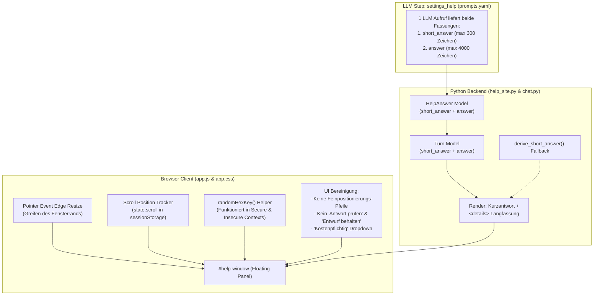

# Mailhelp 5.5 – Hilfschat Feinabstimmung: Ergonomie, kompakte Antworten, freies Skalieren und Robustheit

**Zielversion:** 5.5.0, Umsetzung in Patchversionen 5.5.x

**Stand:** 11. November 2026

**Status:** In Umsetzung; S1 mit 5.5.0, S2 mit 5.5.1, S3 mit 5.5.2 umgesetzt.

**Umsetzung:** Die Patchnummern beginnen bei 5.5.0 (S1) und enden bei 5.5.5 (S6), damit jeder
Commit die Version lückenlos erhöht. Zur Tastaturbedienung ohne Pfeilschaltflächen siehe 2.2.

**Ausgangsstand:** 5.4.1 laut `pyproject.toml`

**Vorgänger:** [Planung 5.4](Planung-5.4.md), [Release 5.4](Release-5.4.md)

**Grundlage:** [Entwicklungsregeln](../AGENTS.md), [Projektspezifikation](../Mailhelp-Projektspezifikation.md)

---

## 1. Übersicht und Ziel

Version 5.4 hat den Hilfschat erfolgreich als dauerhaft geöffnetes Fenster vor den
Einstellungsseiten verankert. In der praktischen Nutzung haben sich jedoch sieben konkrete
Punkte gezeigt, die Ergonomie, Platzbedarf, Interaktion und Stabilität im Netzwerkalltag
beeinträchtigen:

1. **Scroll-Sprünge:** Beim Wechseln von Seiten (Einstellungen, Bereiche, Dokumentation)
   springt der Chat jedes Mal an den Anfang zurück, statt die Leseposition beizubehalten.
2. **Überflüssige Bedienelemente:** Die vier Pfeilschaltflächen zur schrittweisen
   Feinpositionierung (`←`, `→`, `↑`, `↓`) verbrauchen Platz und sind durch die Verschiebbarkeit
   per Kopfzeile überflüssig geworden.
3. **Fehlende Fenster-Größenänderung:** Das Chatfenster lässt sich bisher nicht über das
   Greifen des Fensterrandes vergrößern oder verkleinern, um mehr Inhalt zu erfassen.
4. **Zu lange Chatantworten im kleinen Fenster:** Die ausführlichen Antworten sind inhaltlich
   hervorragend, überfordern aber den kleinen Anzeigebereich. Für das Fenster soll eine
   prägnante kurze Antwort angezeigt werden, mit der Möglichkeit, die lange Originalantwort
   jederzeit auf Wunsch einzublenden.
5. **Platzraubender Kosten- und Datenschutzhinweis:** Der bestehende vierzeilige Hinweistext
   nimmt im Chatfenster dauerhaft vertikalen Raum ein; er soll kompakt hinter „Kostenpflichtig“
   versteckt und erst bei ausdrücklichem Klick ausgeklappt werden.
6. **Veraltete Fallback-Schaltflächen:** Die Schaltflächen „Antwort prüfen“ und „Entwurf behalten“
   stören den modernen Chatablauf und entfallen ersatzlos.
7. **Fehleranzeige „crypto.randomUUID is not a function“:** Dieser Fehler tritt beim Zugriff
   über HTTP im lokalen Netzwerk auf, weil `crypto.randomUUID` in unsicheren Browser-Kontexten
   nicht verfügbar ist. Die Ursache wird nachhaltig durch eine universelle Schlüsselgenerierung
   behoben.

Ziel von Version 5.5 ist es, den Hilfschat zu einem aufgeräumten, flüssig bedienbaren und
robusten Begleiter in den Einstellungen zu machen.

---

## 2. Detaillierte Analyse und Spezifikation der Anforderungen

### 2.1 Anforderung 1: Chat-Scrollposition merken und beibehalten

#### Problem
Der Scroll-Container des Fensters (`#help-window-content`) besitzt `overflow-y: auto`.
Wenn die Person im Chat nach unten scrollt, um Antworten zu lesen, und anschließend:
- zwischen Einstellungsseiten oder Reitern navigiert (`/einstellungen`, `/themen`),
- eine Suche ausführt oder einen Einstellungsblock öffnet,
- eine Dokumentationsquelle im Fenster öffnet und mit „Zurück zum Gespräch“ zurückkehrt,
- oder das Dokument durch Abspeichern neu aufgebaut wird,
startet das Chatfenster stets mit `scrollTop = 0` (am oberen Rand). Die Leseposition geht
verloren und muss mühsam manuell wieder gesucht werden.

#### Ursachenanalyse
1. Der lokale Zustand in `sessionStorage` (`KEY = "mailhelp.help-window.v1"`) speichert
   bisher nur `scope`, `opened`, `draft`, `setting`, `expires`, `x` und `y`. Das Feld
   `scrollTop` fehlt im Speichervertrag.
2. Beim Initialisieren (`show()`) wird der Entwurf wiederhergestellt, die Scrollposition
   des DOM-Elements wird jedoch nicht restauriert.
3. Beim Wechsel zur Dokumentationsansicht (`jsonDocument()`) wird `content.hidden = true`
   gesetzt; beim Rücksprung (`[data-help-back]`) wird `content.hidden = false` gesetzt,
   wobei manche Browser den internen Scroll-Offset zurücksetzen.

#### Lösungsdesign
- **Zustandserweiterung:** `state.scroll` (Ganzzahl, Standard `0`) wird in das
  `sessionStorage`-Objekt aufgenommen.
- **Scroll-Überwachung:** Auf `#help-window-content` wird ein passiver, gedrosselter
  Scroll-Eventhandler registriert, der `state.scroll = content.scrollTop` speichert.
- **Zustandssicherung vor Wechseln:** Vor dem Verlassen der Seite (`pagehide`, `beforeunload`)
  und vor dem Einblenden der Dokumentation (`jsonDocument()`) wird `state.scroll` explizit
  gesichert.
- **Wiederherstellung:** In `show()` sowie nach dem Wiederherstellen des Gesprächs und beim
  Klick auf `[data-help-back]` wird `content.scrollTop = state.scroll` verlässlich gesetzt.
- **Intelligentes Verhalten bei neuen Antworten:** Trifft eine neue Antwort ein (über
  `refresh()`), während die Person gerade liest (Scroll-Offset weiter oben), bleibt die
  Position erhalten; war die Person bereits ganz unten, wird dezent mitgeführt.

---

### 2.2 Anforderung 2: Pfeile zur Feinpositionierung entfernen

#### Problem
Im Kopfbereich des Fensters bzw. unter dem Header existiert das Formular
`<form class="help-move">` mit vier Richtungspfeilen (`←`, `→`, `↑`, `↓`), die das
Fenster in 40-Pixel-Schritten verschieben. Sie verbrauchen wertvolle vertikale Pixel,
wirken visuell unruhig und sind durch das flüssige Verschieben per Kopfzeile (Drag & Drop)
überflüssig.

#### Lösungsdesign
- **Entfernung im Template:** In `src/mailhelp/web/help_window.py` (`HelpWindow.frame()`)
  wird das gesamte `<form class="help-move">` samt Buttons entfernt.
- **Entfernung im Frontend-Skript:** In `src/mailhelp/web/static/app.js` wird die Abfrage
  von `[data-move]` und die zugehörige Verschiebelogik entfernt.
- **CSS-Bereinigung:** Die Selektoren `.help-move` und `.help-move button` in
  `src/mailhelp/web/static/app.css` werden entfernt.
- **Backend & Tests:** Die Methode `HelpWindow.change()` wird von der Aktion `"move"`
  bereinigt (oder zur Wahrung von Schnittstellenkompatibilität tolerant gehalten);
  zugehörige Tests in `tests/web/test_help_window54.py` werden angepasst.
- **Tastaturbedienung (Umsetzung 5.5.0):** Planung 5.4, Abschnitt 3.1, verlangt eine
  Positionsänderung auch per Tastatur. Statt sichtbarer Schaltflächen ist der Fenstertitel
  fokussierbar und verschiebt das Fenster mit den Pfeiltasten um je 40 Pixel. Ohne
  JavaScript lässt sich das Fenster nicht mehr verschieben; verdeckt es eine Schaltfläche,
  bleibt das Schließen bzw. die Eingabetaste im Suchfeld. Gespeicherte `corner`-Werte
  älterer Zustände werden weiter gelesen.

---

### 2.3 Anforderung 3: Fenstergröße durch Greifen des Fensterrandes ändern (Resize)

#### Problem
Das Chatfenster hat starre Abmessungen (`width: min(380px, calc(100vw - 24px)); max-height: min(520px, 65dvh);`).
Auf Bildschirmen mit höherer Auflösung oder bei komplexen Erklärungen mit Tabellen und
Codebeispielen ist das Fenster zu schmal und zu niedrig. Das manuelle Vergrößern über
den Rand wird erwartet, fehlt aber bisher vollständig.

#### Lösungsdesign
- **Greifränder & Ecken (Resize Zones):**
  - An den Rändern des `#help-window` wird das Greifen per Zeiger/Maus ermöglicht.
  - Relevante Greifzonen (besonders linker Rand, oberer Rand und obere linke Ecke, da das
    Fenster standardmäßig unten rechts platziert ist, sowie alle übrigen Ränder bei
    freier Positionierung).
  - Zeigerdarstellung (CSS `cursor`):
    - Linker / Rechter Rand: `ew-resize`
    - Oberer / Unterer Rand: `ns-resize`
    - Ecken: `nwse-resize` bzw. `nesw-resize`
- **Pointer-Interaktion mit Capture:**
  - `pointerdown` auf dem Randbereich startet die Größenänderung (`setPointerCapture`).
  - `pointermove` berechnet Delta-Werte für Breite (`width`) und Höhe (`height`).
  - Beim Ziehen an linken oder oberen Kanten wird gleichzeitig die Fensterposition
    (`state.x`, `state.y`) nachgeführt, damit das Fenster synchron am Mauszeiger skaliert.
- **Grenzen und Schutzregeln:**
  - Minimalbreite: 280 px; Maximalbreite: `innerWidth - 16 px`.
  - Minimalhöhe: 180 px; Maximalhöhe: `innerHeight - 24 px` (unter Berücksichtigung von Safe Areas).
- **Persistenz:**
  - Die gewählte Größe wird in `state.width` und `state.height` im `sessionStorage` abgelegt.
  - Beim Laden neuer Einstellungsseiten wird das Fenster direkt mit den gespeicherten
    Abmessungen aufgebaut.
- **No-JS-Verhalten:**
  - Ohne JavaScript gelten saubere Standard-CSS-Grenzen (`min-width`, `max-width`, etc.).

---

### 2.4 Anforderung 4: Kurze Chatantworten mit Option zur Einblendung der Langfassung

#### Problem
Ausführliche Antworten der KI mit mehrstufigen Handlungsanleitungen füllen das kleine
Chatfenster sofort aus. Die Person muss weit nach unten scrollen, um Eingabefeld oder
Aktionen zu sehen.

#### Lösungsdesign
1. **Einheitliche Generierung im Prompt (Kein zweiter LLM-Aufruf):**
   - In `prompts.yaml` (`settings_help`) wird das Antwort-JSON um das Pflichtfeld
     `"short_answer"` erweitert:
     - `short_answer`: 1–2 prägnante Sätze (Kernaussage/Direktantwort, maximal 300 Zeichen)
       für die schnelle Orientierung im kleinen Fenster.
     - `answer`: Die ausführliche, vollständige Anleitung mit nummerierten Schritten,
       Referenzen und Quellbezügen (maximal 4000 Zeichen).
   - **Vorteil:** Keine zusätzlichen Kosten, kein zweiter API-Request, keine Verdopplung
     der Wartezeit. Beide Fassungen entstehen gemeinsam im selben Schritt.
2. **Datenmodelle:**
   - `HelpAnswer` in `src/mailhelp/helpdocs/__init__.py`:
     ```python
     short_answer: str = Field(default="", max_length=1000)
     ```
   - `Turn` in `src/mailhelp/helpdocs/chat.py`:
     ```python
     short_answer: str = Field(default="", max_length=1000)
     ```
3. **Deterministische Fallback-Ableitung (`derive_short_answer`):**
   - Falls ein Modell oder ein Test-Fake `short_answer` nicht belegt, extrahiert eine
     deterministische Hilfsfunktion den ersten prägnanten Satz (bis ca. 200–250 Zeichen,
     abgeschlossen mit Satzzeichen), damit auch historische Verläufe immer einwandfrei
     dargestellt werden.
4. **Visuelle Darstellung im Chat:**
   - Im Chatfenster wird primär die prägnante Kurzantwort angezeigt.
   - Enthält die Langfassung zusätzliche Details, wird direkt darunter ein nativer,
     barrierefreier Klappbereich gerendert:
     ```html
     <div class="help-answer-short">Das Abrufintervall bestimmt, wie oft neue E-Mails automatisch abgefragt werden.</div>
     <details class="help-answer-full">
       <summary>Ausführliche Antwort anzeigen</summary>
       <div class="help-answer-text">1. Öffne die Einstellungen unter „Abruf“ …</div>
     </details>
     ```
   - Dies funktioniert ohne JavaScript, ist screenreader-zugänglich und spart im Normalzustand
     bis zu 80 % des vertikalen Platzes.

---

### 2.5 Anforderung 5: Kosten- und Datenschutzhinweis hinter „Kostenpflichtig“ verbergen

#### Problem
Der Hinweistext:
> *„Frage, kurzer Verlauf und passende Abschnitte der Mailhelp-Dokumentation gehen an den aktiven KI-Anbieter und können Kosten verursachen. Keine Passwörter oder Tokens eingeben. Der Hilfschat erklärt nur; er ändert keine Einstellungen.“*

belegt dauerhaft vier Zeilen unter dem Eingabebereich und verkleinert den sichtbaren
Gesprächsverlauf unnötig.

#### Lösungsdesign
- In `src/mailhelp/web/help_site.py` (`HelpSite._form()`) wird der offene `<p class="meta">`
  durch ein semantisches `<details>`-Element ersetzt:
  ```html
  <details class="help-cost-hint">
    <summary>Kostenpflichtig</summary>
    <p class="meta">Frage, kurzer Verlauf und passende Abschnitte der Mailhelp-Dokumentation gehen an den aktiven KI-Anbieter und können Kosten verursachen. Keine Passwörter oder Tokens eingeben. Der Hilfschat erklärt nur; er ändert keine Einstellungen.</p>
  </details>
  ```
- **CSS-Gestaltung:**
  - `.help-cost-hint` erhält ein dezentes Styling mit Zeiger-Cursor und dezenten Farben.
  - Im Ruhezustand nimmt der Hinweis nur eine einzige, unauffällige Zeile ein.
  - Bei Klick klappt die vollständige Warnung vor Kosten und sensiblen Daten auf.

---

### 2.6 Anforderung 6: Schaltflächen „Antwort prüfen“ und „Entwurf behalten“ entfernen

#### Problem
- **„Entwurf behalten“:** War als expliziter Abspeicher-Button für den Fragentext gedacht.
  Da der Entwurf im Browser beim Tippen automatisch in `sessionStorage` gesichert wird,
  verwirrt diese Schaltfläche und verleitet zu Fehlklicks.
- **„Antwort prüfen“:** Stammt aus dem No-JS-Polling-Konzept. Im regulären Betrieb sorgt
  das asynchrone Polling (`refresh()`) automatisch für die Anzeige der fertigen Antwort.
  Die Schaltfläche nimmt unter dem Chat Platz weg und ist überflüssig.

#### Lösungsdesign
- **In `src/mailhelp/web/help_site.py`:**
  - Aus `_form()` wird der Button `<button ... value="save">Entwurf behalten</button>`
    vollständig entfernt.
  - Aus `conversation()` wird das Formular `<form ...><button ... value="open">Antwort prüfen</button></form>`
    vollständig entfernt.
- **In `src/mailhelp/web/static/app.js`:**
  - Entfernen des Submit-Handlers für `event.submitter.value === "save"`.
  - Der automatische Entwurfserhalt über Tastatureingaben bleibt aktiv.
- **Bereinigung von Tests:**
  - Etwaige Testaufrufe oder Zusicherungen bezüglich dieser beiden Buttons werden aktualisiert.

---

### 2.7 Anforderung 7: Bugfix für „crypto.randomUUID is not a function“

#### Fehleranalyse (Root Cause)
1. **Web-Standard Secure Context:**
   Die Methode `crypto.randomUUID()` ist laut W3C/MDN Web Cryptography API **ausschließlich
   in Secure Contexts** (`window.isSecureContext === true`, z. B. `https://` oder `localhost` / `127.0.0.1`)
   definiert.
2. **Lokaler Netzwerkzugriff:**
   Wird Mailhelp auf einem Heimserver, NAS oder Raspberry Pi betrieben und über das lokale
   Netzwerk per HTTP aufgerufen (z. B. `http://192.168.1.100:8000` oder `http://mailhelp.local:8000`),
   ist `window.isSecureContext` `false`. In Chromium, Firefox und Safari ist `crypto.randomUUID`
   dann `undefined`.
3. **Aufrufort im Code:**
   In `src/mailhelp/web/static/app.js`:
   - Zeile 806 (`fallback()`):
     ```javascript
     body.set("key", crypto.randomUUID().replace(/-/g, ""));
     ```
   - Zeile 604 (`changePush()`):
     ```javascript
     var body = new URLSearchParams({csrf: controls.dataset.csrf, key: crypto.randomUUID()});
     ```
4. **Fehlerausgabe an der Oberfläche:**
   Wird `fallback()` aufgerufen (z. B. bei deaktiviertem/blockiertem Speicher oder beim
   Klick auf Entwurfsaktionen), wirft der Aufruf einen `TypeError: crypto.randomUUID is not a function`.
   Der Fehler landet in `failure(error)`, was unmittelbar
   `message.textContent = "crypto.randomUUID is not a function"` in `<p id="help-window-status">`
   schreibt und für die Anwender sichtbar einblendet.

#### Lösungsdesign
- Bereitstellung einer robusten, kontextunabhängigen Hilfsfunktion `randomHexKey(length = 32)`
  direkt in `src/mailhelp/web/static/app.js`:
  ```javascript
  function randomHexKey(length) {
    var size = length || 32;
    if (window.crypto && typeof window.crypto.randomUUID === "function") {
      return window.crypto.randomUUID().replace(/-/g, "").slice(0, size);
    }
    if (window.crypto && typeof window.crypto.getRandomValues === "function") {
      var bytes = new Uint8Array(Math.ceil(size / 2));
      window.crypto.getRandomValues(bytes);
      var hex = "";
      for (var i = 0; i < bytes.length; i++) {
        hex += (bytes[i] < 16 ? "0" : "") + bytes[i].toString(16);
      }
      return hex.slice(0, size);
    }
    var fallback = "";
    while (fallback.length < size) {
      fallback += Math.floor(Math.random() * 0xffffffff).toString(16);
    }
    return fallback.slice(0, size);
  }
  ```
- Ersetzen aller direkten `crypto.randomUUID()`-Aufrufe durch `randomHexKey()`.
- **Regressionstest:** Ein automatisierter Testfall simuliert eine Ausführungsumgebung
  ohne `crypto.randomUUID` (Insecure Context) und stellt sicher, dass der Fallback-Mechanismus
  ausnahmslos valide 32-Zeichen-Hexadezimalschlüssel ohne Fehler erzeugt.

---

## 3. Architektur- und Datenverträge



### 3.1 Speichervertrag (`sessionStorage`)
Schlüssel: `mailhelp.help-window.v1`
```json
{
  "scope": "<csrf-basierter-scope>",
  "opened": true,
  "draft": "Fragetext...",
  "setting": "poll_interval_seconds",
  "expires": 1731312345000,
  "x": 420,
  "y": 180,
  "width": 440,
  "height": 560,
  "scroll": 340
}
```

---

## 4. Geplante Umsetzungsschritte

Die Umsetzung erfolgt in klar abgegrenzten Schritten mit verbindlicher 100 % Zeilen-
und Branch-Abdeckung für sämtlichen neuen oder geänderten Python-Code sowie begleitenden
UI- und Regressionstests:

| Schritt | Patch-Ziel | Arbeitspaket | Kernänderungen |
| --- | --- | --- | --- |
| **S1** | 5.5.0 | **Bugfix & Aufräumarbeiten** | Behebung von `crypto.randomUUID is not a function` via `randomHexKey()`; Entfernung von `help-move` (Pfeilschaltflächen) sowie der Buttons „Antwort prüfen“ und „Entwurf behalten“; Regressionstest für Insecure Context. |
| **S2** | 5.5.1 | **Kostenhinweis einklappen** | Umbau des Kosten-/Datenschutzhinweises in `<details class="help-cost-hint">` mit `<summary>Kostenpflichtig</summary>`; CSS-Anpassungen; Tastaturzugänglichkeit prüfen. |
| **S3** | 5.5.2 | **Scroll-Erhaltung** | Integration von `state.scroll` in `sessionStorage`; Speicherung bei Scroll, vor Seitenwechsel und vor Doku-Anzeige; automatische Wiederherstellung im Chatfenster. |
| **S4** | 5.5.3 | **Rand-Größenänderung (Resize)** | Implementierung des interaktiven Edge- & Corner-Resizings per Pointer-Events; Persistierung von `state.width` und `state.height`; Begrenzung auf Viewport-Mindest- und Maximalwerte. |
| **S5** | 5.5.4 | **Kurze & lange Chatantworten** | Anpassung von `prompts.yaml` (`settings_help`); Erweiterung von `HelpAnswer` und `Turn` um `short_answer`; Fallback-Funktion `derive_short_answer()`; Rendering der Kurzantwort mit aufklappbarer Langfassung via `<details>`. |
| **S6** | 5.5.5 | **Qualitätssicherung & Dokumentation** | Gesamtabnahme aller Browsertests; Prüfung auf 100 % Zeilen- und Branch-Coverage; Aktualisierung von `README.md`, `CHANGELOG.md` und Bedienungsdokumentation. |

---

## 5. Verbindliche Abnahmekriterien

| Kriterium | Prüfschritt | Erwartetes Ergebnis |
| --- | --- | --- |
| **Scroll-Erhaltung bei Seitenwechsel** | Frage stellen, Antwort erhalten, nach unten scrollen, Seite wechseln (z. B. zu Themen oder andere Kategorie) | Das Chatfenster öffnet sich an exakt derselben vertikalen Scrollposition; kein Zurückspringen an den Anfang. |
| **Scroll-Erhaltung bei Dokumentationsansicht** | Aus Antwort einen Doku-Link anklicken, Doku lesen, „Zurück zum Gespräch“ klicken | Der Chat kehrt exakt zur vorherigen Leseposition zurück. |
| **Keine Feinpositionierungs-Pfeile** | Chatfenster öffnen | Die vier Pfeil-Buttons (`←`, `→`, `↑`, `↓`) sind weder im HTML noch optisch vorhanden; Verschieben per Kopfzeile funktioniert weiterhin einwandfrei. |
| **Größenänderung über Rand** | Mit der Maus über den linken oder oberen Fensterrand fahren und ziehen | Der Mauszeiger wechselt auf Größenänderung (`resize`); das Fenster wird flüssig größer/kleiner; Mindestmaße werden eingehalten; neue Größe bleibt nach Neuladen erhalten. |
| **Kurzantwort im Fenster** | Frage an den Hilfschat senden | Im Chatfenster erscheint eine kompakte 1–2-Satz-Antwort. Darunter befindet sich „Ausführliche Antwort anzeigen“. Ein Klick klappt die ausführliche Langfassung auf. |
| **Kompakter Kostenhinweis** | Frageformular betrachten | Im Ruhezustand steht nur das dezente Wort „Kostenpflichtig“. Ein Klick klappt die vollständigen Datenschutz- und Kostenwarnungen auf. |
| **Keine überflüssigen Buttons** | Chatfenster und Formular betrachten | Die Buttons „Antwort prüfen“ und „Entwurf behalten“ existieren nicht mehr. Der Fragentext bleibt beim Tippen dennoch automatisch gesichert. |
| **Kein crypto.randomUUID-Fehler** | Zugriff über HTTP / IP-Adresse (insecure context) simulieren, Eingabe tätigen, Fallback triggern | Kein `TypeError` in der Konsole; keine Fehlereinblendung im Chatfenster; Aktionen laufen sauber durch. |
| **Testabdeckung** | `pytest --cov=mailhelp --cov-branch` ausführen | Exakt 100 % Zeilen- und 100 % Branch-Abdeckung für sämtlichen eigenen Code. |

---

## 6. Dokumentation und Release-Abschluss

- Bei Veröffentlichung werden `README.md` (Versionsstand, neue Funktionen), `CHANGELOG.md` (Aufstellung aller Änderungen) und `docs/Bedienung.md` aktualisiert.
- Ein abschließender Bericht `docs/Release-5.5.md` dokumentiert die erfolgreiche Abnahme und Nachweise aller 7 Punkte.
