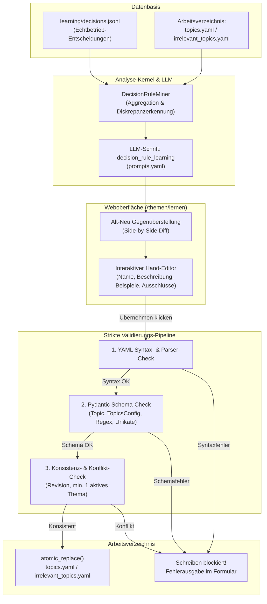
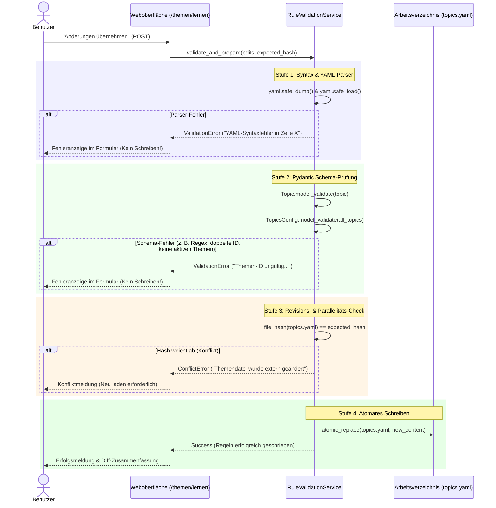

# Mailhelp 5.6 – Regellernen aus Nutzerentscheidungen: Alt-Neu-Vergleich, Hand-Edit und fehlertoleranzfreie Schemavalidierung

**Zielversion:** 5.6.0, gemeinsame Umsetzung von E1–E6

**Stand:** 11. November 2026

**Status:** E1–E6 umgesetzt und abgenommen. Nachweise: [Release 5.6](Release-5.6.md).

**Ausgangsstand:** 5.5.7 laut `pyproject.toml`

**Vorgänger:** [Planung 5.5](Planung-5.5.md), [Release 5.4](Release-5.4.md)

**Grundlage:** [Entwicklungsregeln](../AGENTS.md), [Projektspezifikation](../Mailhelp-Projektspezifikation.md)

**Präzisierungen der Umsetzung:** E1–E6 werden gemeinsam als 5.6.0 freigegeben statt als
sechs Zwischenversionen. Der Miner verwendet das reale Protokollschema mit
`analysis.relevance` und `proposal.changes`. Ablehnung ist kein automatisches negatives
Relevanzsignal, `already_done` bleibt positiv. Die bestehenden Bedeutungen der zwei
Themendateien bleiben erhalten: Im normalen Mailbetrieb wirken relevante Themen und ihre
Ausschlüsse; `irrelevant_topics.yaml` wird in den bisherigen Lern-/Entscheidungstestmodi
verwendet. Alle Dokumente werden vor dem Schreiben geprüft. Atomarität gilt je Datei;
ein dauerhaftes Übernahmejournal sichert die ausdrücklich bestätigte Wiederaufnahme nach
einem Abbruch zwischen Dateien. Eine simultane Dateisystemtransaktion über beide Dateien
wird nicht behauptet. Ausführliche Verträge und Abnahmenachweise stehen im Releasebericht.

---

## 1. Übersicht und Ziel

Im laufenden Betrieb von Mailhelp treffen Nutzer kontinuierlich manuelle Entscheidungen zu offenen
Aufgaben, Kalenderterminen und E-Mail-Relevanzen (über Web und Telegram):
- Vorschläge werden unverändert bestätigt (`confirm`),
- Entwürfe werden inhaltlich oder zeitlich korrigiert (`edit`),
- unpassende Vorschläge werden verworfen (`reject`),
- Mails werden als „bereits erledigt“ markiert (`already_done`),
- oder Rückfragen werden beantwortet (`answer`).

All diese Entscheidungen werden seit Version 5.3 lückenlos und mit vollem Kontext (Originalvorschlag,
vorgenommene Änderungen, E-Mail-Kopfdaten und -Inhalte) im `DecisionLearningLog` in
`learning/decisions.jsonl` gesichert.

**Ziel von Version 5.6** ist es, diesen Datenschatz aktiv für die Optimierung des Systems zu nutzen:
1. **Entscheidungsanalyse:** Eine neue Funktion untersucht die gesammelten Entscheidungen und gleicht
   sie mit den bestehenden Regeln (`topics.yaml` und `irrelevant_topics.yaml`) ab, um systematische
   Lücken, wiederkehrende Ablehnungen oder nötige Schärfungen zu identifizieren.
2. **Alt-Neu-Gegenüberstellung (Side-by-Side Diff):** Potenzielle Regeländerungen werden dem Anwender
   übersichtlich Spalte für Spalte (bisherige Regel links, vorgeschlagene Regel rechts) mit klarer
   Begründung präsentiert.
3. **Interaktive Hand-Bearbeitung (Hand-Edit):** Der Anwender ist nicht an den Vorschlag der KI
   gebunden, sondern kann jedes Feld (Name, Beschreibung, Beispiele, Ausschlüsse) vor der Übernahme
   frei von Hand editieren.
4. **Strikte zweistufige Validierung (Parser- & Schema-Check):** Vor jedem Schreibvorgang werden die
   Änderungen vollständig geparst und gegen die strengen Pydantic-Schemas validiert. Treten syntaktische
   oder schematische Fehler auf, wird das Schreiben ins Arbeitsverzeichnis **ausnahmslos blockiert**.
5. **Atomare Übernahme ins Arbeitsverzeichnis:** Nur wenn alle Prüfungen fehlerfrei bestanden werden,
   werden die Regeln atomar ins Arbeitsverzeichnis geschrieben und sofort für künftige E-Mail-Analysen
   aktiviert.

---

## 2. Ausgangslage und Datenbasis

### 2.1 Der Entscheidungs-Speicher (`learning/decisions.jsonl`)
Jede manuelle Aktion erzeugt über `src/mailhelp/review/learning_log.py` einen JSONL-Eintrag mit:
- `mail`: Absender, Betreff, Textauszug
- `analysis`: Vom Modell ermittelte Relevanz, Begründung, Themen-IDs (`topic_ids`), Aufgaben- und Terminextraktion
- `proposal`:
  - `original`: Der ursprüngliche KI-Vorschlag
  - `decided`: Der vom Nutzer geänderte oder bestätigte Stand
  - `changes`: Exakte Diffs der Felder (z. B. `{"title": ["Alt", "Neu"], "due_date": [...]}`)
  - `result`: Vollständiger endgültiger Vorschlagsstand mit Status (`confirmed`, `rejected`, etc.)
- `kind`: `confirm`, `edit`, `reject`, `already_done`, `clarify`, `answer`, `relevance`

### 2.2 Die bestehenden Regeldokumente
- **`topics.yaml` (Relevante Themen):** Definiert die aktiven Kategorien, nach denen Mails als handlungsrelevant
  eingestuft und Aufgaben/Termine abgeleitet werden.
- **`irrelevant_topics.yaml` (Ausschlussthemen):** Definiert negative Kategorien für die bestehenden
  Lern- und Entscheidungstestmodi. Im normalen Mailbetrieb gelten relevante Themen und deren Ausschlüsse.
- Schema je Thema (`Topic` in `src/mailhelp/config/models.py`):
  - `id`: Eindeutige Kennung (`^[a-z0-9_-]+$`)
  - `name`: Anzeigename
  - `enabled`: Aktivierungsstatus (`true`/`false`)
  - `description`: Inhaltliche Beschreibung des Themas
  - `examples`: Liste typischer Beispiele
  - `exclusions`: Liste expliziter Ausschlüsse
  - `mailboxes`: Optionale Beschränkung auf Postfach-IDs

---

## 3. Funktionsumfang und Architektur

### 3.1 Schritt 1: Aggregation und Diskrepanzerkennung (`DecisionRuleMiner`)
Der Service liest `decisions.jsonl` und filtert nach verwertbaren Mustern:
1. **Ablehnungen (`reject`):** Mails wurden vom Modell als relevant markiert und ein Vorschlag generiert,
   der Nutzer hat den Vorschlag jedoch verworfen.
   *Indikation:* Fehlende Ausschlüsse (`exclusions`) im zugeordneten Thema oder Notwendigkeit eines Ausschlussthemas.
2. **Manuelle Korrekturen (`edit`):** Der Nutzer hat vorgeschlagene Titel, Beschreibungen oder Fälligkeiten
   maßgeblich angepasst.
   *Indikation:* Die Themenbeschreibung ist ungenau; Beispiele (`examples`) sollten ergänzt werden.
3. **Relevanz-Abweichungen:** Mails wurden vom Modell anders bewertet als vom Nutzer entschieden.
4. **Bestätigte Häufungen (`confirm`):** Häufung von bestätigten Aufgaben zu Mails ohne spezifisches Thema.
   *Indikation:* Ein neues Thema sollte vorgeschlagen werden.

### 3.2 Schritt 2: KI-gestützte Regelanalyse (`prompts.yaml`)
In `prompts.yaml` wird der neue Schritt `decision_rule_learning` definiert:
- **Eingabe:** Aktuelle Themenstruktur, aggregierte Diskrepanzen und Entscheidungsbelege (ohne Passwörter/Tokens).
- **Aufgabe:**
  - Ableiten konkreter Modifikationen für bestehende Themen:
    - Neue Ausschlüsse (`exclusions`)
    - Neue Beispiele (`examples`)
    - Geschärfte Beschreibung (`description`)
  - Vorschlagen neuer Themen bei erkennbaren Clustern.
  - Vorschlagen von Deaktivierungen bei wiederholt widersprüchlichen Themen.
- **Ausgabe (Striktes JSON-Schema):**
  - Liste von Regelvorschlägen (`RuleProposal`):
    - `topic_id`: ID des Themas
    - `category`: `"relevant"` oder `"irrelevant"`
    - `action`: `"modify"` | `"create"` | `"disable"`
    - `rationale`: Verständliche Erklärung der Ursache
    - `evidence`: Liste vorhandener Beleg-IDs; die Oberfläche löst diese zu Betreff, Auszügen und Korrekturen auf
    - `proposed`: Vollständiger Themenentwurf (`name`, `description`, `examples`, `exclusions`, `enabled`)

### 3.3 Schritt 3: Alt-Neu-Gegenüberstellung (Side-by-Side Diff)
In der Weboberfläche (unter `/themen/lernen`) werden die Vorschläge als Gegenüberstellung gerendert:

| Bisherige Regel (Alt) | Vorgeschlagene Regel (Neu & Editierbar) |
| :--- | :--- |
| **Name:** Wohnung **Beschreibung:** Mietverhältnis und Hausverwaltung. **Beispiele:** - Betriebskostenabrechnung - Wartungstermin **Ausschlüsse:** - Immobilienwerbung | **Name:** `[ Wohnung                  ]` **Beschreibung:** `[ Mietverhältnis, Hausverwaltung und Nebenkosten. ]` **Beispiele (neu hervorgehoben):** `[ - Betriebskostenabrechnung                ]` `[ - Wartungstermin                          ]` `[ + Ankündigung Handwerkerbesuch            ]` *(neu)* **Ausschlüsse (neu hervorgehoben):** `[ - Immobilienwerbung                     ]` `[ + Unverbindliche Handwerkerangebote       ]` *(neu)* |

**Begründungs-Box:**
> *„In 3 Fällen wurden Handwerkerangebote ohne konkreten Auftrag abgelehnt. Es wird empfohlen, unverbindliche Angebote als Ausschluss aufzunehmen und angekündigte Besuche als Beispiel zu ergänzen.“*
> *(3 Belegentscheidungen anzeigen)*

### 3.4 Schritt 4: Freie manuelle Bearbeitung (Hand-Edit)
- Jedes Feld in der rechten Spalte ist ein reguläres Formularfeld:
  - Textfeld für `name`
  - Mehrzeiliges Textfeld für `description`
  - Zeilenbasierte Editoren für `examples` und `exclusions` (ein Eintrag pro Zeile)
  - Schalter für `enabled`
- Der Anwender kann:
  - den Vorschlag unverändert übernehmen,
  - Formulierungen frei anpassen oder ergänzen,
  - unerwünschte Änderungen löschen,
  - einzelne Regelvorschläge abwählen („Überspringen“).

### 3.5 Schritt 5: Strikte zweistufige Validierung vor dem Schreiben
Beim Klick auf **„Ausgewählte Änderungen prüfen und übernehmen“** durchläuft das Formular eine
verbindliche Validierungs-Pipeline im Server:

#### Validierungsregeln im Detail:
1. **Parser-Validierung:**
   - Textfelder dürfen keine unzulässigen Steuerzeichen oder ungültige YAML-Sequenzen enthalten.
   - Der Serialisierer erzeugt valides, standardkonformes UTF-8 YAML ohne Escaping-Fehler.
2. **Schema-Validierung (`Topic`):**
   - `id`: Striktes Regex `^[a-z0-9_-]+$`. Leerzeichen, Umlaute oder Sonderzeichen führen zu
     sofortiger Ablehnung.
   - `name`: Mindestens 1 Zeichen, maximal 200 Zeichen.
   - `description`: Mindestens 1 Zeichen, maximal 1000 Zeichen.
   - `examples` und `exclusions`: Gültige Listen von Strings, keine leeren Elemente.
3. **Gesamt-Validierung (`TopicsConfig` / `IrrelevantTopicsConfig`):**
   - Eindeutigkeit: Keine doppelten `id`-Werte über die gesamte Themenliste hinweg.
   - Mindestbestand: Mindestens ein Thema in `topics.yaml` muss `enabled: true` sein.
4. **Fehlertoleranzfreies Schutzprinzip:**
   - Tritt auch nur ein einziger Fehler auf, wird **keine Datei im Arbeitsverzeichnis modifiziert**.
   - Die Originaldatei bleibt unverändert erhalten.
   - Die Fehlermeldung benennt exakt das betroffene Thema, das fehlerhafte Feld und den Grund.
   - Die Eingaben des Nutzers bleiben im Formular erhalten, sodass er sie korrigieren kann.

---

## 4. Geplante Umsetzungsschritte

Die Umsetzung erfolgt in sechs modularen Arbeitspaketen mit verbindlicher 100 % Zeilen-
und Branch-Abdeckung für sämtlichen Python-Code:

| Schritt | Umsetzung | Inhalt und Ergebnis |
| :--- | :--- | :--- |
| **E1** | 5.6.0 | **Entscheidungs-Mining & Aggregation:** `DecisionRuleMiner`, begrenzte Auswertung, getrennte Signale, beschädigte Zeilen und UTF-8 geprüft. |
| **E2** | 5.6.0 | **KI-Prompt & Analyse-Schritt:** optionaler zentraler Prompt, striktes `RuleProposal`, aktive Modellroute, Belegprüfung und vorhandene Wiederholungsgrenzen. |
| **E3** | 5.6.0 | **Strikte Validierungs-Engine:** Parser, `RuleTopic`, beide Gesamtschemas, eindeutige IDs und unveränderte bestehende Postfachbereiche. |
| **E4** | 5.6.0 | **Web-Oberfläche & Side-by-Side Diff:** `/themen/lernen`, bearbeitbare Felder/YAML, Begründungen, Belege, einzelne Auswahl und gesonderte Bestätigung. |
| **E5** | 5.6.0 | **Atomare Übernahme & Schreibschutz:** doppelte Hashprüfung, dauerhaftes Journal, atomarer Austausch je Datei, sichere explizite Wiederaufnahme und Aktivierung. |
| **E6** | 5.6.0 | **Gesamtabnahme & Dokumentation:** synthetische Browser-/End-to-End-Tests, globale 100-%-Gates, aktualisierte Anleitungen und Releasebericht. |

---

## 5. Verbindliche Abnahmekriterien

| Kriterium | Prüfablauf | Erwartetes Ergebnis |
| :--- | :--- | :--- |
| **Entscheidungserfassung** | Nutzer lehnt Vorschlag ab oder editiert Aufgabe; `/themen/lernen` öffnen | Die Entscheidung wird korrekt erkannt und in der Analyse berücksichtigt. |
| **Side-by-Side Darstellung** | Analyse über Testdaten mit bekannten Diskrepanzen starten | Änderungen werden nebeneinander angezeigt (Alt links, Neu rechts); Unterschiede sind klar hervorgehoben. |
| **Hand-Editierung** | Nutzer ändert den vorgeschlagenen Thementitel oder fügt manuell einen Ausschluss hinzu | Die manuellen Eingaben überschreiben den KI-Vorschlag im Formular vollständig. |
| **Abfangen von Parser-Fehlern** | Ungültige Formatierung eingeben und „Übernehmen“ klicken | Syntaktischer Fehler wird gemeldet; **Datei im Arbeitsverzeichnis wird nicht verändert**. |
| **Abfangen von Schema-Fehlern** | Ungültige ID (z. B. `Ungültige ID!`) oder alle Themen deaktivieren | Schemafehler wird mit genauer Ursache angezeigt; **Arbeitsverzeichnis bleibt unberührt**. |
| **Erfolgreiches atomares Schreiben** | Valide Änderungen annehmen und bestätigen | `topics.yaml` wird atomar im Arbeitsverzeichnis aktualisiert; Syntax und Einrückung sind einwandfrei. |
| **Parallelitätskonflikt** | `topics.yaml` extern ändern, während Formular offen ist | Revisionsprüfung schlägt an (409 Conflict); kein versehentliches Überschreiben externer Änderungen. |
| **Codeabdeckung** | `pytest --cov=mailhelp --cov-branch` ausführen | Exakt 100 % Zeilen- und Branch-Abdeckung für sämtlichen neuen Code. |

---

## 6. Dokumentation und Release

- Nach erfolgreicher Abnahme wird `docs/Release-5.6.md` erstellt.
- Aktualisierung von `README.md` (Vorstellung der neuen Regellern-Funktion), `CHANGELOG.md` und `docs/Bedienung.md` (Anleitung zur Überprüfung und Anpassung von Regeln aus Entscheidungen).
