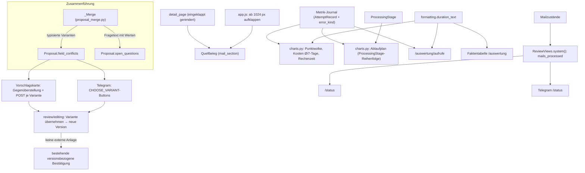

# Mailhelp 5.9 – Widersprüche auflösen, Quellbeleg, Themenlayout, Statuszähler und Auswertung

**Zielversion:** 5.9.0, Umsetzung in Patchversionen 5.9.1 bis 5.9.12

**Stand:** 12. November 2026 (überarbeitet nach Abgleich mit dem Quellstand)

**Status:** Geplant als Weiterentwicklung nach Version 5.8

**Ausgangsstand:** 5.8.2 laut `pyproject.toml`

**Vorgänger:** [Planung 5.8](Planung-5.8.md), [Release 5.8](Release-5.8.md), [Release 5.8.1](Release-5.8.1.md)

**Grundlage:** [Entwicklungsregeln](../AGENTS.md), [Projektspezifikation](../Mailhelp-Projektspezifikation.md)

---

## 0. Ergebnis der Überprüfung dieser Planung

Die Planung wurde gegen den Code von 5.8.2 geprüft. Die Ziele bleiben, einige Annahmen und
Designentscheidungen waren aber nicht tragfähig und wurden korrigiert:

| Thema | Ursprüngliche Annahme / Entscheidung | Befund im Code | Korrektur in dieser Fassung |
| :--- | :--- | :--- | :--- |
| Konflikte | `FieldConflict` speichert nur formatierte Texte; Felder `start`, `end`, `location`, `title` | Zusammengeführt werden `start`, `end`, `due`, `location`, `video_link`, `known_temporal_facts`, **nicht** `title`. Mit reinen Anzeigetexten kann ein Klick den Wert gar nicht übernehmen. | Typisierte Werte und Quellbezug werden gespeichert, formatiert wird erst bei der Anzeige. Beginn und Ende werden gemeinsam als **Zeitraum** angeboten. |
| Konflikte | Klick setzt den Vorschlag auf `pending_confirmation` | Weitere offene Fragen können bestehen bleiben; Bestätigung und externe Anlage sind getrennte Schritte (AGENTS.md). | Ein Klick erzeugt nur eine neue Version. Den Status bestimmt weiter `merge_facts`/`Proposal`. Die Anlage braucht wie bisher eine eigene, versionsbezogene Bestätigung. |
| Quellmail bei Aufgaben | Bei Terminen ist die Quellmail in der Übersicht schon aufgeklappt, bei Aufgaben nicht | `detail_page` klappt „Quellbeleg aus E-Mail / Anhang“ **unabhängig von der Art** nur dann auf, wenn Bildvorschauen existieren. Die Kartenliste zeigt die Mail nie. | Ab 1024 px Breite (Split-View und Detailansicht) ist der Quellbeleg **immer** aufgeklappt, für Termine und Aufgaben. Auf schmalen Bildschirmen ist er **immer zunächst eingeklappt**, auch bei Bildvorschauen. Die Kartenliste bleibt kompakt (entschieden am 12.11.2026, siehe 2.2). |
| `/themen` | `max-width: min(96vw, 1500px)`, `nowrap` auch für Geltungsbereich und die Kopfzeile „Beispiele / Ausschlüsse“ | Der Geltungsbereich kann mehrere Postfachnamen enthalten. Mit `nowrap` würde die Tabelle überlaufen. `main:has(.topic-heading)` trifft auch die Editorseiten. | Umbruch nur an Wortgrenzen statt `nowrap`. Breite 1320 px nur für die Themenliste. Die Kopfzeile darf an „ / “ umbrechen. |
| Statuszähler | Zähler steht in der Zusammenfassung an erster Stelle | Die Zusammenfassung und die Kacheln aus 5.8.1 zeigen zu erledigende Arbeit. Eine reine Informationszahl an erster Stelle verdrängt das. | Der Zähler kommt in die Faktenliste „Mails“ und in den Satz zur letzten Mail. Er wird keine Kachel. |
| Dauer-Punktwolke | Jeder Punkt ist per Tab fokussierbar | Bei 30 Tagen fallen leicht Tausende Aufrufe an (Vergleichsläufe mit 16 Threads). Das ergibt Tausende Tab-Stopps und große SVGs. | Punkte sind nicht fokussierbar. Die Tastatur nutzt die Wertetabelle. Höchstens 3000 Punkte werden deterministisch ausgedünnt. Fehler erhalten eine eigene Form statt nur einer anderen Farbe. |
| Kostendiagramm | „Geschwungene“ Trendlinie, Ø-Text an der Linie | Kurven schwingen über und können unter 0 fallen. Der Text kollidiert mit der Legende oben rechts. | Gerade Polylinie, Name „7-Tage-Mittel“. Werte stehen in der Legende und in der Tabelle. Der Durchschnitt zählt erst ab dem ersten erfassten Tag. |
| Pipeline-Ablaufplan | Flussdiagramm mit 10 Schritten von `preparation` bis `auto_draft`, umschaltbar gegen die Rangliste | Das Metrik-Journal kennt nur **KI-Aufrufe** (`relevance`, `summary`, `action_router`, `event_extraction`, `task_extraction` u. a.). Für `preparation`, `normalization`, `proposal_building` und `duplicate_precheck` gibt es keine Dauern. Ein SVG mit 10+ Kästen ist bei 640 px Breite mobil nicht lesbar. Ein Umschalter bräuchte JavaScript. | Das Flussdiagramm kommt (entschieden am 12.11.2026) in der Reihenfolge von `ProcessingStage`. Lokale Schritte erscheinen **ohne Laufzeit** als „lokal · nicht gemessen“, weil sie keine relevanten Wartezeiten erzeugen. Es ist eine HTML-Liste statt SVG und bricht auf Mobilgeräten senkrecht um. Rangliste und Ablauf stehen **beide** auf der Seite, einen Umschalter gibt es nicht. |
| Adaptive Einheiten | Gemeinsame Achseneinheit s/Min./Std. für das Schrittdiagramm | `bar_list` hat keine Achse, nur Beschriftungen je Balken. Die Längen sind ohnehin proportional. | Jede Beschriftung wird einzeln adaptiv formatiert. Eine Achsenumrechnung entfällt. Die Einheit heißt „Tag/Tage“ statt „T“. |
| Detailseiten | 9 Kennzahlen mit je eigener Detailseite, inklusive Fehlerursachen | `AttemptRecord` speichert keine Fehlerursache, nur `success`/`failed`. Einzelaufrufe gibt es nur innerhalb von `metrics.retention_days`. | Eine einzige Aufrufliste `/auswertung/aufrufe` mit Voreinstellung je Kennzahl. Das inhaltsfreie Feld `error_kind` kommt in 5.9 ins Journal (entschieden am 12.11.2026). Ältere Einträge zeigen „Ursache nicht erfasst“. |
| Patchfolge | Formatierer erst in K10, aber schon in K7 und K9 benötigt | – | Der Formatierer kommt zuerst. Die Konflikte folgen als wichtigstes Paket direkt danach. |

Die in Abschnitt 7 festgehaltenen **Entscheidungen** vom 12.11.2026 sind in diese Fassung
eingearbeitet.

---

## 1. Übersicht und Ziel

Version 5.9 verbessert Entscheidungssicherheit, Darstellung und Nachvollziehbarkeit:

1. **Widersprüche verständlich machen und mit einem Klick auflösen.** Statt
   `Widerspruch bei end: Angaben aus den Quellen vergleichen.` nennt Mailhelp beide Werte mit
   Herkunft, zum Beispiel *„Endzeit: bisher 16:30 Uhr, laut Mail vom 08.11. 19:30 Uhr“*. Web und
   Telegram bieten dafür je eine Schaltfläche pro Variante an. Die Auswahl ändert nur den Vorschlag
   und legt **nichts** extern an.
2. **Quellbeleg einheitlich für Termine und Aufgaben.** Auf breiten Bildschirmen (Split-View,
   Detailansicht ab 1024 px) ist er standardmäßig aufgeklappt. Auf schmalen Bildschirmen ist er
   immer zunächst eingeklappt.
3. **Themenliste `/themen` für breite Bildschirme.** Die Liste nutzt mehr Breite, Wörter werden
   nicht mehr mitten im Wort getrennt, „Bearbeiten“ steht einzeilig und Filter und „Neues Thema“
   stehen in einer Werkzeugzeile.
4. **Statuszähler „verarbeitet“.** `/status` und Telegram `/status` nennen die Zahl der
   vollständig verarbeiteten Mails.
5. **Aufrufdauer als logarithmische Punktwolke mit Median je Zeitabschnitt** statt starrer
   Dauerklassen.
6. **Durchschnitt und 7-Tage-Mittel im Cloudkosten-Diagramm.**
7. **Rechenzeit je Schritt und Pipeline-Ablaufplan.** Die Rangliste zeigt deutsche Schrittnamen,
   prozentualen Anteil und Dauer. Der Ablaufplan zeigt alle Verarbeitungsschritte in ihrer
   Reihenfolge. Lokale Schritte erscheinen darin ohne Laufzeit.
8. **Lesbare Zeiteinheiten.** Statt `75.240,0 s` steht `20 Std. 54 Min.`.
9. **Kennzahlen zum Anklicken.** Jede Kennzahl auf `/auswertung` führt zur Aufrufliste mit
   passender Voreinstellung und Erklärung.

**Nicht Teil von 5.9:** neue Einstellungen in `config.yaml`, Änderungen an Prompts oder Modellen,
JavaScript-Pflicht für neue Funktionen und das Speichern von Mail- oder LLM-Inhalten im
Metrik-Journal.

---

## 2. Detaillierte Spezifikation

### 2.1 Widersprüche mit Gegenüberstellung und 1-Klick-Auswahl

#### 2.1.1 Bestand

[proposal_merge.py](../src/mailhelp/proposals/proposal_merge.py) vergleicht in `_merge_field` die
Felder aus `_MERGED_FIELDS = ("start", "end", "due", "location", "video_link", "known_temporal_facts")`.
Ein Widerspruch entsteht in zwei Fällen:

- Das Feld steht in `previous.protected_fields`, wurde also vom Nutzer festgelegt.
- Die Quelle ist neuer oder ihr Datum ist unbekannt, und `_replaces` greift nicht.

In beiden Fällen wird nur der Text `Widerspruch bei {field}: Angaben aus den Quellen vergleichen.`
an `open_questions` (`list[str]`) angehängt. Der eingehende Wert wird **nicht gespeichert**. Er geht
nach der Zusammenführung verloren. Weitere textuelle Rückfragen derselben Familie:

- `Abweichender Beginn ohne belegtes Ende: Quellen vergleichen.`
- `Ganztägige und zeitgebundene Angaben aus den Quellen vergleichen.`
- `Widerspruch zum manuell festgelegten Datum oder Beginn: Quellen vergleichen.`
- `Widersprüchliches Zeitintervall aus den Quellen prüfen.`

#### 2.1.2 Datenmodell

`Proposal` erhält ein neues, abwärtskompatibles Feld `field_conflicts: list[FieldConflict] = []`
(höchstens 10 Einträge). Vorschläge ohne dieses Feld laden unverändert.

```python
ConflictField = Literal["interval", "start", "end", "due", "location", "video_link"]

class ConflictVariant(StrictModel):
    id: Literal["a", "b", "c"]
    # Typisierte Werte, keine Anzeigetexte; formatiert wird erst bei der Darstellung (Zeitzone, ganztägig).
    start: AwareDatetime | None = None      # für "interval" und "start"
    end: AwareDatetime | None = None        # für "interval" und "end"
    due: AwareDatetime | date | None = None
    text: str | None = Field(default=None, max_length=500)   # location, video_link
    origin: Literal["current", "manual", "source"]          # bisheriger Wert, vom Nutzer festgelegt, neue Quelle
    source: ProposalReference | None = None                  # Mail, aus der die Variante stammt
    source_subject: str | None = Field(default=None, max_length=200)
    source_sent_at: AwareDatetime | None = None
    derived_end: bool = False   # Ende aus bisheriger Dauer abgeleitet (siehe unten)

class FieldConflict(StrictModel):
    id: str = Field(pattern=r"^[a-z_]{1,20}-[0-9]{1,3}$")   # z. B. "interval-1", stabil je Vorschlag
    field: ConflictField
    variants: list[ConflictVariant] = Field(min_length=2, max_length=3)
    question: str   # genau dieser Eintrag steht in open_questions
```

**Regeln:**

- **Zeitraum statt Einzelfelder.** Unterscheiden sich `start` und `end` in derselben
  Zusammenführung, entsteht genau ein Konflikt `interval`. Einzeln wählbare Beginn- und Endzeiten
  würden sonst unsinnige Kombinationen erlauben, etwa einen neuen Beginn mit einem alten Ende vor
  diesem Beginn.
- **Abweichender Beginn ohne belegtes Ende.** Dieser Fall wird ebenfalls ein Konflikt `interval`.
  Die neue Variante übernimmt die bisherige Dauer (`derived_end = True`). Die Anzeige sagt das
  ausdrücklich: *„18:00–18:30 Uhr (Dauer wie bisher)“*.
- **Ein Konflikt je Feld.** Bringt eine weitere Quelle einen dritten, abweichenden Wert, wird er als
  Variante `c` ergänzt. Bei mehr als drei Werten bleibt der Konflikt ohne Schaltflächen und verweist
  auf „Selbst ändern“.
- **Fragetext und Konflikt gehören zusammen.** Wird ein Konflikt aufgelöst, verschwinden
  Konflikteintrag und Fragetext gemeinsam, und zwar über `FieldConflict.id`, nicht über einen
  Textvergleich. Ändert der Nutzer das Feld manuell oder kommt eine Quelle mit einem passenden Wert,
  entfällt der Konflikt ebenso.
- **Bestehende Präfix-Logik bleibt intakt.** `_answered_questions` entfernt Fragen über
  Textpräfixe (`_TIME_QUESTIONS`). Die neuen Texte dürfen mit keinem dieser Präfixe und mit keinem
  Eintrag aus `RECONCILIATION_QUESTIONS` beginnen. Ein Test stellt das sicher.
- **Altbestand.** Gespeicherte Vorschläge mit dem alten Text behalten ihn. Sie zeigen keine
  Schaltflächen, da der eingehende Wert nie gespeichert wurde, und werden nicht migriert.
- **Ohne Schaltflächen, aber mit Werten im Text:** ganztägig gegen zeitgebunden, Widerspruch zum
  manuell festgelegten Datum, ungültiges Intervall und zusätzliche Beschreibung. Diese Fälle
  brauchen weiterhin eine Bearbeitung.

#### 2.1.3 Texte

Die Feldnamen sind deutsch: Zeitraum, Beginn, Endzeit, Fälligkeit, Ort, Videolink. Die
Formatierung hängt vom Kontext ab:

- Gleiches Datum: nur die Uhrzeiten, also `16:30 Uhr`.
- Anderes Datum: `Sa 15.11., 16:30 Uhr`.
- Zeitraum: `Sa 15.11., 16:00–16:30 Uhr`.

| Fall | Fragetext |
| :--- | :--- |
| Neue Quelle widerspricht | *„Widerspruch beim Zeitraum: bisher Sa 15.11., 16:00–16:30 Uhr, laut Mail „Elternabend – Änderung“ vom 08.11. 16:00–19:30 Uhr. Welcher Zeitraum soll gelten?“* |
| Vom Nutzer festgelegter Wert | *„Widerspruch beim Ort: von dir festgelegt „Aula“, laut Mail vom 08.11. „Turnhalle“. Welcher Ort soll gelten?“* |
| Text ohne Varianten | *„Ganztägige und zeitgebundene Angaben widersprechen sich: bisher ganztägig am 15.11., laut Mail vom 08.11. 16:00–19:30 Uhr. Bitte den Termin bearbeiten.“* |

Alle Werte stammen aus Mails beziehungsweise aus LLM-Ausgaben und gelten als **nicht
vertrauenswürdig**. Im Web werden sie escaped, in Telegram ohne HTML-Parse-Modus oder escaped
gesendet. Orte werden in Schaltflächen nach 40 Zeichen mit „…“ gekürzt. Von Videolinks zeigt die
Schaltfläche nur die Domain, die volle Adresse steht als Text in der Gegenüberstellung.

#### 2.1.4 Weboberfläche

Auf der Vorschlagskarte ersetzt eine Gegenüberstellung die Textfrage. Sie nutzt die vorhandenen
Klassen `.compare` und `.compare-side`: zwei Spalten ab 720 px, darunter gestapelt.

```
┌ ⚠️ Widerspruch beim Zeitraum ─────────────────────────────────────────┐
│ Bisher                          │ Neu                                  │
│ Sa 15.11., 16:00–16:30 Uhr      │ Sa 15.11., 16:00–19:30 Uhr           │
│ aus „Einladung Elternabend“,    │ aus „Elternabend – Änderung“,        │
│ 05.11.                          │ 08.11.                               │
│ [ 16:00–16:30 Uhr behalten ]    │ [ 16:00–19:30 Uhr übernehmen ]       │
└──────────────────────────────── Selbst ändern ›  ────────────────────┘
```

- Jede Schaltfläche ist ein eigenes `POST`-Formular an `/vorschlag/{mail}/{id}/konflikt`. Es trägt
  ein CSRF-Token, `version`, `conflict_id`, `variant_id` und einen Idempotenzschlüssel. Die Seite
  funktioniert vollständig ohne JavaScript.
- Die neue Variante wird nicht vorausgewählt und nicht farblich bevorzugt. Die Entscheidung liegt
  beim Nutzer.
- Bei der Ausführung prüft der Server erneut Sitzung, Version, Konflikt-ID und Variante. Er übernimmt
  den Wert, nimmt das Feld in `protected_fields` auf (der Nutzer hat entschieden), entfernt Konflikt
  und Frage und speichert eine neue Version. Den Status bestimmt die bestehende Logik:
  `needs_clarification` bleibt, solange andere Fragen offen sind.
- **Keine externe Anlage.** Danach erscheint die Karte der neuen Version mit dem gewohnten
  „Bestätigen“. Die Auswahl ist keine Freigabe.
- **Wiederholung und Konkurrenz.** Derselbe Klick mit demselben Idempotenzschlüssel hat dieselbe
  Wirkung und erzeugt keine zweite Version. Eine veraltete Version, ein entfallener Konflikt oder eine
  fremde Variante führen zu *„Der Vorschlag wurde inzwischen geändert. Bitte die aktuelle Fassung
  prüfen.“* und lassen den Vorschlag unverändert.
- Das Freitextfeld für Rückfragen bleibt für Sonderfälle erhalten.

#### 2.1.5 Telegram

```
⚠️ Widerspruch beim Zeitraum – Elternabend
• bisher: Sa 15.11., 16:00–16:30 Uhr (Mail vom 05.11.)
• neu: Sa 15.11., 16:00–19:30 Uhr (Mail vom 08.11.)
Welcher Zeitraum soll gelten?

[ 16:00–16:30 behalten ] [ 16:00–19:30 übernehmen ]
[ ✏️ Selbst ändern ]
```

- Eine neue Aktion `DecisionAction.CHOOSE_VARIANT` arbeitet wie die bestehenden Aktionen mit
  Token-Callbacks und bleibt damit unter der Grenze von 64 Byte. Gebunden ist sie an Mail, Vorschlag,
  Version, `conflict_id` und `variant_id`.
- Nach dem Klick wird die Nachricht quittiert („Zeitraum 16:00–19:30 Uhr übernommen“). Anschließend
  wird die neue Version über die bestehende Outbox vorgelegt. Bei mehreren offenen Fragen folgt die
  nächste, sonst erscheinen die Bestätigungsschaltflächen.
- Doppelte Klicks, Klicks nach einem Neustart und Klicks auf veraltete Nachrichten verhalten sich wie
  im Web: idempotent beziehungsweise mit einem Hinweis und ohne Änderung.

---

### 2.2 Quellbeleg bei Terminen und Aufgaben standardmäßig aufgeklappt

#### 2.2.1 Bestand

In [review_pages.py](../src/mailhelp/web/review_pages.py) baut `detail_page` den Abschnitt
`disclosure("Quellbeleg aus E-Mail / Anhang", mail_section(mail), opened=previews)`.
`previews` ist nur dann wahr, wenn ein Anhang eine Bildvorschau hat. Die Art des Vorschlags spielt
keine Rolle. Ein Termin aus einem eingescannten Elternbrief zeigt die Mail daher sofort, eine
Aufgabe aus einer reinen Textmail nicht. Im Split-View ab 1024 px lädt `app.js` genau diese
Detailseite in den rechten Bereich. Die Kartenliste selbst zeigt nie eine Mail.

#### 2.2.2 Lösung

Die Regel hängt nur von der Bildschirmbreite ab, nicht von der Art (Termin, Aufgabe, Änderung,
Absage) und nicht von Bildvorschauen:

| Breite | Anfangszustand des Quellbelegs |
| :--- | :--- |
| ab 1024 px (Split-View und eigenständige Detailseite) | aufgeklappt, vollständiger Mailtext mit Bildvorschauen |
| unter 1024 px | **immer eingeklappt**, auch bei Bildvorschauen (bisher dort aufgeklappt) |
| ohne JavaScript, jede Breite | eingeklappt (sichere Voreinstellung) |

**Umsetzung:**

- Der Server rendert den Abschnitt immer **ohne** `open` und markiert ihn mit
  `<details class="disclosure" data-source-mail>`. Das bisherige `opened=previews` entfällt.
- `app.js` setzt `open` beim Laden der Detailseite und beim Füllen des Split-View-Bereichs, wenn
  `matchMedia("(min-width: 1024px)")` zutrifft. Die Grenze ist dieselbe wie beim Split-View in
  `app.css`.
- Ein späteres Ändern der Fenstergröße schaltet den Zustand nicht um. Was der Nutzer gerade liest,
  klappt nicht von selbst zu.
- Der Server kann die Breite nicht kennen und CSS kann `<details>` nicht öffnen. Deshalb ist diese
  kleine JavaScript-Erweiterung nötig. Ohne JavaScript bleibt alles bedienbar, nur eingeklappt.
- Der Abschnitt lässt sich jederzeit auf- und zuklappen. Der Zustand wird nicht gespeichert.
- Die Zusammenfassung des eingeklappten Abschnitts nennt den Inhalt, etwa
  *„Quellbeleg aus E-Mail / Anhang (Mail von Schule, 2 Bilder)“*. So sieht man auch eingeklappt,
  dass Bildbelege vorhanden sind.
- Ist der Volltext nach `retention.full_mail_days` bereinigt, erscheint wie bisher der Hinweis von
  `mail_section`.
- **Die Kartenliste bleibt kompakt.** Volle Mails unter jeder Karte würden die Liste auf Mobilgeräten
  stark verlängern. Bei Serien und mehreren Vorschlägen aus einer Mail stünde dieselbe Mail
  mehrfach da. Der Beleg (`evidence`) unter „Beschreibung und Beleg“ bleibt die Kurzfassung in der
  Liste.

---

### 2.3 Themenliste `/themen` für breite Bildschirme

#### 2.3.1 Bestand

- `main { max-width: 1080px; }` gilt auch für die sechsspaltige Themenliste. Die Spalten
  „Beschreibung“ und „Geltungsbereich“ werden schmal, an den Seiten bleibt viel Fläche frei.
- `.topic-table th, .topic-table td { overflow-wrap: anywhere; }` erlaubt dem Tabellenalgorithmus
  Umbrüche an jedem Zeichen. Das führt zu *„Geltun/gsbere/ich“*, *„Postfä/cher“*,
  *„Ausschlü/sse“* und einem dreizeiligen *„Bear/beit/en“*.
- `#topic-filter` ist ein zweispaltiges Raster. „Neues Thema“ steht getrennt darunter.

#### 2.3.2 Lösung

Die Breite gilt nur für die Liste, nicht für die Editorseiten. Diese bleiben mit
`main:has(.topic-field) > form { max-width: 760px }` bewusst schmal.

```css
@media (min-width: 1024px) {
  main:has(.topic-table) { max-width: 1320px; }
}
.topic-table th, .topic-table td { overflow-wrap: normal; word-break: normal; hyphens: manual; }
.topic-table td small { overflow-wrap: anywhere; }            /* technische Themen-ID ohne Leerzeichen */
.topic-table td[data-label="Beschreibung"] { overflow-wrap: break-word; }
```

| Spalte | Regel | Begründung |
| :--- | :--- | :--- |
| Thema | `min-width: 12rem` | Name lesbar, ID darf umbrechen |
| Status | `white-space: nowrap` | Kurze, feste Werte („aktiv“, „deaktiviert“) |
| Geltungsbereich | `min-width: 9rem`, Umbruch nur an Leerzeichen | Mehrere Postfachnamen müssen umbrechen dürfen. `nowrap` würde überlaufen. |
| Beispiele / Ausschlüsse | Zelle `nowrap`, `text-align: center`, `font-variant-numeric: tabular-nums`; Kopfzeile bricht an „ / “ um | Ziffern bleiben untereinander, die Kopfzeile erzwingt keine Überbreite |
| Beschreibung | übrige Breite, `min-width: 16rem` | Der Text ist auf 160 Zeichen gekürzt und braucht bei 1320 px höchstens zwei Zeilen |
| Aktion | `white-space: nowrap; text-align: right`; Kopfzeile „Bearbeiten“ nur für Screenreader sichtbar | Schaltfläche einzeilig, keine doppelte Beschriftung |

**Werkzeugzeile:** Ab 720 px stehen in einer Flex-Zeile:

- das Suchfeld (`flex: 1 1 18rem`, `max-width: 28rem`),
- die Statusauswahl,
- die Filterschaltfläche für Nutzung ohne JavaScript,
- rechtsbündig „Neues Thema“ als primäre Schaltfläche.

Darunter umbrechen die Elemente. Die Beschriftungen bleiben als sichtbare `<label>` erhalten.

Die **mobile Kartenansicht** (`@media (max-width: 800px)`) bleibt unverändert und wird in der
Abnahme erneut geprüft.

---

### 2.4 Statuszähler „Mails verarbeitet“

#### 2.4.1 Bestand

`SystemStatus.mails_total` zählt alle gespeicherten Mailzustände und erscheint als „Gespeichert“.
Der Zähler eignet sich als Grundlage, weil die Aufbewahrung (`runtime/retention.py`) Zustände nur
**bereinigt** und nicht löscht. Identität und Ergebnis bleiben erhalten.

#### 2.4.2 Lösung

- **Definition:** `mails_processed = Anzahl der Zustände mit steps.completion == "completed"`. Das
  schließt irrelevante Mails und Duplikate ein. Der Wert wird bei jedem Aufruf aus dem Zustand
  berechnet. Es gibt keine eigene Zählerdatei, damit nichts doppelt gezählt wird und kein
  Neustartproblem entsteht.
- Zustände mit `completion == "skipped"` zählen nicht. In K7 wird geprüft, wann `skipped` gesetzt
  wird, und das Ergebnis in der Spezifikation festgehalten.
- Wird eine Mail neu analysiert, zählt sie bis zum erneuten Abschluss nicht mit. Die Zahl kann dabei
  kurz sinken. Das ist gewollt und wird in der Hilfe beschrieben.
- **`/status`, Zusammenfassung:** Der Satz zur letzten Mail wird erweitert. Die zu erledigenden
  Zahlen bleiben vorne:
  > *„3 offene Vorschläge · 1 Relevanzfrage.“*
  > *„Bisher 1.234 Mails verarbeitet, zuletzt am 12.11.2026, 07:45.“*
- **`/status`, Abschnitt „Mails“:**

  | Bezeichnung | Wert |
  | :--- | :--- |
  | Verarbeitet (abgeschlossen) | `mails_processed` |
  | Gespeichert (alle Zustände) | `mails_total` |
  | Zuletzt verarbeitet | wie bisher |
  | Warten auf Relevanzentscheidung | wie bisher |
  | Zurückgestellt (neuer Versuch später) | wie bisher |

- **Keine neue Kachel.** Die Kacheln aus 5.8.1 sind Wege zu offener Arbeit. Eine reine Gesamtzahl
  gehört nicht dazu.
- **Telegram `/status`:** Als erste Zeile erscheint *„📊 Bisher 1.234 Mails verarbeitet.“*, danach
  die bestehende Übersicht. `/offen` bleibt unverändert. `TelegramCommands` erhält dafür lesenden
  Zugriff auf `ReviewViews.system()` über den Presenter, ohne Schreibzugriff.
- Zahlen ab 1000 erhalten einen Tausenderpunkt (deutsche Schreibweise, wie `_number` in `charts.py`).

---

### 2.5 Aufrufdauer als logarithmische Punktwolke

#### 2.5.1 Bestand

`statistics_charts` sortiert die Dauern in `DURATION_CLASSES` (`< 1 s` bis `> 60 s`) und zeichnet
ein Säulendiagramm. Es zeigt weder den zeitlichen Verlauf noch Unterschiede unter einer Sekunde.

#### 2.5.2 Lösung: `scatter_chart` in `charts.py`

- **Achsen:**
  - Die x-Achse ist die Zeit mit denselben Abschnitten wie die anderen Diagramme (Stunden bei
    1 Tag, sonst Kalendertage). Punkte sitzen am genauen Zeitpunkt.
  - Die y-Achse ist logarithmisch von 0,1 s bis `max(100 s, nächste Zehnerpotenz über dem Maximum)`.
    Kürzere Dauern werden auf 0,1 s gesetzt, und die Tabelle weist sie als „< 0,1 s“ aus.

  ```
  y = TOP + h · (1 − (log10(max(d, 0,1)) + 1) / (log10(y_max) + 1))
  ```

  Beschriftete Gitterlinien liegen bei 0,1 s, 1 s, 10 s und 100 s, feine Hilfslinien ohne
  Beschriftung bei 0,2/0,5/2/5/20/50 s.
- **Punkte:**
  - Erfolge sind Kreise (`r = 2.5`, halbtransparent, damit dichte Bereiche dunkler wirken).
  - Fehler sind rote Kreuze (×). Die Form unterscheidet sie, nicht nur die Farbe (Grundsatz aus 5.0.7).
  - Jeder Punkt hat `<title>` und `data-chart-detail` für Maus und Touch, zum Beispiel
    *„12.11. 14:23 · Relevanzprüfung · 1,4 s · gemini-2.5-flash · Fehler“*.
  - Punkte sind **nicht** per Tab fokussierbar (kein `tabindex`, kein `role="img"`). Die Tastatur
    erreicht alle Werte über die Wertetabelle.
  - Der Hinweis im Diagramm lautet „Punkte für Details berühren oder mit der Maus zeigen; alle Werte
    in der Tabelle.“
- **Ausdünnung:** Ab 3000 Aufrufen bleiben alle Fehler und alle Aufrufe über dem 95-%-Wert erhalten.
  Vom Rest wird in fester Schrittweite gezogen (kein Zufall, damit Tests stabil bleiben). Der
  Untertitel nennt *„1.200 von 8.400 Aufrufen dargestellt“*.
- **Median je Zeitabschnitt:** Eine Linie `<path class="chart-trend-line">` verbindet den Median
  jedes Abschnitts mit mindestens 3 Aufrufen. Abschnitte mit weniger Aufrufen unterbrechen die Linie,
  statt sie zu interpolieren. Die Legende lautet `● erfolgreich  × fehlgeschlagen  — Median je Tag`
  (bei 1 Tag: „je Stunde“).
- **Wertetabelle je Abschnitt:** Aufrufe, Fehler, Median, 95 %, Maximum.
- Die Ausgabe bleibt reines Server-SVG ohne Inline-Skripte und Inline-Styles. Die Farben kommen wie
  bisher als Präsentationsattribut mit Hex-Fallback, die Klassenregeln in `app.css` gelten für Hell
  und Dunkel. `DURATION_CLASSES` entfällt.

---

### 2.6 Durchschnitt und 7-Tage-Mittel im Cloudkosten-Diagramm

- **Durchschnittslinie:** Sie berechnet sich als Summe der gemeldeten Kosten geteilt durch die
  Zahl der Abschnitte vom **ersten Abschnitt mit einem erfassten Aufruf** bis heute. Tage vor
  Beginn der Erfassung drücken den Schnitt sonst künstlich. Aufrufe ohne Kostenangabe zählen nicht
  mit, wie im Diagramm selbst. Gezeichnet wird eine gestrichelte Linie
  (`class="chart-average-line"`, `stroke-dasharray="5 3"`) in einer eigenen Farbe, die sich von den
  Säulen unterscheidet.
- **7-Tage-Mittel:** Es erscheint ab einem Zeitraum von 14 Tagen als gleitender Mittelwert über die
  letzten 7 Tage, beginnend am 7. erfassten Tag. Gezeichnet wird eine gerade Polylinie durch die
  Säulenmitten (`class="chart-cost-trend"`). Es gibt keine Kurvenglättung, die überschwingt oder
  unter null fällt.
- **Beschriftung:** Die Werte stehen in der Legende, nicht an der Linie:
  `■ Kosten  ┄ Ø 0,0340 $ je Tag  — 7-Tage-Mittel`.
- Die **Wertetabelle** erhält eine Spalte „7-Tage-Mittel“ sowie die Zeilen „Summe“ und
  „Durchschnitt (ab erstem erfassten Tag)“.
- `column_chart` erhält dafür optionale Parameter `average: float | None` und
  `trend: list[float | None] | None`. Das Aufrufdiagramm bleibt unverändert.

---

### 2.7 Rechenzeit je Verarbeitungsschritt und Pipeline-Ablaufplan

#### 2.7.1 Bestand

`bar_list("chart-stages", …)` zeigt die rohen Schlüssel (`event_extraction`) absteigend nach
Sekunden. Erfasst sind nur KI-Aufrufe. Parallele Aufrufe werden addiert. Die Seite weist bereits
darauf hin, dass dies keine Durchlaufzeit ist.

#### 2.7.2 Rangliste „Rechenzeit je Verarbeitungsschritt“

- **Titel:** „Rechenzeit je Verarbeitungsschritt“. Beschreibung: „Summierte Dauer der KI-Aufrufe,
  größter Anteil zuerst; parallele Aufrufe werden addiert.“
- **Deutsche Namen** aus `STAGE_LABELS` (`review/views.py`). Unbekannte Schlüssel erscheinen
  unverändert.
- **Sortierung** wie bisher nach Größe, größter zuerst, und ab 8 Einträgen mit „Weitere“. Die
  Reihenfolge des Ablaufs zeigt der Ablaufplan (2.7.3). So beantwortet jede Darstellung genau eine
  Frage und ein Umschalter ist nicht nötig.
- **Doppelte Beschriftung an jedem Balken:** `48,9 % · 2 Std. 25 Min.`, mit dem Anteil
  `p = T_Schritt / T_gesamt · 100 %` (auf eine Nachkommastelle gerundet). Die Rundung kann die
  Summe von 100 % leicht verfehlen; die Tabelle nennt das.
- **Wertetabelle:** Schritt, Anteil, Summe, Aufrufe, **Median je Mail**. Dafür wird die Dauer je
  `mail_id` und Schritt summiert und davon der Median gebildet. Aufrufe ohne `mail_id`, etwa aus
  Vergleichsläufen, zählen nur in Summe und Anteil.

#### 2.7.3 Pipeline-Ablaufplan

Der Ablaufplan zeigt, wo in der Kette der Verarbeitung die Wartezeit entsteht. Er steht als eigene
Abbildung direkt unter der Rangliste. Titel: „Ablauf der Mailverarbeitung“.

**Schritte und Reihenfolge.** Die Reihenfolge folgt `ProcessingStage`
(`domain/processing.py`), damit sie mit der tatsächlichen Pipeline übereinstimmt:

| Nr. | Schritt | Art | Anzeige |
| :--- | :--- | :--- | :--- |
| 1 | Aufbereitung (`preparation`) | lokal | ohne Laufzeit |
| 2 | Relevanzprüfung (`relevance`) | KI | Laufzeit und Anteil |
| 3 | Zusammenfassung (`summary`) | KI | Laufzeit und Anteil |
| 4 | Telegram-Zusammenfassung (`summary_notification`) | Versand | ohne Laufzeit |
| 5 | Aktionserkennung (`action_detection`) | lokal | ohne Laufzeit |
| 6 | Aktionszuordnung (`action_router`) | KI | Laufzeit und Anteil |
| 7 | Terminerkennung (`event_extraction`) und Aufgabenerkennung (`task_extraction`) | KI, Verzweigung | nebeneinander, je Laufzeit und Anteil |
| 8 | Normalisierung (`normalization`) | lokal | ohne Laufzeit |
| 9 | Vorschlagserstellung (`proposal_building`) | lokal | ohne Laufzeit |
| 10 | Duplikatprüfung (`duplicate_precheck`) | lokal | ohne Laufzeit |
| 11 | Telegram-Vorschlag (`proposal_notification`) | Versand | ohne Laufzeit |
| 12 | Abschluss (`completion`) | lokal | ohne Laufzeit |

- **Gemessen oder nicht.** Die Spalte „Art“ ist nicht fest verdrahtet. Ein Schritt zeigt Laufzeit
  und Anteil genau dann, wenn im gewählten Zeitraum Metrikzeilen mit seinem `stage`-Schlüssel
  vorliegen. Alle anderen Schritte erscheinen als **„lokal · nicht gemessen“**. Begründung: Lokale
  Schritte laufen sehr schnell und erzeugen keine relevante Wartezeit. Eine eigene Zeitmessung
  dafür ist in 5.9 nicht vorgesehen. Wird ein Schritt später gemessen, zeigt der Plan ihn ohne
  Codeänderung mit Laufzeit an.
- **Weitere KI-Aufrufe.** Metrikschlüssel, die keinem `ProcessingStage` entsprechen (etwa
  Bilderkennung, Antwortentwurf, `diagnostic_test`), erscheinen am Ende als Knoten „Weitere
  KI-Aufrufe“ mit eigener Liste in der Tabelle. Ein Schritt wird nie stillschweigend weggelassen.
- **Darstellung als HTML, nicht als SVG.** Der Plan ist eine geordnete Liste
  `<ol class="pipeline">` mit Knoten `<li class="pipeline-step">`. Begründungen:
  - Text bleibt bei jeder Breite lesbar, weil er nicht mit dem SVG skaliert.
  - Die Reihenfolge ist für Screenreader semantisch richtig.
  - Es braucht weder Inline-Styles noch JavaScript.
- **Aufbau eines Knotens:**
  - **Gemessener Schritt:** Nummer, Name, `48,9 % · 2 Std. 25 Min.`, Median je Mail und ein
    schmaler Anteilsbalken. Die Breite wird über Klassen in 5-%-Stufen gesetzt
    (`.share-0` … `.share-100`), weil die CSP keine Inline-Styles erlaubt.
  - **Nicht gemessener Schritt:** Nummer, Name und der Text „lokal · nicht gemessen“, gedämpft
    dargestellt und ohne Balken. Er bleibt kompakt, damit der Blick auf die gemessenen Schritte
    fällt.
  - **Verzweigung (Schritt 7):** Termin- und Aufgabenerkennung stehen in einem gemeinsamen Knoten
    nebeneinander. Die Beschriftung „je nach Aktion“ zeigt, dass eine Mail einen oder beide Zweige
    durchläuft.
- **Flaschenhals.** Der gemessene Schritt mit dem größten Anteil erhält
  `class="pipeline-step is-bottleneck"`, einen kräftigeren Rand und den sichtbaren Text
  „⏱ größte Wartezeit“. Die Markierung ist damit nicht nur farblich.
- **Layout:**
  - Ab 900 px fließen die Knoten in Zeilen von links nach rechts und sind durch Pfeile `→`
    verbunden. Die Pfeile sind CSS-Pseudoelemente mit `aria-hidden`-Wirkung.
  - Darunter steht der Plan senkrecht mit Pfeilen `↓`.
  - Hell- und Dunkeldarstellung kommen über die vorhandenen Farbtokens.
- **Wertetabelle** unter `<details><summary>Werte als Tabelle</summary>` mit den Spalten Nr.,
  Schritt, Art (gemessen / lokal, nicht gemessen), Anteil, Summe, Median je Mail.
- **Leerer Zeitraum.** Ohne Metrikzeilen erscheint der Plan nicht. Es bleibt beim bestehenden
  Leerhinweis der Auswertung.

---

### 2.8 Lesbare Zeiteinheiten

`formatting.py` erhält `duration_text(seconds: float, *, precise: bool = False) -> str`:

| Bereich (nach Rundung) | Ausgabe | Beispiel |
| :--- | :--- | :--- |
| < 60 s | Sekunden mit 1 Nachkommastelle (`precise`: 2) | `42,3 s`, `0,85 s` |
| 60 s bis < 1 Std. | Minuten und ganze Sekunden; „0 s“ entfällt | `4 Min. 12 s`, `5 Min.` |
| 1 Std. bis < 1 Tag | Stunden und Minuten | `2 Std. 15 Min.` |
| ab 1 Tag | Tage und Stunden | `1 Tag 4 Std.`, `3 Tage` |

- **Rundung vor der Bereichswahl:** 59,96 s ergibt `1 Min.`, nicht `60,0 s`. 3599,6 s ergibt
  `1 Std.`.
- Negative oder nicht endliche Werte werden abgelehnt (`ValueError`). Die Metriken liefern sie nie,
  der Test sichert den Vertrag ab.
- **Faktentabelle `/auswertung`:**
  - „Summierte Aufrufdauer“ zeigt `20 Std. 54 Min.` und dezent dahinter
    `<span class="meta">(75.240 s)</span>`.
  - „Dauer je Aufruf (Mittel / Median / 95 %)“ nutzt `precise=True`.
  - Der vorhandene Hinweis „Die summierte Aufrufdauer ist keine Durchlaufzeit“ bleibt. Er ist bei
    Werten wie „3 Tage“ besonders wichtig.
- **Diagramme:** Die Balkenbeschriftungen der Rechenzeit und die Knoten des Ablaufplans (2.7)
  nutzen `duration_text`. Die
  Punktwolke (2.5) bleibt bei Sekunden, weil ihre logarithmische Achse von 0,1 s bis 100 s reicht.
  Eine Achsenumrechnung ist nicht nötig.

---

### 2.9 Kennzahlen zum Anklicken: Aufrufliste `/auswertung/aufrufe`

#### 2.9.1 Bestand

Die Faktentabelle auf `/auswertung` besteht aus reinen `<dt>/<dd>`-Paaren. `AttemptRecord` enthält
je Versuch Zeit, Schritt, Modell, Anbieter, Server, Status (`success`/`failed`), Tokens, Kosten
(oder `None`) und, wenn vorhanden, `mail_id`. Eine **Fehlerursache wird nicht gespeichert**.
Einzelaufrufe bleiben `metrics.retention_days` erhalten (Standard 90 Tage).

#### 2.9.2 Navigation

Wie die Statuskacheln in 5.8.1 wird jeder **Wert** in der Faktentabelle ein nativer Link mit
sichtbarer Unterstreichung und `›`. Er hat eine sprechende Beschriftung, etwa
`aria-label="3 fehlgeschlagene Aufrufe anzeigen"`, und funktioniert ohne JavaScript. Der aktive
Filter (`days`, `mode`, `model`, `provider`, `stage`, `since`, `until`) wird übernommen. Bei einem
Wert von 0 führt der Link zu einer verständlichen leeren Liste.

Es gibt **eine** Seite mit Voreinstellung statt neun eigener Detailseiten:

| Kennzahl | `metric` | Voreinstellung der Liste | Erklärung oben |
| :--- | :--- | :--- | :--- |
| Aufrufe (einzelne Versuche) | `calls` | alle, neueste zuerst | „Jeder Versuch zählt einzeln, auch Wiederholungen.“ |
| davon fehlgeschlagen | `failed` | `status=failed` | Ursachen nach `error_kind` gezählt (siehe unten) |
| Gemeldete Cloudkosten | `cloud_costs` | mit Kostenangabe, teuerste zuerst | Summe je Modell |
| Cloudaufrufe ohne Kostenangabe | `unknown_cost` | Cloud, `cost_usd = None` | „Der Anbieter hat keine Nutzungsdaten gemeldet; die Kosten sind unbekannt, nicht null.“ |
| Cloudkosten in Euro | `cloud_eur` | wie `cloud_costs` | `EUR = USD ÷ usd_per_eur` mit eingestelltem Kurs und Bezugsdatum |
| Geschätzte Stromkosten Ollama | `electricity` | `provider=ollama` | `belegte Serverzeit × Leistung × Strompreis`, Serverzeit je Server mit zusammengeführten Überlappungen, eingestellte Werte genannt |
| Summierte Aufrufdauer | `duration` | längste zuerst | „Summe aller Versuche; keine Durchlaufzeit.“ |
| Dauer je Aufruf | `distribution` | längste zuerst | Mittel, Median, 90/95/99 %, Maximum |
| Unvollständige Erfassung | `incomplete` | keine Liste | Bedeutung von beschädigten Zeilen und Erfassungsfehlern, Verweis auf die Protokolle |

#### 2.9.3 Seite `/auswertung/aufrufe`

- Die Seite ist **lesend**: `GET`, Anmeldung erforderlich, keine Seiteneffekte. Unbekannte
  `metric`-, `sort`- oder Filterwerte führen wie auf `/auswertung` zu 422.
- **Kopf:** Link „← Zurück zur Auswertung“ mit denselben Filtern, Titel der Kennzahl,
  Erklärungsbox und der aktive Filter als lesbarer Text.
- **Tabelle** (`.table-scroll`, semantisches `<table>`):

  | Spalte | Inhalt |
  | :--- | :--- |
  | Zeit | lokale Zeitzone |
  | Schritt | deutscher Name |
  | Modell / Anbieter | wie gespeichert |
  | Status | Abzeichen „Erfolg“ / „Fehler“ mit Text, nicht nur Farbe, bei Fehlern mit Ursache |
  | Dauer | `duration_text(precise=True)` |
  | Tokens | Eingabe / Ausgabe |
  | Kosten | USD mit 4 Nachkommastellen oder „unbekannt“ |
  | Mail | Link `/mail/{mail_id}` mit Betreff, wenn der Zustand vorhanden ist; „Mail nicht mehr gespeichert“; bei Vergleichsläufen „Vergleichslauf“ ohne Link |

- **Sortierung und Filter** erfolgen über Links und ein GET-Formular: `status`, `sort` ∈
  {`time`, `duration`, `cost`}, absteigend.
- **Seitenweise Anzeige** mit 100 Zeilen je Seite (`page`). Gesamtzahl und Seitennavigation stehen
  oben und unten.
- Hinweis bei Zeiträumen über `retention_days`: *„Einzelaufrufe liegen nur für die letzten 90 Tage
  vor; die Summen oben enthalten ältere Tage.“*
- **Datenschutz:** Die Liste zeigt nur Metadaten aus dem inhaltsfreien Journal. Der Betreff kommt
  aus dem Mailzustand und wird wie überall escaped.

#### 2.9.4 Erweiterung des Journals: `error_kind`

Entschieden am 12.11.2026: Das Feld kommt in 5.9. `AttemptRecord` erhält das optionale Feld
`error_kind`:

```python
error_kind: Literal["timeout", "rate_limited", "provider_error", "invalid_json",
                    "schema_invalid", "cancelled", "other"] | None = None
```

- Gesetzt wird es nur bei `status == "failed"`. Abgeleitet wird es aus dem vorhandenen
  Fehlerereignis, ohne Fehlermeldung und ohne Inhalte.
- Ältere Zeilen ohne das Feld bleiben gültig (`extra="forbid"` bleibt, das Feld hat einen
  Standardwert). Sie erscheinen als „Ursache nicht erfasst (vor 5.9)“.
- Die Verdichtung (`daily.json`) zählt `error_kind` nicht. Es gibt keine Formatänderung der
  Aggregate.

---

## 3. Architektur und betroffene Module



| Modul | Änderung |
| :--- | :--- |
| `domain/proposal.py` | `ConflictVariant`, `FieldConflict`, `Proposal.field_conflicts`; Invarianten Frage ↔ Konflikt |
| `proposals/proposal_merge.py` | Konflikte mit typisierten Varianten erzeugen; Zeitraum-Gruppierung; Fragetexte mit Werten |
| `review/editing.py`, `review/service.py`, `review/commands.py` | Befehl „Variante übernehmen“ mit Versions- und Idempotenzprüfung |
| `web/review_pages.py`, `web/actions.py`, `web/review_site.py` | Gegenüberstellung, Formulare, Route `POST …/konflikt`; Quellbeleg immer eingeklappt gerendert mit `data-source-mail` und Inhaltsangabe in der Zusammenfassung |
| `web/static/app.js` | Quellbeleg ab 1024 px beim Laden der Detailseite und im Split-View aufklappen |
| `telegram/callbacks.py`, `telegram/decisions.py`, `telegram/formatting.py`, `telegram/presenter.py` | `CHOOSE_VARIANT`, Nachrichtentext, Quittung, Outbox-Folge |
| `telegram/commands.py` | Zeile „Bisher … Mails verarbeitet“ in `/status` |
| `review/views.py`, `web/status_pages.py` | `SystemStatus.mails_processed`, Anzeige |
| `web/topic_site.py`, `web/static/app.css` | Werkzeugzeile, versteckte Aktionskopfzeile, Tabellen- und Diagrammklassen (Hell/Dunkel) |
| `formatting.py` | `duration_text` |
| `web/charts.py` | `scatter_chart`; `column_chart(average, trend)`; `bar_list` mit deutschen Namen und Anteil; neu `pipeline_plan` (HTML-Liste); `DURATION_CLASSES` entfällt |
| `web/archive_pages.py`, `web/history_site.py`, `web/site.py` | verlinkte Faktentabelle, Seite und Route `GET /auswertung/aufrufe` |
| `runtime/metrics.py` | `AttemptRecord.error_kind`, Abfrage mit Status, Sortierung und Seiten |

---

## 4. Umsetzungsschritte

Jeder Schritt ist ein Patch nach AGENTS.md: Versionsnummer in `pyproject.toml` und
`src/mailhelp/__init__.py`, `CHANGELOG.md` und `README.md`. Er enthält Tests mit 100 % Zeilen- und
Branch-Abdeckung. Jeder Bugfix (etwa der Silbenumbruch auf `/themen` oder der zufällig geschlossene
Quellbeleg) enthält einen Regressionstest, der vor dem Fix scheitert.

| Schritt | Patch | Arbeitspaket | Kerninhalt und Tests |
| :--- | :--- | :--- | :--- |
| K1 | 5.9.1 | Zeitformat | `duration_text` mit Tabellentests aller Grenzen (59,96 s; 3599,6 s; 86 400 s; 1 Tag/Tage); Faktentabelle `/auswertung` |
| K2 | 5.9.2 | Konfliktmodell und Texte | `FieldConflict`; Merge für alle Felder, Zeitraum-Gruppierung, dritte Variante, geschützte Felder, Altbestand ohne Migration; Präfix-Kollisionstest; Laden alter Vorschläge |
| K3 | 5.9.3 | Auswahl im Web | Gegenüberstellung, `POST …/konflikt`; Tests für Erfolg, Doppelklick, veraltete Version, fremde Sitzung, fehlendes oder falsches CSRF-Token, abgelaufene Sitzung bei Ausführung, ohne JavaScript; Nachweis, dass kein Kalender- oder Todoist-Schreibzugriff erfolgt |
| K4 | 5.9.4 | Auswahl in Telegram | `CHOOSE_VARIANT`, Quittung, Outbox-Folge; Tests für Wiederholung, Neustart, veraltete Nachricht, fremden Chat |
| K5 | 5.9.5 | Quellbeleg nach Breite | Eingeklappt gerendert, `app.js` öffnet ab 1024 px; Regressionstest „Aufgabe aus Textmail zeigt Mail im Split-View sofort“; Browsertests bei 1366 px (offen), 390 px (zu, auch mit Bildern), ohne JavaScript (zu); Größenänderung klappt nicht um; bereinigter Volltext |
| K6 | 5.9.6 | Themenliste | CSS, Werkzeugzeile, Aktionskopfzeile; Browserprüfung bei 1920, 1366, 1024, 800 und 390 px, hell und dunkel |
| K7 | 5.9.7 | Statuszähler | `mails_processed`; Web und Telegram; Tests für Duplikat, irrelevante Mail, Neuanalyse, bereinigten Zustand, Neustart |
| K8 | 5.9.8 | Kostendiagramm | Durchschnitt ab erstem Tag, 7-Tage-Mittel ab 14 Tagen, Legende, Tabelle; Tests für leeren Zeitraum, einen Tag, Lücken |
| K9 | 5.9.9 | Dauer-Punktwolke | `scatter_chart`, Ausdünnung, Median je Abschnitt, Tabelle; Tests für < 0,1 s, > 100 s, 0/1/3 Aufrufe je Abschnitt, 3001 Aufrufe |
| K10 | 5.9.10 | Rechenzeit und Ablaufplan | Rangliste mit Namen, Anteil, Median je Mail; `pipeline_plan` in `ProcessingStage`-Reihenfolge mit „lokal · nicht gemessen“, Verzweigung, Flaschenhals, „Weitere KI-Aufrufe“; Tests für unbekannte Schritte, gleich große Anteile, Rundung, leeren Zeitraum; Browsertests bei 1366 und 390 px |
| K11 | 5.9.11 | Aufrufliste | `error_kind`, Route, Voreinstellungen, Sortierung, Seiten, Mail-Links; Tests für Anmeldung, 422, Altzeilen, Vergleichslauf, bereinigte Mail, Aufbewahrungsgrenze |
| K12 | 5.9.12 | Abnahme und Release | Gesamtprüfung Windows und Linux/Docker, Browserprüfungen (Desktop, mobil, ohne JavaScript, hell/dunkel, axe), `docs/Release-5.9.md` |

---

## 5. Abnahmekriterien

| Kriterium | Prüfablauf | Erwartetes Ergebnis |
| :--- | :--- | :--- |
| Werte im Konflikttext | Zwei Quellen mit abweichendem Ende zusammenführen | Frage nennt „Zeitraum“, beide Zeiträume und die Quellmails; kein `end` |
| Zeitraum statt Einzelfelder | Quellen mit abweichendem Beginn und Ende | Genau ein Konflikt mit zwei vollständigen Zeiträumen |
| Auswahl Web | „16:00–19:30 Uhr übernehmen“ klicken | Neue Version mit 19:30 Uhr; Frage verschwindet; Feld geschützt; **kein** externer Eintrag; „Bestätigen“ weiterhin nötig |
| Auswahl wiederholt/veraltet | Doppelklick; Klick nach Bearbeitung in anderem Tab | Eine Version; bzw. Hinweis „inzwischen geändert“ ohne Änderung |
| Auswahl Telegram | Inline-Button drücken, auch nach Neustart | Variante übernommen, Quittung, danach nächste Frage oder Bestätigung |
| Altbestand | Vorschlag mit altem Fragetext öffnen | Text sichtbar, keine Schaltflächen, kein Fehler |
| Quellbeleg breit | Aufgabe aus reiner Textmail im Split-View öffnen | Mailtext sofort sichtbar, wie bei Terminen |
| Quellbeleg schmal | Termin mit Bildanhang bei 390 px öffnen | Quellbeleg eingeklappt; Zusammenfassung nennt die Bilder; Aufklappen per Tippen |
| Themenliste breit | `/themen` bei 1920 px | Tabelle bis 1320 px; keine Trennung innerhalb von Wörtern; „Bearbeiten“ einzeilig |
| Themenliste mobil | `/themen` bei 390 px | Kartenansicht ohne horizontalen Überlauf |
| Statuszähler | `/status` und Telegram `/status` | „Bisher N Mails verarbeitet“; N = Zustände mit `completion == "completed"` |
| Punktwolke | `/auswertung`, 30 Tage | Log-Achse 0,1–100 s, Fehler als ×, Median-Linie mit Lücken, Tabelle je Tag; keine Tab-Stopps je Punkt |
| Kostenlinien | `/auswertung`, 30 Tage | Ø-Linie ab erstem erfassten Tag, 7-Tage-Mittel, Werte in Legende und Tabelle |
| Rechenzeit | `/auswertung` | Deutsche Namen, größter zuerst, `48,9 % · 2 Std. 25 Min.` |
| Ablaufplan | `/auswertung` | Alle Schritte in Pipeline-Reihenfolge; lokale als „lokal · nicht gemessen“; Termin-/Aufgabenerkennung als Verzweigung; „⏱ größte Wartezeit“ am größten gemessenen Schritt; mobil senkrecht ohne Überlauf |
| Zeiteinheiten | Summierte Dauer 75 240 s | `20 Std. 54 Min. (75.240 s)` |
| Aufrufliste | Wert „davon fehlgeschlagen“ anklicken | Gefilterte Liste mit Ursache; Filter erhalten; Zurück-Link mit Filtern |
| Aufrufliste ohne Anmeldung | URL direkt aufrufen | Weiterleitung zur Anmeldung |
| Barrierefreiheit | axe, Tastatur, Screenreader-Stichprobe | Keine neuen Verstöße; alle Diagrammwerte über Tabellen erreichbar |
| Abdeckung | `pytest --cov=mailhelp --cov-branch` | 100 % Zeilen und Branches für den gesamten Anwendungscode; Prüfung scheitert sonst |

---

## 6. Dokumentation und Release

- `Mailhelp-Projektspezifikation.md`: Konfliktmodell und Auswahl ohne Anlage-Autorisierung,
  Definition von `mails_processed`, `error_kind`, neue Route.
- `docs/Bedienung.md` und der eingebaute Hilfebestand (`helpdocs`): Widersprüche auflösen,
  Auswertung lesen, Aufrufliste.
- `README.md` und `CHANGELOG.md` bei jedem Patch, `docs/Release-5.9.md` mit Nachweisen.
- Keine neuen Einstellungen. Die Konfigurationsbeispiele bleiben unverändert, das wird im Release
  ausdrücklich festgehalten.

---

## 7. Entscheidungen vom 12.11.2026

1. **Quellmail auf schmalen Bildschirmen:** Sie steht nicht unter jeder Karte. Unter 1024 px ist der
   Quellbeleg immer zunächst eingeklappt, auch bei Bildanhängen. Ab 1024 px ist er aufgeklappt
   (2.2).
2. **Pipeline-Flussdiagramm:** Es kommt in 5.9. Lokale Schritte werden vorerst ohne Laufzeit als
   „lokal · nicht gemessen“ eingebaut, weil sie sehr schnell sind und keine relevanten Wartezeiten
   erzeugen. Eine Zeitmessung für lokale Schritte ist nicht Teil von 5.9 (2.7.3).
3. **`error_kind`:** Das Feld kommt in 5.9 ins Metrik-Journal (2.9.4).
