# Mailhelp 5.9 – Ergonomie, Widescreen, Status-Zähler, Auswertungsmetriken und adaptive Skalierung

**Zielversion:** 5.9.0, Umsetzung in Patchversionen 5.9.x

**Stand:** 12. November 2026

**Status:** Geplant als Weiterentwicklung nach Version 5.8

**Ausgangsstand:** 5.8.1 laut `pyproject.toml`

**Vorgänger:** [Planung 5.8](Planung-5.8.md), [Release 5.8](Release-5.8.md)

**Grundlage:** [Entwicklungsregeln](../AGENTS.md), [Projektspezifikation](../Mailhelp-Projektspezifikation.md)

---

## 1. Übersicht und Ziel

Version 5.9 widmet sich neun wesentlichen Verbesserungen der Ergonomie, Entscheidungssicherheit,
visuellen Darstellung, Betriebstransparenz und Leistungsanalyse:

1. **Strukturierte Konflikt-Auflösung bei Terminen mit Anzeige beider Varianten:**  
   Wenn bei der Zusammenführung (Reconciliation Merge) oder durch Folge-E-Mails widersprüchliche
   Angaben aufeinandertreffen (z. B. unterschiedliche Endzeiten wie 16:30 Uhr vs. 19:30 Uhr),
   erscheint bisher lediglich die abstrakte Frage `Widerspruch bei end: Angaben aus den Quellen vergleichen.`.
   Der Nutzer erfährt weder, welche Werte kollidieren, noch kann er den Konflikt direkt lösen.  
   **Neu in 5.9:** Bei jedem Feldkonflikt werden **beide Varianten explizit und verständlich gegenübergestellt**
   (z. B. *„Endzeit: 16:30 Uhr (bisher) vs. 19:30 Uhr (neu)“*). Im Web und in Telegram wird eine
   direkte **1-Klick-Auswahl** angeboten (`[ 16:30 Uhr übernehmen ]` / `[ 19:30 Uhr übernehmen ]`),
   sodass die Entscheidung ohne mühsames Nachschlagen sofort getroffen werden kann.

2. **Quellmail bei Aufgaben in der Vorschlagsübersicht standardmäßig komplett anzeigen:**  
   Bei Terminvorschlägen wird in der Übersicht bereits standardmäßig die zugehörige Quell-E-Mail
   vollständig unter dem Vorschlag angezeigt, damit der zeitliche Kontext und Details sofort
   geprüft werden können. Für Aufgabenvorschläge (`kind: "task"`) soll dies **exakt genauso**
   funktionieren: Die Quell-E-Mail wird auch unter jeder Aufgabe standardmäßig vollständig
   eingeblendet, ohne dass erst separate Unterseiten oder Detailansichten geöffnet werden müssen.

3. **Responsive Widescreen- und Tabellen-Optimierung für `/themen`:**  
   Auf hochauflösenden Breitbildmonitoren wirkt die Seite `/themen` visuell unausgewogen: Der Inhalt
   ist links eingepfercht, während der rechte Bildschirmbereich leer bleibt. Gleichzeitig bricht
   die Tabelle durch zu aggressive Silbentrennung Wörter mitten im Wort um (*„Geltun/gsbere/ich“*,
   *„Ausschlü/sse“*, *„alle/Postfä/cher“*) und quetscht den Bearbeiten-Button auf drei Zeilen (*„Bear/beit/en“*).  
   **Neu in 5.9:** Breitere Container-Nutzung auf Desktop-Displays (`max-width: min(96vw, 1500px)`),
   bruchsichere Spaltendefinitionen (`white-space: nowrap` für Metadaten und Aktionsbuttons) und
   eine aufgeräumte Filterleiste sorgen für eine professionelle, flüssige Darstellung.

4. **Transparenter Gesamtzähler für verarbeitete E-Mails in der Statusanzeige:**  
   Bisher zeigt die Statusanzeige (`/status`) unter *„Mails“* lediglich den Zähler *„Gespeichert“*
   (die Anzahl der aktuell im Dateisystem vorgehaltenen JSON-Zustandsdateien) sowie den Fortschritt
   des aktuellen Durchlaufs (*„X von Y Mails analysiert“*). Es fehlte eine einfache, klare Kennzahl,
   wie viele E-Mails Mailhelp insgesamt im Betrieb abgearbeitet hat.  
   **Neu in 5.9:** Einführung eines transparenten Gesamtzählers **„Mails insgesamt verarbeitet“**
   (`mails_processed`), der in der Status-Zusammenfassung (`.status-summary`), in den Betriebsdetails
   (`<h2>Mails</h2>`) sowie im Telegram-Statusbericht (`/status`) gut sichtbar ausgewiesen wird.

5. **Logarithmischer Scatter-Plot mit Trendlinie für Aufrufdauern auf `/auswertung`:**  
   Bisher teilt das Diagramm *„Verteilung der Aufrufdauer“* auf `/auswertung` alle Aufrufe in ein
   grobes Säulendiagramm mit starren Klassen (`< 1 s`, `1–2 s`, ..., `> 60 s`). Schnelle Subsekunden-Aufrufe
   (0,1–0,8 s) werden nicht differenziert, langsame Ausreißer (> 60 s) sind zeitlich nicht einzuordnen,
   und es fehlt der Bezug zum zeitlichen Verlauf.  
   **Neu in 5.9:** Ersetzung des starren Säulendiagramms durch eine **Punktwolke (Scatter-Plot)**
   über den gewählten Zeitraum mit **logarithmischer Y-Achse (0,1 s bis 100 s)** und einer
   **gleitenden Median-Trendlinie**. Jeder Aufruf wird als farbiger Punkt (Erfolg/Fehler) im Zeitverlauf
   dargestellt, Tooltips und Tastaturfokus bleiben barrierefrei erhalten.

6. **Durchschnitts- und Trendlinie im Cloudkosten-Diagramm auf `/auswertung`:**  
   Das Säulendiagramm *„Gemeldete Cloudkosten je Tag“* visualisiert bisher nur die absoluten Werte
   je Tag, ohne das Normalniveau oder die Entwicklungsrichtung direkt im Diagramm kenntlich zu machen.  
   **Neu in 5.9:** Einblendung einer horizontalen **Durchschnitts-Benchmark-Linie** (z. B. *„Ø 0,0340 $ / Tag“*)
   über den gesamten Zeitraum sowie bei 30-Tage-Auswertungen einer **gleitenden 7-Tage-Trendlinie** zur
   Glättung von Wochentagsschwankungen und klaren Erkennung von Kostentrends.

7. **Prozentuale Schrittdauer und Pipeline-Ablaufplan auf `/auswertung`:**  
   Das Diagramm *„Summierte Dauer je Verarbeitungsschritt“* listet Schritte bisher nur als einfache
   Sekunden-Rangliste („größter zuerst“) auf.  
   **Neu in 5.9:**
   - **Prozentualer Anteil an der Gesamtrechenzeit:** Anzeige und Umschaltmöglichkeit auf den relativen Zeitanteil jedes Schritts ($p_i = T_i / T_{\text{gesamt}} \times 100\,\%$), mit dualer Beschriftung (z. B. *„48,9 % (145,2 s)“*).
   - **Pipeline-Ablaufplan:** Alternative Darstellung der Schritte in ihrer tatsächlichen Durchlauf-Reihenfolge (`Vorbereitung → Relevanzprüfung → Zusammenfassung → Aktionserkennung → Termin-/Aufgabenerkennung → Normalisierung → Vorschlagserstellung`), wodurch der zeitliche Haupt-Flaschenhals im Workflow auf einen Blick sichtbar wird.

8. **Adaptive Zeiteinheiten und dynamische Skalierung für Aufrufdauern:**  
   Bisher wird die summierte Aufrufdauer auf `/auswertung` in der Faktentabelle und im Diagramm starr in Sekunden ausgegeben (z. B. `75 240,0 s`).  
   **Neu in 5.9:** Automatische Anpassung der Einheit an die Größenordnung:
   - `< 60 s`: Sekunden (`s`)
   - `60 s bis < 3600 s`: Minuten (`Min.`), z. B. `4 Min. 12 s`
   - `1 Std. bis < 24 Std.`: Stunden (`Std.`), z. B. `2 Std. 15 Min.`
   - `≥ 24 Std.`: Tage (`T`), z. B. `3 T 4 Std.`
   - In Diagrammen passt sich die Skalierung der Achse dynamisch an das Maximum an (Sekunden → Minuten → Stunden).

9. **Anklickbare Kennzahlen mit interaktiven Detailseiten auf `/auswertung` (`/auswertung/details`):**  
   In der Faktentabelle (`.facts-table`) auf `/auswertung` sind Kennzahlen wie *„Aufrufe (einzelne Versuche)“*,
   *„davon fehlgeschlagen“*, *„Gemeldete Cloudkosten“*, *„Cloudaufrufe ohne Kostenangabe“*, *„Cloudkosten in Euro“*,
   *„Geschätzte Stromkosten Ollama“*, *„Summierte Aufrufdauer“*, *„Dauer je Aufruf“* und *„Unvollständige Erfassung“*
   bisher reine Textzeilen.  
   **Neu in 5.9:** Jeder dieser Einträge wird **anklickbar** und führt zu einer dedizierten **Detailseite
   (`/auswertung/details?metric=...`)**, die den aktuellen Filterkontext (Zeitraum, Modus, Modell etc.) übernimmt.
   Die Detailseite schlüsselt die zugrundeliegenden Einzelaufrufe, Zeitstempel, Berechnungsformeln, Tokens, Kosten,
   Verarbeitungsstufen und verknüpften E-Mails transparent und nachvollziehbar auf.

---

## 2. Detaillierte Spezifikation der Anforderungen

### 2.1 Anforderung 1: Strukturierte Konflikt-Auflösung mit Varianten-Gegenüberstellung

#### 2.1.1 Problem und Ursache im Bestand
In [src/mailhelp/proposals/proposal_merge.py](../src/mailhelp/proposals/proposal_merge.py)
vergleicht `_merge_field` Werte zwischen dem bestehenden Vorschlag (`previous`) und dem
eingehenden Stand (`incoming`):
```python
if field in previous.protected_fields:
    self.questions.append(f"Widerspruch bei {field}: Angaben aus den Quellen vergleichen.")
...
elif self.newer or self.latest_new is None or self.latest_new == self.latest_old:
    self.questions.append(f"Widerspruch bei {field}: Angaben aus den Quellen vergleichen.")
```
Dies führt zu folgenden Defiziten:
- **Kryptischer Feldname:** `end` statt verständlichem deutschen Begriff wie *„Endzeit“*.
- **Fehlende Werte:** Die Frage nennt weder den bisherigen Wert (`16:30 Uhr`) noch den neuen
  Wert (`19:30 Uhr`). Der Anwender hat keine Ahnung, worin der Widerspruch besteht.
- **Keine Entscheidungshilfe:** Es gibt keine direkte Aktionsmöglichkeit. Der Nutzer muss den
  Vorschlag manuell editieren oder die Antwort als Freitext tippen.

#### 2.1.2 Lösungsdesign in 5.9
1. **Strukturiertes Datenmodell für Feldkonflikte (`FieldConflict`):**
   ```python
   class FieldConflict(StrictModel):
       field: str  # z. B. "end", "start", "location", "title"
       field_label: str  # z. B. "Endzeit", "Beginn", "Ort"
       old_value: str  # Formatierter bisheriger Wert, z. B. "16:30 Uhr"
       new_value: str  # Formatierter eingehender Wert, z. B. "19:30 Uhr"
       old_source_label: str  # z. B. "Bisheriger Vorschlag"
       new_source_label: str  # z. B. "Quelle vom 08.11.2026"
   ```
2. **Verständliche Fragetexte:**
   - Statt `Widerspruch bei end: Angaben aus den Quellen vergleichen.` wird formuliert:
     > *„Widerspruch bei der Endzeit: 16:30 Uhr (bisher) vs. 19:30 Uhr (hinzugefügt). Welche Endzeit soll gelten?“*
3. **Direkte 1-Klick-Entscheidung (Web & Telegram):**
   - **Weboberfläche (Review-Karte):**
     - Direkt unter der Frage erscheinen zwei Auswahlschaltflächen:
       - `[ 16:30 Uhr behalten ]`
       - `[ 19:30 Uhr übernehmen ]`
     - Ein Klick sendet die Entscheidung, übernimmt den gewählten Wert, entfernt die Frage
       und setzt den Vorschlag auf `pending_confirmation`.
     - Ein optionales Freitextfeld bleibt für manuelle Sonderfälle erhalten.
   - **Telegram:**
     - Die Nachricht enthält die Gegenüberstellung beider Werte und bietet zwei Inline-Buttons:
       - `[ 16:30 Uhr ]` | `[ 19:30 Uhr ]`

---

### 2.2 Anforderung 2: Vollständige Quellmail-Anzeige für Aufgaben in der Vorschlagsübersicht

#### 2.2.1 Problem im Bestand
In der Vorschlagsübersicht ([src/mailhelp/web/review_pages.py](../src/mailhelp/web/review_pages.py))
wird der Quelltext bei Terminen und Aufgaben ungleich behandelt:
- Während bei Terminen die Quell-E-Mail vollständig dargestellt wird, ist sie bei Aufgaben
  oft verkürzt oder erfordert zusätzliche Klicks auf die Detailseite (`/vorschlag/...`).
- Für Nutzer, die Aufgaben schnell freigeben oder ablehnen möchten, ist das zeitraubend,
  weil sie den vollständigen Wortlaut der E-Mail (z. B. Handlungsanweisung, Fristkontext,
  Absenderdetails) direkt im Blick haben müssen.

#### 2.2.2 Lösungsdesign in 5.9
1. **Gleichbehandlung von Terminen und Aufgaben:**
   - In der Vorschlagsübersicht (`overview_page` und `proposal_card`) wird für Aufgabenvorschläge
     (`ProposalKind.TASK`) standardmäßig derselbe vollständige Quellmail-Bereich (`mail_section(mail)`)
     gerendert wie bei Terminvorschlägen.
2. **Datenbereitstellung im `Overview`:**
   - Der Review-Dienst stellt sicher, dass `MailView` (mit dem vollständigen E-Mail-Text und
     etwaigen Bildanhang-Vorschauen) auch für alle offenen Aufgaben in der Übersicht geladen ist.
3. **Kompaktes, lesefreundliches Layout:**
   - Der Quelltext wird sauber formatiert unter der Aufgabenkarte platziert:
     - Absender, Betreff, Empfangsdatum
     - Vollständiger Mailtext mit Textumbruch
     - Bildanhänge/Scans direkt sichtbar (falls vorhanden)
   - Schutz bei abgelaufener Aufbewahrungsfrist (`retention.full_mail_days`): Wurde der Volltext
     bereits bereinigt, wird der bewährte Status-Hinweis angezeigt.

---

### 2.3 Anforderung 3: Responsive Widescreen-Optimierung und Spalten-Layout für `/themen`

#### 2.3.1 Problem und Ursachen im Bestand
Auf Desktop- und Widescreen-Monitoren (z. B. 1920×1080 oder 2560×1440) zeigt `/themen`
zwei deutliche visuelle Mängel:

1. **Unzureichende Ausnutzung der Bildschirmbreite:**
   - Standardmäßig begrenzt `main { max-width: 1080px; }` in [src/mailhelp/web/static/app.css](../src/mailhelp/web/static/app.css#L151)
     den Inhaltsbereich. Bei tabellarischen Datenansichten mit vielen Spalten führt dies dazu,
     dass die Spalten extrem eng zusammengequetscht werden, während mehr als die Hälfte des Bildschirms rechts weiß bleibt.
2. **Aggressiver Zeichenumbruch (`overflow-wrap: anywhere`):**
   - In `.topic-table th, .topic-table td` ([src/mailhelp/web/static/app.css](../src/mailhelp/web/static/app.css#L892))
     ist `overflow-wrap: anywhere;` global gesetzt. Da der Browser-Tabellenlayout-Algorithmus
     damit jedes einzelne Zeichen als potenziellen Umbruchpunkt bewertet, werden kurze Wörter
     und Buttons brutal zerteilt:
     - *„Geltungsbereich“* bricht um in *„Geltun“*, *„gsbere“*, *„ich“*.
     - *„alle Postfächer“* bricht um in *„alle“*, *„Postfä“*, *„cher“*.
     - *„Ausschlüsse“* bricht um in *„Ausschlü“*, *„sse“*.
     - Der Button *„Bearbeiten“* wird zu einem dreizeiligen Block *„Bear“ / „beit“ / „en“*.
3. **Such- und Filterleiste `#topic-filter`:**
   - Das zweispaltige Raster (`grid-template-columns: minmax(0, 1fr) minmax(90px, .45fr)`)
     wirkt auf großen Bildschirmen auseinandergezogen, während der Button „Neues Thema“ isoliert darunter steht.

#### 2.3.2 Lösungsdesign in 5.9
1. **Container-Erweiterung für Themen-Seiten:**
   - Analog zu `.split-view` (1500px) erhält der Hauptcontainer auf Themen-Seiten mehr Raum:
     ```css
     main:has(.topic-table), main:has(.topic-heading) {
       max-width: min(96vw, 1500px);
     }
     ```
2. **Robuste Spaltenbreiten und Umbruchschutz (`white-space: nowrap`):**
   - Für Metadaten- und Aktionsspalten wird Umbruchschutz definiert:
     - **Status:** `white-space: nowrap; width: 90px;`
     - **Geltungsbereich:** `white-space: nowrap; width: 140px;`
     - **Beispiele / Ausschlüsse:** `white-space: nowrap; width: 120px; text-align: center;`
     - **Bearbeiten:** `white-space: nowrap; width: 110px; text-align: right;` (Button bleibt stets einzeilig)
     - **Thema:** `min-width: 180px; width: 22%;`
     - **Beschreibung:** Nimmt den verbleibenden Platz flexibel ein (`min-width: 250px;`).
3. **Behebung des aggressiven Zeichenumbruchs:**
   - Ersetzen von `overflow-wrap: anywhere` durch `overflow-wrap: break-word` (mit CSS-Silbentrennung `hyphens: auto;` nur dort, wo langer Freitext fließt).
   - In Kopfzellen (`th`) und Metadaten-Zellen (`td`) wird kein willkürlicher Wortzerfall mehr zugelassen.
4. **Aufgeräumte Toolbar:**
   - Auf Desktop-Bildschirmen wird `#topic-filter` mit den Aktionen („Themen suchen“, „Neues Thema“)
     harmonisch in einer flexiblen Toolbar-Zeile ausgerichtet.
5. **Erhalt der mobilen Responsivität:**
   - Die bestehende Kartenansicht für Mobilgeräte (`@media (max-width: 800px)`) bleibt vollständig
     intakt und funktional.

---

### 2.4 Anforderung 4: Zähler für insgesamt verarbeitete Mails in der Statusanzeige

#### 2.4.1 Problem und Bestand
In der aktuellen Statusanzeige auf `/status` ([src/mailhelp/web/status_pages.py](../src/mailhelp/web/status_pages.py))
und im Datenmodell `SystemStatus` ([src/mailhelp/review/views.py](../src/mailhelp/review/views.py)):
- Unter `<h2>Mails</h2>` existiert lediglich:
  - `("Gespeichert", str(system.mails_total))` – dies ist die reine Anzahl der im Dateisystem liegenden Datensätze.
  - `("Zuletzt verarbeitet", _when(system.last_processed, zone))`
  - `("Warten auf Relevanzentscheidung", str(system.mails_waiting_relevance))`
  - `("Zurückgestellt (neuer Versuch später)", str(system.mails_deferred))`
- In der Kopf-Zusammenfassung (`.status-summary`) wird zwar der Zeitpunkt der letzten Mail genannt, aber keine Gesamtzahl:
  > *„X offene Vorschläge · Y Relevanzfragen. Letzte verarbeitete Mail: 12.11.2026, 07:45.“*
- Dem Anwender fehlt damit eine zentrale Kennzahl über das Gesamtvolumen der von Mailhelp bereits
  vollständig bewältigten Korrespondenz.

#### 2.4.2 Lösungsdesign in 5.9
1. **Definition und Berechnung von `mails_processed`:**
   - Als *verarbeitet* gilt jede E-Mail, deren Verarbeitungszyklus vollständig abgeschlossen ist:
     `state.steps.completion == "completed"`.
     Dies umfasst alle relevanten ausgewerteten Mails, als irrelevant eingestuften Mails und als Duplikate erkannten Mails (alle erhalten bei regulärem Abschluss `completion = "completed"`).
   - In `SystemStatus` wird das Feld `mails_processed: int` ergänzt:
     ```python
     @dataclass(frozen=True)
     class SystemStatus:
         mails_total: int
         mails_processed: int  # NEU in 5.9: Anzahl aller fertig verarbeiteten Mails
         mails_failed: int
         mails_deferred: int
         mails_waiting_relevance: int
         last_processed: datetime | None
         ...
     ```
   - In `ReviewViews.status()` wird der Zähler ermittelt:
     ```python
     mails_processed = sum(state.steps.completion == "completed" for state in mails)
     ```
2. **Darstellung in der Weboberfläche (`/status`):**
   - **In der Zusammenfassungskarte (`.status-summary`):**
     > *„{mails_processed} Mails insgesamt verarbeitet · {open} offene Vorschläge · {relevance} Relevanzfragen.“*
   - **In den Betriebsdetails unter `<h2>Mails</h2>`:**
     ```html
     <dl class="facts-table">
       <dt>Insgesamt verarbeitet</dt><dd>{system.mails_processed}</dd>
       <dt>Aktuell gespeichert</dt><dd>{system.mails_total}</dd>
       <dt>Zuletzt verarbeitet</dt><dd>{last_processed}</dd>
       <dt>Warten auf Relevanzentscheidung</dt><dd>{system.mails_waiting_relevance}</dd>
       <dt>Zurückgestellt (neuer Versuch später)</dt><dd>{system.mails_deferred}</dd>
     </dl>
     ```
     *(Aus dem bisherigen Eintrag „Gespeichert“ wird zur klaren Unterscheidung „Aktuell gespeichert“, platziert direkt unter „Insgesamt verarbeitet“).*
3. **Telegram-Statusbericht (`/status`):**
   - Im Telegram-Kommando `/status` ([src/mailhelp/telegram/commands.py](../src/mailhelp/telegram/commands.py))
     wird die Gesamtzahl der verarbeiteten Mails ebenfalls kurz und prägnant aufgeführt:
     > *„📊 Status: {mails_processed} Mails insgesamt verarbeitet · {open} offene Entscheidungen...“*

---

### 2.5 Anforderung 5: Logarithmischer Scatter-Plot mit Trendlinie für Aufrufdauern auf `/auswertung`

#### 2.5.1 Problem und Ursachen im Bestand
In [src/mailhelp/web/charts.py](../src/mailhelp/web/charts.py) teilt `statistics_charts`
die Aufrufdauern über feste Klassen `DURATION_CLASSES` in ein Säulendiagramm ein:
`((1, "< 1 s"), (2, "1–2 s"), (5, "2–5 s"), (10, "5–10 s"), (30, "10–30 s"), (60, "30–60 s"), (None, "> 60 s"))`.

Dies führt zu gravierenden Defiziten bei der Leistungsbeurteilung:
1. **Verlust im Subsekunden-Bereich:** Schnelle Anfragen (lokale Ollama-Modelle oder einfache Relevanzchecks mit 0,1 bis 0,8 s) landen alle in derselben Kategorie `< 1 s`. Es gibt keine Differenzierung zwischen blitzschnellen 150 ms und trägen 950 ms.
2. **Keine zeitliche Zuordnung:** Man sieht nicht, *wann* langsame Aufrufe auftraten (z. B. nächtliche Stapelverarbeitung, Provider-Latenzspitzen oder einzelne Ausreißer).
3. **Kein echter Trend erkennbar:** Ob eine Anpassung von Modellparametern oder Prompts die Antwortzeiten verbessert hat, ist im statischen Säulendiagramm nicht ablesbar.

#### 2.5.2 Lösungsdesign in 5.9: Logarithmische Punktwolke mit Median-Trendlinie
1. **Geometrie und Achsenskalierung (Logarithmisch 0,1 s bis 100 s):**
   - **Y-Achse:** Logarithmische Skalierung über 3 Zehnerpotenzen von $0,1\text{ s} = 10^{-1}$ über $1\text{ s} = 10^0$ und $10\text{ s} = 10^1$ bis $100\text{ s} = 10^2$ (oder dynamisch bis zum Maximum bei extremen Timeouts).
     $$\text{log\_val} = \log_{10}(\max(d, 0,1))$$
     $$y = \text{TOP} + \text{height} \times \left(1 - \frac{\text{log\_val} - (-1,0)}{\log_{10}(\max(100, \text{max\_dauer})) - (-1,0)}\right)$$
   - **Gitterlinien:** Hauptlinien und Beschriftungen bei $0,1\text{ s}$, $1\text{ s}$, $10\text{ s}$, $100\text{ s}$ sowie feine Hilfslinien bei $0,2\text{ s}$, $0,5\text{ s}$, $2\text{ s}$, $5\text{ s}$, $20\text{ s}$, $50\text{ s}$.
   - **X-Achse:** Zeitachse analog zu den Anruf- und Kostendiagrammen (Stunden bei 1 Tag, Tage bei 7/30 Tagen).
2. **Punktwolke (Scatter Plot):**
   - Jeder erfasste Aufruf wird als SVG-Punkt (`<circle>`) gezeichnet:
     ```html
     <circle cx="{x:.1f}" cy="{y:.1f}" r="3.5" class="chart-point {css}" data-chart-detail="{detail}">
       <title>{detail}</title>
     </circle>
     ```
   - Farbcodierung: Grün (`.chart-ok`) für erfolgreiche Aufrufe, Rot (`.chart-failed`) für Fehler oder Abbrüche.
   - Detailinformationen via Tooltip und ARIA-Label: *„12.11. 14:23 · Relevanz · 1,4 s · gemini-2.5-flash“*.
3. **Zusätzliche Trendlinie (Gleitender Median):**
   - Eine durchgehende Trendlinie (`<path class="chart-trend-line">`) verbindet den gleitenden Median der Aufrufdauern über die Zeitabschnitte.
   - Der Median filtert Ausreißer zuverlässig heraus und visualisiert die tatsächliche Grundlast und Antwortgeschwindigkeit des KI-Dienstes.
4. **Barrierefreiheit und CSP-Konformität:**
   - 100 % Server-Side SVG ohne Fremdbibliotheken und ohne Inline-Skripte/Inline-Styles.
   - Die Wertetabelle unter `<details><summary>Werte als Tabelle</summary>` bietet eine vollständige, screenreader-optimierte tabellarische Übersicht nach Zeitfenstern.

---

### 2.6 Anforderung 6: Durchschnitts- und Trendlinie im Cloudkosten-Diagramm auf `/auswertung`

#### 2.6.1 Problem und Bestand
In [src/mailhelp/web/charts.py](../src/mailhelp/web/charts.py) stellt `column_chart("chart-costs", ...)`
die Kosten je Tag (oder Stunde) als einfache Säulen dar:
- **Fehlender visueller Maßstab:** Ob die Kosten eines Tages hoch oder niedrig waren, lässt sich nur
  durch gedanklichen Abgleich mit den Textwerten oberhalb des Diagramms beurteilen.
- **Wochentagsrauschen:** Regelmäßige Schwankungen (z. B. geringes Mailaufkommen am Wochenende,
  hohes Aufkommen zur Wochenmitte) überlagern den eigentlichen Monatstrend.

#### 2.6.2 Lösungsdesign in 5.9: Horizontale Benchmark und gleitender 7-Tage-Trend
1. **Horizontale Durchschnitts-Benchmark-Linie (Ø-Linie):**
   - Auf Höhe des mathematischen Durchschnitts der dargestellten Periode wird eine gestrichelte
     Referenzlinie über die gesamte Breite gezeichnet:
     ```html
     <line class="chart-average-line" stroke="var(--warn)" stroke-dasharray="5 3" stroke-width="1.5"
           x1="{LEFT}" x2="{WIDTH - 8}" y1="{y:.1f}" y2="{y:.1f}" />
     <text class="chart-average-text" x="{WIDTH - 10}" y="{y - 4:.1f}" text-anchor="end">
       Ø {dollars(average)} / {period}
     </text>
     ```
   - Alle Säulen, die über diese Benchmark ragen, kennzeichnen sofort erkennbar überdurchschnittlich
     kostenintensive Tage (z. B. viele OCR-/Vision-Scans oder komplexe Anhänge).
2. **Gleitender 7-Tage-Durchschnitt (bei 30-Tage-Auswertung):**
   - Bei Auswertungszeiträumen von 30 Tagen wird zusätzlich eine geschwungene Trendlinie
     (`<path class="chart-cost-trend">`) berechnet, die die Balkenmitten verbindet.
   - Sie glättet das Wochenend-Rauschen und zeigt auf einen Blick, ob der laufende Monat
     einen steigenden oder fallenden Kostentrend aufweist.
3. **Legende und Barrierefreiheit:**
   - Die Legende wird erweitert um: `┄ Ø Durchschnitt` sowie `— 7-Tage-Trend`.
   - Die barrierefreie Wertetabelle (`<details><summary>Werte als Tabelle</summary>`) enthält
     eine Summen- und Durchschnittszeile.

---

### 2.7 Anforderung 7: Prozentuale Schrittdauer und Pipeline-Ablaufplan auf `/auswertung`

#### 2.7.1 Problem und Bestand
In [src/mailhelp/web/charts.py](../src/mailhelp/web/charts.py) aggregiert `statistics_charts`
die Schrittdauern in `by_stage: dict[str, float]` und stellt sie mittels `bar_list("chart-stages", ...)` dar:
- **Nur absolute Sekundenwerte:** Es ist nicht auf einen Blick erkennbar, wie viel Prozent der gesamten Rechenzeit
  einzelne Verarbeitungsschritte einnehmen (z. B. welcher Anteil auf die Relevanzprüfung im Vergleich zur Terminextraktion entfällt).
- **Verlorener Prozesszusammenhang:** Die Balken sind stur absteigend nach Sekunden sortiert („größter zuerst“).
  Der logische Durchlauf der Mailverarbeitung – welche Stufen chronologisch nacheinander durchlaufen werden
  und wo in der Kette der Engpass liegt – bleibt verborgen.

#### 2.7.2 Lösungsdesign in 5.9
1. **Duale Beschriftung und Prozent-Umschaltung (% der Gesamtrechenzeit):**
   - Die Gesamtrechenzeit über alle Stufen wird berechnet:
     $$T_{\text{gesamt}} = \sum_{s \in \text{Stufen}} T_s$$
   - Der relative Anteil jeder Stufe ergibt sich zu:
     $$p_s = \frac{T_s}{T_{\text{gesamt}}} \times 100\,\%$$
   - **Duale Beschriftung:** Am Balken bzw. in der Detailansicht wird sowohl der Prozentwert als auch die absolute Dauer angezeigt (z. B. `48,9 % (145,2 s)`).
   - **Umschaltoption:** Im Diagrammkopf kann zwischen *„Dauer (Sekunden)“* und *„Anteil (Prozent)“* gewechselt werden (die Achse skaliert im Prozentmodus passend bis 100 % bzw. zum nächsthöheren Rundenwert).
2. **Pipeline-Ablaufplan (Kaskaden- und Flaschenhals-Ansicht):**
   - Chronologische Modell-Reihenfolge der Mailhelp-Pipeline:
     1. `preparation` (Aufbereitung & Mailparsing)
     2. `relevance` (Relevanzprüfung gegen Themen/Regeln)
     3. `summary` (Zusammenfassung der Mail)
     4. `action_detection` (Aktionserkennung: Aufgaben/Termine)
     5. `action_router` (Aktionszuordnung)
     6. `event_extraction` / `task_extraction` (Termin- & Aufgabenerkennung)
     7. `normalization` (Normalisierung)
     8. `proposal_building` (Vorschlagserstellung & Policies)
     9. `duplicate_precheck` (Duplikatprüfung)
     10. `auto_draft` (Antwortentwurf)
   - **Darstellung als Prozess-Flow (Server-Side SVG):**
     - Die Schritte werden in ihrer natürlichen Reihenfolge mit Verbindungspfeilen (`→`) dargestellt.
     - Jeder Schritt zeigt seine Dauer und seinen relativen Prozentanteil an.
     - Stufen mit überdurchschnittlich hohem Zeitbedarf (die Flaschenhälse) werden optisch hervorgehoben (z. B. farblich akzentuierter Fortschrittsbalken).
   - **Umschaltung am Diagramm:**
     - `[ Rangliste (nach Dauer) ]`
     - `[ Ablaufplan (Pipeline) ]`
3. **Barrierefreie Wertetabelle:**
   - Die Tabelle unter `<details><summary>Werte als Tabelle</summary>` weist neben Schrittname und Dauer in Sekunden auch den prozentualen Anteil und die Pipeline-Position aus.

---

### 2.8 Anforderung 8: Adaptive Zeiteinheiten und dynamische Skalierung für Aufrufdauern

#### 2.8.1 Problem und Bestand
Auf der Seite `/auswertung` werden Zeiten und Dauern bislang starr in Sekunden angegeben:
- In [src/mailhelp/web/archive_pages.py](../src/mailhelp/web/archive_pages.py) formatiert die Kennzahlen-Tabelle die Gesamtdauer mit `_number(report.get("seconds", 0.0), 1) + " s"`.
  Bei Zeiträumen von 7, 14 oder 30 Tagen entstehen dadurch unhandliche Werte wie `75 240,0 s` oder `184 320,5 s`. Für den Menschen ist nicht intuitiv erfassbar, wie viele Minuten, Stunden oder Tage das tatsächlich sind.
- Im Diagramm *„Summierte Dauer je Verarbeitungsschritt“* ([src/mailhelp/web/charts.py](../src/mailhelp/web/charts.py)) sowie im Pipeline-Ablaufplan werden alle Schrittdauern ausschließlich in Sekunden angegeben. Bei lang laufenden Systemen skaliert die Achse linear in Tausenden Sekunden, was die Übersichtlichkeit mindert.

#### 2.8.2 Lösungsdesign in 5.9
1. **Adaptive Zeitformatierung (`format_adaptive_duration`):**
   Eine zentrale Formatierungsfunktion wandelt beliebige Sekundendauern in die ergonomisch passendste Einheit um:
   - **$t < 60\,\text{s}$:** Sekunden mit einer Nachkommastelle, z. B. `42,3 s` (oder bei sehr kurzen Dauern `0,8 s`).
   - **$60\,\text{s} \le t < 3600\,\text{s}$:** Minuten und Sekunden, z. B. `4 Min. 12 s`.
   - **$3600\,\text{s} \le t < 86400\,\text{s}$ (1 h bis < 24 h):** Stunden und Minuten, z. B. `2 Std. 15 Min.` bzw. `20 Std. 54 Min.`.
   - **$t \ge 86400\,\text{s}$ ($\ge 24\text{ h}$):** Tage und Stunden, z. B. `3 T 4 Std.`.
   - **Präzisions-Erhalt:** In Kennzahlen- und Faktentabellen wird der adaptive Hauptwert prominent angezeigt, während der exakte Sekundenwert dezent in Klammern oder per Tooltip zugänglich bleibt (z. B. `20 Std. 54 Min. (75.240 s)`).

2. **Dynamische Achsenskalierung im Diagramm (`charts.py`):**
   Für Stufendauern und Gesamtlaufzeiten im Balken- bzw. Pipeline-Diagramm:
   - Ermittlung des Maximalwerts $t_{\max}$ im aktuellen Datensatz:
     - $t_{\max} < 90\,\text{s}$: Achse und Balkenbeschriftungen verbleiben in Sekunden (`s`).
     - $90\,\text{s} \le t_{\max} < 3600\,\text{s}$: Automatische Umrechnung aller Werte in Minuten (`t / 60`), Achsenbeschriftung *„Dauer in Minuten“*.
     - $t_{\max} \ge 3600\,\text{s}$: Automatische Umrechnung aller Werte in Stunden (`t / 3600`), Achsenbeschriftung *„Dauer in Stunden“*.
   - **Einheitlichkeit:** Innerhalb eines Diagramms teilen sich stets alle Daten dieselbe Einheit, damit die optischen Proportionen der Balken korrekt vergleichbar bleiben.
   - **Barrierefreiheit:** Die zugehörige Screenreader-Tabelle (`<details><summary>Werte als Tabelle</summary>`) listet sowohl die skalierte Einheit als auch die exakten Rohsekunden auf.

---

### 2.9 Anforderung 9: Anklickbare Auswertungs-Kennzahlen mit interaktiven Detailseiten (`/auswertung/details`)

#### 2.9.1 Problem und Bestand
Auf der Seite `/auswertung` werden in der Faktentabelle (`.facts-table`) die aggregierten Gesamtkennzahlen ausgegeben:
- `Aufrufe (einzelne Versuche)`
- `davon fehlgeschlagen`
- `Gemeldete Cloudkosten`
- `Cloudaufrufe ohne Kostenangabe`
- `Cloudkosten in Euro`
- `Geschätzte Stromkosten Ollama`
- `Summierte Aufrufdauer`
- `Dauer je Aufruf (Mittel / Median / 95 %)`
- `Unvollständige Erfassung`

Derzeit sind diese Zeilen reine Text-Tags (`<dt>...</dt><dd>...</dd>`). Wenn ein Anwender nachvollziehen möchte:
- Welche konkreten Aufrufe sind fehlgeschlagen (und warum)?
- Welche Modelle/Anfragen haben die gemeldeten Cloudkosten verursacht?
- Wie viele Tokens wurden verbraucht und welche E-Mails gehörten dazu?
- Warum sind manche Kosten „unbekannt“?
- Wie genau errechnen sich die EUR-Cloudkosten bzw. die geschätzten Stromkosten?
- Welche einzelnen Aufrufe waren die langsamsten (Ausreißer)?
gibt es im Web-Interface keine Möglichkeit, tiefer einzutauchen. Die Daten liegen zwar im Metrik-Journal (`metrics.records()`) vollständig vor, sind aber für den Nutzer nicht direkt erreichbar.

#### 2.9.2 Lösungsdesign in 5.9
1. **Verlinkung in der Faktentabelle:**
   Jeder Eintrag in der Liste erhält einen Link zur neuen Route `/auswertung/details`, wobei der aktive Filterkontext (`days`, `mode`, `model`, `provider`, `stage`, `since`, `until`) als Query-Parameter mitgegeben wird:
   - `<a class="metric-link" href="/auswertung/details?metric=calls&days=30&mode=production...">Aufrufe (einzelne Versuche)</a>`
   - `<a class="metric-link" href="/auswertung/details?metric=failed&days=30&mode=production...">davon fehlgeschlagen</a>`
   - `<a class="metric-link" href="/auswertung/details?metric=cloud_costs&days=30&mode=production...">Gemeldete Cloudkosten</a>`
   - `<a class="metric-link" href="/auswertung/details?metric=unknown_cost&days=30&mode=production...">Cloudaufrufe ohne Kostenangabe</a>`
   - `<a class="metric-link" href="/auswertung/details?metric=cloud_eur&days=30&mode=production...">Cloudkosten in Euro</a>`
   - `<a class="metric-link" href="/auswertung/details?metric=electricity&days=30&mode=production...">Geschätzte Stromkosten Ollama</a>`
   - `<a class="metric-link" href="/auswertung/details?metric=duration&days=30&mode=production...">Summierte Aufrufdauer</a>`
   - `<a class="metric-link" href="/auswertung/details?metric=distribution&days=30&mode=production...">Dauer je Aufruf (Mittel / Median / 95 %)</a>`
   - `<a class="metric-link" href="/auswertung/details?metric=incomplete&days=30&mode=production...">Unvollständige Erfassung</a>`

2. **Detailseite `/auswertung/details`:**
   - **Zurück-Navigation:** Erhalt der Filtereinstellungen (`← Zurück zur Auswertung mit aktuellen Filtern`).
   - **Erklärungs- und Formel-Banner:**
     - Bei `cloud_eur`: Transparente Darlegung der Umrechnung ($$\text{USD} / \text{Wechselkurs} = \text{EUR}$$), Datum des Wechselkurses, Tabelle je Anbieter/Modell.
     - Bei `electricity`: Darlegung der Berechnungsformel ($$\text{Watt} \times \text{Zeit} \times \text{Strompreis}$$), Berücksichtigung überlappender Server-Aufrufe.
     - Bei `duration` & `distribution`: Verteilungskennzahlen, Quantile und Rangliste der Top-Dauern.
     - Bei `failed`: Erklärung der Fehlerursachen (Timeout, ungültiges JSON, Provider-Fehler).
     - Bei `unknown_cost`: Erklärung, warum der Provider keine Nutzungsdaten zurückgemeldet hat.
   - **Detaillierte Datentabelle der Einzelaufrufe:**
     - Für jede Zeile werden übersichtlich ausgewiesen:
       - **Zeitstempel:** Datum & Uhrzeit in lokaler Zeitzone (`format_datetime_local`).
       - **Schritt:** Verarbeitungsstufe (`stage`, z. B. `relevance`, `event_extraction`).
       - **Modell & Anbieter:** Modellname und Provider (`provider`, `model`).
       - **Status:** Badge (z. B. `Erfolg` grün, `Fehler` rot).
       - **Dauer:** Formatierte Laufzeit (z. B. `1,42 s` bzw. adaptive Anzeige).
       - **Tokens & Kosten:** Prompt- / Completion-Tokens und berechnete Kosten in USD/Cent.
       - **Mail-Bezug:** Wenn `mail_id` vorhanden ist, direkter anklickbarer Link zur E-Mail (`/mail/{mail_id}`) oder zur Suche im Archiv (`/archiv?search=...`).
   - **Filterung & Sortierung:**
     - Möglichkeit, innerhalb der Detailansicht nach Status, Modell oder Schritt zu filtern oder nach Zeitstempel / Dauer / Kosten absteigend zu sortieren.
   - **Barrierefreiheit & Performance:**
     - Reines serverseitiges HTML mit semantischen `<table>`-Elementen. Bei sehr vielen Datensätzen transparente Limitierung mit Anzeige von z. B. den neuesten 200 Aufrufen und Paginierung / Zusammenfassung.

---

## 3. Architektur und Komponenten

```mermaid
flowchart TD
    subgraph Merge ["Zusammenführung & Konflikterkennung"]
        PM["ProposalMerge (proposal_merge.py)"]
        PM -->|Erkennt Differenz bei start/end/location| FC["FieldConflict<br/>(old_value vs new_value)"]
        FC -->|Formatiert Frage mit Werten| OQ["open_questions:<br/>'Widerspruch bei Endzeit: 16:30 Uhr vs. 19:30 Uhr...'"]
    end

    subgraph UI ["Präsentationsschicht"]
        OQ --> WebCard["Vorschlagskarte (Web)"]
        OQ --> TGCard["Telegram-Nachricht"]
        
        WebCard --> Buttons["1-Klick Buttons:<br/>[ 16:30 Uhr ] [ 19:30 Uhr ]"]
        TGCard --> InlineButtons["Inline-Buttons:<br/>[ 16:30 ] [ 19:30 ]"]
    end

    subgraph SourceMail ["Quellmail-Darstellung"]
        MailData["MailView (Mailtext & Anhänge)"]
        MailData --> EventCard["📅 Terminkarte: Quellmail komplett"]
        MailData --> TaskCard["✅ Aufgabenkarte: Quellmail komplett (NEU)"]
    end

    subgraph TopicUI ["Themenverwaltung Widescreen & Tabelle"]
        CSS["app.css: main:has(.topic-table)"]
        CSS --> WideContainer["Desktop: max-width 1500px"]
        CSS --> ColWidths["nowrap für Status, Geltungsbereich, Bearbeiten"]
        CSS --> NoHyphenBug["Entfernung von overflow-wrap: anywhere"]
    end

    subgraph StatusMetrics ["Statusanzeige & Metriken"]
        Store["Store: mail-* States"] --> Views["ReviewViews.status()"]
        Views -->|steps.completion == completed| ProcessedCount["system.mails_processed"]
        ProcessedCount --> StatusWeb["/status: Summary & Faktenliste"]
        ProcessedCount --> StatusTG["Telegram: /status Bericht"]
    end

    subgraph EvaluationCharts ["Auswertungsdiagramme (charts.py)"]
        Records["Metric Records (runtime/metrics.py)"]
        Records --> Durations["Dauer-Punktwolke: log10(0.1s..100s) + Median-Linie"]
        Records --> Costs["Kosten-Balken: Ø-Benchmark-Linie + 7-Tage-Trend"]
        Records --> Stages["Schrittdauer: %-Anteil + Pipeline-Ablaufplan"]
    end

    subgraph AdaptiveScaling ["Adaptive Zeiteinheiten (formatting & charts)"]
        RawSecs["Sekundenwerte (metrics / report)"]
        RawSecs --> Formatter["format_adaptive_duration()<br/>(< 60s: s, < 1h: Min., < 24h: Std., >= 24h: T)"]
        Formatter --> FactTable["Faktentabelle /auswertung:<br/>'20 Std. 54 Min. (75.240 s)'"]
        Formatter --> ChartAxis["Diagrammachse:<br/>Autom. Skalierung (s / Min. / Std.)"]
    end

    subgraph EvaluationDrilldown ["Auswertungs-Drilldown & Detailseiten"]
        FactsTable["Faktentabelle /auswertung"]
        FactsTable -->|Klick auf Kennzahl| MetricLink["/auswertung/details?metric=..."]
        MetricLink --> DetailView["Detailseite (evaluation_details.py)"]
        DetailView --> FormulaBanner["Formel- & Erklärungs-Banner"]
        DetailView --> RecordTable["Aufrufe-Tabelle (Zeit, Modell, Schritt, Dauer, Tokens, Kosten, Mail)"]
        RecordTable --> MailLink["Link zur E-Mail: /mail/{mail_id}"]
    end
```



### 3.1 Betroffene Module und Dateien
1. **`src/mailhelp/proposals/proposal_merge.py`:**
   - Erzeugung verständlicher Fragetexte inklusive beider Werte (`old` und `new`) bei Konflikten.
   - Speicherung der Konfliktvarianten zur einfachen Maschinenlesbarkeit.
2. **`src/mailhelp/web/review_pages.py`:**
   - Einbettung von `mail_section(mail)` unter Aufgabenvorschlägen in `proposal_card` und `overview_page`.
   - Anzeige von 1-Klick-Auswahlschaltflächen bei Variantenkonflikten auf der Karte.
3. **`src/mailhelp/web/actions.py` & `src/mailhelp/review/editing.py`:**
   - Verarbeitung der 1-Klick-Auswahl (Übernahme des gewählten Wertes und Beantwortung der Frage).
4. **`src/mailhelp/telegram/formatting.py` & `src/mailhelp/telegram/presenter.py` & `src/mailhelp/telegram/commands.py`:**
   - Formatierung der Varianten im Fragetext für Telegram.
   - Bereitstellung von Inline-Buttons für die Varianten-Auswahl.
   - Ausgabe der verarbeiteten Mails im `/status`-Kommando.
5. **`src/mailhelp/web/static/app.css` & `src/mailhelp/web/topic_site.py`:**
   - Widescreen-Containererweiterung für `.topic-table`.
   - Umbruchschutz und feste Breiten für Status-, Geltungsbereich- und Bearbeiten-Spalten.
   - Bereinigung von `#topic-filter` und Beseitigung der Silbenzerreißung.
   - CSS-Klassen für Punktwolke (`.chart-point`), Median-Linie (`.chart-trend-line`), Durchschnittslinie (`.chart-average-line`, `.chart-average-text`), Kostentrend (`.chart-cost-trend`) und Pipeline-Flow (`.chart-pipeline`).
6. **`src/mailhelp/review/views.py` & `src/mailhelp/web/status_pages.py`:**
   - Erweiterung von `SystemStatus` um `mails_processed`.
   - Berechnung und Anzeige des Gesamtzählers auf `/status` (Zusammenfassungs-Karte und Faktenliste).
7. **`src/mailhelp/web/charts.py` & `tests/web/test_charts.py`:**
   - Neue Diagrammfunktion für logarithmische Punktwolke mit Trendlinie (`scatter_chart`).
   - Erweiterung von `column_chart` um optionale Durchschnitts-Benchmark und gleitenden Trend.
   - Erweiterung von `bar_list` um Prozentberechnung, duale Beschriftung und Pipeline-Ablaufplan-Modus.
   - Dynamische Achsen- und Werteskalierung (Sekunden, Minuten, Stunden) für Schrittdauern.
8. **`src/mailhelp/formatting.py` & `src/mailhelp/web/archive_pages.py`:**
   - Implementierung von `format_adaptive_duration` für adaptive Einheiten (`s`, `Min.`, `Std.`, `T`).
   - Einbindung der adaptiven Zeitformate in die Kennzahlen-Tabelle auf `/auswertung`.
9. **`src/mailhelp/web/evaluation_details.py` (neu) & `src/mailhelp/web/history_site.py`:**
   - Neue Web-Route `GET /auswertung/details` zur Anzeige detaillierter Aufschlüsselungen für jede Kennzahl.
   - Tabellarische Aufbereitung der Einzelaufrufe (`records`) mit Sortierung, Filterung und Verknüpfung zur E-Mail (`/mail/{mail_id}`).
   - Formel- und Rechengrundlagen-Banner für Währungsumrechnung, Stromverbrauch und Latenzverteilung.

---

## 4. Geplante Umsetzungsschritte

| Schritt | Patch | Arbeitspaket | Kerninhalt |
| :--- | :--- | :--- | :--- |
| **K1** | 5.9.1 | **Konflikt-Formatierung im Merge-Kernel** | `ProposalMerge` formatiert Fragetexte mit beiden Werten (z. B. *„16:30 Uhr (bisher) vs. 19:30 Uhr (neu)“*); Unit-Tests für `start`, `end`, `location`, `title`. |
| **K2** | 5.9.2 | **1-Klick Konflikt-Auswahl im Web** | Schnellauswahl-Buttons auf der Vorschlagskarte im Web; direkte Übernahme des gewählten Wertes; Regressionstests für CSRF und Idempotenz. |
| **K3** | 5.9.3 | **1-Klick Konflikt-Auswahl in Telegram** | Inline-Keyboard mit Varianten-Buttons in Telegram; Quittierung und Auflösung der offenen Frage. |
| **K4** | 5.9.4 | **Quellmail bei Aufgaben in der Übersicht** | Vollständige Anzeige der Quellmail (`mail_section`) unter Aufgabenvorschlägen in der Übersicht; Anpassung von CSS und Barrierefreiheit. |
| **K5** | 5.9.5 | **Widescreen- und Tabellen-Optimierung für `/themen`** | CSS- und Layoutanpassungen für `/themen`: Containerverbreiterung bis 1500px, Umbruchschutz (`white-space: nowrap`), Einzeiligkeit der Bearbeiten-Buttons, harmonische Filter-Toolbar. |
| **K6** | 5.9.6 | **Zähler für insgesamt verarbeitete Mails in Status** | `SystemStatus.mails_processed` implementieren; Anzeige in `/status` (Summary und Detailtabelle) sowie Telegram `/status`; Tests für Zählgenauigkeit und Neustart-Resilienz. |
| **K7** | 5.9.7 | **Logarithmischer Scatter-Plot mit Trendlinie für `/auswertung`** | SVG-Visualisierung für Aufrufdauern als Punktwolke (0,1–100 s) mit gleitender Median-Linie in `charts.py`; CSS-Styling; Wertetabelle; Tests. |
| **K8** | 5.9.8 | **Durchschnitts- und Trendlinie im Cloudkosten-Diagramm** | Horizontale Ø-Benchmark-Linie und gleitender 7-Tage-Trend im Balkendiagramm *„Gemeldete Cloudkosten“*; Legende; Wertetabelle; Tests. |
| **K9** | 5.9.9 | **Prozentuale Schrittdauer und Pipeline-Ablaufplan** | Duale Beschriftung (% und s) für Schrittdauern; Pipeline-Flow-Modus in Prozessreihenfolge mit Flaschenhals-Kennzeichnung; Tests. |
| **K10** | 5.9.10 | **Adaptive Zeiteinheiten und dynamische Skalierung für Aufrufdauern** | `format_adaptive_duration` implementieren; Faktentabelle auf `/auswertung` anpassen (Hauptwert adaptiv, Rohsekunden in Klammern); dynamische Achsenskalierung (s / Min. / Std.) im Diagramm `by_stage` und im Pipeline-Plan; Unit- und Web-Tests. |
| **K11** | 5.9.11 | **Anklickbare Kennzahlen & Detailseiten auf `/auswertung`** | Route `/auswertung/details` implementieren; anklickbare Links in der Faktentabelle; Aufschlüsselung der Einzelaufrufe, Fehlerursachen, Tokens, Kosten, Strom und Latenzen mit Mail-Verlinkung; Tests. |
| **K12** | 5.9.12 | **Gesamtabnahme & Dokumentation** | End-to-End- und Browsertests; Sicherstellung von 100 % Zeilen- und Branch-Coverage; Aktualisierung von `README.md`, `CHANGELOG.md` und `Bedienung.md`. |

---

## 5. Verbindliche Abnahmekriterien

| Kriterium | Prüfablauf | Erwartetes Ergebnis |
| :--- | :--- | :--- |
| **Werte im Konflikttext** | Vorschläge mit abweichender Endzeit zusammenführen | Fragetext lautet z. B. *„Widerspruch bei der Endzeit: 16:30 Uhr (bisher) vs. 19:30 Uhr (aus zweiter Quelle). Welche Zeit soll gelten?“* (kein nacktes `end`). |
| **1-Klick-Auswahl Web** | Vorschlagskarte im Browser öffnen, auf `[ 19:30 Uhr übernehmen ]` klicken | Die Endzeit wechselt sofort auf 19:30 Uhr; die offene Frage verschwindet; der Vorschlag ist bereit zur Freigabe. |
| **1-Klick-Auswahl Telegram** | Telegram-Nachricht mit Terminkonflikt betrachten, Inline-Button drücken | Die ausgewählte Variante wird sofort gesetzt; Rückfrage gilt als beantwortet. |
| **Quellmail bei Aufgaben** | Übersicht `/` mit offenen Aufgabenvorschlägen öffnen | Unter jeder Aufgabe ist der vollständige Quelltext der E-Mail direkt sichtbar, exakt wie bei Terminvorschlägen. |
| **Bilder & Anhänge bei Aufgaben** | Aufgabe aus E-Mail mit Scan/Bild betrachten | Die Voransicht des Bildes wird zusammen mit dem Mailtext unter der Aufgabe dargestellt. |
| **Widescreen-Layout `/themen`** | `/themen` auf einem Monitor ≥ 1400px Breite öffnen | Die Tabelle nutzt die verfügbare Breite bis 1500px harmonisch aus; kein ungenutzter Leerraum auf der rechten Seite. |
| **Keine Silbenzerreißung `/themen`** | Tabellenspalten auf `/themen` betrachten | Wörter wie *„Geltungsbereich“*, *„Ausschlüsse“* und *„alle Postfächer“* werden intakt dargestellt; der Button *„Bearbeiten“* ist einzeilig. |
| **Mobile Responsivität `/themen`** | `/themen` im Viewport ≤ 800px öffnen | Die bewährte mobile Kachel-/Kartenansicht greift sauber ohne horizontale Überläufe. |
| **Verarbeitungszähler Weboberfläche** | Statusseite `/status` aufrufen | In der Zusammenfassungs-Karte steht *„X Mails insgesamt verarbeitet“* und unter *„Mails“* wird *„Insgesamt verarbeitet: X“* exakt ausgewiesen. |
| **Verarbeitungszähler Telegram** | `/status` an den Telegram-Bot senden | Die Statusnachricht enthält die Gesamtzahl der verarbeiteten Mails. |
| **Logarithmische Skala `/auswertung`** | Seite `/auswertung` aufrufen | Das Diagramm zur Aufrufdauer zeigt eine logarithmische Skala von 0,1 s bis 100 s mit Hilfslinien bei den Zehnerpotenzen. |
| **Punktwolke & Trendlinie** | Einzelaufrufe im Diagramm betrachten | Aufrufe erscheinen als unterscheidbare Punkte (grün/rot) mit Tooltip-Details; eine Median-Linie visualisiert die zeitliche Baseline. |
| **Kosten-Benchmark-Linie** | Diagramm *„Gemeldete Cloudkosten“* betrachten | Eine gestrichelte Durchschnittslinie markiert das Normalniveau; Tage über dem Schnitt ragen klar sichtbar heraus. |
| **Kosten-Trendlinie (30 Tage)** | Zeitraum 30 Tage auswählen | Ein gleitender 7-Tage-Trend visualisiert den wahren Verlauf ohne Wochenendrauschen. |
| **Prozentuale Schrittdauer** | Diagramm *„Dauer je Verarbeitungsschritt“* betrachten | Die Schritte zeigen ihren prozentualen Anteil an der Gesamtdauer (z. B. `48,9 % (145,2 s)`). |
| **Pipeline-Ablaufplan** | Auf Pipeline-Ansicht umschalten | Die Schritte erscheinen in ihrer tatsächlichen Durchlauf-Reihenfolge mit Verbindungen; Flaschenhälse sind sofort erkennbar. |
| **Adaptive Zeiteinheiten Faktentabelle** | Seite `/auswertung` bei > 60 s bzw. > 3600 s Gesamtlaufzeit aufrufen | Kennzahl zeigt verständliche Zeiteinheiten (z. B. `4 Min. 12 s` oder `20 Std. 54 Min.`) mit Rohsekunden als Ergänzung statt nackter Riesenzahl. |
| **Dynamische Diagrammskalierung** | Stufendauern-Diagramm mit Gesamtdauern > 90 s oder > 3600 s betrachten | Achse und Balkenbeschriftungen wechseln automatisch auf Minuten (`Min.`) bzw. Stunden (`Std.`); Balkenverhältnisse bleiben exakt gewahrt. |
| **Anklickbare Kennzahlen auf `/auswertung`** | Eine Kennzahl in der Faktentabelle (z. B. *„Gemeldete Cloudkosten“* oder *„davon fehlgeschlagen“*) anklicken | Der Browser navigiert zur Detailseite `/auswertung/details?metric=...`; alle aktiven Filter bleiben vollständig erhalten. |
| **Detailansicht Aufrufe und Fehler** | Detailseite für *„davon fehlgeschlagen“* oder *„Aufrufe“* betrachten | Alle relevanten Einzelaufrufe erscheinen mit Zeitstempel, Schritt, Modell, Status, Tokens, Kosten und ggf. anklickbarem Link zur E-Mail. |
| **Detailansicht Berechnungen** | Detailseite für *„Cloudkosten in Euro“* oder *„Geschätzte Stromkosten“* aufrufen | Die Berechnungsformel (Wechselkurs, Watt, Strompreis, deduplizierte Serverlaufzeit) ist transparent aufgeführt. |
| **Codeabdeckung** | `pytest --cov=mailhelp --cov-branch` ausführen | Exakt 100 % Zeilen- und Branch-Coverage für jeden neuen oder geänderten Python-Code. |

---

## 6. Dokumentation und Release-Abschluss

- Bei Veröffentlichung von Version 5.9 werden `README.md`, `CHANGELOG.md` und `docs/Bedienung.md` aktualisiert.
- Nachweis der Abnahme aller Abnahmekriterien in `docs/Release-5.9.md`.
