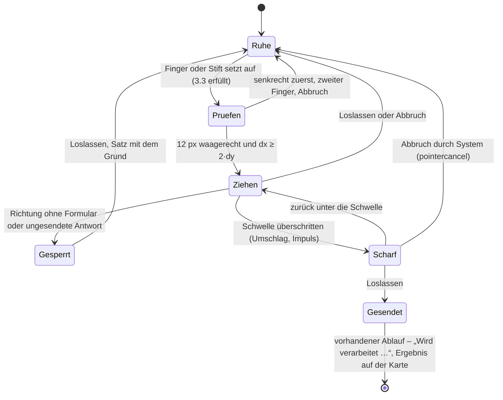

# Mailhelp 6.3 – Wischen auf „Offen“: Vorschläge auf dem Telefon mit einer Bewegung entscheiden

**Zielversion:** 6.3.0, Umsetzung in Patchversionen 6.3.1 bis 6.3.5

**Stand:** 14. November 2026 (überarbeitet)

**Status:** Umgesetzt mit 6.3.1 (siehe [Release 6.3](Release-6.3.md)); E1 bis E8 mit dem jeweiligen Vorschlag übernommen, D1 bis D5 in einer Version zusammengefasst

**Ausgangsstand:** 6.2.11 (nach Abnahme von [Planung 6.2](Planung-6.2.md))

**Vorgänger:** [Planung 6.2](Planung-6.2.md)

**Grundlage:** [Entwicklungsregeln](../AGENTS.md), [Projektspezifikation](../Mailhelp-Projektspezifikation.md),
[Alltagsbedienung](Bedienung.md)

---

## 0. Bestandsaufnahme

Geprüft wurden `static/app.js` (Split-View, Absenden, Tastenkürzel), `static/app.css` (Karten,
Aktionsleiste, Farbvariablen) und `web/actions.py` (welche Karte welche Formulare erhält). Nicht
geprüft wurden echte Geräte; alle Grenzwerte in diesem Plan sind Startwerte und werden in D2 auf
einem echten Telefon nachgemessen.

### 0.1 Was heute gilt

| Bereich | Stand in 6.2.11 | Folge für 6.3 |
| :--- | :--- | :--- |
| Telefon und Tablet (unter 1024 px) | Karten stehen untereinander, jede zeigt Beleg, Zeiten und Rückfragen vollständig. Die Aktionsleiste haftet unten; „Verwerfen“ steht links, die Hauptaktion rechts (`app.css`, Zeile 586 bis 588). | Die Wischrichtung kann die vorhandene Anordnung übernehmen: rechts die Hauptaktion, links „Verwerfen“. |
| Desktop (ab 1024 px) | Liste links, Detail rechts. Die Listenkarten sind gekürzt (Beleg, Rückfragen und Formulare ausgeblendet). Tastenkürzel: `J`/`K` wechseln, `A`/`C`/Enter bestätigen, `X`/`D` verwerfen, `E` bearbeitet. | Schnelles Abarbeiten ist hier bereits gelöst. Der Entwurf vom 14.11. nannte nur `A` und `X` und wollte `V` ergänzen; das ist überflüssig. |
| Absenden | Jedes Formular nach `/aktion` wird sofort gesendet (Sitzung, CSRF, Version, `receipt_id`); die Karte zeigt „Wird verarbeitet …“, danach ersetzt die frisch geladene Karte mit dem Ergebnis die alte **an derselben Stelle**. | Eine Karte, die aus dem Bild fliegt, würde gleich danach mit dem Ergebnis wieder erscheinen. Die Animation muss zum echten Ablauf passen (E5). |
| Rückgängig | In `app.js` gibt es keine Rückhaltefrist mehr; der Hilfetext sagt „Aktionen werden sofort angenommen“. `docs/Bedienung.md` (Zeile 24) und die Projektspezifikation (Abschnitt Weboberfläche) beschreiben noch 5 Sekunden Rückgängig. | Ein Wisch nach rechts legt sofort im Kalender oder in Todoist an. Das bestimmt Schwelle und Auslösung (E2). Die Doku wird in D5 angeglichen. |
| Welche Karte was darf | Ohne geklärten Widerspruch, beantwortete Rückfrage, Vorschlagsabgleich oder erfolgreiche Dublettenprüfung rendert der Server kein `confirm`-Formular. „Verwerfen“ gibt es bei jedem offenen Vorschlag mit Aktionen. | Das Skript braucht keine eigene Fachlogik: Fehlt das Formular, ist die Richtung gesperrt. |
| Altlast | `.card.leaving` in `app.css` (Zeile 500) wird von keinem Skript mehr gesetzt. | Wird in D1 entfernt. |

### 0.2 Befunde

| ID | Befund | Folge |
| :--- | :--- | :--- |
| G1 | Auf dem Telefon verlangt jede Entscheidung einen gezielten Tipp auf die Aktionsleiste; bei zehn offenen Vorschlägen wechselt der Daumen zehnmal zwischen Scrollen und Zielen. | Wischen über die ganze Kartenfläche. |
| G2 | Der Wisch nach rechts löst einen externen Schreibzugriff ohne Rückgängig aus. | Keine Auslösung durch Tempo, sondern nur durch Weg; der Zustand „Loslassen löst aus“ muss eindeutig erkennbar sein. |
| G3 | Die Karte bleibt nach der Entscheidung mit ihrem Ergebnis stehen. | Kein Herausgleiten. |
| G4 | Wischgesten sind unsichtbar. Der Entwurf vom 14.11. enthielt keinen Weg, sie zu entdecken. | Ein einmaliger, schließbarer Hinweis. |
| G5 | Listenkarten am Desktop zeigen den Beleg nicht. Ein Wisch dort wäre eine Entscheidung ohne Blick auf die Quelle; Ziehen mit der Maus stört außerdem Textmarkieren und die Auswahl per Klick. | Wischen nur in der gestapelten Ansicht und nur mit Finger oder Stift. |
| G6 | `touch-action: pan-y` allein schaltet auf der Karte das Zoomen mit zwei Fingern ab. | `touch-action: pan-y pinch-zoom`. |

---

## 1. Ziele und Nichtziele

### Ziele

1. Auf Telefon und Tablet lässt sich jeder entscheidbare Vorschlag und jede Relevanzfrage mit einer
   waagerechten Bewegung über die Karte entscheiden.
2. Vor dem Loslassen ist jederzeit eindeutig zu sehen, **ob** das Loslassen etwas auslöst und
   **was genau** – mit demselben Wortlaut wie auf der Schaltfläche.
3. Senkrechtes Scrollen, Zoomen, Textmarkieren und die Zurück-Geste des Browsers lösen nie eine
   Entscheidung aus.
4. Die Geste ist nur ein zweiter Weg zum vorhandenen Formular. Sitzung, CSRF, Version und
   Idempotenzschlüssel bleiben unverändert.
5. Wer die Geste nicht kennt, nicht will oder nicht ausführen kann, verliert nichts: Schaltflächen,
   Tastatur und Bedienung ohne JavaScript bleiben, wie sie sind.

### Nichtziele

- Kein Wischen mit der Maus und keines in der Split-View ab 1024 px (G5).
- Keine neuen Tastenkürzel; `A`/`C`/Enter und `X`/`D` bleiben unverändert.
- Keine Auslösung durch schnelles Schnippen, kein Herausgleiten der Karte, kein Rütteln, keine
  mitwachsenden Symbole, keine Drehung oder Schattenänderung der Karte, keine Vorführ-Animation
  beim Laden. Das alles sieht nach Bewegung aus, sagt aber nichts über den Zustand.
- Keine dritte oder vierte Geste (langes Wischen, Wisch nach oben). „Schon erledigt“, „Bearbeitung
  beenden“, „Diesen Termin meinen“ und Antworten bleiben Schaltflächen.
- Keine Änderung an `/aktion`, Datenmodell, Sitzungsprüfung oder Telegram.
- Kein Wischen auf Mails, Verlauf, Abgleich, Einstellungen oder Detailseiten.

---

## 2. Entscheidungen

| ID | Frage | Vorschlag | Warum es die Bedienung verbessert |
| :--- | :--- | :--- | :--- |
| **E1** | Richtung | Rechts = Hauptaktion der Karte (`confirm` bzw. „Relevant“), links = „Verwerfen“ bzw. „Irrelevant“. | Entspricht der Reihenfolge der Schaltflächen in der Aktionsleiste; nichts Neues zu lernen. |
| **E2** | Auslösung | Nur durch Weg: Loslassen jenseits von 40 % der Kartenbreite, höchstens 160 px. Kein Schnippen. Wer zurückzieht, bricht ab. Der Wisch sendet sofort, wie ein Tipp auf die Schaltfläche. **Alternative:** Der Wisch legt nur die Schaltfläche frei, ein Tipp bestätigt (zwei Schritte, sicherer, aber kaum schneller als heute). | Ein versehentlicher Kalendereintrag kostet mehr als ein etwas längerer Weg. |
| **E3** | Gilt der Wisch als ausdrückliche Bestätigung? | Ja, weil der Hintergrund vor dem Loslassen den Wortlaut der Schaltfläche zeigt („Im Kalender anlegen“) und das Formular genau dieser Version gesendet wird. Verlangt die Regel aus `AGENTS.md` strenger einen Tipp, gilt die Alternative aus E2 nur für die rechte Richtung. | – |
| **E4** | Anzeige unter der Karte | Zwei Zustände statt eines Verlaufs. **Vor der Schwelle:** heller Grund (`--accent-soft` bzw. `--danger-soft`), Symbol und Text in der kräftigen Farbe. **Ab der Schwelle:** kräftiger Grund (`--accent` bzw. `--danger`), Symbol und Text in `--accent-text`, dazu ein kurzer Vibrationsimpuls, wo das Gerät ihn anbietet. Text und Symbol stehen fest am Rand, den die Karte freigibt. | Ein klarer Umschlagpunkt beantwortet die einzige Frage beim Wischen: „Passiert etwas, wenn ich jetzt loslasse?“ Ein fließender Verlauf beantwortet sie nicht. |
| **E5** | Nach dem Loslassen | Die Karte gleitet in 0,2 s an ihren Platz zurück. Bei Auslösung bleibt der kräftige Grund währenddessen stehen, die Schaltflächen sind gesperrt und „Wird verarbeitet …“ erscheint; danach steht das Ergebnis auf der Karte. | Zeigt den echten Ablauf. Scheitert die Annahme (z. B. veraltete Version), steht die Fehlermeldung dort, wo die Karte ist. |
| **E6** | Gesperrte Richtung | Die Karte gibt höchstens 24 px nach, der Grund bleibt neutral (`--surface-2`) und zeigt ein Schloss. Beim Loslassen nennt der vorhandene Hinweis am unteren Rand den Grund in Worten, z. B. „Erst die Rückfrage beantworten.“ | Der Widerstand zeigt sofort „geht nicht“, der Satz sagt, was zu tun ist. |
| **E7** | Wo und womit | Nur unter 1024 px (gestapelte Karten) und nur mit Finger oder Stift (`pointerType` „touch“ oder „pen“). | Entschieden wird nur, wo der Beleg auf der Karte steht (G5). |
| **E8** | Entdecken | Auf Geräten mit Touch-Bedienung steht einmalig eine Zeile (umgesetzt: unter der ersten wischbaren Karte, siehe Release 6.3): „Tipp: Karte nach rechts wischen zum Anlegen, nach links zum Verwerfen.“ mit „Verstanden“. Sie verschwindet nach dem ersten ausgelösten Wisch oder per Tipp und bleibt auf diesem Gerät aus. | Ohne Hinweis findet die Geste niemand; mit Dauerhinweis kostet sie Platz auf dem ersten Bildschirm (Ziel aus 6.2). |

---

## 3. Gestaltung im Detail

### 3.1 Aufbau

```text
Ruhe            ┌──────────────────────────────┐
                │ Karte                        │
                └──────────────────────────────┘

vor Schwelle    ┌────────┬─────────────────────────┐
(heller Grund)  │ ✓ Im   │ Karte ─▶                │
                │ Kalen… │                         │
                └────────┴─────────────────────────┘

ab Schwelle     ┌──────────────┬───────────────────┐
(kräftiger      │ ✓ Im Kalen-  │ Karte ─▶          │
 Grund)         │   der anlegen│                   │
                └──────────────┴───────────────────┘
```

- **Farben:** ausschließlich vorhandene Variablen; der helle und der dunkle Modus sind damit
  abgedeckt. Rechts dieselbe Farbe wie die Hauptschaltfläche, links dieselbe wie „Verwerfen“. Für
  „Irrelevant“ (heute eine graue Schaltfläche) gilt ebenfalls die linke, rote Farbe, weil beide den
  Vorgang ohne Eintrag beenden.
- **Text:** der Wortlaut der Schaltfläche der Karte, aus dem Formular gelesen, nie ein allgemeines
  „Bestätigen“. Also „Im Kalender anlegen“, „Als Aufgabe anlegen“, „Bestehenden Termin
  aktualisieren“, „Termin absagen“, „Simulieren“, „Relevant“ bzw. „Verwerfen“, „Irrelevant“.
- **Symbol plus Text:** ✓, ✕ und Schloss stehen immer neben dem Text; die Bedeutung hängt nie nur
  an der Farbe.
- **Lage:** Symbol und Text stehen oben im freigegebenen Streifen, 16 px vom Rand, und bleiben
  beim Ziehen stehen. Bei Karten, die höher als der Bildschirm sind, haften sie am oberen
  Fensterrand, damit sie sichtbar bleiben.
- **Form:** Der Grund hat denselben Eckenradius wie die Karte (`--radius`) und liegt genau unter
  ihr; die Karte selbst ändert weder Schatten noch Größe noch Winkel.
- **Schrift:** `--text-m`, halbfett; bis zur Schwelle umbricht der Text im schmalen Streifen.

### 3.2 Bewegung

| Phase | Verhalten | Wert (Startwert, in D2 nachmessen) |
| :--- | :--- | :--- |
| Erkennen | Die Geste beginnt erst nach einem waagerechten Weg, der mindestens doppelt so groß ist wie der senkrechte. Vorher bewegt sich nichts. | 12 px; `|dx| ≥ 2·|dy|` |
| Senkrecht zuerst | Die Geste ist für diese Berührung beendet; die Seite scrollt wie immer. | `|dy|` > 8 px vor dem Erkennen |
| Ziehen | Die Karte folgt dem Finger genau (`transform: translateX`), ohne Übergang. | 1 : 1 |
| Jenseits der Schwelle | Die Karte folgt nur noch mit einem Viertel des Wegs; sie soll nicht aus dem Bild laufen. | Faktor 0,25 |
| Schwelle | Umschlag des Grunds und ein Vibrationsimpuls je Überschreiten. Zurück unter die Schwelle: heller Grund, kein Impuls. | 40 % der Kartenbreite, höchstens 160 px; `navigator.vibrate(10)` |
| Gesperrte Richtung | Starker Widerstand. | Faktor 0,15, höchstens 24 px |
| Loslassen | Rückweg mit dem vorhandenen Kartenübergang. | `transform .2s ease` |
| Reduzierte Bewegung | Die Karte folgt dem Finger weiterhin (direkte Bedienung), springt aber ohne Übergang zurück. | `prefers-reduced-motion: reduce` |

### 3.3 Wann keine Geste beginnt

- Die Berührung beginnt auf einem Bedienelement: `a`, `button`, `input`, `textarea`, `select`,
  `label`, `summary`, Bildvorschau.
- Die Berührung beginnt in einem waagerecht scrollbaren Bereich der Karte (breite Tabelle,
  Vergleich).
- Die Berührung beginnt näher als 24 px am linken oder rechten Fensterrand (Zurück-Geste des
  Browsers).
- Auf der Seite ist Text markiert.
- Ein zweiter Finger liegt auf; eine laufende Geste wird dann abgebrochen (Zoomen).
- Die Karte wird gerade verarbeitet („Wird verarbeitet …“) oder zeigt bereits ein Ergebnis.
- Die Karte hat weder ein `reject`- noch ein Relevanzformular (z. B. Prüfung eines angelegten
  Eintrags, pausierte Verarbeitung). Sie bewegt sich dann gar nicht, statt Widerstand zu zeigen.

### 3.4 Wann eine Richtung gesperrt ist

Rechts ist gesperrt, wenn die Karte kein `confirm`-Formular hat. Der Server kennt den Grund und
schreibt ihn als fertigen Satz an die Karte (`data-swipe-blocked`); das Skript zeigt ihn nur an.

| Ursache | Satz beim Loslassen |
| :--- | :--- |
| Offener Widerspruch | „Erst den Widerspruch klären.“ |
| Offene Rückfrage | „Erst die Rückfrage beantworten.“ |
| Vorschlagsabgleich nötig | „Erst im Vorschlagsabgleich entscheiden.“ |
| Dublettenprüfung fehlgeschlagen | „Erst die Dublettenprüfung wiederholen.“ |
| Mehrere passende Termine | „Erst den gemeinten Termin wählen.“ |
| Sonst | „Diese Aktion ist für diesen Vorgang nicht möglich.“ (vorhandener Text) |

Beide Richtungen sind gesperrt, solange im Antwortfeld der Karte ungesendeter Text steht: „Erst
die Antwort senden oder das Feld leeren.“ Sonst ginge die Eingabe mit einem Wisch verloren.

### 3.5 Auslösen

Beim Loslassen jenseits der Schwelle ruft das Skript `requestSubmit()` auf dem Formular der Karte
auf, das zur Richtung gehört. Alles Weitere erledigt der vorhandene `submit`-Handler: Sperre gegen
doppeltes Senden (`dataset.sending`), „Wird verarbeitet …“, Abfrage des Ergebnisses, Fehlermeldung
bei abgelehnter Version. Das Skript baut keine eigene Anfrage und liest oder verändert weder Token
noch `receipt_id`.

### 3.6 Hinweis zum Entdecken (E8)

- Der Server rendert die Zeile als gewöhnlichen Hinweis über der Liste, zunächst versteckt
  (`hidden`). Das Skript blendet sie ein, wenn `(pointer: coarse)` zutrifft, die Ansicht schmaler
  als 1024 px ist, mindestens eine Karte wischbar ist und der Merker in `localStorage` fehlt.
- Ohne JavaScript bleibt sie versteckt – dort gibt es auch keine Geste.
- Ist `localStorage` nicht verfügbar, erscheint der Hinweis je Seitenaufruf und lässt sich
  schließen.
- `docs/Bedienung.md` und der Hilfeindex beschreiben die Geste dauerhaft.

### 3.7 Barrierefreiheit

- Der Grund unter der Karte ist `aria-hidden`; für Screenreader und Tastatur ändert sich nichts.
- Gesperrte Richtung und Fehler laufen über den vorhandenen Hinweis mit `role="status"`.
- `touch-action: pan-y pinch-zoom` setzt erst das Skript (Klasse `swipeable`); Zoomen bleibt
  möglich, ohne JavaScript ändert sich nichts.
- Kontrast von Symbol und Text auf hellem und kräftigem Grund wird in beiden Farbmodi von der
  vorhandenen Barrierefreiheitsprüfung gemessen (mindestens 4,5 : 1).

---

## 4. Ablauf



---

## 5. Umsetzungsschritte

| Schritt | Patch | Arbeitspaket | Tests |
| :--- | :--- | :--- | :--- |
| **D1** | 6.3.1 | **Markup und Aussehen.** Grund unter der Karte mit zwei Seiten und den Zuständen hell, kräftig, gesperrt (3.1); `data-swipe-blocked` mit Satz aus `actions.py` (3.4); versteckte Hinweiszeile (3.6); `.card.leaving` entfernen. Noch keine Geste: Die Zustände werden im Test per Klasse gesetzt. | Python: jeder Sperrgrund, Karte ohne Aktionen, Relevanzkarte, HTML-Escaping des Satzes. Wächtertest der Gestaltungsvariablen bleibt grün. Bilder der drei Zustände bei 390 px, hell und dunkel; Kontrastprüfung; ohne JavaScript unverändert. |
| **D2** | 6.3.2 | **Erkennen und Ziehen** (3.2, 3.3): Zeigerereignisse, Achsenentscheidung, Folgen, Dämpfung, Umschlag, Rückweg. Loslassen löst noch nichts aus. Danach Messung auf einem echten Telefon und Anpassung der Startwerte. | Browser-Suite mit Touch-Eingabe: senkrechtes und schräges Scrollen bewegt keine Karte; Start auf Schaltfläche, im Textfeld, am Fensterrand, mit markiertem Text, mit zweitem Finger; Maus bewegt nichts; ab 1024 px bewegt nichts; `pointercancel`; reduzierte Bewegung; Zoomen bleibt möglich. |
| **D3** | 6.3.3 | **Auslösen** in beide Richtungen (3.5) für Termine, Aufgaben, Änderungen, Absagen und Relevanzfragen; Zustand nach dem Loslassen (E5). | Je Kartenart rechts und links: genau eine Anfrage mit Version, CSRF-Token und `receipt_id` des Formulars; unter der Schwelle keine Anfrage; Zurückziehen bricht ab; zweiter Wisch während der Verarbeitung sendet nichts; veraltete Version zeigt die Fehlermeldung auf der Karte; abgelaufene Sitzung führt zur Anmeldung; unterbrochene Antwort wird abgeglichen statt neu gesendet. |
| **D4** | 6.3.4 | **Sperren und Entdecken:** gesperrte Richtung mit Satz (E6, 3.4), Sperre bei ungesendeter Antwort, Hinweiszeile mit Merker (E8). | Regression je Sperrgrund: Wisch nach rechts sendet nichts und nennt den Grund; links bleibt möglich. Antworttext bleibt erhalten. Hinweis: erscheint nur bei Touch und wischbarer Karte, verschwindet nach „Verstanden“ und nach dem ersten Wisch, bleibt nach Neuladen aus, funktioniert ohne `localStorage`. |
| **D5** | 6.3.5 | **Doku, Abnahme, Release.** `docs/Bedienung.md` (Abschnitt „Wischen“, Hilfeindex neu erzeugen; veraltete Angabe „5 Sekunden rückgängig“ berichtigen), Projektspezifikation (Weboberfläche: Geste, sofortige Annahme), `README.md`, `CHANGELOG.md`, `docs/Release-6.3.md`. | Gesamtprüfung: 100 % Zeilen- und Branch-Abdeckung, 100 % JavaScript-Blockabdeckung, Browser-Suite auf Telefon, Tablet und Desktop, hell und dunkel; bestehende Sicherheitstests unverändert grün. |

D1 und D2 ändern noch kein Verhalten und können einzeln ausgeliefert werden. Fällt E2/E3 zugunsten
der Alternative aus, ändert sich nur D3: Ab der Schwelle rastet die Karte ein und gibt die
Schaltfläche frei, statt zu senden.

Jeder Patch erhöht die Version in `pyproject.toml` und `src/mailhelp/__init__.py` und pflegt
`CHANGELOG.md` und `README.md`.

---

## 6. Abnahmekriterien

- **Entscheiden:** Bei 390 × 844 und 768 × 1024 lässt sich jede Karte mit `confirm`-Formular nach
  rechts und jede Karte mit `reject`-Formular nach links entscheiden; Relevanzfragen in beide
  Richtungen.
- **Eindeutigkeit:** Vor dem Loslassen zeigt der Grund den Wortlaut der Schaltfläche; der Umschlag
  von hell zu kräftig fällt genau mit der Schwelle zusammen, ab der das Loslassen sendet.
- **Keine Fehlauslösung:** Senkrechtes und schräges Scrollen, Zoomen, Textmarkieren, die
  Zurück-Geste und schnelles Schnippen unterhalb der Schwelle senden nichts.
- **Sperren:** Karten mit Widerspruch, Rückfrage, nötigem Abgleich, fehlgeschlagener
  Dublettenprüfung oder ungesendeter Antwort lassen sich nicht nach rechts auslösen und nennen den
  Grund.
- **Wahrheit der Anzeige:** Nach dem Loslassen steht die Karte an ihrem Platz und zeigt erst
  „Wird verarbeitet …“, dann das Ergebnis oder die Fehlermeldung.
- **Sicherheit:** Jede per Wisch ausgelöste Anfrage ist bytegleich zu der der Schaltfläche (Version,
  CSRF-Token, Idempotenzschlüssel); kein externer Schreibzugriff ohne diese Anfrage.
- **Unverändert:** Ab 1024 px, mit der Maus, mit der Tastatur, mit Screenreader und ohne JavaScript
  verhält sich „Offen“ wie in 6.2.11.
- **Qualität:** 100 % Zeilen- und Branch-Abdeckung, 100 % JavaScript-Blockabdeckung,
  Barrierefreiheitsprüfung in beiden Farbmodi.

---

## 7. Risiken und Gegenmaßnahmen

| Risiko | Auswirkung | Gegenmaßnahme |
| :--- | :--- | :--- |
| Versehentlicher Wisch nach rechts | Kalendereintrag oder Aufgabe ohne Absicht, kein Rückgängig. | Auslösung nur durch Weg (E2), strenge Achsenentscheidung, Umschlag mit Impuls, Wortlaut der Aktion sichtbar. Reicht das im Alltag nicht, ist die Alternative aus E2 ein Wechsel in D3 ohne Umbau. |
| Startwerte passen nicht zur Hand | Geste löst zu schwer oder zu leicht aus. | Messung auf echtem Gerät in D2; Werte stehen als benannte Konstanten an einer Stelle. |
| Geste stört das Scrollen | Ruckeln, Karte wandert beim Scrollen. | `touch-action: pan-y pinch-zoom`, Erkennung erst bei `|dx| ≥ 2·|dy|`, Tests mit schrägen Bewegungen. |
| Zurück-Geste des Browsers | Seite wechselt statt Karte zu bewegen oder umgekehrt. | 24 px Randzone ohne Geste. |
| Touch-Eingabe in der Browser-Suite | Die übliche Tipp-Simulation erzeugt keine Wischbewegung. | Bewegungen als Folge echter Touch-Ereignisse über die DevTools-Schnittstelle; ein Hilfsbaustein für alle Wischtests. |
| Hinweis nervt oder wird übersehen | Platzverlust oder unentdeckte Geste. | Einmalig, schließbar, endet nach dem ersten Wisch; dauerhaft in Bedienung und Hilfe. |

---

## 8. Dokumentation und Release

- `docs/Bedienung.md`: neuer Abschnitt „Wischen auf dem Telefon“ mit Richtungen, Schwelle,
  gesperrten Karten; Berichtigung der Rückgängig-Angabe; Hilfeindex neu erzeugen.
- Projektspezifikation: Abschnitt Weboberfläche um die Geste ergänzen und die Beschreibung der
  Rückhaltefrist an den Stand des Codes angleichen.
- `docs/Release-6.3.md`: Abnahme mit Bildern der drei Zustände (hell, kräftig, gesperrt) in beiden
  Farbmodi und dem Messprotokoll aus D2.
- `README.md` und `CHANGELOG.md` je Patch.
